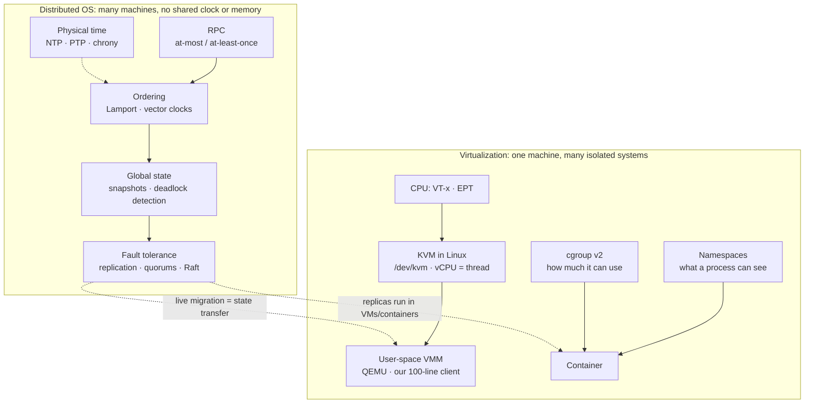
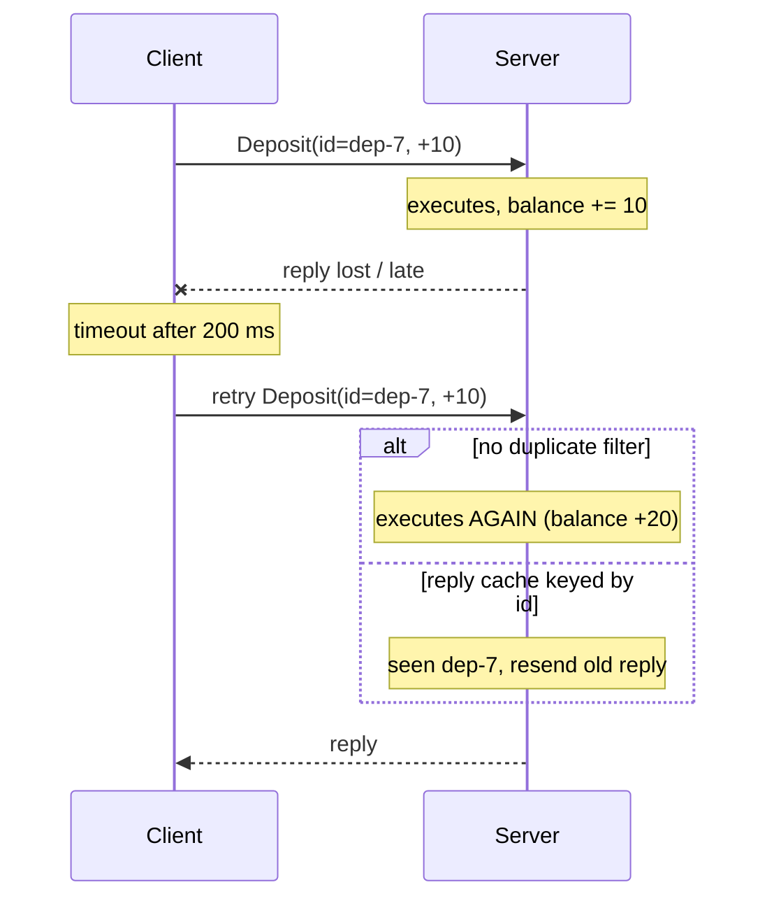
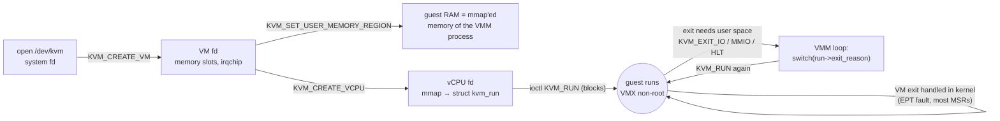

# 06 — Distributed OS & Virtualization

> Advanced Operating Systems · Term 1 · Pins: Linux **v6.18.63**, OpenBSD **`8cada8c`** · Arch: **x86-64**
> Time: ~14 h (6 h lesson + notes, 8 h labs) · Farsi: [`lesson.fa.md`](lesson.fa.md) · Notes: [`notes/INDEX.en.md`](notes/INDEX.en.md) · Code: [`kernel-walkthrough.en.md`](kernel-walkthrough.en.md) · Slides: [`slides/`](slides/)

**Depends on:**

- **Module 02:** processes, threads, `clone()` flags, IPC over sockets. Containers are `clone()` with more flags, and a vCPU is a thread.
- **Module 04:** page tables, TLB, page faults. EPT is a second page table, and `memory.max` charges the pages you fault in.
- **Module 01:** privilege rings and traps. A VM exit is a trap one level further out.

## 1. Learning goals

- Explain what an RPC promises (at-most-once, at-least-once, exactly-once effect) and build the duplicate filter that makes retries safe.
- Order events without a global clock: compute Lamport and vector timestamps and say what each can and cannot prove.
- Explain how physical clocks are synchronized (NTP offset/delay, PTP) and why `CLOCK_MONOTONIC` exists.
- Describe distributed deadlock detection, consistent snapshots, and the replication arithmetic (f+1, 2f+1, 3f+1).
- Trace a VM exit from guest instruction → `vmx.c` handler → `KVM_RUN` return → user-space VMM, and write that VMM.
- Build a container from `unshare`, `pivot_root` and cgroup v2 files, and point at the kernel code that enforces each part.

## 2. Glossary

| Term | Definition |
|---|---|
| **RPC** | Remote Procedure Call: a request/reply exchange made to look like a local call. The network can lose either half. |
| **Idempotent** | Running an operation twice has the same effect as running it once (`SET x=5` yes, `x += 5` no). |
| **Request ID / DRC** | A unique ID per logical call, reused on retries. The server's Duplicate Reply Cache (DRC) answers a repeated ID from memory instead of executing again. |
| **Happened-before (→)** | Lamport's partial order: a → b if they are in the same process in that order, or a is a send and b its receive, or by transitivity. |
| **Lamport clock** | One counter per process. Guarantees a → b ⇒ L(a) < L(b), but not the converse. |
| **Vector clock** | One counter per process *per process*. a → b ⇔ V(a) < V(b). Two incomparable vectors mean the events are concurrent (a ∥ b). |
| **NTP / PTP** | Network Time Protocol (ms over the internet, sub-ms on LAN) and Precision Time Protocol (IEEE 1588, sub-µs with hardware timestamps). |
| **Consistent cut** | A global state where every received message was also sent inside the cut. Chandy–Lamport snapshots produce one. |
| **Wait-for graph (WFG)** | Nodes = transactions/processes, edge T1→T2 = T1 waits for a resource T2 holds. A cycle = deadlock. |
| **Quorum** | A subset of replicas big enough that any two subsets overlap (R + W > N). |
| **Hypervisor (VMM)** | Software that runs virtual machines. Type 1 runs on hardware (Xen, Hyper-V); type 2 runs on a host OS. KVM turns Linux into a type-1-like hypervisor. |
| **Trap-and-emulate** | Run the guest deprivileged; every sensitive instruction traps to the hypervisor, which emulates it. |
| **VT-x / VMX** | Intel's hardware virtualization: VMX root (hypervisor) and non-root (guest) modes, switched by VM entry/exit. AMD's is SVM. |
| **VMCS** | Virtual Machine Control Structure: per-vCPU memory block that holds guest/host state and decides which events cause exits. |
| **VM exit** | The CPU leaves the guest and jumps into the hypervisor with an exit reason (I/O, CPUID, HLT, EPT violation, ...). |
| **EPT** | Extended Page Tables: a second, hypervisor-owned page table that maps guest-physical to host-physical addresses. |
| **`/dev/kvm`** | The character device of the KVM module. Its ioctls create VMs and vCPUs. |
| **`struct kvm_run`** | A page shared between KVM and user space through `mmap` of the vCPU fd. It holds the exit reason and its data. |
| **Namespace** | A per-process view of one global resource (PIDs, mounts, hostname, network, ...). Created by `clone`/`unshare`, joined by `setns`. |
| **`struct nsproxy`** | The kernel struct a task points to that holds its namespace pointers. |
| **cgroup v2** | One hierarchy under `/sys/fs/cgroup`. Each directory is a group, each controller file (`memory.max`, `pids.max`, `cpu.max`) a limit. |
| **`pivot_root`** | Syscall that swaps the root mount of the current mount namespace. Unlike `chroot`, the old root can then be unmounted. |
| **pledge / unveil** | OpenBSD's isolation answer: a process promises which syscall groups (pledge) and which paths (unveil) it will ever use. |

## 3. Big picture

The module has two halves that meet in practice: distributed systems are built from many nodes, and today each node is usually a VM or a container.

## 4. Concepts

### 4.1 RPC: what does a remote call actually promise?

A local call runs exactly once. A remote call crosses a network that can lose the request, lose the reply, or delay either. The client sees only "no answer in 200 ms" and cannot tell which happened.

| Semantics | Client does | Server does | Result | Lab 06.2 run |
|---|---|---|---|---|
| **At-most-once** | no retry | — | 0 or 1 execution, client may not know which | A: 8 of 20 "failed", all 20 executed |
| **At-least-once** | retry until reply | execute every request | ≥ 1 execution; fine only for idempotent ops | B: balance 290, expected 200 |
| **Exactly-once effect** | retry with same ID | filter duplicates by ID | 1 execution per logical call | C: balance 200 |

"Exactly-once" is not a network property; it is at-least-once delivery plus server-side deduplication. Linux's NFS server keeps such a cache (`fs/nfsd/nfscache.c`, `nfsd_cache_lookup()`). Birrell & Nelson (1984) is the classic RPC design paper. → [note 01](notes/01-rpc-semantics.en.md), [Lab 06.2](labs/02-rpc-idempotency/)

### 4.2 Logical time: which event came first, with no shared clock?

Rules (Lamport 1978; vectors: Fidge 1988, Mattern 1988):

| Event at process i | Lamport `L` | Vector `V` |
|---|---|---|
| local or send | `L = L + 1` | `V[i]++` |
| send message m | attach `L` | attach `V` |
| receive m | `L = max(L, L_m) + 1` | `V = max(V, V_m)` elementwise, then `V[i]++` |

- **Clock condition:** a → b ⇒ L(a) < L(b). The converse is false: L(a) < L(b) can also mean a ∥ b.
- **Vector clocks are exact:** a → b ⇔ V(a) ≤ V(b) and V(a) ≠ V(b). If neither V(a) ≤ V(b) nor V(b) ≤ V(a), then a ∥ b.
- **Total order:** sort by `(L, process id)`. Mutual exclusion and totally-ordered multicast use it.

In Lab 06.1 three processes exchanged 10 messages. All 10 satisfied both clock conditions, and 85 event pairs had L(a) < L(b) while their vectors showed a ∥ b. Lamport order is consistent with causality, not equal to it. Cost: a vector has N entries, so it grows with the number of processes. → [note 02](notes/02-lamport-vector-clocks.en.md), [Lab 06.1](labs/01-lamport-vector-clocks/)

### 4.3 Physical time: how close can two machines' clocks get?

NTP measures four timestamps: client send `t1`, server receive `t2`, server send `t3`, client receive `t4`.

- offset θ = ((t2 − t1) + (t3 − t4)) / 2
- round-trip delay δ = (t4 − t1) − (t3 − t2)

The formula assumes symmetric paths, so the error is bounded by δ/2. `chronyd` or `systemd-timesyncd` then *slews* the kernel clock through `adjtimex()` (`kernel/time/time.c` → `do_adjtimex()` in `kernel/time/timekeeping.c`) instead of jumping it. PTP (IEEE 1588) takes the timestamps in the NIC hardware and reaches sub-microsecond accuracy on a LAN.

Consequences for code: use `CLOCK_MONOTONIC` for timeouts (never steps), `CLOCK_REALTIME` only for wall-clock display. Never order events across machines by wall-clock time unless you also know the error bound (Spanner's TrueTime waits out that bound). → [note 03](notes/03-clock-sync-ntp-ptp.en.md)

### 4.4 Global state: how do you detect a deadlock no single node can see?

Each node sees only its local part of the wait-for graph. A cycle T1 → T2 (node A) → T3 (node B) → T1 is invisible to both.

- **Centralized:** every node sends its WFG to a coordinator. Simple, but delayed or reordered reports create *phantom deadlocks* (cycles that never existed at one instant).
- **Edge chasing (Chandy–Misra–Haas 1983):** a blocked process sends a probe `(initiator, sender, receiver)` along wait-for edges. If the probe comes back to its initiator, there is a cycle.
- **Snapshots (Chandy–Lamport 1985):** record a consistent cut without stopping the system. The initiator records its state and sends a *marker* on every outgoing channel; a process that receives its first marker records its state and relays markers; channel state = messages that arrive before the marker. Needs FIFO channels.

A cut is consistent iff no message is received inside the cut but sent outside it. With vector clocks: the frontier events' vectors must be pairwise consistent. → [note 04](notes/04-distributed-deadlock-snapshots.en.md)

### 4.5 Fault tolerance: how many replicas do you need?

| Failure model | Replicas to tolerate f faults | Why |
|---|---|---|
| Crash-stop, failures detectable | f + 1 | one survivor holds the state |
| Crash, agreement needed (Paxos/Raft) | 2f + 1 | any two majorities overlap |
| Byzantine (arbitrary/malicious) | 3f + 1 | honest replicas must outvote f liars, even across overlaps |

- **Primary–backup:** the primary executes and ships state or a log to backups.
- **State machine replication:** all replicas apply the same deterministic commands in the same order. Raft (Ongaro & Ousterhout 2014) elects a leader per *term*, the leader appends entries, and an entry commits once a majority stores it.
- **FLP (Fischer, Lynch, Paterson 1985):** in a fully asynchronous system, no deterministic consensus protocol is guaranteed to terminate if even one process may crash. Real systems use timeouts (partial synchrony).
- **Quorums:** with N replicas, read quorum R and write quorum W, R + W > N guarantees that a read sees the latest write.

→ [note 05](notes/05-fault-tolerance-replication.en.md)

### 4.6 Virtualization: how can a guest kernel run in ring 0 when the host is already there?

Popek & Goldberg (1974): a machine is virtualizable by trap-and-emulate if every *sensitive* instruction (one that reads or changes privileged state) is also *privileged* (traps when run deprivileged). Classic x86 broke this: for example, `popf` run in ring 3 silently drops the interrupt-flag change instead of trapping. Before hardware support there were two workarounds: binary translation (VMware) and paravirtualization (Xen, where the guest kernel calls the hypervisor explicitly).

VT-x (2005) and AMD-V add a new mode instead of fixing the instructions:

| | VMX root | VMX non-root |
|---|---|---|
| Who runs | host kernel + KVM | guest kernel (ring 0) and guest apps (ring 3) |
| Entry/exit | `VMLAUNCH`/`VMRESUME` → | ← VM exit (reason in VMCS) |
| Memory | host page tables | guest page tables + **EPT** (guest-phys → host-phys) |

With EPT, a TLB miss walks two page tables: every guest page-table level is itself a guest-physical address that has to be translated through EPT. With 4 levels each, that is up to 24 memory references instead of 4. Large pages and the TLB hide most of it.

Our measurement inside Docker Desktop's WSL2 VM (Hyper-V): a `cpuid` (always exits) costs **~384 ns**, a guest `getppid` syscall **~96 ns**, an `add` **0.2 ns**. → [note 06](notes/06-hypervisors-vtx-ept.en.md), [Lab 06.5](labs/05-vmexit-cost/)

### 4.7 KVM: what does a hypervisor look like from user space?

KVM is a kernel module that exposes VT-x/AMD-V through file descriptors:

- A vCPU is an ordinary host thread blocked in `ioctl(KVM_RUN)`. The host scheduler (Module 02) schedules it like any other thread.
- Guest RAM is ordinary anonymous memory of the VMM process. EPT maps it, and the host can swap it or back it with huge pages (Module 04).
- Exits that KVM can finish itself stay in the kernel. The rest return from `KVM_RUN` with `run->exit_reason` set, and the user-space VMM (QEMU, Firecracker, or Lab 06.4's 100-line client) emulates the device and calls `KVM_RUN` again.

→ [note 07](notes/07-kvm-architecture.en.md), [walkthrough §1](kernel-walkthrough.en.md), [Lab 06.4](labs/04-kvm-client/)

### 4.8 Containers: what is a container, if not a VM?

A container is a normal process tree with a different *view* (namespaces) and a *budget* (cgroups). It shares the host kernel.

| Namespace | `clone` flag | Isolates |
|---|---|---|
| mount | `CLONE_NEWNS` | mount table, so `pivot_root` affects only us |
| UTS | `CLONE_NEWUTS` | hostname |
| IPC | `CLONE_NEWIPC` | SysV IPC, POSIX mqueues |
| PID | `CLONE_NEWPID` | PID numbers; first child is PID 1 |
| network | `CLONE_NEWNET` | interfaces, routes, ports |
| user | `CLONE_NEWUSER` | UID/GID mapping and capabilities |
| cgroup | `CLONE_NEWCGROUP` | the cgroup path you see as `/` |
| time | `CLONE_NEWTIME` | `CLOCK_MONOTONIC`/`BOOTTIME` offsets |

| cgroup v2 file | Effect | Kernel |
|---|---|---|
| `memory.max` | hard limit, reclaim then OOM kill inside the group | `mm/memcontrol.c` `memory_max_write()` |
| `pids.max` | `fork()` fails with `EAGAIN` | `kernel/cgroup/pids.c` `pids_try_charge()` |
| `cpu.max` | `quota period`: run at most quota µs per period | CFS bandwidth in `kernel/sched/fair.c` |
| `cgroup.procs` | write a PID to move it | `kernel/cgroup/cgroup.c` `__cgroup_procs_write()` |

Isolation boundary: VM = the hardware interface (VT-x, EPT, virtual devices). Container = the whole Linux syscall interface. A kernel bug reachable by a syscall is reachable from a container. → [note 08](notes/08-containers-namespaces-cgroups.en.md), [Lab 06.3](labs/03-mini-container/)

## 5. Where this lives in Linux

| Topic | File · function | Walkthrough |
|---|---|---|
| `/dev/kvm` ioctls | `virt/kvm/kvm_main.c` · `kvm_dev_ioctl()`, `kvm_vcpu_ioctl()` | [§1](kernel-walkthrough.en.md#1-kvm_run-from-ioctl-to-guest-and-back) |
| run loop | `arch/x86/kvm/x86.c` · `vcpu_run()`, `vcpu_enter_guest()` | §1 |
| exit dispatch | `arch/x86/kvm/vmx/vmx.c` · `kvm_vmx_exit_handlers[]`, `handle_io()` | §2 |
| PIO to user space | `arch/x86/kvm/x86.c` · `emulator_pio_in_out()` | §2 |
| namespaces | `kernel/nsproxy.c` · `create_new_namespaces()`, `unshare_nsproxy_namespaces()`; `kernel/pid_namespace.c` · `copy_pid_ns()` | §3 |
| cgroups | `kernel/cgroup/cgroup.c` · `__cgroup_procs_write()`; `mm/memcontrol.c` · `memory_max_write()`; `kernel/cgroup/pids.c` · `pids_try_charge()` | §4 |
| OpenBSD | `sys/dev/vmm/vmm.c` · `vmmioctl()`, `vm_ioctl()`; `sys/arch/amd64/amd64/vmm_machdep.c` · `vmx_handle_exit()`; `sys/kern/kern_pledge.c` · `pledge_syscall()` | §5 |
| NFS duplicate reply cache | `fs/nfsd/nfscache.c` · `nfsd_cache_lookup()` | note 01 |
| clock discipline | `kernel/time/timekeeping.c` · `do_adjtimex()` | note 03 |

## 6. Common misconceptions

| Misconception | Reality |
|---|---|
| "TCP makes RPC exactly-once." | TCP retransmits *within one connection*. If the connection breaks or the client times out and retries, the server can execute twice. |
| "Lamport timestamps tell you which event caused which." | L(a) < L(b) is necessary for a → b, not sufficient. Use vector clocks to detect concurrency. |
| "NTP-synced clocks can order events across machines." | Only to within the sync error (ms on the internet). Two writes 1 ms apart on different hosts may be ordered wrongly. |
| "Two replicas tolerate one failure." | With crash faults and agreement needed, two replicas cannot tell "peer crashed" from "network split". You need 2f + 1 = 3. |
| "A container is a lightweight VM." | It is a process with namespaces and cgroups. It shares the host kernel, so its isolation boundary is the syscall interface. |
| "`unshare --pid` puts my shell in a new PID namespace." | Only the *children* go in (`pid_ns_for_children`, see `copy_pid_ns()`). That is why you need `--fork`. |
| "`chroot` is enough for a container root." | `chroot` changes only path lookup for one process; the old root stays mounted and reachable. `pivot_root` in a private mount namespace lets you unmount it. |
| "KVM is the hypervisor and QEMU is just a UI." | KVM handles CPU and memory virtualization; QEMU (or another VMM) emulates devices and owns the run loop. |
| "Guest syscalls cause VM exits." | No. With VT-x the guest's `syscall` stays inside non-root mode. Exits happen for I/O, CPUID, EPT faults, some MSRs, HLT, external interrupts. |
| "OpenBSD has containers too." | It has no namespaces or cgroups. Its isolation tools are `pledge`, `unveil`, `chroot`, privilege-separated daemons, and `vmm(4)` VMs. |

## 7. Self-check

1. A client retries a `Transfer(from, to, 100)` after a timeout. List two ways the server can make this safe, and why `TCP` alone is not one of them.
2. V(a) = [2, 0, 1], V(b) = [1, 3, 1]. Is a → b, b → a, or a ∥ b? What can you say about L(a) and L(b)?
3. NTP: t1 = 100, t2 = 160, t3 = 161, t4 = 121 (ms). Compute offset and delay. What is the error bound?
4. Why does Chandy–Lamport need FIFO channels? What goes wrong without them?
5. You need to survive 2 simultaneous crash failures with a Raft cluster. How many nodes? What is the write quorum?
6. Name three events that cause a VM exit on VT-x and one that does not.
7. In your KVM client, `KVM_RUN` returns `KVM_EXIT_FAIL_ENTRY`. What is wrong: the guest code, or the vCPU state? Where do you look?
8. In the mini container, `ps` inside shows the host's processes. Which step did you forget?
9. Inside a `memory.max=64M` group, a process allocates 1 GiB with `malloc` but never touches it. Is it killed? Why?
10. How would you give an OpenBSD daemon container-like isolation without namespaces?

Answers to most of these are in the [quiz](quiz.en.md) and the notes; self-check 3: θ = ((160 − 100) + (161 − 121)) / 2 = 50 ms, δ = (121 − 100) − (161 − 160) = 20 ms, error ≤ δ/2 = 10 ms.
