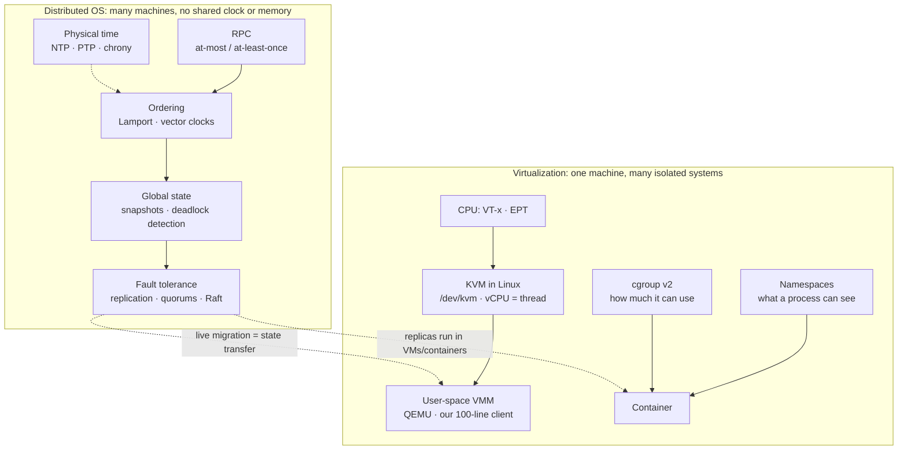
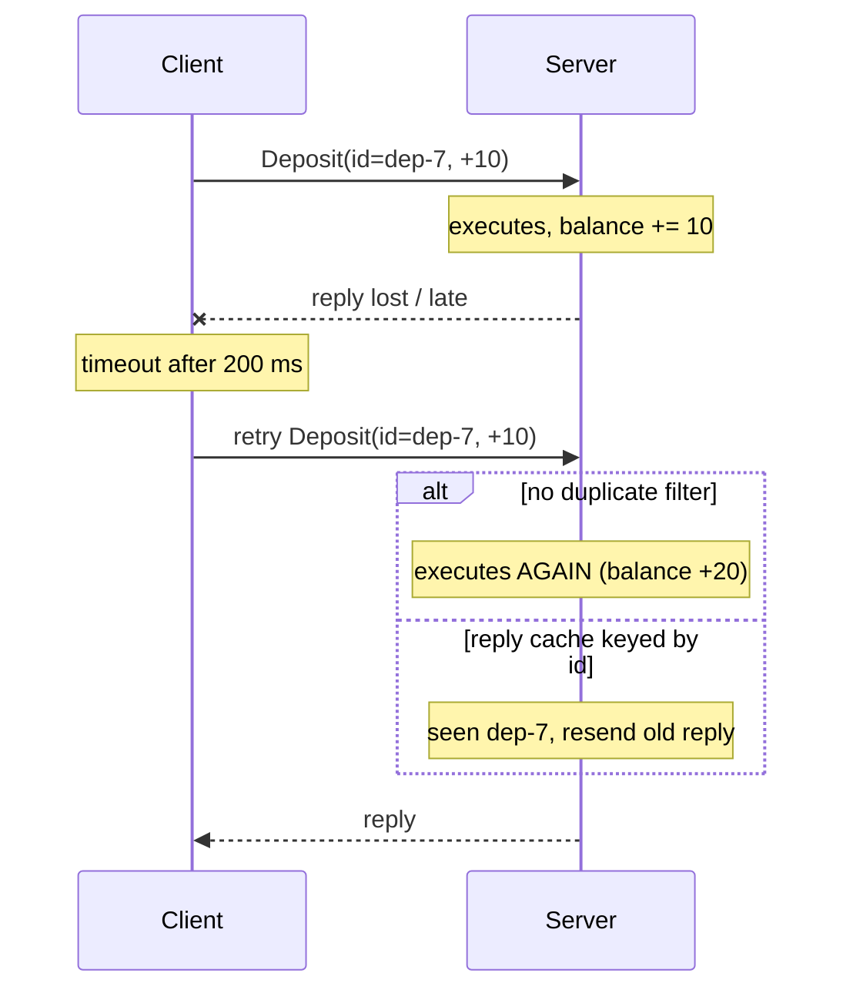
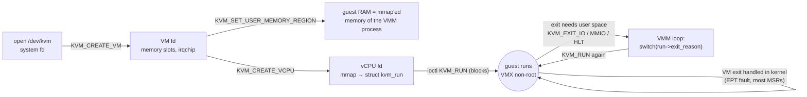

# ۰۶ — سیستم‌عامل توزیع‌شده و مجازی‌سازی

> سیستم‌عامل پیشرفته · ترم ۱ · نسخه‌های ثابت: Linux **v6.18.63** و OpenBSD **`8cada8c`** · معماری: **x86-64**
> زمان: حدود ۱۴ ساعت (۶ ساعت درس و یادداشت‌ها، ۸ ساعت آزمایش) · نسخهٔ انگلیسی: [`lesson.en.md`](lesson.en.md) · یادداشت‌ها: [`notes/INDEX.fa.md`](notes/INDEX.fa.md) · کد: [`kernel-walkthrough.fa.md`](kernel-walkthrough.fa.md) · اسلایدها: [`slides/`](slides/)

**پیش‌نیازها:**

- **ماژول ۰۲:** پردازه، نخ، پرچم‌های `clone()` و IPC روی socket. container همان `clone()` با پرچم‌های بیشتر است و هر vCPU یک نخ است.
- **ماژول ۰۴:** page table، TLB و page fault. EPT یک page table دوم است و `memory.max` صفحه‌هایی را حساب می‌کند که واقعاً fault شده‌اند.
- **ماژول ۰۱:** حلقه‌های امتیاز (privilege rings) و trap. هر VM exit یک trap است، فقط یک لایه بیرونی‌تر.

## ۱. هدف‌های یادگیری

- توضیح بدهید یک RPC چه قولی می‌دهد (at-most-once، at-least-once، و اثر exactly-once) و فیلتر تکراری‌ای بسازید که تکرار درخواست را بی‌خطر کند.
- بدون ساعت سراسری رویدادها را مرتب کنید: برچسب‌های Lamport و vector را حساب کنید و بگویید هر کدام چه چیزی را می‌تواند و نمی‌تواند ثابت کند.
- توضیح بدهید ساعت‌های فیزیکی چطور هم‌گام می‌شوند (offset و delay در NTP، و PTP) و چرا `CLOCK_MONOTONIC` وجود دارد.
- تشخیص بن‌بست توزیع‌شده، snapshot سازگار و حساب تکثیر (f+1، 2f+1، 3f+1) را شرح بدهید.
- یک VM exit را از دستور مهمان ← handler در `vmx.c` ← بازگشت `KVM_RUN` ← VMM در فضای کاربر دنبال کنید و خود آن VMM را بنویسید.
- با `unshare`، `pivot_root` و فایل‌های cgroup v2 یک container بسازید و برای هر بخش، کد کرنلی را که اجرایش می‌کند نشان بدهید.

## ۲. واژه‌نامه

| اصطلاح | تعریف |
|---|---|
| **RPC** | فراخوانی رویه از راه دور: یک تبادل درخواست/پاسخ که شبیه فراخوانی محلی جلوه داده می‌شود. شبکه می‌تواند هر کدام از دو نیمه را گم کند. |
| **Idempotent** | عملی که دو بار اجرایش همان اثر یک بار اجرا را دارد (`SET x=5` بله، `x += 5` نه). |
| **Request ID / DRC** | شناسهٔ یکتا برای هر فراخوانی منطقی که در تکرارها عوض نمی‌شود. Duplicate Reply Cache (DRC) در سرور به شناسهٔ تکراری از حافظه جواب می‌دهد و دوباره اجرا نمی‌کند. |
| **Happened-before (→)** | ترتیب جزئی Lamport: a → b اگر هر دو در یک پردازه و به همین ترتیب باشند، یا a ارسال و b دریافت همان پیام باشد، یا از راه تعدی. |
| **Lamport clock** | یک شمارنده برای هر پردازه. تضمین می‌کند a → b ⇒ L(a) < L(b)، ولی عکسش را نه. |
| **Vector clock** | در هر پردازه، یک شمارنده به ازای *هر* پردازه. a → b ⇔ V(a) < V(b). اگر دو بردار قابل مقایسه نباشند رویدادها همروندند (a ∥ b). |
| **NTP / PTP** | Network Time Protocol (دقت میلی‌ثانیه روی اینترنت و زیرمیلی‌ثانیه روی LAN) و Precision Time Protocol (IEEE 1588، زیرمیکروثانیه با timestamp سخت‌افزاری). |
| **Consistent cut** | یک وضعیت سراسری که در آن هر پیام دریافت‌شده، ارسالش هم داخل همان برش است. snapshot به روش Chandy–Lamport چنین برشی می‌دهد. |
| **Wait-for graph (WFG)** | گراف انتظار: گره‌ها تراکنش یا پردازه‌اند و یال T1→T2 یعنی T1 منتظر منبعی است که دست T2 است. دور در گراف یعنی بن‌بست. |
| **Quorum** | زیرمجموعه‌ای از replicaها آن‌قدر بزرگ که هر دو زیرمجموعه حتماً اشتراک داشته باشند (R + W > N). |
| **Hypervisor (VMM)** | نرم‌افزاری که ماشین مجازی اجرا می‌کند. نوع ۱ مستقیم روی سخت‌افزار است (Xen، Hyper-V) و نوع ۲ روی یک سیستم‌عامل میزبان. KVM لینوکس را به چیزی شبیه hypervisor نوع ۱ تبدیل می‌کند. |
| **Trap-and-emulate** | مهمان با امتیاز کمتر اجرا می‌شود؛ هر دستور حساس به hypervisor trap می‌کند و hypervisor آن را شبیه‌سازی می‌کند. |
| **VT-x / VMX** | مجازی‌سازی سخت‌افزاری اینتل: حالت VMX root (برای hypervisor) و non-root (برای مهمان) که با VM entry/exit عوض می‌شوند. معادل AMD نامش SVM است. |
| **VMCS** | Virtual Machine Control Structure: بلوک حافظه‌ای برای هر vCPU که وضعیت مهمان و میزبان را نگه می‌دارد و تعیین می‌کند کدام رویداد exit ایجاد کند. |
| **VM exit** | CPU از مهمان خارج می‌شود و با یک «دلیل exit» به hypervisor می‌پرد (I/O، CPUID، HLT، EPT violation و ...). |
| **EPT** | Extended Page Tables: page table دوم که مال hypervisor است و آدرس فیزیکی مهمان را به آدرس فیزیکی میزبان نگاشت می‌کند. |
| **`/dev/kvm`** | دستگاه کاراکتری ماژول KVM. ioctlهای آن VM و vCPU می‌سازند. |
| **`struct kvm_run`** | صفحه‌ای مشترک بین KVM و فضای کاربر که با `mmap` روی fd مربوط به vCPU به دست می‌آید. دلیل exit و داده‌هایش در آن است. |
| **Namespace** | نمای اختصاصی یک پردازه از یک منبع سراسری (PIDها، mountها، hostname، شبکه و ...). با `clone`/`unshare` ساخته می‌شود و با `setns` می‌شود به آن پیوست. |
| **`struct nsproxy`** | ساختاری در کرنل که task به آن اشاره می‌کند و اشاره‌گرهای namespaceهای آن task را نگه می‌دارد. |
| **cgroup v2** | یک سلسله‌مراتب واحد زیر `/sys/fs/cgroup`. هر پوشه یک گروه است و هر فایل controller (`memory.max`، `pids.max`، `cpu.max`) یک محدودیت. |
| **`pivot_root`** | syscallی که mount ریشهٔ mount namespace فعلی را عوض می‌کند. برخلاف `chroot`، بعدش می‌شود ریشهٔ قبلی را unmount کرد. |
| **pledge / unveil** | پاسخ OpenBSD به ایزوله‌سازی: پردازه قول می‌دهد فقط از گروه‌های مشخصی از syscallها (pledge) و مسیرهای مشخصی (unveil) استفاده کند. |

## ۳. تصویر کلی

این ماژول دو نیمه دارد که در عمل به هم می‌رسند: سیستم توزیع‌شده از چندین گره ساخته می‌شود و امروز هر گره معمولاً یک VM یا container است.

## ۴. مفاهیم

### ۴.۱ RPC: یک فراخوانی از راه دور دقیقاً چه قولی می‌دهد؟

فراخوانی محلی دقیقاً یک بار اجرا می‌شود. فراخوانی از راه دور از شبکه‌ای می‌گذرد که ممکن است درخواست را گم کند، پاسخ را گم کند، یا هر کدام را با تأخیر برساند. کلاینت فقط می‌بیند «در ۲۰۰ میلی‌ثانیه جوابی نیامد» و نمی‌تواند بفهمد کدام اتفاق افتاده است.

| معنا (semantics) | کلاینت | سرور | نتیجه | اجرای آزمایش ۰۶.۲ |
|---|---|---|---|---|
| **At-most-once** | تکرار نمی‌کند | — | صفر یا یک بار اجرا؛ کلاینت شاید نداند کدام | A: ۸ از ۲۰ «شکست خورد»، ولی هر ۲۰ اجرا شد |
| **At-least-once** | تا پاسخ نیاید تکرار می‌کند | هر درخواست را اجرا می‌کند | حداقل یک بار؛ فقط برای عمل idempotent بی‌خطر است | B: موجودی 290، مورد انتظار 200 |
| **اثر exactly-once** | با همان ID تکرار می‌کند | تکراری‌ها را با ID فیلتر می‌کند | برای هر فراخوانی منطقی یک اجرا | C: موجودی 200 |

«exactly-once» ویژگی شبکه نیست؛ همان تحویل at-least-once است به‌اضافهٔ حذف تکراری در سرور. سرور NFS لینوکس چنین cacheای دارد (`fs/nfsd/nfscache.c`، تابع `nfsd_cache_lookup()`). مقالهٔ کلاسیک طراحی RPC مال Birrell و Nelson (۱۹۸۴) است. ← [یادداشت ۰۱](notes/01-rpc-semantics.fa.md)، [آزمایش ۰۶.۲](labs/02-rpc-idempotency/)

### ۴.۲ زمان منطقی: بدون ساعت مشترک، کدام رویداد اول بود؟

قواعد (Lamport ۱۹۷۸؛ برای بردارها Fidge ۱۹۸۸ و Mattern ۱۹۸۸):

| رویداد در پردازهٔ i | Lamport `L` | Vector `V` |
|---|---|---|
| محلی یا ارسال | `L = L + 1` | `V[i]++` |
| ارسال پیام m | `L` را ضمیمه کن | `V` را ضمیمه کن |
| دریافت m | `L = max(L, L_m) + 1` | `V = max(V, V_m)` درایه‌به‌درایه، سپس `V[i]++` |

- **شرط ساعت:** a → b ⇒ L(a) < L(b). عکس آن درست نیست: L(a) < L(b) می‌تواند به معنای a ∥ b هم باشد.
- **ساعت برداری دقیق است:** a → b ⇔ V(a) ≤ V(b) و V(a) ≠ V(b). اگر نه V(a) ≤ V(b) باشد و نه V(b) ≤ V(a)، آن‌گاه a ∥ b.
- **ترتیب کامل:** بر اساس `(L, process id)` مرتب کنید. mutual exclusion و multicast با ترتیب کامل از همین استفاده می‌کنند.

در آزمایش ۰۶.۱ سه پردازه 10 پیام رد و بدل کردند. هر 10 پیام هر دو شرط ساعت را داشتند، و 85 جفت رویداد بودند که L(a) < L(b) ولی بردارهایشان a ∥ b نشان می‌داد. ترتیب Lamport با علیت سازگار است، نه برابر با آن. هزینه: بردار N درایه دارد و با تعداد پردازه‌ها بزرگ می‌شود. ← [یادداشت ۰۲](notes/02-lamport-vector-clocks.fa.md)، [آزمایش ۰۶.۱](labs/01-lamport-vector-clocks/)

### ۴.۳ زمان فیزیکی: ساعت دو ماشین تا چه حد به هم نزدیک می‌شود؟

NTP چهار timestamp می‌گیرد: ارسال کلاینت `t1`، دریافت سرور `t2`، ارسال سرور `t3`، دریافت کلاینت `t4`.

- offset θ = ((t2 − t1) + (t3 − t4)) / 2
- تأخیر رفت‌وبرگشت δ = (t4 − t1) − (t3 − t2)

فرمول فرض می‌کند مسیر رفت و برگشت متقارن است، پس خطا حداکثر δ/2 است. سپس `chronyd` یا `systemd-timesyncd` ساعت کرنل را با `adjtimex()` (`kernel/time/time.c` ← `do_adjtimex()` در `kernel/time/timekeeping.c`) به‌آرامی *slew* می‌کنند، نه این‌که یک‌باره بپرانند. PTP (IEEE 1588) timestampها را در سخت‌افزار کارت شبکه می‌گیرد و روی LAN به دقت زیرمیکروثانیه می‌رسد.

پیامد برای کد: برای timeout از `CLOCK_MONOTONIC` استفاده کنید (هرگز پرش نمی‌کند) و `CLOCK_REALTIME` را فقط برای نمایش ساعت دیواری. هیچ‌وقت رویدادهای ماشین‌های مختلف را با ساعت دیواری مرتب نکنید، مگر این‌که کران خطا را هم بدانید (TrueTime در Spanner دقیقاً همین کران را صبر می‌کند). ← [یادداشت ۰۳](notes/03-clock-sync-ntp-ptp.fa.md)

### ۴.۴ وضعیت سراسری: بن‌بستی را که هیچ گره‌ای به‌تنهایی نمی‌بیند چطور پیدا کنیم؟

هر گره فقط بخش محلی خودش از wait-for graph را می‌بیند. دوری مثل T1 → T2 (گره A) → T3 (گره B) → T1 برای هیچ‌کدام دیده نمی‌شود.

- **متمرکز:** هر گره WFG خودش را برای یک هماهنگ‌کننده می‌فرستد. ساده است، ولی گزارش‌های دیررس یا جابه‌جا *phantom deadlock* می‌سازند (دورهایی که هیچ لحظه‌ای واقعاً وجود نداشتند).
- **Edge chasing (Chandy–Misra–Haas ۱۹۸۳):** پردازهٔ مسدود یک probe به شکل `(initiator, sender, receiver)` را در امتداد یال‌های انتظار می‌فرستد. اگر probe به آغازگرش برگردد، دور وجود دارد.
- **Snapshot (Chandy–Lamport ۱۹۸۵):** بدون متوقف کردن سیستم یک برش سازگار ثبت می‌کند. آغازگر وضعیت خودش را ثبت می‌کند و روی هر کانال خروجی یک *marker* می‌فرستد؛ پردازه‌ای که اولین marker را دریافت می‌کند وضعیتش را ثبت و markerها را منتشر می‌کند؛ وضعیت کانال = پیام‌هایی که قبل از marker می‌رسند. کانال‌ها باید FIFO باشند.

یک برش سازگار است اگر و فقط اگر هیچ پیامی داخل برش دریافت ولی بیرون آن ارسال نشده باشد. با ساعت برداری: بردارهای رویدادهای مرز باید دوبه‌دو سازگار باشند. ← [یادداشت ۰۴](notes/04-distributed-deadlock-snapshots.fa.md)

### ۴.۵ تحمل خطا: چند replica لازم است؟

| مدل خرابی | replica لازم برای تحمل f خرابی | چرا |
|---|---|---|
| crash-stop، خرابی قابل تشخیص | f + 1 | یک بازمانده وضعیت را نگه می‌دارد |
| crash، با نیاز به توافق (Paxos/Raft) | 2f + 1 | هر دو اکثریت با هم اشتراک دارند |
| Byzantine (دلبخواه یا بدخواه) | 3f + 1 | replicaهای درستکار باید حتی در اشتراک‌ها به f دروغگو رأی بیاورند |

- **Primary–backup:** primary اجرا می‌کند و وضعیت یا log را برای backupها می‌فرستد.
- **State machine replication:** همهٔ replicaها همان دستورهای قطعی را به همان ترتیب اعمال می‌کنند. Raft (Ongaro و Ousterhout ۲۰۱۴) در هر *term* یک leader انتخاب می‌کند، leader مدخل‌ها را اضافه می‌کند و هر مدخل وقتی اکثریت آن را ذخیره کنند commit می‌شود.
- **FLP (Fischer، Lynch، Paterson ۱۹۸۵):** در سیستم کاملاً ناهمگام، هیچ پروتکل توافق قطعی‌ای تضمین ندارد که تمام شود، حتی اگر فقط یک پردازه بتواند crash کند. سیستم‌های واقعی از timeout استفاده می‌کنند (partial synchrony).
- **Quorum:** با N replica، quorum خواندن R و نوشتن W، شرط R + W > N تضمین می‌کند هر خواندن آخرین نوشتن را ببیند.

← [یادداشت ۰۵](notes/05-fault-tolerance-replication.fa.md)

### ۴.۶ مجازی‌سازی: کرنل مهمان چطور در ring 0 اجرا می‌شود وقتی میزبان آن‌جاست؟

Popek و Goldberg (۱۹۷۴): ماشینی با trap-and-emulate مجازی‌سازی‌پذیر است که هر دستور *حساس* (دستوری که وضعیت ممتاز را می‌خواند یا تغییر می‌دهد) *ممتاز* هم باشد (وقتی با امتیاز کم اجرا شود trap کند). x86 کلاسیک این شرط را نقض می‌کرد: مثلاً `popf` در ring 3 بی‌صدا تغییر پرچم interrupt را نادیده می‌گیرد، به‌جای این‌که trap کند. پیش از پشتیبانی سخت‌افزاری دو راه‌حل بود: binary translation (VMware) و paravirtualization (Xen، که در آن کرنل مهمان مستقیم hypervisor را صدا می‌زند).

VT-x (۲۰۰۵) و AMD-V به‌جای اصلاح دستورها یک حالت جدید اضافه می‌کنند:

| | VMX root | VMX non-root |
|---|---|---|
| چه کسی اجرا می‌شود | کرنل میزبان + KVM | کرنل مهمان (ring 0) و برنامه‌های مهمان (ring 3) |
| ورود/خروج | `VMLAUNCH`/`VMRESUME` ← | → VM exit (دلیلش در VMCS) |
| حافظه | page tableهای میزبان | page tableهای مهمان + **EPT** (فیزیکی مهمان ← فیزیکی میزبان) |

با EPT، هر TLB miss دو page table را پیمایش می‌کند: هر سطح page table مهمان خودش یک آدرس فیزیکی مهمان است که باید از EPT ترجمه شود. با ۴ سطح در هر دو، این می‌شود تا 24 دسترسی حافظه به‌جای 4. صفحه‌های بزرگ و TLB بیشتر این هزینه را پنهان می‌کنند.

اندازه‌گیری ما داخل VM مربوط به WSL2 در Docker Desktop (روی Hyper-V): یک `cpuid` (که همیشه exit می‌کند) حدود **۳۸۴ نانوثانیه**، یک syscall `getppid` در مهمان حدود **۹۶ نانوثانیه** و یک `add` حدود **۰٫۲ نانوثانیه** هزینه دارد. ← [یادداشت ۰۶](notes/06-hypervisors-vtx-ept.fa.md)، [آزمایش ۰۶.۵](labs/05-vmexit-cost/)

### ۴.۷ KVM: یک hypervisor از دید فضای کاربر چه شکلی دارد؟

KVM یک ماژول کرنل است که VT-x/AMD-V را از طریق file descriptor در اختیار می‌گذارد:

- هر vCPU یک نخ معمولی میزبان است که در `ioctl(KVM_RUN)` مسدود شده. scheduler میزبان (ماژول ۰۲) آن را مثل هر نخ دیگری زمان‌بندی می‌کند.
- RAM مهمان حافظهٔ ناشناس (anonymous) معمولی پردازهٔ VMM است. EPT آن را نگاشت می‌کند و میزبان می‌تواند آن را swap کند یا با huge page پشتیبانی کند (ماژول ۰۴).
- exitهایی که KVM خودش می‌تواند تمامشان کند در کرنل می‌مانند. بقیه با مقدار `run->exit_reason` از `KVM_RUN` برمی‌گردند و VMM فضای کاربر (QEMU، Firecracker یا کلاینت ۱۰۰ خطی آزمایش ۰۶.۴) دستگاه را شبیه‌سازی می‌کند و دوباره `KVM_RUN` را صدا می‌زند.

← [یادداشت ۰۷](notes/07-kvm-architecture.fa.md)، [walkthrough بخش ۱](kernel-walkthrough.fa.md)، [آزمایش ۰۶.۴](labs/04-kvm-client/)

### ۴.۸ Container: اگر VM نیست، پس چیست؟

container یک درخت پردازهٔ معمولی است با *نمای* متفاوت (namespaceها) و یک *بودجه* (cgroupها). کرنل میزبان را به اشتراک می‌گذارد.

| Namespace | پرچم `clone` | چه چیزی را ایزوله می‌کند |
|---|---|---|
| mount | `CLONE_NEWNS` | جدول mount، تا `pivot_root` فقط روی ما اثر کند |
| UTS | `CLONE_NEWUTS` | hostname |
| IPC | `CLONE_NEWIPC` | SysV IPC و POSIX mqueue |
| PID | `CLONE_NEWPID` | شماره‌های PID؛ اولین فرزند PID 1 است |
| network | `CLONE_NEWNET` | واسط‌ها، مسیرها، پورت‌ها |
| user | `CLONE_NEWUSER` | نگاشت UID/GID و capabilityها |
| cgroup | `CLONE_NEWCGROUP` | مسیر cgroupای که به‌عنوان `/` می‌بینید |
| time | `CLONE_NEWTIME` | offset برای `CLOCK_MONOTONIC`/`BOOTTIME` |

| فایل cgroup v2 | اثر | کرنل |
|---|---|---|
| `memory.max` | سقف سخت؛ اول reclaim، بعد OOM kill داخل همان گروه | `mm/memcontrol.c` `memory_max_write()` |
| `pids.max` | `fork()` با `EAGAIN` شکست می‌خورد | `kernel/cgroup/pids.c` `pids_try_charge()` |
| `cpu.max` | `quota period`: در هر دوره حداکثر quota میکروثانیه اجرا | CFS bandwidth در `kernel/sched/fair.c` |
| `cgroup.procs` | نوشتن یک PID آن را منتقل می‌کند | `kernel/cgroup/cgroup.c` `__cgroup_procs_write()` |

مرز ایزوله‌سازی: برای VM، رابط سخت‌افزار (VT-x، EPT، دستگاه‌های مجازی). برای container، کل رابط syscall لینوکس. هر باگ کرنل که از راه یک syscall در دسترس باشد، از داخل container هم در دسترس است. ← [یادداشت ۰۸](notes/08-containers-namespaces-cgroups.fa.md)، [آزمایش ۰۶.۳](labs/03-mini-container/)

## ۵. این مفاهیم کجای لینوکس‌اند

| موضوع | فایل · تابع | Walkthrough |
|---|---|---|
| ioctlهای `/dev/kvm` | `virt/kvm/kvm_main.c` · `kvm_dev_ioctl()`، `kvm_vcpu_ioctl()` | [بخش ۱](kernel-walkthrough.fa.md) |
| حلقهٔ اجرا | `arch/x86/kvm/x86.c` · `vcpu_run()`، `vcpu_enter_guest()` | بخش ۱ |
| توزیع exit | `arch/x86/kvm/vmx/vmx.c` · `kvm_vmx_exit_handlers[]`، `handle_io()` | بخش ۲ |
| PIO به فضای کاربر | `arch/x86/kvm/x86.c` · `emulator_pio_in_out()` | بخش ۲ |
| namespaceها | `kernel/nsproxy.c` · `create_new_namespaces()`، `unshare_nsproxy_namespaces()`؛ `kernel/pid_namespace.c` · `copy_pid_ns()` | بخش ۳ |
| cgroupها | `kernel/cgroup/cgroup.c` · `__cgroup_procs_write()`؛ `mm/memcontrol.c` · `memory_max_write()`؛ `kernel/cgroup/pids.c` · `pids_try_charge()` | بخش ۴ |
| OpenBSD | `sys/dev/vmm/vmm.c` · `vmmioctl()`، `vm_ioctl()`؛ `sys/arch/amd64/amd64/vmm_machdep.c` · `vmx_handle_exit()`؛ `sys/kern/kern_pledge.c` · `pledge_syscall()` | بخش ۵ |
| cache پاسخ تکراری NFS | `fs/nfsd/nfscache.c` · `nfsd_cache_lookup()` | یادداشت ۰۱ |
| تنظیم ساعت | `kernel/time/timekeeping.c` · `do_adjtimex()` | یادداشت ۰۳ |

## ۶. برداشت‌های اشتباه رایج

| برداشت اشتباه | واقعیت |
|---|---|
| «TCP، RPC را exactly-once می‌کند.» | TCP فقط *داخل یک اتصال* دوباره می‌فرستد. اگر اتصال قطع شود یا کلاینت پس از timeout تکرار کند، سرور ممکن است دو بار اجرا کند. |
| «برچسب Lamport می‌گوید کدام رویداد باعث کدام شد.» | L(a) < L(b) برای a → b لازم است، نه کافی. برای تشخیص همروندی از ساعت برداری استفاده کنید. |
| «ساعت‌های هم‌گام با NTP می‌توانند رویدادهای ماشین‌های مختلف را مرتب کنند.» | فقط تا حد خطای هم‌گام‌سازی (روی اینترنت در حد میلی‌ثانیه). دو نوشتن با فاصلهٔ ۱ میلی‌ثانیه روی دو میزبان ممکن است اشتباه مرتب شوند. |
| «دو replica یک خرابی را تحمل می‌کنند.» | با خرابی crash و نیاز به توافق، دو replica نمی‌توانند «همتا crash کرد» را از «شبکه دو تکه شد» تشخیص دهند. 2f + 1 = 3 لازم است. |
| «container یک VM سبک است.» | یک پردازه با namespace و cgroup است. کرنل میزبان را شریک است، پس مرز ایزوله‌سازی‌اش رابط syscall است. |
| «`unshare --pid` شِل مرا به PID namespace جدید می‌برد.» | فقط *فرزندان* می‌روند (`pid_ns_for_children`، ببینید `copy_pid_ns()`). برای همین `--fork` لازم است. |
| «برای ریشهٔ container، `chroot` کافی است.» | `chroot` فقط جستجوی مسیر را برای یک پردازه عوض می‌کند؛ ریشهٔ قدیم mount و قابل دسترسی می‌ماند. `pivot_root` در یک mount namespace خصوصی اجازه می‌دهد آن را unmount کنید. |
| «KVM همان hypervisor است و QEMU فقط رابط کاربری است.» | KVM مجازی‌سازی CPU و حافظه را انجام می‌دهد؛ QEMU (یا VMM دیگر) دستگاه‌ها را شبیه‌سازی می‌کند و صاحب حلقهٔ اجراست. |
| «syscallهای مهمان باعث VM exit می‌شوند.» | نه. با VT-x دستور `syscall` مهمان داخل حالت non-root می‌ماند. exit برای I/O، CPUID، EPT fault، بعضی MSRها، HLT و interrupt خارجی رخ می‌دهد. |
| «OpenBSD هم container دارد.» | namespace و cgroup ندارد. ابزارهای ایزوله‌سازی‌اش `pledge`، `unveil`، `chroot`، daemonهای privilege-separated و VMهای `vmm(4)` هستند. |

## ۷. پرسش‌های خودآزمایی

۱. کلاینت پس از timeout یک `Transfer(from, to, 100)` را تکرار می‌کند. دو راه نام ببرید که سرور این را بی‌خطر کند، و بگویید چرا `TCP` به‌تنهایی یکی از آن‌ها نیست.
۲. V(a) = [2, 0, 1] و V(b) = [1, 3, 1]. آیا a → b، یا b → a، یا a ∥ b؟ دربارهٔ L(a) و L(b) چه می‌توان گفت؟
۳. NTP: t1 = 100، t2 = 160، t3 = 161، t4 = 121 (میلی‌ثانیه). offset و delay را حساب کنید. کران خطا چقدر است؟
۴. چرا Chandy–Lamport به کانال FIFO نیاز دارد؟ بدون آن چه چیزی خراب می‌شود؟
۵. می‌خواهید یک خوشهٔ Raft دو crash هم‌زمان را تحمل کند. چند گره؟ quorum نوشتن چند است؟
۶. سه رویداد نام ببرید که روی VT-x باعث VM exit می‌شوند، و یکی که نمی‌شود.
۷. در کلاینت KVM شما، `KVM_RUN` مقدار `KVM_EXIT_FAIL_ENTRY` برمی‌گرداند. اشکال از کد مهمان است یا وضعیت vCPU؟ کجا را نگاه می‌کنید؟
۸. در container کوچک، `ps` داخل آن پردازه‌های میزبان را نشان می‌دهد. کدام گام را فراموش کرده‌اید؟
۹. داخل گروهی با `memory.max=64M`، پردازه‌ای با `malloc` یک گیگابایت می‌گیرد ولی هیچ‌وقت به آن دست نمی‌زند. کشته می‌شود؟ چرا؟
۱۰. چطور بدون namespace به یک daemon در OpenBSD ایزوله‌سازی‌ای شبیه container بدهید؟

پاسخ بیشتر این‌ها در [quiz](quiz.fa.md) و یادداشت‌هاست. خودآزمایی ۳: θ = ((160 − 100) + (161 − 121)) / 2 = 50 ms، δ = (121 − 100) − (161 − 160) = 20 ms، خطا ≤ δ/2 = 10 ms.

