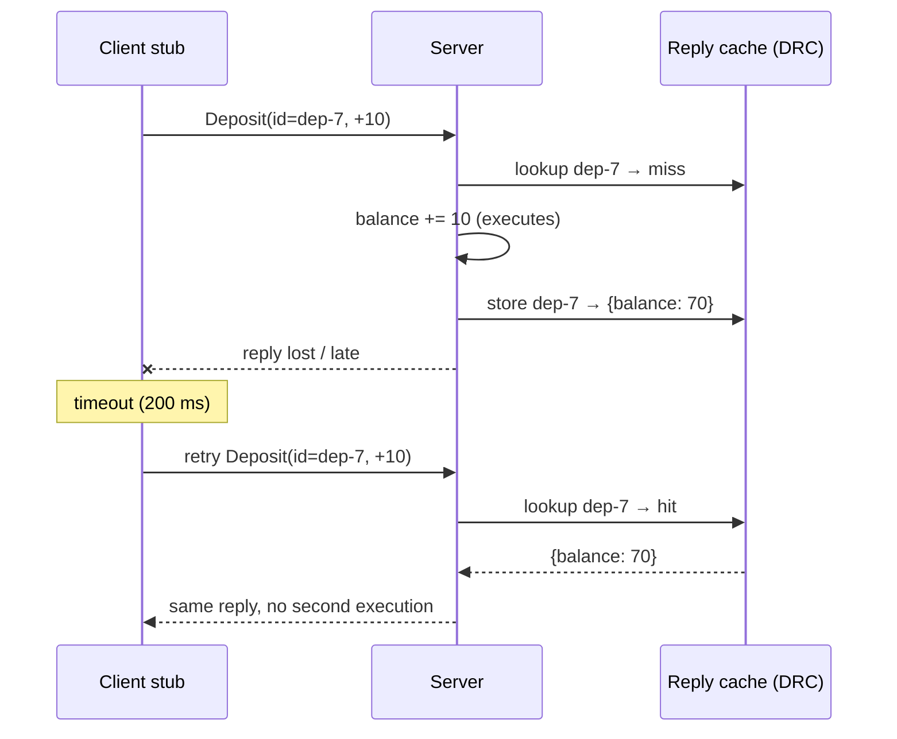

# 01 — RPC semantics: at-most-once, at-least-once, exactly-once

> Module 06 · Distributed OS & Virtualization · Pins: Linux **v6.18.63**, OpenBSD **`8cada8c`** · Farsi: [`01-rpc-semantics.fa.md`](01-rpc-semantics.fa.md)

## Glossary

| Term | Meaning |
|---|---|
| **RPC** | Remote Procedure Call: a call that looks local but is a request message and a reply message over a network. |
| **Stub** | Generated client/server code that marshals arguments into a message and unmarshals the reply. |
| **XID** | Transaction ID that ONC RPC puts in every call; a retransmission reuses it. |
| **Idempotent** | Running an operation twice has the same effect as running it once (`SET x=5`, `READ`), unlike `x += 10`. |
| **DRC** | Duplicate Request Cache (Linux `nfsd` reply cache): the server remembers recent replies by request key. |

## 1. Summary

- A local call either runs once or the whole process dies; a remote call has a **third outcome**: "no reply", and the caller cannot tell whether the request ran.
- Timeouts + retries give **at-least-once** (duplicates possible); a duplicate filter on the server gives **at-most-once**; both together give an **exactly-once effect**, as long as the server's filter state survives.
- Linux implements both halves: SunRPC clients retransmit with the **same XID** (`net/sunrpc/`), and `nfsd` filters duplicates in its **reply cache** (`fs/nfsd/nfscache.c`).

## 2. Detailed explanation

**Intuition.** You call `Deposit(10)`. Locally, either it returns or the process crashes and nothing is left to care. Remotely, the request can be lost, the server can crash before or after executing, or the reply can be lost or simply be late. From the client's side these all look the same: **a timeout**. Birrell & Nelson (1984) named the core problem: RPC can hide marshalling and naming, but it cannot hide partial failure.

**Three semantics.**

| Semantics | Client does | Server does | Effect when replies get lost |
|---|---|---|---|
| **Maybe / at-most-once (no retry)** | send once, give up on timeout | execute each message | 0 or 1 executions; client does not know which |
| **At-least-once** | retry until a reply arrives | execute every message | ≥ 1 executions; correct only for idempotent ops |
| **At-most-once with retries** ("exactly-once effect") | retry with the **same request ID** | keep `ID → reply`; on a duplicate, resend the stored reply | exactly 1 execution, if the cache survives and is large enough |

**Mechanism of the duplicate filter.**

1. Each logical operation gets a unique ID (ONC RPC: the 32-bit XID; gRPC/HTTP APIs: an `Idempotency-Key` header; Lab 06.2: `RequestID`).
2. Retries reuse that ID. A *new* operation gets a new ID.
3. The server looks the ID up **before** executing. Three cases: unknown → execute and record; known and finished → replay the stored reply; known and still running → drop the duplicate (the original will answer).
4. The cache must be bounded. Classic fix: per client, keep only the reply for the highest sequence number, and treat a new sequence number as an implicit acknowledgement of the previous one (that is the Lab 06.2 extension).

**Where it breaks.** The filter is state. If the server reboots and the cache was only in RAM, a retry that arrives after the reboot is executed again. That is why exactly-once is an *effect* that depends on durable state, not a property of the network. Linux `nfsd` keeps its DRC in memory, so a server reboot loses it (UNVERIFIED for every configuration; NFSv4.1 sessions add a per-slot reply cache with stronger rules).

**Timeouts are a policy, not a fact.** A timeout says "I stopped waiting", never "the server failed". The client must pick: wait longer (latency), retry (duplicates), or report an unknown outcome to the user. SunRPC picks retry with growing timeouts and either loops forever (`hard` NFS mount) or gives up with `-ETIMEDOUT`/`-EIO` (`soft` mount).

## 3. Diagram



## 4. Worked example: the kernel's own at-most-once filter

The Linux NFS server checks every incoming call against the reply cache **before** it runs the procedure.

`linux/fs/nfsd/nfscache.c · nfsd_cache_lookup() · v6.18.63` ([Elixir L492](https://elixir.bootlin.com/linux/v6.18.63/source/fs/nfsd/nfscache.c#L492))

```c
  492  	b = nfsd_cache_bucket_find(rqstp->rq_xid, nn);
  493  	spin_lock(&b->cache_lock);
  494  	found = nfsd_cache_insert(b, rp, nn);
  495  	if (found != rp)
  496  		goto found_entry;
  497  	*cacherep = rp;
  498  	rp->c_state = RC_INPROG;
  ...
  509  found_entry:
  510  	/* We found a matching entry which is either in progress or done. */
  511  	nfsd_reply_cache_free_locked(NULL, rp, nn);
  512  	nfsd_stats_rc_hits_inc(nn);
  513  	rtn = RC_DROPIT;
  514  	rp = found;
  515  
  516  	/* Request being processed */
  517  	if (rp->c_state == RC_INPROG)
  518  		goto out_trace;
```

- **L492**: the hash bucket is chosen by the RPC **XID**, the ID a client reuses on retransmit.
- **L494–496**: insert-or-find in one step under the bucket lock. If another entry with the same key exists, this is a duplicate.
- **L498**: a new entry starts as `RC_INPROG`: "executing now".
- **L513–518**: duplicate of a call that is still running → `RC_DROPIT`. The server stays silent; the original execution will reply. A duplicate of a *finished* call falls through to code that replays the cached reply (`RC_REPLY`).

The key is more than the XID. `fs/nfsd/cache.h` defines `c_key` as `k_xid`, `k_csum` (checksum of the request), `k_proc`, `k_prot`, `k_vers`, `k_len` and `k_addr` (client address), and `nfsd_cache_key_cmp()` (L389) compares it with `memcmp`. Two clients that happen to pick the same XID do not collide.

The client half, `linux/net/sunrpc/xprt.c · xprt_adjust_timeout() · v6.18.63` ([Elixir L706](https://elixir.bootlin.com/linux/v6.18.63/source/net/sunrpc/xprt.c#L706)):

```c
  706  	if (time_before(jiffies, req->rq_majortimeo)) {
  707  		if (time_before(jiffies, req->rq_minortimeo))
  708  			return status;
  709  		if (to->to_exponential)
  710  			req->rq_timeout <<= 1;
  711  		else
  712  			req->rq_timeout += to->to_increment;
  713  		if (to->to_maxval && req->rq_timeout >= to->to_maxval)
  714  			req->rq_timeout = to->to_maxval;
  715  		req->rq_retries++;
```

- A **minor timeout** (L707) means: retransmit the same request, with a longer timeout (exponential L710 or linear L712, capped at L713).
- A **major timeout** (the `else` branch, not shown) returns `-ETIMEDOUT`; `rpc_check_timeout()` in `net/sunrpc/clnt.c` (L2546) then fails a `soft` task or prints "server … not responding" and keeps going for a `hard` one.

The same three outcomes appear in Lab 06.2 with Go's `net/rpc`: `labs/02-rpc-idempotency/rpcbank.go`, `Bank.Deposit()` (L44) checks `b.replies[args.RequestID]` before `b.balance += args.Amount`, and `callWithTimeout()` (L90) is the client's minor timeout. Run `run.sh` and compare the three lines `A`, `B`, `C`: the real numbers are in the lab README.

## 5. Edge cases & pitfalls

- **"Use TCP and you get exactly-once."** No. TCP gives in-order, no-duplicate delivery *within one connection*. If the connection breaks after the server executed but before the reply arrived, the client reconnects and retries: a duplicate at the application layer.
- **Natural idempotency is fragile.** `PUT /balance 70` is idempotent, but two clients interleaving `PUT`s with retries can still overwrite each other. Idempotency is about repeats of *one* request, not about concurrency.
- **Same ID for a different request** (client bug, ID counter reset after restart) makes the server replay an old reply for a new operation. NFS adds the request checksum to the key for this reason (`nfsd_cache_key_cmp()` counts XID matches with a different checksum as `payload_misses`).
- **Cache too small or too short-lived**: a slow retry finds its entry evicted and executes again. Size the cache for (request rate × maximum retry window).
- **Server crash between "execute" and "store reply"**: the effect happened but the cache has no record. Fix: make the effect and the cache entry one atomic write (same database transaction).
- **Timeouts shorter than the server's tail latency** turn normal slowness into duplicates (Lab 06.2: a 500 ms slow reply vs a 200 ms timeout).

## 6. Exam-style key points

- Remote call outcomes: success, failure, **unknown**. The unknown case is why RPC semantics exist.
- At-least-once = retries; at-most-once = duplicate detection; exactly-once **effect** = both + durable filter state.
- Retries must reuse the request ID; new operations must get a new ID.
- ONC RPC: XID; Linux nfsd: DRC keyed by XID + checksum + proc + version + client address; states `RC_INPROG` → done; duplicate of in-progress → `RC_DROPIT`.
- SunRPC client: minor timeout → retransmit with backoff; major timeout → `soft` fails with `ETIMEDOUT`/`EIO`, `hard` retries forever.
- Bound the cache with per-client sequence numbers (implicit ack).
- Birrell & Nelson (1984), *Implementing Remote Procedure Calls*, ACM TOCS.

## 7. Links

- Lesson: [`../lesson.en.md`](../lesson.en.md) §4.1 (RPC)
- Lab: [`../labs/02-rpc-idempotency/`](../labs/02-rpc-idempotency/) (three runs A/B/C; extension: bounded cache)
- Quiz: [`../quiz.en.md`](../quiz.en.md) Q1 (semantics), Q9 (read the lab output)
- Next note: [`02-lamport-vector-clocks.en.md`](02-lamport-vector-clocks.en.md)
