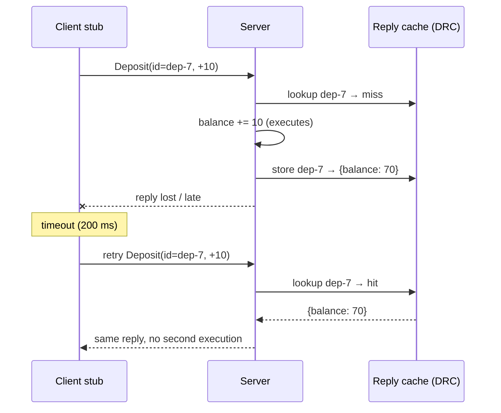

<div dir="rtl">

# ۰۱ — معنای RPC: حداکثر یک‌بار، حداقل یک‌بار، دقیقاً یک‌بار

> ماژول ۰۶ · سیستم‌عامل توزیع‌شده و مجازی‌سازی · نسخه‌های ثابت: Linux **v6.18.63** و OpenBSD **`8cada8c`** · نسخهٔ انگلیسی: [`01-rpc-semantics.en.md`](01-rpc-semantics.en.md)

## واژه‌نامه

| اصطلاح | تعریف |
|---|---|
| **RPC** | فراخوانی رویه از راه دور: فراخوانی‌ای که شبیه تابع محلی است ولی در واقع یک پیام درخواست و یک پیام پاسخ روی شبکه است. |
| **Stub** | کد تولیدشده در سمت client و server که آرگومان‌ها را به پیام تبدیل می‌کند (marshal) و پاسخ را برمی‌گرداند. |
| **XID** | شناسهٔ تراکنش که ONC RPC در هر فراخوانی می‌گذارد؛ ارسال دوباره (retransmit) همان XID را دارد. |
| **Idempotent** | عملیاتی که دو بار اجرا کردنش همان اثر یک بار را دارد (مثل `SET x=5` یا خواندن)، برخلاف `x += 10`. |
| **DRC** | حافظهٔ پنهان درخواست‌های تکراری (reply cache در `nfsd` لینوکس): server پاسخ‌های اخیر را بر اساس کلید درخواست نگه می‌دارد. |

## ۱. خلاصه

- فراخوانی محلی یا یک بار اجرا می‌شود یا کل پردازه می‌میرد؛ فراخوانی راه دور **نتیجهٔ سومی** دارد: «پاسخی نیامد»، و فراخواننده نمی‌داند درخواست اجرا شده یا نه.
- Timeout به‌اضافهٔ تکرار، معنای **at-least-once** می‌دهد (تکرار ممکن است)؛ فیلتر تکراری در server معنای **at-most-once** می‌دهد؛ هر دو با هم **اثر exactly-once** می‌سازند، به شرطی که وضعیت فیلتر از بین نرود.
- لینوکس هر دو نیمه را دارد: client در SunRPC با **همان XID** دوباره می‌فرستد (`net/sunrpc/`) و `nfsd` تکراری‌ها را با **reply cache** فیلتر می‌کند (`fs/nfsd/nfscache.c`).

## ۲. توضیح مفصل

**شهود.** `Deposit(10)` را صدا می‌زنید. در حالت محلی یا تابع برمی‌گردد یا پردازه crash می‌کند و دیگر کسی نیست که نگران باشد. در حالت راه دور ممکن است درخواست گم شود، server قبل یا بعد از اجرا crash کند، یا پاسخ گم شود یا فقط دیر برسد. از دید client همهٔ این‌ها یک شکل دارند: **timeout**. Birrell و Nelson در ۱۹۸۴ همین را مسئلهٔ اصلی دانستند: RPC می‌تواند marshalling و نام‌گذاری را پنهان کند، ولی خرابی جزئی (partial failure) را نه.

**سه معنا.**

| معنا | client چه می‌کند | server چه می‌کند | اثر وقتی پاسخ‌ها گم می‌شوند |
|---|---|---|---|
| **maybe / at-most-once (بدون تکرار)** | یک بار می‌فرستد، با timeout رها می‌کند | هر پیام را اجرا می‌کند | ۰ یا ۱ اجرا؛ client نمی‌داند کدام |
| **at-least-once** | آن‌قدر تکرار می‌کند تا پاسخ بیاید | هر پیام را اجرا می‌کند | ۱ اجرا یا بیشتر؛ فقط برای عملیات idempotent درست است |
| **at-most-once با تکرار** («اثر exactly-once») | با **همان شناسهٔ درخواست** تکرار می‌کند | نگاشت `ID → reply` را نگه می‌دارد و برای تکراری همان پاسخ ذخیره‌شده را می‌فرستد | دقیقاً یک اجرا، اگر cache زنده بماند و به اندازهٔ کافی بزرگ باشد |

**سازوکار فیلتر تکراری.**

۱. هر عملیات منطقی یک شناسهٔ یکتا می‌گیرد (در ONC RPC همان XID سی‌ودو بیتی؛ در APIهای gRPC/HTTP سرآیند `Idempotency-Key`؛ در آزمایش ۰۶.۲ فیلد `RequestID`).
۲. تکرارها همان شناسه را دوباره استفاده می‌کنند؛ عملیات *جدید* شناسهٔ جدید می‌گیرد.
۳. server **قبل از** اجرا شناسه را جستجو می‌کند. سه حالت: ناشناخته ← اجرا و ثبت؛ شناخته‌شده و تمام‌شده ← پاسخ ذخیره‌شده دوباره فرستاده می‌شود؛ شناخته‌شده و در حال اجرا ← تکراری دور ریخته می‌شود (خود اجرای اصلی پاسخ می‌دهد).
۴. cache باید محدود باشد. راه‌حل کلاسیک: برای هر client فقط پاسخ بزرگ‌ترین شمارهٔ ترتیبی (sequence number) نگه داشته شود و رسیدن شمارهٔ جدید به‌معنای تأیید ضمنی شمارهٔ قبلی باشد (این همان تمرین تکمیلی آزمایش ۰۶.۲ است).

**کجا می‌شکند.** فیلتر خودش «وضعیت» است. اگر server ریبوت شود و cache فقط در RAM بوده باشد، تکراری که بعد از ریبوت برسد دوباره اجرا می‌شود. برای همین exactly-once یک *اثر* است که به وضعیت ماندگار وابسته است، نه ویژگی شبکه. DRC در `nfsd` لینوکس در حافظه است و با ریبوت server از دست می‌رود (برای همهٔ پیکربندی‌ها UNVERIFIED؛ sessionهای NFSv4.1 یک reply cache برای هر slot با قواعد سخت‌گیرانه‌تر دارند).

**Timeout یک سیاست است، نه یک واقعیت.** timeout می‌گوید «من دیگر صبر نکردم»، نه «server خراب شد». client باید انتخاب کند: بیشتر صبر کند (تأخیر)، تکرار کند (اجرای تکراری)، یا به کاربر بگوید نتیجه نامعلوم است. SunRPC تکرار با timeoutهای رو به افزایش را انتخاب می‌کند و یا تا ابد ادامه می‌دهد (mount از نوع `hard`) یا با `-ETIMEDOUT`/`-EIO` تسلیم می‌شود (mount از نوع `soft`).

## ۳. نمودار

</div>



<div dir="rtl">

## ۴. مثال عملی: فیلتر at-most-once خود کرنل

server مربوط به NFS در لینوکس هر فراخوانی ورودی را **قبل از** اجرای رویه با reply cache مقایسه می‌کند.

`linux/fs/nfsd/nfscache.c · nfsd_cache_lookup() · v6.18.63` ([Elixir L492](https://elixir.bootlin.com/linux/v6.18.63/source/fs/nfsd/nfscache.c#L492))

</div>

```c
  492  	b = nfsd_cache_bucket_find(rqstp->rq_xid, nn);
  493  	spin_lock(&b->cache_lock);
  494  	found = nfsd_cache_insert(b, rp, nn);
  495  	if (found != rp)
  496  		goto found_entry;
  497  	*cacherep = rp;
  498  	rp->c_state = RC_INPROG;
  ...
  509  found_entry:
  510  	/* We found a matching entry which is either in progress or done. */
  511  	nfsd_reply_cache_free_locked(NULL, rp, nn);
  512  	nfsd_stats_rc_hits_inc(nn);
  513  	rtn = RC_DROPIT;
  514  	rp = found;
  515  
  516  	/* Request being processed */
  517  	if (rp->c_state == RC_INPROG)
  518  		goto out_trace;
```

<div dir="rtl">

- **خط ۴۹۲**: سطل hash بر اساس **XID** انتخاب می‌شود، یعنی همان شناسه‌ای که client در ارسال دوباره تکرار می‌کند.
- **خط‌های ۴۹۴ تا ۴۹۶**: درج یا پیدا کردن در یک قدم و زیر قفل همان سطل. اگر ورودی دیگری با همین کلید باشد، این درخواست تکراری است.
- **خط ۴۹۸**: ورودی جدید با وضعیت `RC_INPROG` شروع می‌شود، یعنی «الان در حال اجراست».
- **خط‌های ۵۱۳ تا ۵۱۸**: تکراریِ فراخوانی‌ای که هنوز در حال اجراست ← `RC_DROPIT`. server ساکت می‌ماند و اجرای اصلی پاسخ می‌دهد. تکراریِ فراخوانی *تمام‌شده* به کدی می‌رسد که پاسخ ذخیره‌شده را دوباره می‌فرستد (`RC_REPLY`).

کلید فقط XID نیست. در `fs/nfsd/cache.h` ساختار `c_key` شامل `k_xid`، `k_csum` (checksum درخواست)، `k_proc`، `k_prot`، `k_vers`، `k_len` و `k_addr` (نشانی client) است و `nfsd_cache_key_cmp()` (خط ۳۸۹) آن را با `memcmp` مقایسه می‌کند. پس دو client که اتفاقاً یک XID انتخاب کنند با هم تداخل ندارند.

نیمهٔ client، یعنی `linux/net/sunrpc/xprt.c · xprt_adjust_timeout() · v6.18.63` ([Elixir L706](https://elixir.bootlin.com/linux/v6.18.63/source/net/sunrpc/xprt.c#L706)):

</div>

```c
  706  	if (time_before(jiffies, req->rq_majortimeo)) {
  707  		if (time_before(jiffies, req->rq_minortimeo))
  708  			return status;
  709  		if (to->to_exponential)
  710  			req->rq_timeout <<= 1;
  711  		else
  712  			req->rq_timeout += to->to_increment;
  713  		if (to->to_maxval && req->rq_timeout >= to->to_maxval)
  714  			req->rq_timeout = to->to_maxval;
  715  		req->rq_retries++;
```

<div dir="rtl">

- **minor timeout** (خط ۷۰۷) یعنی: همان درخواست را دوباره بفرست، با timeout بلندتر (نمایی در خط ۷۱۰ یا خطی در خط ۷۱۲، با سقف خط ۷۱۳).
- **major timeout** (شاخهٔ `else` که اینجا نیامده) مقدار `-ETIMEDOUT` برمی‌گرداند؛ سپس `rpc_check_timeout()` در `net/sunrpc/clnt.c` (خط ۲۵۴۶) کار `soft` را با خطا تمام می‌کند یا برای کار `hard` پیام «server … not responding» چاپ می‌کند و ادامه می‌دهد.

همین سه نتیجه در آزمایش ۰۶.۲ با `net/rpc` زبان Go دیده می‌شود: در `labs/02-rpc-idempotency/rpcbank.go` تابع `Bank.Deposit()` (خط ۴۴) قبل از `b.balance += args.Amount` اول `b.replies[args.RequestID]` را بررسی می‌کند، و `callWithTimeout()` (خط ۹۰) همان minor timeout سمت client است. `run.sh` را اجرا کنید و سه خط `A`، `B` و `C` را مقایسه کنید؛ اعداد واقعی در README آزمایش آمده‌اند.

## ۵. حالت‌های مرزی و دام‌ها

- **«TCP بگذارید، exactly-once می‌گیرید.»** نه. TCP تحویل مرتب و بدون تکرار را فقط *داخل یک اتصال* تضمین می‌کند. اگر اتصال بعد از اجرا در server و قبل از رسیدن پاسخ قطع شود، client دوباره وصل می‌شود و تکرار می‌کند؛ یعنی تکرار در لایهٔ برنامه.
- **idempotent بودن طبیعی شکننده است.** `PUT /balance 70` idempotent است، ولی دو client که `PUT`هایشان با تکرار در هم بیفتد باز هم روی هم می‌نویسند. idempotency دربارهٔ تکرار *یک* درخواست است، نه دربارهٔ همروندی.
- **شناسهٔ یکسان برای درخواست متفاوت** (باگ client، یا صفر شدن شمارنده بعد از ری‌استارت) باعث می‌شود server پاسخ قدیمی را برای عملیات جدید بفرستد. NFS به همین دلیل checksum درخواست را هم در کلید می‌گذارد (`nfsd_cache_key_cmp()` حالت XID برابر با checksum متفاوت را با `payload_misses` می‌شمارد).
- **cache خیلی کوچک یا کم‌عمر**: تکرار کند می‌رسد، ورودی‌اش حذف شده و دوباره اجرا می‌شود. اندازه را بر اساس (نرخ درخواست × بیشترین پنجرهٔ تکرار) بگیرید.
- **crash بین «اجرا» و «ذخیرهٔ پاسخ»**: اثر اتفاق افتاده ولی cache خبر ندارد. راه‌حل: اثر و ورودی cache را در یک نوشتن اتمی (همان تراکنش پایگاه داده) بگذارید.
- **timeout کوتاه‌تر از تأخیر دم (tail latency) server** کندی عادی را به اجرای تکراری تبدیل می‌کند (آزمایش ۰۶.۲: پاسخ کند ۵۰۰ میلی‌ثانیه در برابر timeout دویست میلی‌ثانیه).

## ۶. نکته‌های امتحانی

- نتیجه‌های فراخوانی راه دور: موفق، ناموفق، **نامعلوم**. معناهای RPC به خاطر حالت نامعلوم وجود دارند.
- at-least-once = تکرار؛ at-most-once = تشخیص تکراری؛ **اثر** exactly-once = هر دو + وضعیت ماندگار فیلتر.
- تکرارها باید شناسهٔ درخواست را حفظ کنند؛ عملیات جدید شناسهٔ جدید می‌گیرد.
- ONC RPC: XID؛ `nfsd` لینوکس: DRC با کلید XID + checksum + proc + version + نشانی client؛ وضعیت `RC_INPROG` و سپس تمام‌شده؛ تکراریِ در حال اجرا ← `RC_DROPIT`.
- client در SunRPC: minor timeout ← ارسال دوباره با backoff؛ major timeout ← `soft` با `ETIMEDOUT`/`EIO` شکست می‌خورد و `hard` تا ابد تکرار می‌کند.
- cache را با شمارهٔ ترتیبی برای هر client محدود کنید (تأیید ضمنی).
- Birrell و Nelson (۱۹۸۴)، *Implementing Remote Procedure Calls*، مجلهٔ ACM TOCS.

## ۷. پیوندها

- درس: [`../lesson.fa.md`](../lesson.fa.md) بخش ۴.۱ (RPC)
- آزمایش: [`../labs/02-rpc-idempotency/`](../labs/02-rpc-idempotency/) (سه اجرای A/B/C؛ تمرین تکمیلی: cache محدود)
- آزمون: [`../quiz.fa.md`](../quiz.fa.md) پرسش ۱ (معناها)، پرسش ۹ (خواندن خروجی آزمایش)
- یادداشت بعدی: [`02-lamport-vector-clocks.fa.md`](02-lamport-vector-clocks.fa.md)

</div>
