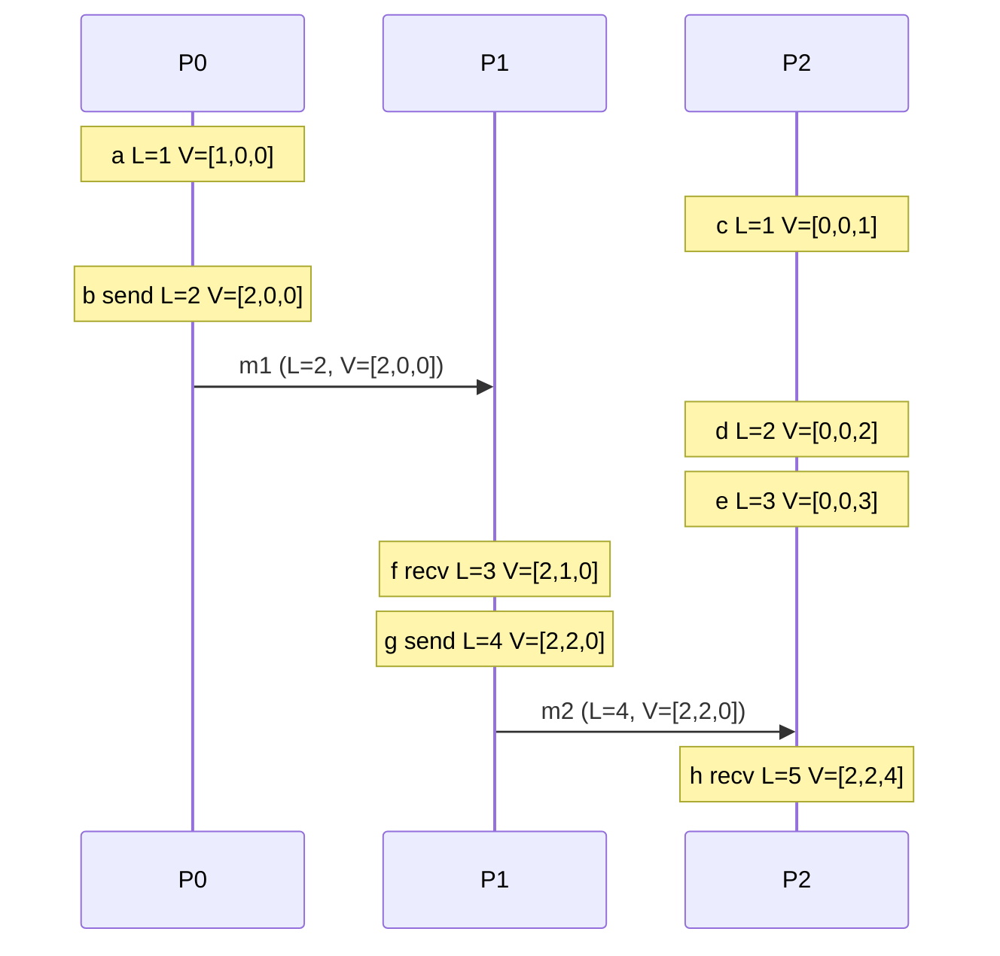

# 02 — Lamport clocks and vector clocks

> Module 06 · Distributed OS & Virtualization · Pins: Linux **v6.18.63**, OpenBSD **`8cada8c`** · Farsi: [`02-lamport-vector-clocks.fa.md`](02-lamport-vector-clocks.fa.md)

## Glossary

| Term | Meaning |
|---|---|
| **Happened-before (→)** | Lamport's partial order: `a → b` if a precedes b in one process, or a is the send and b the receive of one message, or by transitivity. |
| **Concurrent (a ∥ b)** | Neither `a → b` nor `b → a`. Not "at the same time": "no causal path between them". |
| **Lamport clock** | One integer per process. Gives `a → b ⇒ L(a) < L(b)`, not the converse. |
| **Vector clock** | One integer per process *per process* (`V[N]`). Gives `a → b ⇔ V(a) < V(b)`. |
| **Causal delivery** | Deliver a message only after every message that causally precedes it. |

## 1. Summary

- Physical clocks drift, so distributed systems order events by **causality** instead of wall time (Lamport 1978).
- A **Lamport clock** is one counter: it is consistent with causality but cannot detect concurrency; `(L, process id)` gives a **total order** usable for mutual exclusion and replicated logs.
- A **vector clock** (Fidge 1988, Mattern 1988) stores one counter per process and **characterizes** causality exactly: compare two vectors and you know `→`, `←` or `∥`, at the cost of O(N) space per message.

## 2. Detailed explanation

**Why not just timestamps?** Two machines' clocks differ by milliseconds even with NTP (note 03). A message can carry a send time *later* than the receiver's receive time. Ordering by wall time then puts an effect before its cause. What we really need to know is: *could event a have influenced event b?* That is happened-before.

**Lamport clock rules** (one integer `L` per process):

1. Before every local event or send: `L = L + 1`.
2. A message carries the sender's `L`.
3. On receive of `Lm`: `L = max(L, Lm) + 1`.

Result (the **clock condition**): `a → b ⇒ L(a) < L(b)`. The converse is false: `L(a) < L(b)` happens for unrelated events too, because counters on different processes advance independently. Breaking ties with the process id gives a total order `(L, pid)` that every process computes identically. Lamport used it for distributed mutual exclusion; replicated state machines use the same idea to agree on one order of commands.

**Vector clock rules** (array `V[0..N-1]` per process `i`):

1. Before a local event or send: `V[i] = V[i] + 1`.
2. A message carries the whole vector.
3. On receive of `Vm`: `V[k] = max(V[k], Vm[k])` for all k, then `V[i] = V[i] + 1`.

Meaning: `V[k]` at process i = "how many events of process k I have causally seen". Comparison:

| Relation | Test |
|---|---|
| `V(a) = V(b)` | all components equal (same event) |
| `a → b` | `V(a)[k] ≤ V(b)[k]` for all k, and at least one `<` |
| `a ∥ b` | some component larger on each side |

Now the converse holds: `V(a) < V(b) ⇔ a → b`. That is what makes vector clocks useful for **conflict detection** (Dynamo-style stores keep "sibling" versions when two writes are concurrent), **causal delivery** (hold back a message until its dependencies are delivered: the Lab 06.1 extension) and **consistent snapshots** (note 04).

**Cost.** N integers per message and per stored version. With thousands of clients, systems compact them (version vectors per *replica* instead of per client, dotted version vectors) or switch to hybrid logical clocks (HLC: physical time + a Lamport counter, 64 bits), which keep `a → b ⇒ HLC(a) < HLC(b)` but, like Lamport clocks, cannot detect concurrency.

**Where the OS meets this.** The kernel has no logical clocks of its own; distributed file systems and databases implement them in user space or in their protocols. The lab implements both clocks in Go (`labs/01-lamport-vector-clocks/clocks.go`): `tick()` at L51 is rule 1, `merge()` at L57 is rule 3, `before()` at L135 is the `→` test.

## 3. Diagram



## 4. Worked example: one history, two clocks

A deterministic Go program (same rules as the lab, single-threaded so the history is fixed) prints each event, then compares five pairs. Real run, Docker Desktop on the host, `golang:1.22` image (`go1.22.12 linux/amd64`), 2026-11-15:

```text
a   P0 local  L=1 V=[1 0 0]
b   P0 send   L=2 V=[2 0 0]
c   P2 local  L=1 V=[0 0 1]
d   P2 local  L=2 V=[0 0 2]
e   P2 local  L=3 V=[0 0 3]
f   P1 recv   L=3 V=[2 1 0]
g   P1 send   L=4 V=[2 2 0]
h   P2 recv   L=5 V=[2 2 4]
pair  L-order  vector
a,f  L(a)<L(b)  ->
c,f  L(a)<L(b)  ||
e,b  L(a)>=L(b) ||
b,h  L(a)<L(b)  ->
d,g  L(a)<L(b)  ||
```

Read it line by line:

- `f` receives `m1`: `L = max(0, 2) + 1 = 3`; `V = max([0,0,0],[2,0,0])` then `V[1]++` → `[2 1 0]`.
- `h` receives `m2` while P2 is already at `L=3`: `max(3, 4) + 1 = 5`; `V = max([0,0,3],[2,2,0]) = [2,2,3]`, then `V[2]++` → `[2 2 4]`.
- **`c,f`**: `L(c)=1 < L(f)=3`, yet the vectors `[0 0 1]` and `[2 1 0]` are incomparable → concurrent. Lamport order would have told you "c before f", which is only an arbitrary tie-break.
- **`e,b`**: `L(e)=3 > L(b)=2`, but they are also concurrent. A larger Lamport value proves nothing.
- **`b,h`**: `b → f → g → h` through two messages; `[2 0 0] < [2 2 4]`.

The lab (`run.sh`) does the same with three real processes over UDP and reports `clock condition: lamport n/n, vector n/n` for every message plus the count of pairs with `L(a) < L(b)` that are actually concurrent. The captured numbers are in the lab README.

## 5. Edge cases & pitfalls

- **"Concurrent" means "causally unrelated"**, not "same wall-clock time". Two events an hour apart on disconnected machines are concurrent.
- **Increment before send, not after.** If the sender increments after sending, the receiver's merge cannot place the send strictly before the receive and the clock condition breaks.
- **Lamport tie-break is arbitrary.** `(L, pid)` is a fine total order for agreement, but never use it to infer cause.
- **Vector size is fixed by membership.** Adding or removing processes needs a protocol (or maps instead of arrays). Garbage-collecting entries of departed nodes is a real problem in long-lived systems.
- **Message loss does not break the clocks**: a lost message just never creates the `send → receive` edge. Duplicated delivery is also safe (max is idempotent), but a re-executed *event* would advance `V[i]` twice.
- **Clocks per process, not per thread**, unless threads communicate only by messages. Shared memory between threads creates causal edges the clock does not see.

## 6. Exam-style key points

- `a → b ⇒ L(a) < L(b)`; the converse is false. Vector clocks: `a → b ⇔ V(a) < V(b)`.
- Lamport rules: increment before each event; on receive `max(L, Lm) + 1`.
- Vector rules: `V[i]++` on each event; on receive component-wise max, then `V[i]++`.
- Concurrency test: neither vector ≤ the other.
- `(L, pid)` = total order consistent with causality (Lamport mutual exclusion, replicated logs).
- Cost: Lamport O(1), vector O(N) per message; HLC = physical + logical, 64-bit, no concurrency detection.
- Lamport (1978) *Time, Clocks, and the Ordering of Events in a Distributed System*, CACM. Fidge (1988), Mattern (1988).

## 7. Links

- Lesson: [`../lesson.en.md`](../lesson.en.md) §4.2 (logical clocks)
- Lab: [`../labs/01-lamport-vector-clocks/`](../labs/01-lamport-vector-clocks/) (extension: causal broadcast with a hold-back queue)
- Quiz: [`../quiz.en.md`](../quiz.en.md) Q2 (converse of the clock condition), Q3 (compare vectors), oral O2 (why O(N), and alternatives)
- Related: note 04 uses vector clocks to define a consistent cut: [`04-distributed-deadlock-snapshots.en.md`](04-distributed-deadlock-snapshots.en.md)
