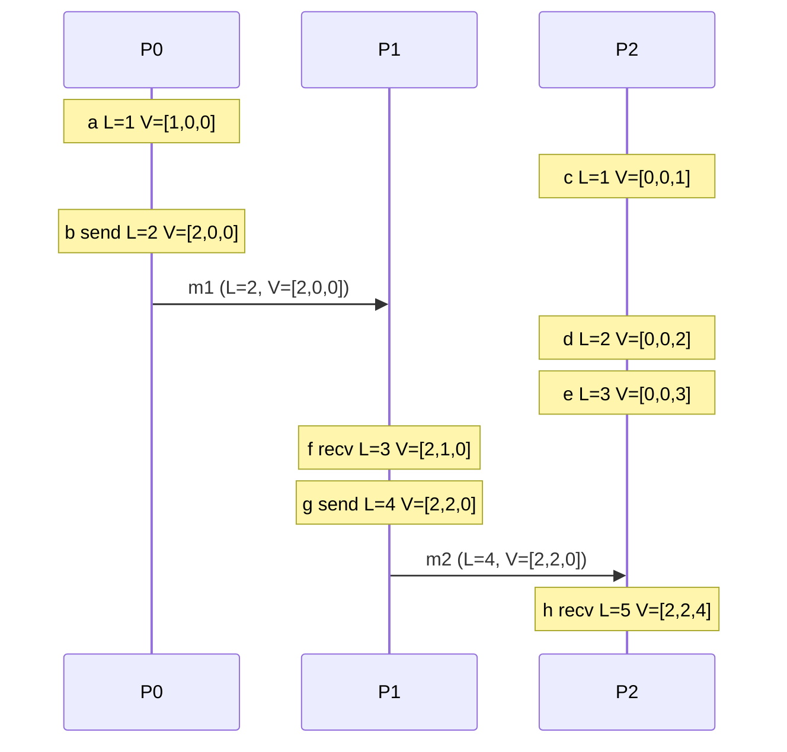

<div dir="rtl">

# ۰۲ — ساعت Lamport و ساعت برداری (Vector Clock)

> ماژول ۰۶ · سیستم‌عامل توزیع‌شده و مجازی‌سازی · نسخه‌های ثابت: Linux **v6.18.63** و OpenBSD **`8cada8c`** · نسخهٔ انگلیسی: [`02-lamport-vector-clocks.en.md`](02-lamport-vector-clocks.en.md)

## واژه‌نامه

| اصطلاح | تعریف |
|---|---|
| **Happened-before (→)** | ترتیب جزئی Lamport: `a → b` اگر a در همان پردازه قبل از b باشد، یا a ارسال و b دریافت یک پیام باشد، یا از راه تعدی (transitivity). |
| **همروند (a ∥ b)** | نه `a → b` و نه `b → a`. یعنی «هیچ مسیر علّی بینشان نیست»، نه «هم‌زمان». |
| **ساعت Lamport** | یک عدد صحیح برای هر پردازه. تضمین می‌کند `a → b ⇒ L(a) < L(b)`، ولی عکسش را نه. |
| **ساعت برداری** | برای هر پردازه یک آرایه به طول تعداد پردازه‌ها (`V[N]`). تضمین می‌کند `a → b ⇔ V(a) < V(b)`. |
| **تحویل علّی (Causal delivery)** | پیام فقط بعد از همهٔ پیام‌هایی که از نظر علّی قبلش هستند تحویل داده شود. |

## ۱. خلاصه

- ساعت‌های فیزیکی drift دارند؛ برای همین سیستم‌های توزیع‌شده رویدادها را بر اساس **علیت** مرتب می‌کنند، نه زمان دیواری (Lamport، ۱۹۷۸).
- **ساعت Lamport** یک شمارنده است: با علیت سازگار است ولی همروندی را تشخیص نمی‌دهد؛ زوج `(L, process id)` یک **ترتیب کامل** می‌دهد که برای انحصار متقابل و logهای تکثیرشده کافی است.
- **ساعت برداری** (Fidge و Mattern، ۱۹۸۸) برای هر پردازه یک شمارنده نگه می‌دارد و علیت را **دقیقاً** نشان می‌دهد: با مقایسهٔ دو بردار می‌فهمید `→` است یا `←` یا `∥`؛ هزینه‌اش O(N) فضا در هر پیام است.

## ۲. توضیح مفصل

**چرا فقط timestamp کافی نیست؟** ساعت دو ماشین حتی با NTP چند میلی‌ثانیه اختلاف دارد (یادداشت ۰۳). ممکن است پیامی زمان ارسالی داشته باشد که *بعد از* زمان دریافت در گیرنده است. مرتب‌سازی با زمان دیواری آن‌وقت معلول را قبل از علت می‌گذارد. چیزی که واقعاً لازم داریم این است: *آیا رویداد a می‌توانسته روی b اثر بگذارد؟* این همان happened-before است.

**قواعد ساعت Lamport** (یک عدد `L` برای هر پردازه):

۱. قبل از هر رویداد محلی یا ارسال: `L = L + 1`.
۲. پیام مقدار `L` فرستنده را با خودش می‌برد.
۳. هنگام دریافت `Lm`: `L = max(L, Lm) + 1`.

نتیجه (**شرط ساعت**): `a → b ⇒ L(a) < L(b)`. عکس آن درست نیست: `L(a) < L(b)` برای رویدادهای بی‌ربط هم پیش می‌آید، چون شمارنده‌های پردازه‌های مختلف مستقل جلو می‌روند. اگر تساوی را با شمارهٔ پردازه بشکنیم، ترتیب کامل `(L, pid)` به دست می‌آید که همهٔ پردازه‌ها یکسان محاسبه‌اش می‌کنند. Lamport از آن برای انحصار متقابل توزیع‌شده استفاده کرد؛ state machineهای تکثیرشده هم با همین ایده روی یک ترتیب واحد از فرمان‌ها توافق می‌کنند.

**قواعد ساعت برداری** (آرایهٔ `V[0..N-1]` برای پردازهٔ `i`):

۱. قبل از رویداد محلی یا ارسال: `V[i] = V[i] + 1`.
۲. پیام کل بردار را می‌برد.
۳. هنگام دریافت `Vm`: برای همهٔ k مقدار `V[k] = max(V[k], Vm[k])`، سپس `V[i] = V[i] + 1`.

معنا: `V[k]` در پردازهٔ i یعنی «چند رویداد از پردازهٔ k را از نظر علّی دیده‌ام». مقایسه:

| رابطه | آزمون |
|---|---|
| `V(a) = V(b)` | همهٔ مؤلفه‌ها برابر (همان رویداد) |
| `a → b` | برای همهٔ k داریم `V(a)[k] ≤ V(b)[k]` و دست‌کم یکی `<` است |
| `a ∥ b` | در هر طرف دست‌کم یک مؤلفه بزرگ‌تر است |

حالا عکس هم برقرار است: `V(a) < V(b) ⇔ a → b`. به همین دلیل ساعت برداری برای این‌ها مفید است: **تشخیص تعارض** (storeهای شبیه Dynamo وقتی دو نوشتن همروند باشند هر دو نسخه را به‌عنوان sibling نگه می‌دارند)، **تحویل علّی** (پیام را نگه دار تا وابستگی‌هایش تحویل شوند؛ همان تمرین تکمیلی آزمایش ۰۶.۱) و **snapshot سازگار** (یادداشت ۰۴).

**هزینه.** N عدد در هر پیام و در هر نسخهٔ ذخیره‌شده. با هزاران client، سیستم‌ها آن را فشرده می‌کنند (version vector برای هر *replica* به‌جای هر client، یا dotted version vector) یا سراغ hybrid logical clock می‌روند (HLC: زمان فیزیکی + یک شمارندهٔ Lamport در ۶۴ بیت) که `a → b ⇒ HLC(a) < HLC(b)` را حفظ می‌کند ولی مثل Lamport همروندی را تشخیص نمی‌دهد.

**ارتباط با سیستم‌عامل.** کرنل خودش ساعت منطقی ندارد؛ فایل‌سیستم‌ها و پایگاه‌داده‌های توزیع‌شده آن را در فضای کاربر یا در پروتکلشان پیاده می‌کنند. آزمایش هر دو ساعت را در Go پیاده کرده است (`labs/01-lamport-vector-clocks/clocks.go`): `tick()` در خط ۵۱ قاعدهٔ ۱ است، `merge()` در خط ۵۷ قاعدهٔ ۳، و `before()` در خط ۱۳۵ آزمون `→`.

## ۳. نمودار

</div>



<div dir="rtl">

## ۴. مثال عملی: یک تاریخچه، دو ساعت

یک برنامهٔ قطعی Go (همان قواعد آزمایش، ولی تک‌نخی تا تاریخچه ثابت بماند) هر رویداد را چاپ می‌کند و سپس پنج زوج را مقایسه می‌کند. اجرای واقعی روی Docker Desktop میزبان، image با نام `golang:1.22` (`go1.22.12 linux/amd64`)، تاریخ 2026-11-15:

</div>

```text
a   P0 local  L=1 V=[1 0 0]
b   P0 send   L=2 V=[2 0 0]
c   P2 local  L=1 V=[0 0 1]
d   P2 local  L=2 V=[0 0 2]
e   P2 local  L=3 V=[0 0 3]
f   P1 recv   L=3 V=[2 1 0]
g   P1 send   L=4 V=[2 2 0]
h   P2 recv   L=5 V=[2 2 4]
pair  L-order  vector
a,f  L(a)<L(b)  ->
c,f  L(a)<L(b)  ||
e,b  L(a)>=L(b) ||
b,h  L(a)<L(b)  ->
d,g  L(a)<L(b)  ||
```

<div dir="rtl">

خط به خط:

- `f` پیام `m1` را دریافت می‌کند: `L = max(0, 2) + 1 = 3`؛ `V = max([0,0,0],[2,0,0])` و سپس `V[1]++` ← `[2 1 0]`.
- `h` پیام `m2` را وقتی دریافت می‌کند که P2 در `L=3` است: `max(3, 4) + 1 = 5`؛ `V = max([0,0,3],[2,2,0]) = [2,2,3]` و سپس `V[2]++` ← `[2 2 4]`.
- **زوج `c,f`**: `L(c)=1 < L(f)=3`، ولی بردارهای `[0 0 1]` و `[2 1 0]` قابل‌مقایسه نیستند ← همروند. ترتیب Lamport می‌گفت «c قبل از f»، که فقط یک شکستن تساوی دلبخواهی است.
- **زوج `e,b`**: `L(e)=3 > L(b)=2` ولی این‌ها هم همروندند. مقدار Lamport بزرگ‌تر هیچ چیزی را ثابت نمی‌کند.
- **زوج `b,h`**: `b → f → g → h` از راه دو پیام؛ `[2 0 0] < [2 2 4]`.

آزمایش (`run.sh`) همین کار را با سه پردازهٔ واقعی روی UDP انجام می‌دهد و برای همهٔ پیام‌ها `clock condition: lamport n/n, vector n/n` را گزارش می‌کند، به‌اضافهٔ تعداد زوج‌هایی که `L(a) < L(b)` دارند ولی در واقع همروندند. اعداد واقعی در README آزمایش هستند.

## ۵. حالت‌های مرزی و دام‌ها

- **«همروند» یعنی «بدون رابطهٔ علّی»**، نه «هم‌زمان در ساعت دیواری». دو رویداد با یک ساعت فاصله روی دو ماشین جدا از هم همروندند.
- **قبل از ارسال افزایش بده، نه بعد.** اگر فرستنده بعد از ارسال افزایش دهد، ادغام در گیرنده نمی‌تواند ارسال را اکیداً قبل از دریافت بگذارد و شرط ساعت می‌شکند.
- **شکستن تساوی در Lamport دلبخواهی است.** `(L, pid)` برای توافق ترتیب کامل خوبی است، ولی هرگز از آن علیت را نتیجه نگیرید.
- **اندازهٔ بردار با عضویت ثابت می‌شود.** اضافه یا حذف پردازه پروتکل می‌خواهد (یا map به‌جای آرایه). پاک کردن ورودی‌های گره‌های رفته در سیستم‌های طولانی‌مدت مسئلهٔ واقعی است.
- **گم شدن پیام ساعت‌ها را خراب نمی‌کند**؛ فقط یال `send → receive` ساخته نمی‌شود. تحویل تکراری هم امن است (max idempotent است)، ولی اگر یک *رویداد* دوباره اجرا شود `V[i]` دو بار جلو می‌رود.
- **ساعت برای هر پردازه است، نه هر نخ**، مگر این‌که نخ‌ها فقط با پیام ارتباط داشته باشند. حافظهٔ مشترک بین نخ‌ها یال‌های علّی می‌سازد که ساعت نمی‌بیند.

## ۶. نکته‌های امتحانی

- `a → b ⇒ L(a) < L(b)`؛ عکسش غلط است. در ساعت برداری: `a → b ⇔ V(a) < V(b)`.
- قواعد Lamport: قبل از هر رویداد افزایش؛ در دریافت `max(L, Lm) + 1`.
- قواعد برداری: در هر رویداد `V[i]++`؛ در دریافت max مؤلفه‌به‌مؤلفه و سپس `V[i]++`.
- آزمون همروندی: هیچ‌کدام از دو بردار ≤ دیگری نیست.
- `(L, pid)` = ترتیب کامل سازگار با علیت (انحصار متقابل Lamport، logهای تکثیرشده).
- هزینه: Lamport برابر O(1) و برداری O(N) در هر پیام؛ HLC = فیزیکی + منطقی، ۶۴ بیت، بدون تشخیص همروندی.
- Lamport (۱۹۷۸) *Time, Clocks, and the Ordering of Events in a Distributed System*، مجلهٔ CACM. Fidge (۱۹۸۸)، Mattern (۱۹۸۸).

## ۷. پیوندها

- درس: [`../lesson.fa.md`](../lesson.fa.md) بخش ۴.۲ (ساعت‌های منطقی)
- آزمایش: [`../labs/01-lamport-vector-clocks/`](../labs/01-lamport-vector-clocks/) (تمرین تکمیلی: broadcast علّی با صف نگه‌داری)
- آزمون: [`../quiz.fa.md`](../quiz.fa.md) پرسش ۲ (عکس شرط ساعت)، پرسش ۳ (مقایسهٔ بردارها)، پرسش شفاهی O2 (چرا O(N) و جایگزین‌ها)
- مرتبط: یادداشت ۰۴ با ساعت برداری برش سازگار را تعریف می‌کند: [`04-distributed-deadlock-snapshots.fa.md`](04-distributed-deadlock-snapshots.fa.md)

</div>
