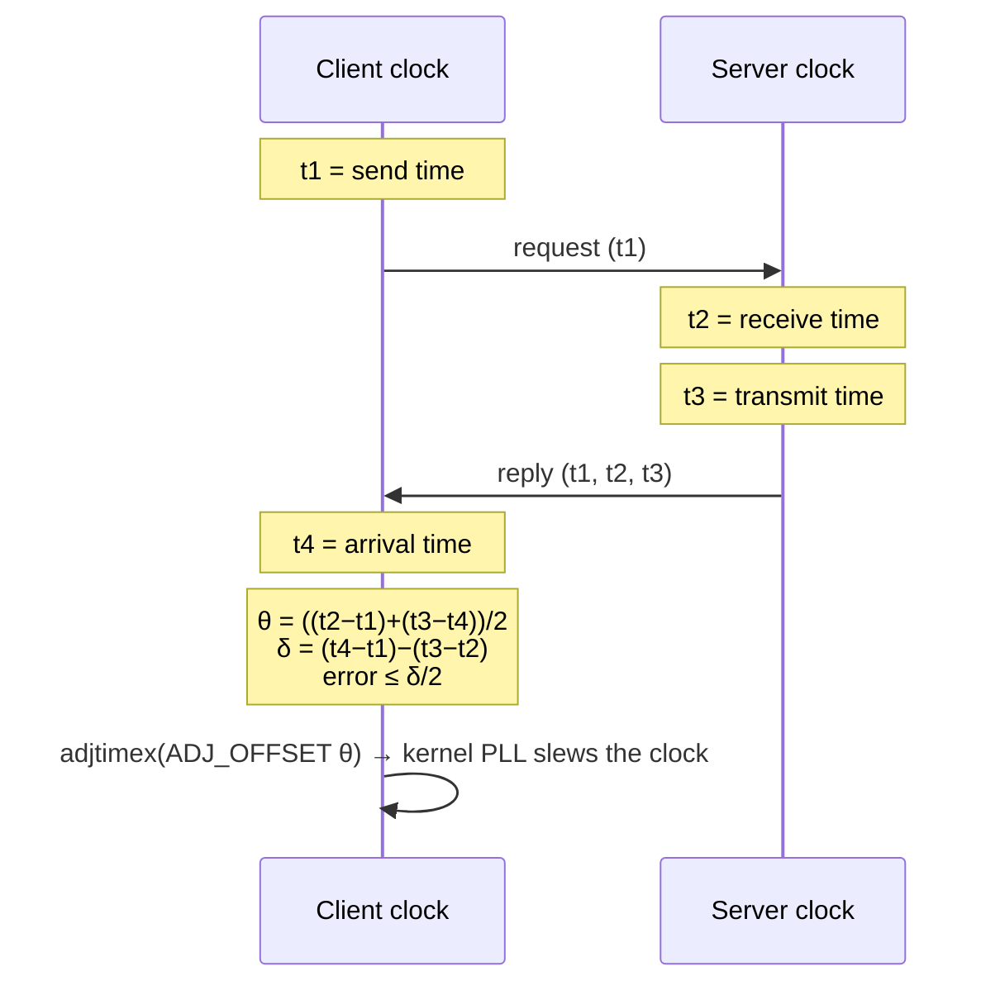

# 03 — Physical clock synchronization: NTP, PTP, chrony

> Module 06 · Distributed OS & Virtualization · Pins: Linux **v6.18.63**, OpenBSD **`8cada8c`** · Farsi: [`03-clock-sync-ntp-ptp.fa.md`](03-clock-sync-ntp-ptp.fa.md)

## Glossary

| Term | Meaning |
|---|---|
| **Drift / skew** | Drift: rate error of a clock (ppm, µs per second). Skew/offset: the difference between two clocks right now. |
| **NTP** | Network Time Protocol: client/server over UDP 123, four timestamps per exchange, servers organised in **strata**. |
| **PTP (IEEE 1588)** | Precision Time Protocol: LAN protocol that timestamps packets **in the NIC hardware**, sub-microsecond accuracy. |
| **Slew vs step** | Slew: run the clock slightly faster/slower until the offset is gone (time stays monotonic). Step: jump to the new time. |
| **`adjtimex(2)`** | Linux system call that reads and adjusts the kernel's NTP state (offset, frequency, status). |
| **chrony** | NTP implementation used by Ubuntu/RHEL (`chronyd`, `chronyc`); also feeds PTP hardware clocks. |

## 1. Summary

- Every quartz clock drifts (tens of ppm = seconds per day), so machines must keep measuring their **offset** against a reference and correct both the offset and the **frequency**.
- NTP estimates offset from four timestamps: `θ = ((t2 − t1) + (t3 − t4)) / 2`, round-trip delay `δ = (t4 − t1) − (t3 − t2)`; the true offset is only known to within **±δ/2**, because path asymmetry is invisible.
- The kernel does the smooth correction (PLL/FLL in `kernel/time/ntp.c`, entered through `adjtimex(2)`); a daemon (chronyd, ntpd, systemd-timesyncd) does the measuring. PTP moves timestamping into the NIC to remove software jitter.

## 2. Detailed explanation

**Why physical sync if we have logical clocks?** Logical clocks order events, but leases, certificate expiry, log correlation, TOTP codes, `make` timestamps and Spanner-style "commit wait" need real time with a **known error bound**.

**Drift numbers.** A 20 ppm oscillator gains or loses 20 µs per second, 1.7 s per day. The Linux NTP code accepts a frequency correction up to 500 ppm and a phase (offset) correction up to 0.5 s:

`linux/include/linux/timex.h · MAXPHASE/MAXFREQ · v6.18.63` ([Elixir L135](https://elixir.bootlin.com/linux/v6.18.63/source/include/linux/timex.h#L135))

```c
  135  #define MAXPHASE 500000000L	/* max phase error (ns) */
  136  #define MAXFREQ 500000		/* max frequency error (ns/s) */
```

**One NTP exchange.** The client writes `t1` (its send time) into the request; the server records `t2` (receive) and `t3` (transmit) with *its* clock; the client records `t4` on arrival. If the network delay is the same in both directions, the server's clock is ahead by

`θ = ((t2 − t1) + (t3 − t4)) / 2` and the network round trip is `δ = (t4 − t1) − (t3 − t2)`.

If the paths are asymmetric (upload 10 ms, download 90 ms), θ is wrong by up to half the difference, and no measurement can see it. So `δ/2` is a hard **error bound**, and good clients prefer samples with the smallest δ (Cristian's algorithm had the same idea in 1989).

**From samples to a clock.** A daemon keeps several samples from several servers, rejects outliers and "falsetickers" (Marzullo-style interval intersection), and feeds the result into a control loop. Linux has a phase-locked loop in the kernel: user space passes an offset with `ADJ_OFFSET`, the kernel slews the clock with a bounded rate and estimates frequency (`freq`). `ADJ_SETOFFSET` instead **steps** the clock (used at boot or for large errors). Stepping backwards breaks programs that measure durations with `CLOCK_REALTIME`, which is why durations belong on `CLOCK_MONOTONIC` (not stepped, but slewed) or `CLOCK_MONOTONIC_RAW` (neither).

**Strata.** Stratum 0 is a reference (GPS, atomic clock), stratum 1 is a server attached to it, stratum 2 syncs from stratum 1, and so on. Stratum is distance from the reference, not quality: a nearby stratum-3 server with low δ can beat a stratum-1 server across an ocean.

**PTP.** On a LAN the remaining error is software: interrupt latency, scheduling, queueing in the stack. IEEE 1588 has the master send `Sync` (+ `Follow_Up` with the precise send time) and the slave send `Delay_Req`; the same four-timestamp algebra applies, but timestamps are taken by the NIC (`SO_TIMESTAMPING`, PTP hardware clock `/dev/ptpN`). `ptp4l` disciplines the NIC clock; `phc2sys` (or chrony with `refclock PHC`) copies it into the system clock. Accuracy: tens of ns to ~1 µs with hardware support and PTP-aware switches; worse without.

**Daemons on Ubuntu 24.04.** Desktop/server images use `systemd-timesyncd` (SNTP client) by default; installing `chrony` replaces it. `chronyc tracking` shows reference, stratum, system offset, frequency (ppm) and root delay/dispersion; `timedatectl timesync-status` shows the timesyncd equivalent.

## 3. Diagram



## 4. Worked example: measure θ and δ, then read the kernel's NTP state

**(a) Four timestamps by hand.** A minimal SNTP client: one mode-3 packet, the server's receive/transmit timestamps are words 8–11 of the reply.

```python
# sntp.py: one SNTP exchange per sample; prints NTP offset/delay.
import socket, struct, sys, time
NTP_EPOCH = 2208988800  # seconds from 1900-01-01 to 1970-01-01
def to_unix(sec, frac): return sec - NTP_EPOCH + frac / 2**32
server = sys.argv[1] if len(sys.argv) > 1 else "pool.ntp.org"
s = socket.socket(socket.AF_INET, socket.SOCK_DGRAM); s.settimeout(3)
for i in range(3):
    pkt = bytearray(48); pkt[0] = (0 << 6) | (4 << 3) | 3   # LI=0, VN=4, mode=3 (client)
    t1 = time.time()
    s.sendto(pkt, (server, 123))
    data, _ = s.recvfrom(48)
    t4 = time.time()
    f = struct.unpack("!12I", data)
    t2 = to_unix(f[8], f[9])    # receive timestamp (server clock)
    t3 = to_unix(f[10], f[11])  # transmit timestamp (server clock)
    theta = ((t2 - t1) + (t3 - t4)) / 2
    delta = (t4 - t1) - (t3 - t2)
    print(f"sample {i}: stratum={data[1]} offset={theta*1000:+.3f} ms delay={delta*1000:.3f} ms "
          f"server-hold={(t3-t2)*1e6:.0f} us")
    time.sleep(1)
```

Real run on the Windows 11 host (Python 3), 2026-11-15:

```text
$ python sntp.py time.cloudflare.com
sample 0: stratum=3 offset=+506.309 ms delay=501.667 ms server-hold=41 us
sample 1: stratum=3 offset=+414.755 ms delay=182.547 ms server-hold=48 us
sample 2: stratum=3 offset=+420.371 ms delay=168.666 ms server-hold=74 us
$ python sntp.py time.windows.com
sample 0: stratum=4 offset=+505.973 ms delay=420.257 ms server-hold=2 us
sample 1: stratum=4 offset=+413.283 ms delay=216.256 ms server-hold=1 us
sample 2: stratum=4 offset=+438.908 ms delay=162.358 ms server-hold=1 us
```

What it shows:

- The **delay is huge** (160–500 ms) for a nearby anycast server: this host's traffic goes through a slow tunnelled path. With δ ≈ 165 ms the offset is only known to ±82 ms.
- The **offset moves with the delay**: sample 0 has the biggest δ and the biggest θ, on both servers. That is path asymmetry leaking into θ. A real daemon would keep sample 2 (smallest δ) and drop sample 0.
- Two independent servers agree on ≈ +415 to +440 ms for the low-delay samples, so this host clock really is about 0.4 s behind.
- `t3 − t2` (server hold time) is microseconds: almost all of δ is network.
- Other servers (`pool.ntp.org`, `time.google.com`) timed out from this host: UDP loss is normal; clients must tolerate it.

**(b) The kernel side.** A daemon's correction enters here:

`linux/kernel/time/time.c · SYSCALL_DEFINE1(adjtimex) · v6.18.63` ([Elixir L269](https://elixir.bootlin.com/linux/v6.18.63/source/kernel/time/time.c#L269))

```c
  269  SYSCALL_DEFINE1(adjtimex, struct __kernel_timex __user *, txc_p)
  270  {
  271  	struct __kernel_timex txc;		/* Local copy of parameter */
  272  	int ret;
  ...
  278  	if (copy_from_user(&txc, txc_p, sizeof(struct __kernel_timex)))
  279  		return -EFAULT;
  280  	ret = do_adjtimex(&txc);
  281  	return copy_to_user(txc_p, &txc, sizeof(struct __kernel_timex)) ? -EFAULT : ret;
  282  }
```

`linux/kernel/time/timekeeping.c · do_adjtimex() · v6.18.63` ([Elixir L2764](https://elixir.bootlin.com/linux/v6.18.63/source/kernel/time/timekeeping.c#L2764))

```c
 2764  int do_adjtimex(struct __kernel_timex *txc)
 2765  {
 2766  	struct adjtimex_result result = { };
 2767  	int ret;
 2768  
 2769  	ret = __do_adjtimex(&tk_core, txc, &result);
 2770  	if (ret < 0)
 2771  		return ret;
 2772  
 2773  	if (txc->modes & ADJ_SETOFFSET)
 2774  		audit_tk_injoffset(result.delta);
 2775  
 2776  	audit_ntp_log(&result.ad);
 2777  
 2778  	if (result.clock_set)
 2779  		clock_was_set(CLOCK_SET_WALL);
```

- **L278–281**: copy in, do the work, copy the (updated) state back out. With `modes = 0` the call is a pure query: it returns the clock state and fills offset, freq, maxerror.
- **L2769**: `__do_adjtimex()` applies the change to the core timekeeper `tk_core` (it calls into the NTP PLL in `kernel/time/ntp.c`).
- **L2773–2774**: a step (`ADJ_SETOFFSET`) is audited separately: jumping the clock is security-relevant (log timestamps, certificate checks).
- **L2778–2779**: if the wall clock was set, `clock_was_set()` tells hrtimers on `CLOCK_REALTIME` to re-evaluate their expiry.

A read-only query (`adjtimex` with `modes = 0`, compiled with `gcc -Wall -Wextra -O2`), real run in the Docker Desktop WSL2 VM, kernel `6.18.58.1-microsoft-standard-WSL2`:

```text
clock state     = 0 (TIME_OK)
status          = 0x0000  STA_UNSYNC=0 STA_PLL=0
offset          = 0 us
freq            = -5710 (ppm * 65536) = -0.087 ppm
maxerror        = 2005 us
esterror        = 0 us
tick            = 10000 us
```

`STA_PLL=0`: no NTP daemon is driving the kernel PLL in WSL2 (the guest's time comes from the Hyper-V host instead), so offset is 0 and the frequency correction is tiny. On a host running chronyd you would see `STA_PLL` set and a non-zero `freq` of a few ppm. `freq` is scaled by 2^16 (`-5710 / 65536 = -0.087 ppm`). The `chronyc tracking` view of the same values on the course VM: UNVERIFIED (the test VM was unreachable when this note was written; run `chronyc tracking || timedatectl timesync-status` there).

## 5. Edge cases & pitfalls

- **Measuring durations with `CLOCK_REALTIME` / `time.Now()` differences across a step.** Go's `time.Now()` carries a monotonic reading for this reason; C must use `CLOCK_MONOTONIC`.
- **Asymmetric paths** (ADSL, satellite, VPN, the host above): θ has an error you cannot measure. More samples do not fix a constant asymmetry.
- **Leap seconds**: NTP inserts 23:59:60 (`STA_INS`); many fleets "smear" the second over hours instead. Mixing smeared and non-smeared servers creates up to 0.5 s disagreement.
- **VMs**: a paused or migrated guest wakes with a large offset; hypervisors provide paravirtual clocks (`kvm-clock`, Hyper-V TSC page, `ptp_kvm`) and guest agents step the clock.
- **"Synchronized" ≠ "same time"**: even good NTP gives ms on WANs; never use cross-machine timestamps to order causally related events: use note 02.
- **Multiple daemons fighting** (chronyd + timesyncd + a guest agent) each calling `adjtimex`: symptoms are oscillating offsets.

## 6. Exam-style key points

- Offset `θ = ((t2−t1)+(t3−t4))/2`; delay `δ = (t4−t1)−(t3−t2)`; error bound `±δ/2`; assumes symmetric paths.
- Pick samples with minimum δ; combine servers; reject falsetickers.
- Correct both **phase** (offset) and **frequency** (drift); slew normally, step only for big errors.
- Linux: `adjtimex(2)` → `do_adjtimex()` → `__do_adjtimex()` → NTP PLL; limits MAXPHASE 0.5 s, MAXFREQ 500 ppm.
- `CLOCK_MONOTONIC` for durations, `CLOCK_REALTIME` for wall time.
- PTP: hardware timestamps in the NIC, `Sync/Follow_Up/Delay_Req`, `ptp4l` + `phc2sys`, sub-µs on a LAN.
- Strata = distance from the reference, not accuracy.

## 7. Links

- Lesson: [`../lesson.en.md`](../lesson.en.md) §4.3 (clock synchronization)
- Lab: [`../labs/01-lamport-vector-clocks/`](../labs/01-lamport-vector-clocks/) (why the lab orders events by logical, not physical, time)
- Quiz: [`../quiz.en.md`](../quiz.en.md) Q4 (compute θ and δ)
- Previous / next: [`02-lamport-vector-clocks.en.md`](02-lamport-vector-clocks.en.md) · [`04-distributed-deadlock-snapshots.en.md`](04-distributed-deadlock-snapshots.en.md)
