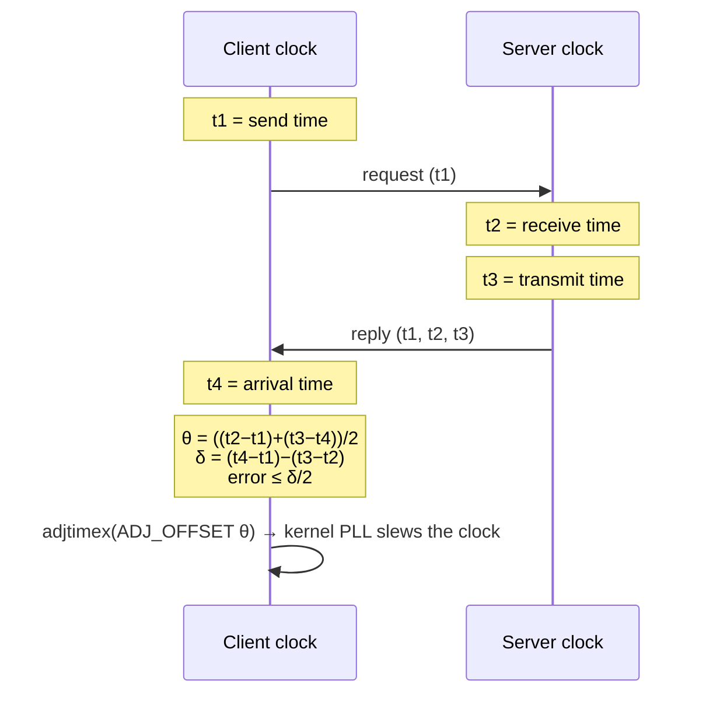

<div dir="rtl">

# ۰۳ — هماهنگ‌سازی ساعت فیزیکی: NTP، PTP و chrony

> ماژول ۰۶ · سیستم‌عامل توزیع‌شده و مجازی‌سازی · نسخه‌های ثابت: Linux **v6.18.63** و OpenBSD **`8cada8c`** · نسخهٔ انگلیسی: [`03-clock-sync-ntp-ptp.en.md`](03-clock-sync-ntp-ptp.en.md)

## واژه‌نامه

| اصطلاح | تعریف |
|---|---|
| **Drift / skew** | Drift خطای سرعت یک ساعت است (ppm، یعنی میکروثانیه در هر ثانیه). Skew یا offset اختلاف فعلی دو ساعت است. |
| **NTP** | پروتکل زمان شبکه: client/server روی UDP پورت ۱۲۳، چهار timestamp در هر تبادل، و serverها در **stratum**های مختلف. |
| **PTP (IEEE 1588)** | پروتکل زمان دقیق برای LAN که بسته‌ها را **در سخت‌افزار NIC** timestamp می‌زند؛ دقت زیر میکروثانیه. |
| **Slew در برابر step** | Slew: ساعت کمی تندتر یا کندتر کار کند تا offset صفر شود (زمان یکنوا می‌ماند). Step: پرش مستقیم به زمان جدید. |
| **`adjtimex(2)`** | system call لینوکس برای خواندن و تنظیم وضعیت NTP کرنل (offset، فرکانس، status). |
| **chrony** | پیاده‌سازی NTP در Ubuntu/RHEL (`chronyd`، `chronyc`)؛ ساعت‌های سخت‌افزاری PTP را هم تغذیه می‌کند. |

## ۱. خلاصه

- هر ساعت کوارتز drift دارد (ده‌ها ppm، یعنی چند ثانیه در روز)؛ پس ماشین‌ها باید مدام **offset** خود را نسبت به یک مرجع اندازه بگیرند و هم offset و هم **فرکانس** را اصلاح کنند.
- NTP مقدار offset را از چهار timestamp تخمین می‌زند: `θ = ((t2 − t1) + (t3 − t4)) / 2` و تأخیر رفت‌وبرگشت `δ = (t4 − t1) − (t3 − t2)`؛ offset واقعی فقط تا **±δ/2** معلوم است، چون عدم‌تقارن مسیر دیده نمی‌شود.
- اصلاح نرم کار کرنل است (PLL/FLL در `kernel/time/ntp.c` که از راه `adjtimex(2)` وارد آن می‌شویم)؛ اندازه‌گیری کار daemon است (chronyd، ntpd، systemd-timesyncd). PTP زدن timestamp را به NIC می‌برد تا jitter نرم‌افزاری حذف شود.

## ۲. توضیح مفصل

**وقتی ساعت منطقی داریم چرا هماهنگی فیزیکی؟** ساعت منطقی رویدادها را مرتب می‌کند، ولی lease، انقضای گواهی، هم‌بستگی logها، کدهای TOTP، timestampهای `make` و «commit wait» به سبک Spanner به زمان واقعی با **کران خطای معلوم** نیاز دارند.

**اعداد drift.** نوسان‌گر ۲۰ ppm در هر ثانیه ۲۰ میکروثانیه جلو یا عقب می‌رود، یعنی ۱٫۷ ثانیه در روز. کد NTP لینوکس اصلاح فرکانس تا ۵۰۰ ppm و اصلاح فاز (offset) تا ۰٫۵ ثانیه را می‌پذیرد:

`linux/include/linux/timex.h · MAXPHASE/MAXFREQ · v6.18.63` ([Elixir L135](https://elixir.bootlin.com/linux/v6.18.63/source/include/linux/timex.h#L135))

</div>

```c
  135  #define MAXPHASE 500000000L	/* max phase error (ns) */
  136  #define MAXFREQ 500000		/* max frequency error (ns/s) */
```

<div dir="rtl">

**یک تبادل NTP.** client زمان ارسال خود `t1` را در درخواست می‌نویسد؛ server با ساعت *خودش* `t2` (دریافت) و `t3` (ارسال) را ثبت می‌کند؛ client هنگام رسیدن پاسخ `t4` را ثبت می‌کند. اگر تأخیر شبکه در دو جهت یکسان باشد، ساعت server به این اندازه جلوتر است:

`θ = ((t2 − t1) + (t3 − t4)) / 2` و رفت‌وبرگشت شبکه `δ = (t4 − t1) − (t3 − t2)` است.

اگر مسیرها نامتقارن باشند (رفت ۱۰ و برگشت ۹۰ میلی‌ثانیه)، θ تا نصف اختلاف اشتباه است و هیچ اندازه‌گیری‌ای آن را نمی‌بیند. پس `δ/2` یک **کران خطای** قطعی است و clientهای خوب نمونه‌های با کمترین δ را ترجیح می‌دهند (الگوریتم Cristian در ۱۹۸۹ هم همین ایده را داشت).

**از نمونه تا ساعت.** daemon چند نمونه از چند server نگه می‌دارد، داده‌های پرت و «falseticker»ها را کنار می‌گذارد (اشتراک بازه‌ها به سبک Marzullo) و نتیجه را به یک حلقهٔ کنترلی می‌دهد. لینوکس یک phase-locked loop داخل کرنل دارد: فضای کاربر offset را با `ADJ_OFFSET` می‌دهد، کرنل ساعت را با نرخ محدود slew می‌کند و فرکانس (`freq`) را تخمین می‌زند. در مقابل `ADJ_SETOFFSET` ساعت را **step** می‌کند (هنگام بوت یا برای خطای بزرگ). step به عقب برنامه‌هایی را که مدت‌زمان را با `CLOCK_REALTIME` می‌سنجند خراب می‌کند؛ برای همین مدت‌زمان جایش روی `CLOCK_MONOTONIC` است (step نمی‌شود ولی slew می‌شود) یا `CLOCK_MONOTONIC_RAW` (هیچ‌کدام).

**Stratum.** stratum صفر مرجع است (GPS، ساعت اتمی)، stratum یک serverی است که به آن وصل است، stratum دو از stratum یک هماهنگ می‌شود و همین‌طور. stratum فاصله از مرجع است، نه کیفیت: یک server نزدیک با stratum سه و δ کم ممکن است از stratum یکِ آن سوی اقیانوس بهتر باشد.

**PTP.** در LAN خطای باقی‌مانده نرم‌افزاری است: تأخیر وقفه، زمان‌بندی، صف‌شدن در پشتهٔ شبکه. در IEEE 1588 فرستندهٔ اصلی (master) پیام `Sync` (و `Follow_Up` با زمان دقیق ارسال) می‌فرستد و گیرنده `Delay_Req`؛ همان جبر چهار timestamp به کار می‌رود، ولی timestampها را NIC می‌زند (`SO_TIMESTAMPING`، ساعت سخت‌افزاری PTP در `/dev/ptpN`). `ptp4l` ساعت NIC را تنظیم می‌کند و `phc2sys` (یا chrony با `refclock PHC`) آن را به ساعت سیستم منتقل می‌کند. دقت: با پشتیبانی سخت‌افزاری و switchهای آگاه از PTP از ده‌ها نانوثانیه تا حدود ۱ میکروثانیه؛ بدون آن بدتر.

**daemonها در Ubuntu 24.04.** imageهای desktop/server به‌طور پیش‌فرض `systemd-timesyncd` (یک client ساده از نوع SNTP) دارند؛ نصب `chrony` جایگزینش می‌کند. `chronyc tracking` مرجع، stratum، offset سیستم، فرکانس (ppm) و root delay/dispersion را نشان می‌دهد؛ `timedatectl timesync-status` معادل آن برای timesyncd است.

## ۳. نمودار

</div>



<div dir="rtl">

## ۴. مثال عملی: اندازه‌گیری θ و δ و خواندن وضعیت NTP کرنل

**(الف) چهار timestamp با دست.** یک client حداقلی SNTP: یک بستهٔ mode 3؛ timestampهای دریافت و ارسال server کلمه‌های ۸ تا ۱۱ پاسخ‌اند.

</div>

```python
# sntp.py: one SNTP exchange per sample; prints NTP offset/delay.
import socket, struct, sys, time
NTP_EPOCH = 2208988800  # seconds from 1900-01-01 to 1970-01-01
def to_unix(sec, frac): return sec - NTP_EPOCH + frac / 2**32
server = sys.argv[1] if len(sys.argv) > 1 else "pool.ntp.org"
s = socket.socket(socket.AF_INET, socket.SOCK_DGRAM); s.settimeout(3)
for i in range(3):
    pkt = bytearray(48); pkt[0] = (0 << 6) | (4 << 3) | 3   # LI=0, VN=4, mode=3 (client)
    t1 = time.time()
    s.sendto(pkt, (server, 123))
    data, _ = s.recvfrom(48)
    t4 = time.time()
    f = struct.unpack("!12I", data)
    t2 = to_unix(f[8], f[9])    # receive timestamp (server clock)
    t3 = to_unix(f[10], f[11])  # transmit timestamp (server clock)
    theta = ((t2 - t1) + (t3 - t4)) / 2
    delta = (t4 - t1) - (t3 - t2)
    print(f"sample {i}: stratum={data[1]} offset={theta*1000:+.3f} ms delay={delta*1000:.3f} ms "
          f"server-hold={(t3-t2)*1e6:.0f} us")
    time.sleep(1)
```

<div dir="rtl">

اجرای واقعی روی میزبان Windows 11 (Python 3)، تاریخ 2026-11-15:

</div>

```text
$ python sntp.py time.cloudflare.com
sample 0: stratum=3 offset=+506.309 ms delay=501.667 ms server-hold=41 us
sample 1: stratum=3 offset=+414.755 ms delay=182.547 ms server-hold=48 us
sample 2: stratum=3 offset=+420.371 ms delay=168.666 ms server-hold=74 us
$ python sntp.py time.windows.com
sample 0: stratum=4 offset=+505.973 ms delay=420.257 ms server-hold=2 us
sample 1: stratum=4 offset=+413.283 ms delay=216.256 ms server-hold=1 us
sample 2: stratum=4 offset=+438.908 ms delay=162.358 ms server-hold=1 us
```

<div dir="rtl">

چه چیزی نشان می‌دهد:

- **تأخیر بسیار زیاد است** (۱۶۰ تا ۵۰۰ میلی‌ثانیه) برای یک server نزدیک از نوع anycast: ترافیک این میزبان از یک مسیر تونلی کند می‌گذرد. با δ حدود ۱۶۵ میلی‌ثانیه، offset فقط تا ±۸۲ میلی‌ثانیه معلوم است.
- **offset همراه با delay تغییر می‌کند**: نمونهٔ ۰ در هر دو server بیشترین δ و بیشترین θ را دارد. این همان نشت عدم‌تقارن مسیر به θ است. یک daemon واقعی نمونهٔ ۲ (کمترین δ) را نگه می‌دارد و نمونهٔ ۰ را دور می‌اندازد.
- دو server مستقل برای نمونه‌های کم‌تأخیر روی حدود ۴۱۵+ تا ۴۴۰+ میلی‌ثانیه توافق دارند؛ پس ساعت این میزبان واقعاً حدود ۰٫۴ ثانیه عقب است.
- `t3 − t2` (مدت نگه‌داری در server) چند میکروثانیه است: تقریباً همهٔ δ مربوط به شبکه است.
- serverهای دیگر (`pool.ntp.org`، `time.google.com`) از این میزبان timeout دادند: گم شدن بستهٔ UDP عادی است و client باید تحملش کند.

**(ب) سمت کرنل.** اصلاحی که daemon می‌فرستد از اینجا وارد می‌شود:

`linux/kernel/time/time.c · SYSCALL_DEFINE1(adjtimex) · v6.18.63` ([Elixir L269](https://elixir.bootlin.com/linux/v6.18.63/source/kernel/time/time.c#L269))

</div>

```c
  269  SYSCALL_DEFINE1(adjtimex, struct __kernel_timex __user *, txc_p)
  270  {
  271  	struct __kernel_timex txc;		/* Local copy of parameter */
  272  	int ret;
  ...
  278  	if (copy_from_user(&txc, txc_p, sizeof(struct __kernel_timex)))
  279  		return -EFAULT;
  280  	ret = do_adjtimex(&txc);
  281  	return copy_to_user(txc_p, &txc, sizeof(struct __kernel_timex)) ? -EFAULT : ret;
  282  }
```

<div dir="rtl">

`linux/kernel/time/timekeeping.c · do_adjtimex() · v6.18.63` ([Elixir L2764](https://elixir.bootlin.com/linux/v6.18.63/source/kernel/time/timekeeping.c#L2764))

</div>

```c
 2764  int do_adjtimex(struct __kernel_timex *txc)
 2765  {
 2766  	struct adjtimex_result result = { };
 2767  	int ret;
 2768  
 2769  	ret = __do_adjtimex(&tk_core, txc, &result);
 2770  	if (ret < 0)
 2771  		return ret;
 2772  
 2773  	if (txc->modes & ADJ_SETOFFSET)
 2774  		audit_tk_injoffset(result.delta);
 2775  
 2776  	audit_ntp_log(&result.ad);
 2777  
 2778  	if (result.clock_set)
 2779  		clock_was_set(CLOCK_SET_WALL);
```

<div dir="rtl">

- **خط‌های ۲۷۸ تا ۲۸۱**: کپی به داخل، انجام کار، و کپی وضعیت (به‌روزشده) به بیرون. با `modes = 0` این فراخوانی فقط پرس‌وجو است: وضعیت ساعت را برمی‌گرداند و offset، freq و maxerror را پر می‌کند.
- **خط ۲۷۶۹**: `__do_adjtimex()` تغییر را روی timekeeper اصلی یعنی `tk_core` اعمال می‌کند (و PLL مربوط به NTP در `kernel/time/ntp.c` را صدا می‌زند).
- **خط‌های ۲۷۷۳ و ۲۷۷۴**: step (`ADJ_SETOFFSET`) جداگانه audit می‌شود؛ پرش ساعت از نظر امنیتی مهم است (timestamp لاگ‌ها، بررسی گواهی).
- **خط‌های ۲۷۷۸ و ۲۷۷۹**: اگر ساعت دیواری تنظیم شده باشد، `clock_was_set()` به hrtimerهای روی `CLOCK_REALTIME` می‌گوید زمان انقضایشان را دوباره بسنجند.

یک پرس‌وجوی فقط‌خواندنی (`adjtimex` با `modes = 0`، کامپایل با `gcc -Wall -Wextra -O2`)، اجرای واقعی در VM مربوط به WSL2 در Docker Desktop، کرنل `6.18.58.1-microsoft-standard-WSL2`:

</div>

```text
clock state     = 0 (TIME_OK)
status          = 0x0000  STA_UNSYNC=0 STA_PLL=0
offset          = 0 us
freq            = -5710 (ppm * 65536) = -0.087 ppm
maxerror        = 2005 us
esterror        = 0 us
tick            = 10000 us
```

<div dir="rtl">

`STA_PLL=0`: در WSL2 هیچ daemon مربوط به NTP حلقهٔ PLL کرنل را هدایت نمی‌کند (زمان مهمان از میزبان Hyper-V می‌آید)، پس offset صفر است و اصلاح فرکانس ناچیز. روی میزبانی که chronyd دارد، `STA_PLL` روشن است و `freq` چند ppm غیرصفر است. `freq` با ضریب ۲ به توان ۱۶ ذخیره می‌شود (`-5710 / 65536 = -0.087 ppm`). نمای `chronyc tracking` از همین مقادیر روی VM درس: UNVERIFIED (هنگام نوشتن این یادداشت VM آزمایشی در دسترس نبود؛ آنجا `chronyc tracking || timedatectl timesync-status` را اجرا کنید).

## ۵. حالت‌های مرزی و دام‌ها

- **اندازه‌گیری مدت‌زمان با `CLOCK_REALTIME` یا تفاضل `time.Now()` در حالی که ساعت step شده.** `time.Now()` در Go به همین دلیل یک قرائت monotonic هم با خودش دارد؛ در C باید `CLOCK_MONOTONIC` به کار ببرید.
- **مسیرهای نامتقارن** (ADSL، ماهواره، VPN، همین میزبان بالا): θ خطایی دارد که قابل اندازه‌گیری نیست. نمونهٔ بیشتر عدم‌تقارن ثابت را درست نمی‌کند.
- **ثانیهٔ کبیسه (leap second)**: NTP ساعت 23:59:60 را درج می‌کند (`STA_INS`)؛ بسیاری از مجموعه‌ها به‌جایش ثانیه را در چند ساعت «پخش» (smear) می‌کنند. مخلوط کردن serverهای smear و غیر smear تا ۰٫۵ ثانیه اختلاف می‌سازد.
- **VMها**: مهمانی که pause یا مهاجرت داده شده با offset بزرگ بیدار می‌شود؛ hypervisorها ساعت paravirtual می‌دهند (`kvm-clock`، صفحهٔ TSC در Hyper-V، `ptp_kvm`) و agent مهمان ساعت را step می‌کند.
- **«هماهنگ» ≠ «یک زمان»**: حتی NTP خوب روی WAN در حد میلی‌ثانیه است؛ هرگز با timestampهای ماشین‌های مختلف رویدادهای مرتبط علّی را مرتب نکنید: یادداشت ۰۲.
- **دعوای چند daemon** (chronyd + timesyncd + agent مهمان) که هر کدام `adjtimex` را صدا می‌زنند: نشانه‌اش offset نوسانی است.

## ۶. نکته‌های امتحانی

- offset: `θ = ((t2−t1)+(t3−t4))/2`؛ تأخیر: `δ = (t4−t1)−(t3−t2)`؛ کران خطا `±δ/2`؛ فرض مسیر متقارن.
- نمونهٔ با کمترین δ را بردارید؛ serverها را ترکیب کنید؛ falsetickerها را رد کنید.
- هم **فاز** (offset) و هم **فرکانس** (drift) را اصلاح کنید؛ معمولاً slew، و step فقط برای خطای بزرگ.
- لینوکس: `adjtimex(2)` ← `do_adjtimex()` ← `__do_adjtimex()` ← PLL مربوط به NTP؛ محدودیت‌ها MAXPHASE برابر ۰٫۵ ثانیه و MAXFREQ برابر ۵۰۰ ppm.
- `CLOCK_MONOTONIC` برای مدت‌زمان، `CLOCK_REALTIME` برای زمان دیواری.
- PTP: timestamp سخت‌افزاری در NIC، پیام‌های `Sync/Follow_Up/Delay_Req`، ابزار `ptp4l` + `phc2sys`، زیر میکروثانیه در LAN.
- stratum = فاصله از مرجع، نه دقت.

## ۷. پیوندها

- درس: [`../lesson.fa.md`](../lesson.fa.md) بخش ۴.۳ (هماهنگ‌سازی ساعت)
- آزمایش: [`../labs/01-lamport-vector-clocks/`](../labs/01-lamport-vector-clocks/) (چرا آزمایش رویدادها را با زمان منطقی مرتب می‌کند، نه فیزیکی)
- آزمون: [`../quiz.fa.md`](../quiz.fa.md) پرسش ۴ (محاسبهٔ θ و δ)
- قبلی / بعدی: [`02-lamport-vector-clocks.fa.md`](02-lamport-vector-clocks.fa.md) · [`04-distributed-deadlock-snapshots.fa.md`](04-distributed-deadlock-snapshots.fa.md)

</div>
