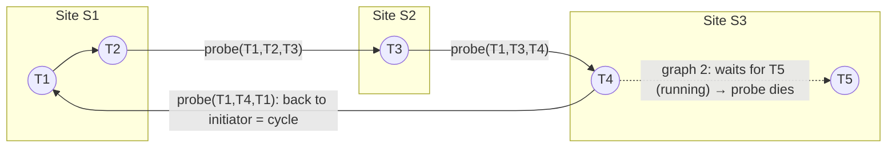

# 04 — Distributed deadlock and global snapshots

> Module 06 · Distributed OS & Virtualization · Pins: Linux **v6.18.63**, OpenBSD **`8cada8c`** · Farsi: [`04-distributed-deadlock-snapshots.fa.md`](04-distributed-deadlock-snapshots.fa.md)

## Glossary

| Term | Meaning |
|---|---|
| **Wait-for graph (WFG)** | Nodes = processes/transactions; edge `Ti → Tj` = Ti waits for a resource Tj holds. A cycle = deadlock (single-instance resources). |
| **Edge chasing** | Detection by forwarding a *probe* message along WFG edges (Chandy-Misra-Haas 1983). |
| **Phantom deadlock** | A "cycle" reported from inconsistent, partly stale information that never existed at one moment. |
| **Global snapshot** | A recorded state of every process plus every channel that *could* have existed at one instant. |
| **Consistent cut** | A cut where, if a receive is inside, its send is inside too. Equivalently, no event inside has a causal predecessor outside. |
| **Marker** | The control message of the Chandy-Lamport (1985) snapshot algorithm. |

## 1. Summary

- Deadlock is still a cycle in a wait-for graph, but in a distributed system **no node sees the whole graph**, and collecting it piece by piece can report cycles that never existed (phantom deadlocks).
- **Edge chasing** (Chandy-Misra-Haas) sends `probe(initiator, sender, receiver)` along wait-for edges; the probe returning to its initiator proves a cycle, with no global graph at all.
- The general tool is a **consistent global snapshot**: Chandy-Lamport records local states and in-flight messages using markers over FIFO channels; any stable property (deadlock, termination, lost token, garbage) can then be checked on the snapshot.

## 2. Detailed explanation

**From local to distributed.** On one machine, the kernel's lockdep keeps the whole lock-dependency graph and searches it before adding an edge (see §4). Across machines, transaction T1 on site S1 waits for T2 (also S1), which waits for T3 on S2, which waits for T4 on S3, which waits for T1. Each site sees only a chain, never the cycle.

**Three detection strategies.**

| Strategy | How | Problem |
|---|---|---|
| Centralized | Every site sends its local WFG to a coordinator, which looks for cycles | Single point of failure; snapshots of sites taken at different times → **phantom** cycles (an edge already removed at S1 is still in the copy) |
| Hierarchical | Sites grouped in a tree; each level detects cycles within its subtree | Better scaling; same consistency issue |
| Distributed (edge chasing) | Blocked process sends probes along its outgoing edges | Needs care with concurrent initiators and resolution (who aborts?) |

**Chandy-Misra-Haas (AND model).** When Ti blocks waiting for Tj, it sends `probe(i, i, j)`. A process Tk that receives `probe(i, s, k)`:

1. if `k == i` → deadlock: the probe came back.
2. if Tk is **not blocked** → discard (a running process breaks any chain).
3. if Tk is blocked and has not forwarded a probe for initiator i before → send `probe(i, k, m)` to every Tm that Tk waits for.

Only blocked processes forward; a process waiting on several resources (AND model: needs all of them) forwards to all. Correctness relies on the fact that a real deadlock is **stable**: once a cycle forms, all its members stay blocked, so the probe cannot be lost to a process that unblocks. Phantoms are still possible if a transaction aborts while its probe is in flight; real systems add timestamps/priorities so exactly one victim is chosen (e.g. abort the youngest initiator).

**Many databases just use timeouts.** A lock wait longer than X is treated as a deadlock and aborted. Cheap, no messages, but kills slow non-deadlocked transactions; Google Spanner uses wound-wait (older transactions wound younger ones) to *prevent* cycles instead.

**Snapshots.** Asking each node "what is your state?" at slightly different times gives a cut that may contain a receive without its send, or lose money that was in flight. Chandy & Lamport (1985), for FIFO channels:

- **Initiator**: record own state; send a *marker* on every outgoing channel.
- **On receiving a marker on channel c**:
  - first marker seen → record own state, mark channel c as *empty*, send markers on all outgoing channels, start recording every other incoming channel;
  - otherwise → stop recording c; its recorded state = the messages received on c since this process recorded its own state.
- Done when every process has received a marker on every incoming channel.

FIFO matters: a marker separates "sent before the sender's snapshot" (must be recorded as in flight) from "sent after" (must not be). The recorded global state may never have existed at any real instant, but it is **reachable** from the start state and the final state is reachable from it: good enough for stable properties.

**Consistent cut with vector clocks.** A cut with frontier events `e_0 … e_{N-1}` (one per process) is consistent iff for all i, j: `V(e_i)[i] ≥ V(e_j)[i]`: no process has seen more of process i than process i itself has done. This links note 02 to snapshots.

## 3. Diagram



## 4. Worked example: lockdep's cycle check, edge chasing, and a snapshot that adds up

**(a) The local version in the kernel.** Before lockdep records a new dependency `prev → next`, it proves that the existing graph has no path from `next` back to `prev`:

`linux/kernel/locking/lockdep.c · check_noncircular() · v6.18.63` ([Elixir L2176](https://elixir.bootlin.com/linux/v6.18.63/source/kernel/locking/lockdep.c#L2176))

```c
 2170   * Prove that the dependency graph starting at <src> can not
 2171   * lead to <target>. If it can, there is a circle when adding
 2172   * <target> -> <src> dependency.
 ...
 2176  static noinline enum bfs_result
 2177  check_noncircular(struct held_lock *src, struct held_lock *target,
 2178  		  struct lock_trace **const trace)
 2179  {
 ...
 2184  	bfs_init_root(&src_entry, src);
 2185  
 2186  	debug_atomic_inc(nr_cyclic_checks);
 2187  
 2188  	ret = check_path(target, &src_entry, hlock_conflict, NULL, &target_entry);
 2189  
 2190  	if (unlikely(ret == BFS_RMATCH)) {
```

- **L2184–2188**: a breadth-first search from `src` over the global dependency graph, looking for `target`. Finding it (`BFS_RMATCH`, L2190) means the new edge would close a cycle: lockdep reports a *possible* deadlock even if it never happened.
- This only works because one kernel owns the whole graph, in one address space, under one lock. That is exactly what a distributed system lacks, and why it needs probes or snapshots instead.

**(b) Edge chasing on the diagram's graph.** A 45-line Go simulation of the CMH rules above (sites S1–S3; graph 1 has the cycle, graph 2 replaces `T4 → T1` with `T4 → T5` where T5 is running). Real run, `golang:1.22` container on the host, 2026-11-15:

```text
== graph 1: T1 is blocked, starts detection
probe(T1,T1,T2) S1->S1 local
probe(T1,T2,T3) S1->S2 remote
probe(T1,T3,T4) S2->S3 remote
probe(T1,T4,T1) S3->S1 remote
result: deadlock=true after 4 probes
== graph 2: T1 is blocked, starts detection
probe(T1,T1,T2) S1->S1 local
probe(T1,T2,T3) S1->S2 remote
probe(T1,T3,T4) S2->S3 remote
probe(T1,T4,T5) S3->S3 local
result: deadlock=false after 4 probes
```

Cost: one probe per edge of the cycle (here 4, three of them network messages). In graph 2 the probe reaches T5, which is not blocked, and dies: no false alarm, no coordinator.

**(c) Chandy-Lamport over Go channels.** Three banks start with 100 each and keep sending random transfers over buffered (FIFO) channels; P0 initiates a snapshot. The marker rule, from the program:

```go
case m := <-p.in[k]:
	if m.marker {
		if !p.recorded {
			p.record(ps) // channel k is recorded as empty
		}
		p.open[k] = false
		p.markers++
	} else {
		p.balance += m.amount
		if p.recorded && p.open[k] {
			p.chanRec[k] = append(p.chanRec[k], m.amount)
		}
	}
```

`record()` saves `p.balance` and sends a marker on every outgoing channel. Real run (same container, 2026-11-15):

```text
P0 initiates snapshot
P0 recorded state=133  recorded in-flight to P0=[[] [14] []] (sum 14)
P1 recorded state= 13  recorded in-flight to P1=[[] [] [6]] (sum 6)
P2 recorded state=134  recorded in-flight to P2=[[] [] []] (sum 0)
snapshot total = 300 (expected 300)
```

133 + 13 + 134 = 280 in the local states; the missing 20 were **on the wire** at the cut: 14 on channel P1→P0 and 6 on P2→P1. Without channel recording, a naive "ask everyone for their balance" would have reported 280 and "lost" money.

## 5. Edge cases & pitfalls

- **Phantom deadlocks** come from combining local graphs taken at different times. Edge chasing avoids most of them, but a transaction that aborts while its probe travels can still trigger one: resolution must re-check.
- **Two initiators, one cycle**: both detect the deadlock; without a rule (abort the highest/lowest id, or youngest timestamp) both abort and work is wasted.
- **OR model** (needs *any one* of several resources, e.g. a `select` on many channels): a cycle is not enough; detection needs a *knot*. CMH has a separate diffusing-computation variant for it.
- **Non-FIFO channels** break plain Chandy-Lamport (a post-snapshot message can overtake the marker). Use Lai-Yang (colour every message) or piggyback snapshot ids.
- **Snapshots are not free**: every channel gets a marker (O(E) messages) and channel recording can buffer a lot under load.
- **A snapshot answers stable questions only.** "Is the system deadlocked?" yes; "was queue length > 10 at some moment?" not reliably.
- **Timeout-based "deadlock detection"** cannot distinguish deadlock from a slow holder; that is fine for databases, wrong for proofs.

## 6. Exam-style key points

- Distributed deadlock = cycle in a WFG that no single site sees. Strategies: centralized, hierarchical, distributed (edge chasing), or prevention (wait-die / wound-wait), or timeouts.
- CMH probe `(initiator, sender, receiver)`; forwarded only by blocked processes; deadlock iff it returns to the initiator; cost ≈ one message per edge.
- Phantom deadlock = cycle built from inconsistent views.
- Chandy-Lamport: record state, send markers; channel state = messages received after own record and before that channel's marker; requires FIFO.
- Consistent cut: every receive inside has its send inside; vector test `V(e_i)[i] ≥ V(e_j)[i]`.
- Snapshot state is reachable, not necessarily "real"; use it for stable properties.
- Single-machine analogue: lockdep `check_noncircular()` (BFS over the global lock graph).

## 7. Links

- Lesson: [`../lesson.en.md`](../lesson.en.md) §4.4 (distributed deadlock & snapshots)
- Lab: [`../labs/01-lamport-vector-clocks/`](../labs/01-lamport-vector-clocks/) (vector clocks used here to test consistency of a cut)
- Quiz: [`../quiz.en.md`](../quiz.en.md) Q5 (snapshot / phantom deadlock), Q15 (design an edge-chasing detector)
- Related: [`02-lamport-vector-clocks.en.md`](02-lamport-vector-clocks.en.md) · next [`05-fault-tolerance-replication.en.md`](05-fault-tolerance-replication.en.md)
