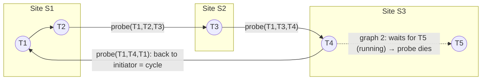

<div dir="rtl">

# ۰۴ — بن‌بست توزیع‌شده و snapshot سراسری

> ماژول ۰۶ · سیستم‌عامل توزیع‌شده و مجازی‌سازی · نسخه‌های ثابت: Linux **v6.18.63** و OpenBSD **`8cada8c`** · نسخهٔ انگلیسی: [`04-distributed-deadlock-snapshots.en.md`](04-distributed-deadlock-snapshots.en.md)

## واژه‌نامه

| اصطلاح | تعریف |
|---|---|
| **Wait-for graph (WFG)** | گره‌ها پردازه یا تراکنش‌اند؛ یال `Ti → Tj` یعنی Ti منتظر منبعی است که دست Tj است. چرخه = بن‌بست (برای منابع تک‌نمونه‌ای). |
| **Edge chasing** | تشخیص با فرستادن پیام *probe* در امتداد یال‌های WFG (Chandy-Misra-Haas، ۱۹۸۳). |
| **Phantom deadlock** | «چرخه‌ای» که از اطلاعات ناسازگار و تا حدی کهنه گزارش می‌شود و هیچ‌وقت در یک لحظه وجود نداشته است. |
| **Global snapshot** | وضعیت ثبت‌شدهٔ همهٔ پردازه‌ها و همهٔ کانال‌ها که *می‌توانسته* در یک لحظه وجود داشته باشد. |
| **Consistent cut** | برشی که اگر یک دریافت داخلش باشد، ارسالش هم داخلش باشد؛ یعنی هیچ رویداد داخل برش پیش‌نیاز علّی بیرون از برش ندارد. |
| **Marker** | پیام کنترلی الگوریتم snapshot مربوط به Chandy-Lamport (۱۹۸۵). |

## ۱. خلاصه

- بن‌بست هنوز همان چرخه در wait-for graph است، ولی در سیستم توزیع‌شده **هیچ گره‌ای کل گراف را نمی‌بیند** و جمع‌کردن تکه‌به‌تکهٔ آن ممکن است چرخه‌هایی را گزارش کند که هرگز نبوده‌اند (phantom deadlock).
- **Edge chasing** (Chandy-Misra-Haas) پیام `probe(initiator, sender, receiver)` را در امتداد یال‌های انتظار می‌فرستد؛ برگشتن probe به آغازگر چرخه را ثابت می‌کند، بدون هیچ گراف سراسری.
- ابزار عمومی‌تر **snapshot سراسری سازگار** است: Chandy-Lamport با markerها روی کانال‌های FIFO وضعیت‌های محلی و پیام‌های در راه را ثبت می‌کند؛ سپس هر ویژگی پایدار (بن‌بست، پایان، گم شدن token، زباله) روی snapshot قابل بررسی است.

## ۲. توضیح مفصل

**از محلی به توزیع‌شده.** روی یک ماشین، lockdep کرنل کل گراف وابستگی قفل‌ها را نگه می‌دارد و قبل از افزودن هر یال آن را جستجو می‌کند (بخش ۴). بین ماشین‌ها: تراکنش T1 در سایت S1 منتظر T2 (هم در S1) است، T2 منتظر T3 در S2، T3 منتظر T4 در S3، و T4 منتظر T1. هر سایت فقط یک زنجیر می‌بیند، نه چرخه را.

**سه راهبرد تشخیص.**

| راهبرد | چطور | مشکل |
|---|---|---|
| متمرکز | هر سایت WFG محلی‌اش را برای یک هماهنگ‌کننده می‌فرستد که دنبال چرخه می‌گردد | نقطهٔ شکست واحد؛ تصویر سایت‌ها در زمان‌های مختلف گرفته می‌شود ← چرخه‌های **phantom** (یالی که در S1 حذف شده هنوز در کپی هست) |
| سلسله‌مراتبی | سایت‌ها در یک درخت گروه می‌شوند و هر سطح چرخه‌های زیردرخت خودش را پیدا می‌کند | مقیاس‌پذیری بهتر؛ همان مشکل سازگاری |
| توزیع‌شده (edge chasing) | پردازهٔ مسدود probe را روی یال‌های خروجی‌اش می‌فرستد | باید آغازگرهای همزمان و نحوهٔ حل (چه کسی abort شود) را مدیریت کرد |

**Chandy-Misra-Haas (مدل AND).** وقتی Ti برای Tj مسدود می‌شود، `probe(i, i, j)` را می‌فرستد. پردازهٔ Tk که `probe(i, s, k)` را دریافت می‌کند:

۱. اگر `k == i` ← بن‌بست: probe برگشته است.
۲. اگر Tk **مسدود نیست** ← دور ریختن (پردازهٔ در حال اجرا هر زنجیری را می‌شکند).
۳. اگر Tk مسدود است و قبلاً برای آغازگر i probe نفرستاده ← به هر Tm که Tk منتظرش است `probe(i, k, m)` بفرست.

فقط پردازه‌های مسدود probe را جلو می‌برند؛ پردازه‌ای که منتظر چند منبع است (مدل AND: همه را لازم دارد) به همه می‌فرستد. درستی الگوریتم بر این تکیه دارد که بن‌بست واقعی **پایدار** است: وقتی چرخه شکل بگیرد همهٔ اعضایش مسدود می‌مانند، پس probe به پردازه‌ای که آزاد شده نمی‌رسد که گم شود. phantom هنوز ممکن است اگر تراکنشی وسط راه probe خودش abort شود؛ سیستم‌های واقعی timestamp یا اولویت اضافه می‌کنند تا دقیقاً یک قربانی انتخاب شود (مثلاً جوان‌ترین آغازگر abort شود).

**بسیاری از پایگاه‌داده‌ها فقط timeout می‌گذارند.** انتظار قفل بیشتر از X بن‌بست حساب و abort می‌شود. ارزان است و پیامی نمی‌خواهد، ولی تراکنش‌های کند بی‌گناه را هم می‌کشد. Google Spanner به‌جای تشخیص با wound-wait از چرخه *جلوگیری* می‌کند (تراکنش قدیمی‌تر جوان‌تر را زخمی و abort می‌کند).

**Snapshot.** اگر در زمان‌های کمی متفاوت از هر گره بپرسیم «وضعیتت چیست؟»، برشی می‌گیریم که ممکن است یک دریافت را بدون ارسالش داشته باشد، یا پولی را که در راه بوده گم کند. الگوریتم Chandy و Lamport (۱۹۸۵) برای کانال‌های FIFO:

- **آغازگر**: وضعیت خودش را ثبت می‌کند و روی هر کانال خروجی یک *marker* می‌فرستد.
- **با دریافت marker روی کانال c**:
  - اگر اولین marker باشد ← وضعیت خودش را ثبت می‌کند، کانال c را *خالی* ثبت می‌کند، روی همهٔ کانال‌های خروجی marker می‌فرستد و ثبت بقیهٔ کانال‌های ورودی را شروع می‌کند؛
  - در غیر این صورت ← ثبت c را متوقف می‌کند؛ وضعیت c = پیام‌هایی که از لحظهٔ ثبت وضعیت خودش تا این marker روی c رسیده‌اند.
- کار وقتی تمام است که هر پردازه روی همهٔ کانال‌های ورودی‌اش marker گرفته باشد.

FIFO مهم است: marker پیام‌های «ارسال‌شده قبل از snapshot فرستنده» (که باید در راه ثبت شوند) را از «ارسال‌شده بعد از آن» (که نباید) جدا می‌کند. وضعیت سراسری ثبت‌شده شاید در هیچ لحظهٔ واقعی وجود نداشته، ولی از وضعیت شروع **قابل‌دسترسی** است و وضعیت پایانی هم از آن قابل‌دسترسی است؛ برای ویژگی‌های پایدار همین کافی است.

**برش سازگار با ساعت برداری.** برشی با رویدادهای مرزی `e_0 … e_{N-1}` (یکی برای هر پردازه) سازگار است اگر و فقط اگر برای همهٔ i و j داشته باشیم `V(e_i)[i] ≥ V(e_j)[i]`؛ یعنی هیچ پردازه‌ای از پردازهٔ i بیشتر از کاری که خود i کرده ندیده باشد. این همان پل یادداشت ۰۲ به snapshot است.

## ۳. نمودار

</div>



<div dir="rtl">

## ۴. مثال عملی: بررسی چرخه در lockdep، edge chasing و snapshotی که جمعش درست درمی‌آید

**(الف) نسخهٔ محلی در کرنل.** lockdep قبل از ثبت یک وابستگی جدید `prev → next` ثابت می‌کند که در گراف فعلی مسیری از `next` به `prev` وجود ندارد:

`linux/kernel/locking/lockdep.c · check_noncircular() · v6.18.63` ([Elixir L2176](https://elixir.bootlin.com/linux/v6.18.63/source/kernel/locking/lockdep.c#L2176))

</div>

```c
 2170   * Prove that the dependency graph starting at <src> can not
 2171   * lead to <target>. If it can, there is a circle when adding
 2172   * <target> -> <src> dependency.
 ...
 2176  static noinline enum bfs_result
 2177  check_noncircular(struct held_lock *src, struct held_lock *target,
 2178  		  struct lock_trace **const trace)
 2179  {
 ...
 2184  	bfs_init_root(&src_entry, src);
 2185  
 2186  	debug_atomic_inc(nr_cyclic_checks);
 2187  
 2188  	ret = check_path(target, &src_entry, hlock_conflict, NULL, &target_entry);
 2189  
 2190  	if (unlikely(ret == BFS_RMATCH)) {
```

<div dir="rtl">

- **خط‌های ۲۱۸۴ تا ۲۱۸۸**: جستجوی سطح‌اول (BFS) از `src` روی گراف وابستگی سراسری برای پیدا کردن `target`. پیدا شدنش (`BFS_RMATCH`، خط ۲۱۹۰) یعنی یال جدید چرخه را می‌بندد: lockdep بن‌بست *ممکن* را گزارش می‌کند، حتی اگر هرگز رخ نداده باشد.
- این فقط به این دلیل کار می‌کند که یک کرنل کل گراف را در یک فضای آدرس و زیر یک قفل دارد. سیستم توزیع‌شده دقیقاً همین را ندارد و برای همین به probe یا snapshot نیاز دارد.

**(ب) Edge chasing روی گراف نمودار.** یک شبیه‌سازی ۴۵ خطی Go از قواعد CMH بالا (سایت‌های S1 تا S3؛ گراف ۱ چرخه دارد، در گراف ۲ یال `T4 → T1` با `T4 → T5` عوض شده که T5 در حال اجراست). اجرای واقعی در container با image `golang:1.22` روی میزبان، 2026-11-15:

</div>

```text
== graph 1: T1 is blocked, starts detection
probe(T1,T1,T2) S1->S1 local
probe(T1,T2,T3) S1->S2 remote
probe(T1,T3,T4) S2->S3 remote
probe(T1,T4,T1) S3->S1 remote
result: deadlock=true after 4 probes
== graph 2: T1 is blocked, starts detection
probe(T1,T1,T2) S1->S1 local
probe(T1,T2,T3) S1->S2 remote
probe(T1,T3,T4) S2->S3 remote
probe(T1,T4,T5) S3->S3 local
result: deadlock=false after 4 probes
```

<div dir="rtl">

هزینه: یک probe برای هر یال چرخه (اینجا ۴ تا که ۳ تایشان پیام شبکه‌اند). در گراف ۲ probe به T5 می‌رسد که مسدود نیست و از بین می‌رود: نه هشدار اشتباه، نه هماهنگ‌کننده.

**(ج) Chandy-Lamport روی کانال‌های Go.** سه بانک هر کدام با ۱۰۰ شروع می‌کنند و مدام انتقال‌های تصادفی روی کانال‌های بافردار (FIFO) می‌فرستند؛ P0 snapshot را آغاز می‌کند. قاعدهٔ marker در برنامه:

</div>

```go
case m := <-p.in[k]:
	if m.marker {
		if !p.recorded {
			p.record(ps) // channel k is recorded as empty
		}
		p.open[k] = false
		p.markers++
	} else {
		p.balance += m.amount
		if p.recorded && p.open[k] {
			p.chanRec[k] = append(p.chanRec[k], m.amount)
		}
	}
```

<div dir="rtl">

تابع `record()` مقدار `p.balance` را ذخیره می‌کند و روی هر کانال خروجی marker می‌فرستد. اجرای واقعی (همان container، 2026-11-15):

</div>

```text
P0 initiates snapshot
P0 recorded state=133  recorded in-flight to P0=[[] [14] []] (sum 14)
P1 recorded state= 13  recorded in-flight to P1=[[] [] [6]] (sum 6)
P2 recorded state=134  recorded in-flight to P2=[[] [] []] (sum 0)
snapshot total = 300 (expected 300)
```

<div dir="rtl">

جمع وضعیت‌های محلی ۱۳۳ + ۱۳ + ۱۳۴ = ۲۸۰ است؛ ۲۰ تای باقی‌مانده در لحظهٔ برش **روی سیم** بودند: ۱۴ روی کانال P1→P0 و ۶ روی P2→P1. بدون ثبت کانال‌ها، روش سادهٔ «از همه موجودی‌شان را بپرس» عدد ۲۸۰ را گزارش می‌کرد و پول «گم» می‌شد.

## ۵. حالت‌های مرزی و دام‌ها

- **Phantom deadlock** از ترکیب گراف‌های محلی که در زمان‌های مختلف گرفته شده‌اند می‌آید. edge chasing بیشترشان را حذف می‌کند، ولی تراکنشی که در حین سفر probe خودش abort شود هنوز می‌تواند یکی بسازد؛ مرحلهٔ حل باید دوباره بررسی کند.
- **دو آغازگر، یک چرخه**: هر دو بن‌بست را پیدا می‌کنند؛ بدون قاعده (abort بزرگ‌ترین یا کوچک‌ترین id، یا جوان‌ترین timestamp) هر دو abort می‌شوند و کار هدر می‌رود.
- **مدل OR** (به *یکی از* چند منبع نیاز است، مثل `select` روی چند کانال): چرخه کافی نیست؛ باید *knot* پیدا شود. CMH برای آن نسخهٔ جداگانه‌ای بر پایهٔ diffusing computation دارد.
- **کانال‌های غیر FIFO** الگوریتم سادهٔ Chandy-Lamport را می‌شکنند (پیام بعد از snapshot ممکن است از marker جلو بزند). از Lai-Yang (رنگ‌کردن هر پیام) یا شناسهٔ snapshot روی پیام‌ها استفاده کنید.
- **snapshot رایگان نیست**: هر کانال یک marker می‌گیرد (O(E) پیام) و ثبت کانال‌ها زیر بار ممکن است حجم زیادی بافر کند.
- **snapshot فقط به پرسش‌های پایدار پاسخ می‌دهد.** «آیا سیستم در بن‌بست است؟» بله؛ «آیا طول صف در لحظه‌ای بیش از ۱۰ بود؟» نه با اطمینان.
- **«تشخیص بن‌بست» با timeout** بن‌بست را از نگه‌دارندهٔ کند تشخیص نمی‌دهد؛ برای پایگاه‌داده قابل‌قبول، برای اثبات نادرست.

## ۶. نکته‌های امتحانی

- بن‌بست توزیع‌شده = چرخه در WFG که هیچ سایتی به‌تنهایی آن را نمی‌بیند. راهبردها: متمرکز، سلسله‌مراتبی، توزیع‌شده (edge chasing)، پیشگیری (wait-die / wound-wait)، یا timeout.
- probe در CMH به شکل `(initiator, sender, receiver)`؛ فقط پردازه‌های مسدود جلویش می‌برند؛ بن‌بست اگر و فقط اگر به آغازگر برگردد؛ هزینه تقریباً یک پیام برای هر یال.
- Phantom deadlock = چرخهٔ ساخته‌شده از دیدهای ناسازگار.
- Chandy-Lamport: ثبت وضعیت و فرستادن marker؛ وضعیت کانال = پیام‌هایی که بعد از ثبت خود و قبل از marker آن کانال رسیده‌اند؛ به FIFO نیاز دارد.
- برش سازگار: هر دریافت داخل برش ارسالش هم داخل است؛ آزمون برداری `V(e_i)[i] ≥ V(e_j)[i]`.
- وضعیت snapshot قابل‌دسترسی است، نه لزوماً «واقعی»؛ برای ویژگی‌های پایدار به کار می‌رود.
- معادل تک‌ماشینی: `check_noncircular()` در lockdep (BFS روی گراف سراسری قفل‌ها).

## ۷. پیوندها

- درس: [`../lesson.fa.md`](../lesson.fa.md) بخش ۴.۴ (بن‌بست توزیع‌شده و snapshot)
- آزمایش: [`../labs/01-lamport-vector-clocks/`](../labs/01-lamport-vector-clocks/) (ساعت برداری که اینجا برای آزمون سازگاری برش به کار رفت)
- آزمون: [`../quiz.fa.md`](../quiz.fa.md) پرسش ۵ (snapshot / phantom deadlock)، پرسش ۱۵ (طراحی تشخیص‌دهندهٔ edge chasing)
- مرتبط: [`02-lamport-vector-clocks.fa.md`](02-lamport-vector-clocks.fa.md) · بعدی [`05-fault-tolerance-replication.fa.md`](05-fault-tolerance-replication.fa.md)

</div>
