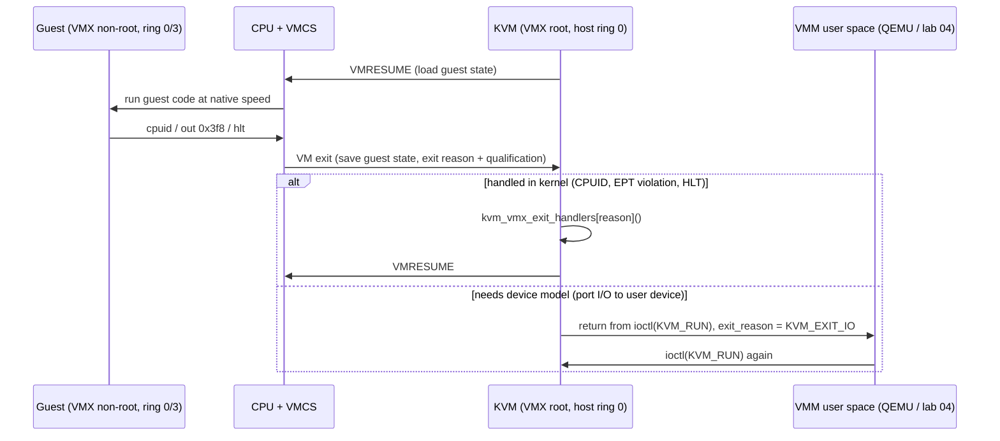

# 06 — Hypervisors: trap-and-emulate, VT-x, EPT

> Module 06 · Distributed OS & Virtualization · pins: Linux **v6.18.63**, OpenBSD **`8cada8c`** · **ARCH-SPECIFIC (x86-64, Intel VT-x)** · Farsi: [`06-hypervisors-vtx-ept.fa.md`](06-hypervisors-vtx-ept.fa.md)

## Glossary

| Term | Meaning |
|---|---|
| **Hypervisor / VMM** | Software that runs guest operating systems and keeps control of the real hardware. |
| **Sensitive instruction** | An instruction that reads or changes machine state the VMM must control (CR3, interrupt flag, I/O ports). |
| **Privileged instruction** | An instruction that traps when executed outside the most privileged mode. |
| **VMX root / non-root** | VT-x CPU modes: the hypervisor runs in root mode, the guest in non-root mode (with its own rings 0–3). |
| **VMCS** | Virtual Machine Control Structure: per-vCPU memory block holding guest state, host state, and "which events cause an exit". |
| **VM exit / VM entry** | Hardware switch non-root → root (exit) and root → non-root (entry, `VMLAUNCH`/`VMRESUME`). |
| **EPT** | Extended Page Tables: a second, hypervisor-owned page table that maps guest-physical to host-physical addresses. |
| **Shadow page tables** | Pre-EPT technique: the VMM builds the guest-virtual → host-physical tables itself and keeps them in sync. |

## 1. Summary

- A guest kernel believes it owns the CPU; the hypervisor makes that belief safe by forcing every *sensitive* operation to **trap** to it.
- Classic x86 broke the Popek–Goldberg condition (some sensitive instructions did not trap), so VMware used binary translation and Xen used paravirtualization until **VT-x** added a new mode in which the hardware traps for us.
- Memory gets a second translation layer (**EPT**); a TLB miss can then cost up to **24** memory references instead of 4. Exits are the price of virtualization, so the number and cost of exits is what you measure (Lab 05).

## 2. Detailed explanation

### 2.1 Intuition: the guest kernel is a user program that thinks it is a kernel

Run a guest kernel as an ordinary process on the host: its normal instructions (`add`, `mov`, loads and stores to its own memory) run at full speed on the real CPU. Problems start only when it does something that affects the whole machine: loading `CR3`, disabling interrupts with `cli`, writing to an I/O port, executing `hlt`. If those executed for real, the guest would take over the host. If the CPU *traps* them, the hypervisor can **emulate** them on the guest's virtual state and resume the guest. That is **trap-and-emulate**.

### 2.2 Popek & Goldberg (1974)

Popek and Goldberg ("Formal Requirements for Virtualizable Third Generation Architectures", CACM 1974) classify instructions:

- **privileged**: trap if executed in user mode;
- **sensitive**: control-sensitive (change resources: `CR3`, interrupt state) or behavior-sensitive (result depends on the mode or location).

**Theorem:** an efficient VMM can be built if **every sensitive instruction is privileged**. Then running the guest deprivileged (ring 3) makes every dangerous instruction trap.

Classic 32-bit x86 failed this test. Robin & Irvine (USENIX Security 2000) counted **17 sensitive, unprivileged instructions**. The textbook example is `popf`: in ring 3 it silently ignores the interrupt-flag bit instead of trapping, so a deprivileged guest kernel that does `popf` to re-enable interrupts gets no trap and the VMM never learns about it. `sgdt`/`sidt`/`smsw` let ring 3 read privileged state without trapping (they reveal the *host's* tables).

### 2.3 Three ways around it

| Technique | Idea | Example | Cost |
|---|---|---|---|
| **Binary translation** | Scan guest kernel code before running it, rewrite the bad instructions into calls to the VMM | VMware Workstation (1999) | translator complexity; translated-code cache |
| **Paravirtualization** | Change the guest kernel source: replace sensitive operations with explicit **hypercalls** | Xen (2003), Linux `pv_ops` | needs a modified guest |
| **Hardware assist** | Add a new CPU mode where sensitive operations exit to the VMM by configuration | Intel VT-x (2005), AMD-V (2006) | each exit costs hundreds to thousands of cycles |

Modern KVM uses hardware assist and still uses paravirtual pieces where they help (virtio devices, kvmclock, PV TLB flush).

### 2.4 VT-x: root and non-root mode

VT-x does not add a "ring −1"; it adds an orthogonal pair of modes. The guest runs in **VMX non-root mode** with its normal rings 0–3, so a guest kernel really runs in ring 0 and `popf` behaves correctly. The hypervisor runs in **VMX root mode**.

The **VMCS** (one per vCPU) holds:

- the **guest-state area** (RIP, RSP, CR0/CR3/CR4, segment registers…), loaded on entry and saved on exit;
- the **host-state area**, loaded on exit (where the hypervisor resumes);
- **execution controls**: which events cause an exit (I/O bitmap, MSR bitmap, "exit on HLT", "exit on CR3 load"…);
- **exit information**: exit reason and *exit qualification* (e.g. for I/O: port, size, direction).

Some instructions always exit (`CPUID`, `INVD`, `VMCALL`); others exit only if a control bit says so (`HLT`, `IN/OUT`, `RDMSR`). The hypervisor's main loop is therefore: VM entry → guest runs → VM exit → read the exit reason → dispatch to a handler → VM entry. In Linux that dispatch is a table indexed by the exit reason (§4).

### 2.5 Memory: shadow page tables vs EPT

The guest has its own page tables: **guest-virtual (GVA) → guest-physical (GPA)**. GPA is not real memory; the host decides **GPA → host-physical (HPA)**.

- **Shadow page tables** (pre-2008): the VMM write-protects the guest's page tables, traps every change, and maintains a combined GVA → HPA table that the real CR3 points to. Correct but exit-heavy: every guest page-table write and every guest context switch (CR3 load) exits.
- **EPT** (Intel, Nehalem 2008; AMD calls it NPT/RVI): the hardware walks **both** tables. The guest changes its own tables freely and loads CR3 without exiting. An access whose GPA has no EPT mapping causes an **EPT violation** exit, which KVM handles like a page fault on the host side.

**Cost of a two-dimensional walk.** With an *n*-level guest table and an *m*-level EPT, each of the *n* guest entries is itself a guest-physical address that needs an *m*-step EPT walk plus the read of the entry, and the final GPA needs one more EPT walk:
n·(m+1) + m = (n+1)(m+1) − 1. For n = m = 4: 4·5 + 4 = **24** memory references, versus 4 natively. This is why large pages (2 MiB/1 GiB) in the EPT and a high TLB hit rate matter so much in VMs.

### 2.6 What still exits

Even with VT-x + EPT, the guest exits for: `CPUID` (always), I/O port and MMIO accesses to emulated devices, `HLT` (idle), some MSR accesses, external interrupts (configurable), EPT violations, and interrupt-window events. Each exit costs a full context save/restore of the VMCS state plus whatever the handler does. Reducing exits (virtio, posted interrupts, APICv, halt polling) is the main theme of hypervisor performance work.

## 3. Diagram



## 4. Worked example

### 4.1 Real source: the exit-reason dispatch table

`linux/arch/x86/kvm/vmx/vmx.c · kvm_vmx_exit_handlers[] · v6.18.63` ([Elixir L6092](https://elixir.bootlin.com/linux/v6.18.63/source/arch/x86/kvm/vmx/vmx.c#L6092))

```c
static int (*kvm_vmx_exit_handlers[])(struct kvm_vcpu *vcpu) = {
	[EXIT_REASON_EXCEPTION_NMI]           = handle_exception_nmi,
	[EXIT_REASON_EXTERNAL_INTERRUPT]      = handle_external_interrupt,
	[EXIT_REASON_TRIPLE_FAULT]            = handle_triple_fault,
	[EXIT_REASON_NMI_WINDOW]	      = handle_nmi_window,
	[EXIT_REASON_IO_INSTRUCTION]          = handle_io,
	[EXIT_REASON_CR_ACCESS]               = handle_cr,
	[EXIT_REASON_DR_ACCESS]               = handle_dr,
	[EXIT_REASON_CPUID]                   = kvm_emulate_cpuid,
	[EXIT_REASON_MSR_READ]                = kvm_emulate_rdmsr,
	[EXIT_REASON_MSR_WRITE]               = kvm_emulate_wrmsr,
	[EXIT_REASON_INTERRUPT_WINDOW]        = handle_interrupt_window,
	[EXIT_REASON_HLT]                     = kvm_emulate_halt,
	[EXIT_REASON_INVD]		      = kvm_emulate_invd,
	[EXIT_REASON_INVLPG]		      = handle_invlpg,
	[EXIT_REASON_RDPMC]                   = kvm_emulate_rdpmc,
```

- The array index is the **hardware** exit reason the CPU wrote into the VMCS; the value is KVM's handler. One exit = one table lookup + one handler.
- `EXIT_REASON_CPUID → kvm_emulate_cpuid`: CPUID always exits; KVM answers from the CPUID table that user space configured, so the guest sees a *virtual* CPU model.
- `EXIT_REASON_HLT → kvm_emulate_halt`: an idle guest does not burn a host CPU; the vCPU thread blocks.
- `EXIT_REASON_CR_ACCESS → handle_cr`: with EPT, CR3 loads normally don't exit; CR0/CR4 writes still can.
- The table continues (line 6128): `[EXIT_REASON_EPT_VIOLATION] = handle_ept_violation`.

`linux/arch/x86/kvm/vmx/vmx.c · handle_io() · v6.18.63` ([Elixir L5366](https://elixir.bootlin.com/linux/v6.18.63/source/arch/x86/kvm/vmx/vmx.c#L5366))

```c
static int handle_io(struct kvm_vcpu *vcpu)
{
	unsigned long exit_qualification;
	int size, in, string;
	unsigned port;

	exit_qualification = vmx_get_exit_qual(vcpu);
	string = (exit_qualification & 16) != 0;

	++vcpu->stat.io_exits;

	if (string)
		return kvm_emulate_instruction(vcpu, 0);

	port = exit_qualification >> 16;
	size = (exit_qualification & 7) + 1;
	in = (exit_qualification & 8) != 0;

	return kvm_fast_pio(vcpu, size, port, in);
}
```

- `vmx_get_exit_qual()` reads the exit qualification the CPU stored in the VMCS: the hardware has already decoded the `in`/`out`.
- Bit 4 = string instruction (`ins`/`outs`): those need the full instruction emulator.
- Bits 31:16 = port, bits 2:0 = size − 1, bit 3 = direction. No instruction decoding in software on the fast path.
- `++vcpu->stat.io_exits` is the counter you see in `/sys/kernel/debug/kvm/` and in `perf kvm stat`.

### 4.2 Real output: the price of one exit, measured from inside a guest

`labs/05-vmexit-cost/vmexit-cost.c` times three operations in a loop. `CPUID` must exit to the hypervisor; `getppid()` is a system call that stays inside the guest kernel; `add` never leaves the core. Captured on 2026-11-15 in the Docker Desktop WSL2 VM (Hyper-V guest) on the course host, built with `gcc -Wall -Wextra -O2`:

```
$ uname -r
6.18.58.1-microsoft-standard-WSL2
$ ./vmexit-cost
CPUID.1:ECX bit 31 (hypervisor present) = 1
CPUID.0x40000000 hypervisor signature = "Microsoft Hv"
add (stays on the CPU)            0.2 ns/op   (20000000 ops)
getppid syscall (guest)          96.4 ns/op   (200000 ops)
cpuid leaf 0 (VM exit)          383.5 ns/op   (200000 ops)
cpuid leaf 1 (VM exit)          385.7 ns/op   (200000 ops)
```

Read it this way:

- **Bit 31 of CPUID.1:ECX** is the "hypervisor present" bit; leaf `0x40000000` returns the hypervisor's vendor string. Both answers are *fabricated by the hypervisor* during an exit; a guest can know it is virtualized.
- A guest system call (~96 ns) is a ring 3 → ring 0 transition *inside non-root mode*: no VM exit.
- A `CPUID` round trip (~384 ns) = VM exit + Hyper-V's CPUID handler + VM entry: about **4× a system call** and ~2000× an ALU op. Numbers are from a shared, noisy host; the *ratio* is the lesson, not the absolute value. Run the lab in the aos-lab VM (VirtualBox on Hyper-V) to compare a second hypervisor stack.

## 5. Edge cases & pitfalls

- **"VT-x is ring −1."** Informal and misleading: root/non-root is orthogonal to rings. The guest has all four rings.
- **Not every exit goes to QEMU.** Most exits (CPUID, HLT, EPT violation, many MSRs) are handled inside `kvm.ko`; only device emulation that KVM doesn't implement returns to user space. Counting "exits to user space" and "VM exits" are different metrics.
- **Nested virtualization** (aos-lab inside Hyper-V): an L2 exit is first taken by L0 and often reflected to L1, so one guest exit can turn into several real ones. That is why nested labs are slow or disabled (no `/dev/kvm` in aos-lab).
- **EPT doesn't remove TLB cost, it moves it.** Fewer exits, but longer page walks on TLB misses; use huge pages in the host for guest RAM.
- **Timing via TSC in a guest** can be offset/scaled by the hypervisor; the lab uses `CLOCK_MONOTONIC`.
- **ARCH-SPECIFIC:** AMD-V uses a VMCB, `VMRUN`, and NPT; the concepts match, the names don't (`arch/x86/kvm/svm/`).

## 6. Exam-style key points

- Popek–Goldberg: efficient VMM ⇔ sensitive ⊆ privileged. Classic x86 had 17 sensitive unprivileged instructions (Robin & Irvine 2000); `popf` is the standard example.
- Pre-hardware fixes: binary translation (VMware), paravirtualization/hypercalls (Xen).
- VT-x: VMX root (hypervisor) / non-root (guest, full rings); VMCS per vCPU = guest state + host state + exit controls + exit info.
- VM exit → handler chosen by exit reason (`kvm_vmx_exit_handlers[]`) → VM entry (`VMRESUME`).
- `CPUID` always exits; `HLT`, `IN/OUT`, MSR accesses exit if configured.
- Shadow page tables: VMM traps guest PT writes and CR3 loads. EPT/NPT: hardware 2-D walk, GPA→HPA owned by the host; EPT violation = host-side page fault.
- 2-D walk cost: (n+1)(m+1) − 1 = 24 references for 4-level/4-level.
- Exit cost is hundreds of ns: measured CPUID ≈ 384 ns vs syscall ≈ 96 ns in a Hyper-V guest.

## 7. Links

- Lesson: [`../lesson.en.md`](../lesson.en.md) §4.6 (hypervisors)
- Kernel walkthrough: [`../kernel-walkthrough.en.md`](../kernel-walkthrough.en.md) (VMX exit dispatch)
- Labs: [`../labs/05-vmexit-cost/`](../labs/05-vmexit-cost/) (exit cost from inside a guest), [`../labs/04-kvm-client/`](../labs/04-kvm-client/) (the exits from the VMM side)
- Quiz: [`../quiz.en.md`](../quiz.en.md) Q6 (Popek–Goldberg, EPT walk), Q10 (read the vmexit-cost output)
- Next note: [`07-kvm-architecture.en.md`](07-kvm-architecture.en.md)
