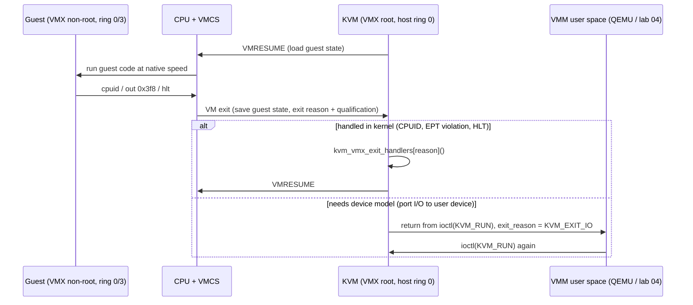

<div dir="rtl">

# ۰۶ — Hypervisorها: trap-and-emulate، VT-x و EPT

> ماژول ۶ · سیستم‌عامل توزیع‌شده و مجازی‌سازی · نسخه‌های ثابت: Linux **v6.18.63** و OpenBSD **`8cada8c`** · **ARCH-SPECIFIC (x86-64، Intel VT-x)** · نسخهٔ انگلیسی: [`06-hypervisors-vtx-ept.en.md`](06-hypervisors-vtx-ept.en.md)

## واژه‌نامه

| اصطلاح | تعریف |
|---|---|
| **Hypervisor / VMM** | نرم‌افزاری که سیستم‌عامل‌های مهمان را اجرا می‌کند و کنترل سخت‌افزار واقعی را در دست نگه می‌دارد. |
| **Sensitive instruction** | دستوری که وضعیتی از ماشین را می‌خواند یا تغییر می‌دهد که VMM باید کنترلش کند (CR3، پرچم وقفه، پورت‌های I/O). |
| **Privileged instruction** | دستوری که اگر بیرون از بالاترین سطح امتیاز اجرا شود، trap می‌دهد. |
| **VMX root / non-root** | دو حالت CPU در VT-x: hypervisor در حالت root اجرا می‌شود و مهمان در non-root (با ringهای ۰ تا ۳ خودش). |
| **VMCS** | ساختار کنترل ماشین مجازی: یک بلوک حافظه برای هر vCPU که وضعیت مهمان، وضعیت میزبان و «چه رخدادهایی باعث exit شوند» را نگه می‌دارد. |
| **VM exit / VM entry** | جابه‌جایی سخت‌افزاری از non-root به root (exit) و برعکس (entry با `VMLAUNCH`/`VMRESUME`). |
| **EPT** | جدول صفحهٔ دوم که مال hypervisor است و آدرس فیزیکیِ مهمان را به آدرس فیزیکی واقعی ترجمه می‌کند. |
| **Shadow page table** | روش پیش از EPT: خود VMM جدول ترجمهٔ مستقیم «مجازیِ مهمان ← فیزیکیِ میزبان» را می‌سازد و همگام نگه می‌دارد. |

## ۱. خلاصه

- کرنل مهمان خیال می‌کند صاحب CPU است؛ hypervisor این توهم را امن می‌کند، چون هر عملیات *sensitive* را مجبور می‌کند به خودش **trap** بدهد.
- x86 کلاسیک شرط Popek–Goldberg را نقض می‌کرد (بعضی دستورهای sensitive هیچ trapی نمی‌دادند). برای همین VMware از binary translation و Xen از paravirtualization استفاده کردند، تا اینکه **VT-x** حالتی تازه آورد که در آن خود سخت‌افزار trap را انجام می‌دهد.
- حافظه یک لایهٔ ترجمهٔ دوم (**EPT**) می‌گیرد و یک TLB miss ممکن است به‌جای ۴ دسترسی تا **۲۴** دسترسی حافظه هزینه داشته باشد. exit هزینهٔ مجازی‌سازی است؛ پس چیزی که اندازه می‌گیریم تعداد و هزینهٔ exitهاست (آزمایش ۰۵).

## ۲. توضیح مفصل

### ۲.۱ شهود: کرنل مهمان یک برنامهٔ کاربر است که فکر می‌کند کرنل است

کرنل مهمان را مثل یک پردازهٔ معمولی روی میزبان اجرا کنید. دستورهای عادی‌اش (`add`، `mov`، خواندن و نوشتن روی حافظهٔ خودش) با سرعت کامل روی CPU واقعی اجرا می‌شوند. مشکل فقط وقتی پیش می‌آید که کاری بکند که روی کل ماشین اثر دارد: بارگذاری `CR3`، خاموش کردن وقفه با `cli`، نوشتن روی یک پورت I/O، یا اجرای `hlt`. اگر این‌ها واقعاً اجرا شوند، مهمان کنترل میزبان را می‌گیرد. اگر CPU آن‌ها را *trap* کند، hypervisor می‌تواند آن‌ها را روی وضعیت مجازی مهمان **شبیه‌سازی (emulate)** کند و مهمان را ادامه دهد. اسم این روش **trap-and-emulate** است.

### ۲.۲ قضیهٔ Popek و Goldberg (۱۹۷۴)

مقالهٔ Popek و Goldberg با عنوان «Formal Requirements for Virtualizable Third Generation Architectures» (CACM، ۱۹۷۴) دستورها را دسته‌بندی می‌کند:

- **privileged**: اگر در حالت کاربر اجرا شوند trap می‌دهند؛
- **sensitive**: یا control-sensitive هستند (منبعی مثل `CR3` یا وضعیت وقفه را عوض می‌کنند)، یا behavior-sensitive (نتیجه‌شان به حالت یا محل اجرا بستگی دارد).

**قضیه:** اگر **هر دستور sensitive، privileged هم باشد**، می‌شود یک VMM کارآمد ساخت. در این صورت کافی است مهمان را با امتیاز کمتر (ring 3) اجرا کنیم تا هر دستور خطرناکی trap بدهد.

x86 سی‌ودوبیتیِ کلاسیک در این آزمون رد می‌شد. Robin و Irvine (USENIX Security، ۲۰۰۰) **۱۷ دستور sensitive و غیر privileged** شمردند. مثال درسیِ معروف `popf` است: در ring 3 بیت پرچم وقفه را بی‌صدا نادیده می‌گیرد و trap نمی‌دهد. پس کرنل مهمانی که با امتیاز کم اجرا شده و با `popf` وقفه‌ها را دوباره روشن می‌کند، هیچ trapی نمی‌دهد و VMM هرگز از آن باخبر نمی‌شود. دستورهای `sgdt`/`sidt`/`smsw` هم به ring 3 اجازه می‌دهند وضعیت ممتاز را بدون trap بخواند (و جدول‌های *میزبان* را لو می‌دهند).

### ۲.۳ سه راه دور زدن مشکل

| روش | ایده | نمونه | هزینه |
|---|---|---|---|
| **Binary translation** | کد کرنل مهمان قبل از اجرا پویش می‌شود و دستورهای مشکل‌دار به فراخوانی VMM بازنویسی می‌شوند | VMware Workstation (۱۹۹۹) | پیچیدگی مترجم؛ cache کد ترجمه‌شده |
| **Paravirtualization** | سورس کرنل مهمان تغییر می‌کند و عملیات sensitive با **hypercall** صریح جایگزین می‌شود | Xen (۲۰۰۳)، `pv_ops` در لینوکس | مهمان باید تغییر کند |
| **کمک سخت‌افزاری** | CPU حالت تازه‌ای می‌گیرد که در آن عملیات sensitive طبق پیکربندی به VMM exit می‌دهند | Intel VT-x (۲۰۰۵)، AMD-V (۲۰۰۶) | هر exit صدها تا هزاران سیکل |

KVM امروزی از کمک سخت‌افزاری استفاده می‌کند و هر جا مفید باشد هنوز قطعه‌های paravirtual دارد (دستگاه‌های virtio، kvmclock، PV TLB flush).

### ۲.۴ VT-x: حالت root و non-root

VT-x چیزی به اسم «ring −1» اضافه نمی‌کند؛ یک جفت حالت عمود بر ringها اضافه می‌کند. مهمان در **VMX non-root** و با ringهای عادی ۰ تا ۳ اجرا می‌شود؛ پس کرنل مهمان واقعاً در ring 0 است و `popf` درست رفتار می‌کند. hypervisor در **VMX root** اجرا می‌شود.

**VMCS** (یکی برای هر vCPU) این‌ها را نگه می‌دارد:

- **ناحیهٔ وضعیت مهمان** (RIP، RSP، CR0/CR3/CR4، ثبات‌های segment و…) که در entry بارگذاری و در exit ذخیره می‌شود؛
- **ناحیهٔ وضعیت میزبان** که در exit بارگذاری می‌شود (hypervisor از آنجا ادامه می‌دهد)؛
- **کنترل‌های اجرا**: چه رخدادهایی exit بدهند (bitmap پورت‌های I/O، bitmap ثبات‌های MSR، «exit روی HLT»، «exit روی بارگذاری CR3»…)؛
- **اطلاعات exit**: دلیل exit و *exit qualification* (مثلاً برای I/O: شمارهٔ پورت، اندازه و جهت).

بعضی دستورها همیشه exit می‌دهند (`CPUID`، `INVD`، `VMCALL`) و بعضی فقط اگر بیت کنترلی‌اش روشن باشد (`HLT`، `IN/OUT`، `RDMSR`). پس حلقهٔ اصلی hypervisor این است: VM entry ← اجرای مهمان ← VM exit ← خواندن دلیل exit ← رفتن سراغ handler ← VM entry. در لینوکس این انتخاب handler با یک جدول انجام می‌شود که با دلیل exit اندیس می‌خورد (بخش ۴).

### ۲.۵ حافظه: shadow page table در برابر EPT

مهمان جدول صفحهٔ خودش را دارد: **GVA ← GPA** (آدرس مجازیِ مهمان به آدرس فیزیکیِ مهمان). GPA حافظهٔ واقعی نیست؛ میزبان تصمیم می‌گیرد **GPA ← HPA** چه باشد.

- **Shadow page table** (پیش از ۲۰۰۸): VMM جدول‌های صفحهٔ مهمان را write-protect می‌کند، هر تغییر را trap می‌کند و یک جدول ترکیبیِ GVA ← HPA می‌سازد که CR3 واقعی به آن اشاره می‌کند. درست است ولی پر از exit: هر نوشتن روی جدول صفحهٔ مهمان و هر context switch مهمان (بارگذاری CR3) exit می‌دهد.
- **EPT** (Intel از Nehalem در ۲۰۰۸؛ نام AMD برایش NPT/RVI است): سخت‌افزار **هر دو** جدول را پیمایش می‌کند. مهمان آزادانه جدول‌هایش را عوض می‌کند و CR3 را بدون exit بارگذاری می‌کند. دسترسی‌ای که GPA آن در EPT نگاشت ندارد یک **EPT violation** می‌دهد و KVM آن را مثل یک page fault سمت میزبان رسیدگی می‌کند.

**هزینهٔ پیمایش دوبعدی.** اگر جدول مهمان *n* سطح و EPT *m* سطح داشته باشد، هر یک از *n* درایهٔ مهمان خودش یک آدرس فیزیکیِ مهمان است که یک پیمایش *m* مرحله‌ای در EPT به‌اضافهٔ خواندن خود درایه لازم دارد، و GPA نهایی هم یک پیمایش EPT دیگر می‌خواهد:
n·(m+1) + m = (n+1)(m+1) − 1. برای n = m = 4 می‌شود 4·5 + 4 = **۲۴** دسترسی حافظه، در برابر ۴ دسترسی بدون مجازی‌سازی. به همین دلیل صفحه‌های بزرگ (۲ مگابایت یا ۱ گیگابایت) در EPT و نرخ بالای hit در TLB در VMها این‌قدر مهم‌اند.

### ۲.۶ چه چیزهایی هنوز exit می‌دهند

حتی با VT-x و EPT، مهمان برای این موارد exit می‌دهد: `CPUID` (همیشه)، دسترسی به پورت I/O و MMIO دستگاه‌های شبیه‌سازی‌شده، `HLT` (بیکاری)، بعضی دسترسی‌های MSR، وقفه‌های خارجی (قابل پیکربندی)، EPT violation و رخدادهای interrupt-window. هر exit یعنی ذخیره و بازیابی کامل وضعیت در VMCS، به‌اضافهٔ کاری که handler انجام می‌دهد. کم کردن exitها (virtio، posted interrupts، APICv، halt polling) موضوع اصلی کار روی کارایی hypervisorهاست.

## ۳. نمودار

</div>



<div dir="rtl">

## ۴. مثال کاربردی

### ۴.۱ سورس واقعی: جدول انتخاب handler بر اساس دلیل exit

`linux/arch/x86/kvm/vmx/vmx.c · kvm_vmx_exit_handlers[] · v6.18.63` ([Elixir L6092](https://elixir.bootlin.com/linux/v6.18.63/source/arch/x86/kvm/vmx/vmx.c#L6092))

</div>

```c
static int (*kvm_vmx_exit_handlers[])(struct kvm_vcpu *vcpu) = {
	[EXIT_REASON_EXCEPTION_NMI]           = handle_exception_nmi,
	[EXIT_REASON_EXTERNAL_INTERRUPT]      = handle_external_interrupt,
	[EXIT_REASON_TRIPLE_FAULT]            = handle_triple_fault,
	[EXIT_REASON_NMI_WINDOW]	      = handle_nmi_window,
	[EXIT_REASON_IO_INSTRUCTION]          = handle_io,
	[EXIT_REASON_CR_ACCESS]               = handle_cr,
	[EXIT_REASON_DR_ACCESS]               = handle_dr,
	[EXIT_REASON_CPUID]                   = kvm_emulate_cpuid,
	[EXIT_REASON_MSR_READ]                = kvm_emulate_rdmsr,
	[EXIT_REASON_MSR_WRITE]               = kvm_emulate_wrmsr,
	[EXIT_REASON_INTERRUPT_WINDOW]        = handle_interrupt_window,
	[EXIT_REASON_HLT]                     = kvm_emulate_halt,
	[EXIT_REASON_INVD]		      = kvm_emulate_invd,
	[EXIT_REASON_INVLPG]		      = handle_invlpg,
	[EXIT_REASON_RDPMC]                   = kvm_emulate_rdpmc,
```

<div dir="rtl">

- اندیس آرایه همان دلیل exit **سخت‌افزاری** است که CPU در VMCS نوشته؛ مقدار، handler مربوط در KVM است. هر exit یعنی یک نگاه به جدول و اجرای یک handler.
- `EXIT_REASON_CPUID ← kvm_emulate_cpuid`: دستور CPUID همیشه exit می‌دهد؛ KVM از جدول CPUIDی جواب می‌دهد که فضای کاربر تنظیم کرده، پس مهمان یک مدل CPU *مجازی* می‌بیند.
- `EXIT_REASON_HLT ← kvm_emulate_halt`: مهمان بیکار یک CPU میزبان را هدر نمی‌دهد؛ نخ vCPU می‌خوابد.
- `EXIT_REASON_CR_ACCESS ← handle_cr`: با EPT معمولاً بارگذاری CR3 exit نمی‌دهد، ولی نوشتن روی CR0/CR4 هنوز می‌تواند exit بدهد.
- جدول ادامه دارد (خط ۶۱۲۸): `[EXIT_REASON_EPT_VIOLATION] = handle_ept_violation`.

`linux/arch/x86/kvm/vmx/vmx.c · handle_io() · v6.18.63` ([Elixir L5366](https://elixir.bootlin.com/linux/v6.18.63/source/arch/x86/kvm/vmx/vmx.c#L5366))

</div>

```c
static int handle_io(struct kvm_vcpu *vcpu)
{
	unsigned long exit_qualification;
	int size, in, string;
	unsigned port;

	exit_qualification = vmx_get_exit_qual(vcpu);
	string = (exit_qualification & 16) != 0;

	++vcpu->stat.io_exits;

	if (string)
		return kvm_emulate_instruction(vcpu, 0);

	port = exit_qualification >> 16;
	size = (exit_qualification & 7) + 1;
	in = (exit_qualification & 8) != 0;

	return kvm_fast_pio(vcpu, size, port, in);
}
```

<div dir="rtl">

- `vmx_get_exit_qual()` همان exit qualification را می‌خواند که CPU در VMCS گذاشته؛ یعنی سخت‌افزار دستور `in`/`out` را از قبل رمزگشایی کرده است.
- بیت ۴ یعنی دستور رشته‌ای (`ins`/`outs`)؛ این‌ها به شبیه‌ساز کامل دستورها نیاز دارند.
- بیت‌های ۳۱ تا ۱۶ شمارهٔ پورت، بیت‌های ۲ تا ۰ اندازه منهای یک، و بیت ۳ جهت است. در مسیر سریع هیچ رمزگشایی نرم‌افزاری انجام نمی‌شود.
- `++vcpu->stat.io_exits` همان شمارنده‌ای است که در `/sys/kernel/debug/kvm/` و خروجی `perf kvm stat` می‌بینید.

### ۴.۲ خروجی واقعی: قیمت یک exit، اندازه‌گیری‌شده از داخل مهمان

`labs/05-vmexit-cost/vmexit-cost.c` سه عملیات را در حلقه زمان‌گیری می‌کند. `CPUID` باید به hypervisor exit بدهد؛ `getppid()` یک syscall است که داخل کرنل مهمان می‌ماند؛ `add` هرگز از هستهٔ CPU بیرون نمی‌رود. این خروجی در تاریخ 2026-11-15 داخل VMِ WSL2 مربوط به Docker Desktop (یک مهمان Hyper-V) روی میزبان درس گرفته شده و برنامه با `gcc -Wall -Wextra -O2` ساخته شده است:

</div>

```
$ uname -r
6.18.58.1-microsoft-standard-WSL2
$ ./vmexit-cost
CPUID.1:ECX bit 31 (hypervisor present) = 1
CPUID.0x40000000 hypervisor signature = "Microsoft Hv"
add (stays on the CPU)            0.2 ns/op   (20000000 ops)
getppid syscall (guest)          96.4 ns/op   (200000 ops)
cpuid leaf 0 (VM exit)          383.5 ns/op   (200000 ops)
cpuid leaf 1 (VM exit)          385.7 ns/op   (200000 ops)
```

<div dir="rtl">

این‌طور بخوانیدش:

- **بیت ۳۱ از CPUID.1:ECX** بیت «hypervisor حاضر است» است و leaf شمارهٔ `0x40000000` نام سازندهٔ hypervisor را برمی‌گرداند. هر دو جواب را *خود hypervisor* در حین exit می‌سازد؛ پس مهمان می‌تواند بفهمد مجازی است.
- یک syscall در مهمان (حدود ۹۶ نانوثانیه) گذر ring 3 به ring 0 *درون حالت non-root* است: هیچ VM exitی رخ نمی‌دهد.
- یک رفت‌وبرگشت `CPUID` (حدود ۳۸۴ نانوثانیه) یعنی VM exit به‌اضافهٔ handler مربوط به CPUID در Hyper-V به‌اضافهٔ VM entry: تقریباً **۴ برابر یک syscall** و حدود ۲۰۰۰ برابر یک دستور ALU. این عددها از یک میزبان مشترک و پرنویز آمده‌اند؛ درس اصلی *نسبت* است، نه مقدار مطلق. آزمایش را در VM به نام aos-lab (VirtualBox روی Hyper-V) هم اجرا کنید تا یک پشتهٔ hypervisor دیگر را مقایسه کنید.

## ۵. حالت‌های خاص و دام‌ها

- **«VT-x یعنی ring −1».** تعبیری غیررسمی و گمراه‌کننده است: root/non-root بر ringها عمود است و مهمان هر چهار ring را دارد.
- **هر exitی به QEMU نمی‌رود.** بیشتر exitها (CPUID، HLT، EPT violation، بسیاری از MSRها) داخل `kvm.ko` رسیدگی می‌شوند؛ فقط شبیه‌سازی دستگاه‌هایی که KVM ندارد به فضای کاربر برمی‌گردد. «exit به فضای کاربر» و «VM exit» دو معیار متفاوت‌اند.
- **مجازی‌سازی تودرتو (nested)** (مثل aos-lab داخل Hyper-V): exit مهمان سطح L2 اول به L0 می‌رسد و اغلب به L1 بازتاب داده می‌شود؛ پس یک exit مهمان ممکن است چند exit واقعی شود. به همین دلیل آزمایش‌های تودرتو کند یا غیرفعال‌اند (در aos-lab اصلاً `/dev/kvm` نیست).
- **EPT هزینهٔ TLB را حذف نمی‌کند، جابه‌جایش می‌کند.** exit کمتر، ولی پیمایش طولانی‌تر در TLB miss؛ برای RAM مهمان در میزبان از huge page استفاده کنید.
- **زمان‌گیری با TSC در مهمان** ممکن است توسط hypervisor جابه‌جا یا مقیاس شود؛ این آزمایش از `CLOCK_MONOTONIC` استفاده می‌کند.
- **ARCH-SPECIFIC:** در AMD-V به‌جای این‌ها VMCB، دستور `VMRUN` و NPT داریم؛ مفهوم‌ها یکی است، نام‌ها نه (`arch/x86/kvm/svm/`).

## ۶. نکته‌های امتحانی

- Popek–Goldberg: VMM کارآمد ⇔ مجموعهٔ دستورهای sensitive زیرمجموعهٔ privileged باشد. x86 کلاسیک ۱۷ دستور sensitive غیر privileged داشت (Robin و Irvine، ۲۰۰۰)؛ مثال استاندارد `popf` است.
- راه‌حل‌های پیش از سخت‌افزار: binary translation (VMware) و paravirtualization/hypercall (Xen).
- VT-x: حالت VMX root برای hypervisor و non-root برای مهمان (با همهٔ ringها)؛ VMCS برای هر vCPU = وضعیت مهمان + وضعیت میزبان + کنترل‌های exit + اطلاعات exit.
- VM exit ← انتخاب handler بر اساس دلیل exit (`kvm_vmx_exit_handlers[]`) ← VM entry (`VMRESUME`).
- `CPUID` همیشه exit می‌دهد؛ `HLT`، `IN/OUT` و دسترسی MSR فقط اگر پیکربندی شده باشند.
- Shadow page table: VMM نوشتن روی جدول صفحهٔ مهمان و بارگذاری CR3 را trap می‌کند. EPT/NPT: پیمایش دوبعدی سخت‌افزاری؛ GPA ← HPA مال میزبان است؛ EPT violation همان page fault سمت میزبان است.
- هزینهٔ پیمایش دوبعدی: (n+1)(m+1) − 1 = ۲۴ دسترسی برای ۴ سطح در ۴ سطح.
- هزینهٔ exit صدها نانوثانیه است: در یک مهمان Hyper-V، CPUID حدود ۳۸۴ نانوثانیه در برابر syscall حدود ۹۶ نانوثانیه اندازه‌گیری شد.

## ۷. پیوندها

- درس: [`../lesson.fa.md`](../lesson.fa.md) بخش ۴.۶ (hypervisorها)
- مرور کد کرنل: [`../kernel-walkthrough.fa.md`](../kernel-walkthrough.fa.md) (انتخاب handler برای exitهای VMX)
- آزمایش‌ها: [`../labs/05-vmexit-cost/`](../labs/05-vmexit-cost/) (هزینهٔ exit از داخل مهمان)، [`../labs/04-kvm-client/`](../labs/04-kvm-client/) (همین exitها از سمت VMM)
- آزمون: [`../quiz.fa.md`](../quiz.fa.md) پرسش ۶ (Popek–Goldberg و پیمایش EPT)، پرسش ۱۰ (خواندن خروجی vmexit-cost)
- یادداشت بعدی: [`07-kvm-architecture.fa.md`](07-kvm-architecture.fa.md)

</div>
