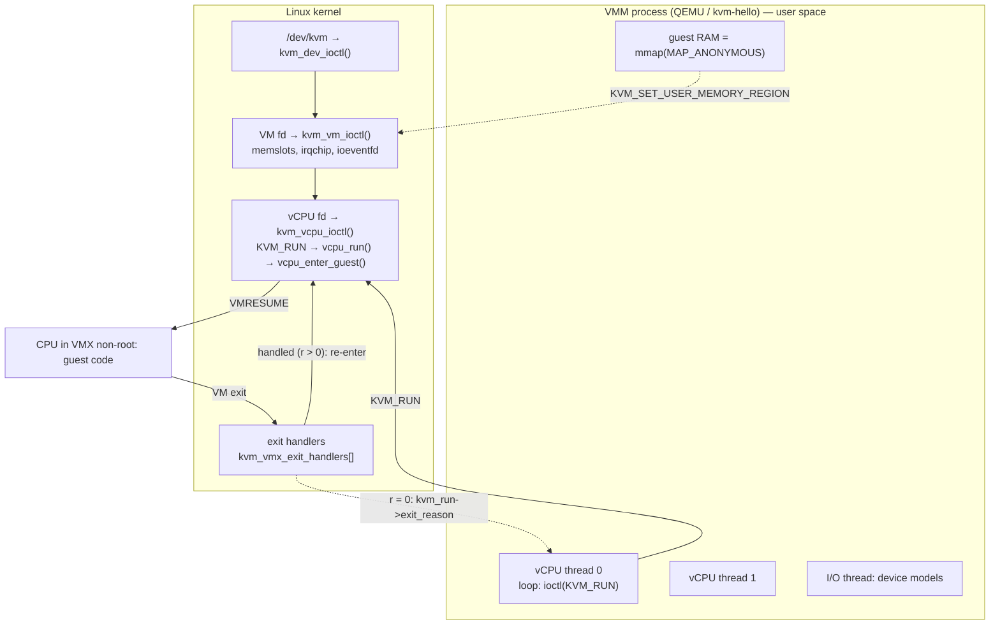

# 07 — KVM architecture: `/dev/kvm`, file descriptors, vCPU threads

> Module 06 · Distributed OS & Virtualization · pins: Linux **v6.18.63**, OpenBSD **`8cada8c`** · **ARCH-SPECIFIC (x86-64)** where noted · Farsi: [`07-kvm-architecture.fa.md`](07-kvm-architecture.fa.md)

## Glossary

| Term | Meaning |
|---|---|
| **KVM** | Kernel-based Virtual Machine: the Linux modules (`kvm.ko` + `kvm-intel.ko`/`kvm-amd.ko`) that turn the kernel into a hypervisor. |
| **VMM user space** | The process that owns the VM: QEMU, Firecracker, cloud-hypervisor, crosvm, or the 100-line client of Lab 04. |
| **vCPU** | A virtual CPU. In KVM it is a file descriptor *and* a host thread that calls `ioctl(KVM_RUN)` on it. |
| **`struct kvm_run`** | A page shared (via `mmap` of the vCPU fd) between KVM and user space; it says why `KVM_RUN` returned. |
| **Memory slot** | A mapping "guest-physical range → this process's virtual address range" (`KVM_SET_USER_MEMORY_REGION`). |
| **In-kernel irqchip** | Emulated local APIC / IOAPIC inside KVM so interrupts don't need user space. |
| **ioeventfd / irqfd** | eventfd hooks: a guest write to a doorbell signals an fd without returning from `KVM_RUN`; an fd write injects an interrupt. |
| **virtio / vhost** | Paravirtual devices with shared-memory queues; vhost moves the device back end into a kernel thread. |

## 1. Summary

- KVM is not a separate hypervisor program: it is a **character device** whose ioctls turn an ordinary Linux process into a VM and its threads into vCPUs. The scheduler, memory manager and cgroups of Linux are reused as they are.
- Three fd levels: `/dev/kvm` (system) → VM fd (`KVM_CREATE_VM`) → vCPU fd (`KVM_CREATE_VCPU`). Guest RAM is plain `mmap`ed memory of the VMM process.
- The core loop is `ioctl(vcpufd, KVM_RUN)`: enter the guest, handle as many exits as possible inside the kernel, and **return to user space** only when the device model is needed (`KVM_EXIT_IO`, `KVM_EXIT_MMIO`, `KVM_EXIT_HLT` without in-kernel irqchip …).

## 2. Detailed explanation

### 2.1 Intuition: a VM is a process, a vCPU is a thread

From the host's point of view a QEMU/KVM VM is just a process. `ps -L` shows one thread per vCPU plus I/O threads; `top` shows guest CPU time as that thread's CPU time; `memory.max` on the VM's cgroup limits guest RAM; `taskset` pins vCPUs. Everything you learned in Modules 02 and 04 applies unchanged. KVM only adds one new "way to run": instead of returning to user mode, the thread enters VMX non-root mode (note 06).

### 2.2 The fd hierarchy

| fd | Created by | Typical ioctls |
|---|---|---|
| system (`open("/dev/kvm")`) | `open(2)` | `KVM_GET_API_VERSION`, `KVM_CHECK_EXTENSION`, `KVM_CREATE_VM`, `KVM_GET_VCPU_MMAP_SIZE` |
| VM | `KVM_CREATE_VM` | `KVM_SET_USER_MEMORY_REGION`, `KVM_CREATE_VCPU`, `KVM_CREATE_IRQCHIP`, `KVM_IOEVENTFD`, `KVM_IRQFD` |
| vCPU | `KVM_CREATE_VCPU` | `KVM_RUN`, `KVM_GET/SET_REGS`, `KVM_GET/SET_SREGS`, `KVM_SET_CPUID2`; `mmap` → `struct kvm_run` |

Using file descriptors means lifetime management comes for free: close the VM fd (or let the process die) and the VM is destroyed; pass the fd over a UNIX socket and another process can drive it; seccomp and fd permissions apply.

### 2.3 Memory

User space `mmap`s anonymous memory and tells KVM "guest-physical 0x0–0x3fffffff is this host virtual range". KVM builds EPT entries lazily: the first guest access to a page causes an EPT violation, KVM resolves the host virtual address with the normal host page-fault machinery (`get_user_pages`-style), and installs GPA → HPA. Consequences: guest RAM can be swapped, KSM-merged, backed by huge pages, or limited by a memory cgroup — like any process memory.

### 2.4 The run loop

`KVM_RUN` goes `kvm_vcpu_ioctl()` → `kvm_arch_vcpu_ioctl_run()` → `vcpu_run()` → `vcpu_enter_guest()` → `kvm_x86_call(vcpu_run)` (VMX: `vmx_vcpu_run`, which executes `VMRESUME`) → exit → `kvm_x86_call(handle_exit)` → `kvm_vmx_exit_handlers[reason]`. A handler returns:

- `> 0`: handled in the kernel, loop and re-enter the guest;
- `0`: user space must act; `kvm_run->exit_reason` says why, and `ioctl` returns;
- `< 0`: error.

Exits handled entirely in the kernel are cheap (hundreds of ns, note 06). An exit to user space adds a full return from the system call, a context switch to the VMM's code, and another `ioctl` (microseconds).

### 2.5 Reducing exits to user space

- **In-kernel irqchip** (`KVM_CREATE_IRQCHIP`): APIC/IOAPIC/PIC emulated in KVM; with APICv/posted interrupts the hardware delivers many interrupts with no exit at all.
- **ioeventfd**: a guest write to a virtio "notify" register is matched in the kernel and just signals an eventfd; the vCPU re-enters the guest immediately.
- **irqfd**: writing to an eventfd injects a guest interrupt, so an I/O thread never has to stop a vCPU.
- **virtio**: the guest driver knows it's virtualized and puts requests into shared rings (vrings) instead of poking emulated registers one by one.
- **vhost / vhost-user**: the virtio back end runs in a kernel thread (`vhost-net`) or another process, so packets don't pass through QEMU at all.

### 2.6 OpenBSD vmm(4) + vmd(8)

OpenBSD has a smaller design: `vmm(4)` in the kernel, `vmd(8)` in user space (one process per VM, privilege-separated, `pledge`d). The kernel handles CPU, EPT and a few exits; **every port I/O exit goes back to vmd**: `vmx_handle_inout()` fills `vcpu->vc_exit.vei` (port, size, direction, data) and returns `VMM_ACTION_ASSIST`. There is no in-kernel equivalent of ioeventfd/vhost, which keeps the kernel small at the cost of more exits to user space (§4.3).

## 3. Diagram



## 4. Worked example

### 4.1 Real source: the KVM_RUN ioctl

`linux/virt/kvm/kvm_main.c · kvm_vcpu_ioctl() · v6.18.63` ([Elixir L4471](https://elixir.bootlin.com/linux/v6.18.63/source/virt/kvm/kvm_main.c#L4471)), lines 4471–4504, shortened:

```c
	case KVM_RUN: {
		struct pid *oldpid;
		r = -EINVAL;
		if (arg)
			goto out;
		/* ... comment on vcpu->pid locking ... */
		oldpid = vcpu->pid;
		if (unlikely(oldpid != task_pid(current))) {
			/* The thread running this VCPU changed. */
			struct pid *newpid;

			r = kvm_arch_vcpu_run_pid_change(vcpu);
			if (r)
				break;

			newpid = get_task_pid(current, PIDTYPE_PID);
			write_lock(&vcpu->pid_lock);
			vcpu->pid = newpid;
			write_unlock(&vcpu->pid_lock);

			put_pid(oldpid);
		}
		vcpu->wants_to_run = !READ_ONCE(vcpu->run->immediate_exit__unsafe);
		r = kvm_arch_vcpu_ioctl_run(vcpu);
		vcpu->wants_to_run = false;

		trace_kvm_userspace_exit(vcpu->run->exit_reason, r);
		break;
```

- `vcpu->pid` records **which host thread** runs this vCPU. KVM uses it for directed yield (one vCPU spinning on a lock can boost the lock holder's thread) — the vCPU really *is* a thread.
- If a different thread calls `KVM_RUN`, the arch hook runs first; moving a vCPU between threads is allowed but rare.
- Before the switch the ioctl took `vcpu->mutex` (L4468): two threads can't run one vCPU at once.
- `kvm_arch_vcpu_ioctl_run()` is the x86 entry into the run loop; it returns only when user space is needed.
- `trace_kvm_userspace_exit` is the `kvm:kvm_userspace_exit` tracepoint that `perf kvm stat` and `bpftrace` can count.

`linux/arch/x86/kvm/x86.c · vcpu_enter_guest() · v6.18.63` — the two lines around the hardware switch ([L11014](https://elixir.bootlin.com/linux/v6.18.63/source/arch/x86/kvm/x86.c#L11014), [L11132](https://elixir.bootlin.com/linux/v6.18.63/source/arch/x86/kvm/x86.c#L11132)):

```c
		exit_fastpath = kvm_x86_call(vcpu_run)(vcpu, run_flags);
	/* ... */
	r = kvm_x86_call(handle_exit)(vcpu, exit_fastpath);
	return r;
```

`kvm_x86_call(vcpu_run)` is the vendor hook (`vmx_vcpu_run` / `svm_vcpu_run`) that enters the guest and comes back on the next exit; `handle_exit` dispatches by exit reason. When an exit needs user space, the handler sets the reason in the shared page and returns 0, as `emulator_pio_in_out()` does for port I/O ([L8081](https://elixir.bootlin.com/linux/v6.18.63/source/arch/x86/kvm/x86.c#L8081)):

```c
	vcpu->run->exit_reason = KVM_EXIT_IO;
	vcpu->run->io.direction = in ? KVM_EXIT_IO_IN : KVM_EXIT_IO_OUT;
	vcpu->run->io.size = size;
	vcpu->run->io.data_offset = KVM_PIO_PAGE_OFFSET * PAGE_SIZE;
	vcpu->run->io.count = count;
	vcpu->run->io.port = port;
	return 0;
```

`data_offset` points to the second page of the vCPU mapping — that is why `KVM_GET_VCPU_MMAP_SIZE` on x86 returns `PAGE_SIZE + PAGE_SIZE` ("pio data page", `kvm_dev_ioctl()` L5566–5569).

### 4.2 The same protocol from user space: `labs/04-kvm-client/kvm-hello.c`

The lab's VMM (compiles with `gcc -Wall -Wextra -O2`, zero warnings) does exactly the fd walk above:

```c
	int kvm = open("/dev/kvm", O_RDWR | O_CLOEXEC);
	int vmfd = ioctl(kvm, KVM_CREATE_VM, 0UL);            /* VM fd   */
	uint8_t *mem = mmap(NULL, 0x1000, PROT_READ | PROT_WRITE,
	                    MAP_SHARED | MAP_ANONYMOUS, -1, 0); /* guest RAM */
	ioctl(vmfd, KVM_SET_USER_MEMORY_REGION, &region);     /* GPA 0x1000 -> mem */
	int vcpufd = ioctl(vmfd, KVM_CREATE_VCPU, 0UL);       /* vCPU fd */
	struct kvm_run *run = mmap(NULL, run_size, PROT_READ | PROT_WRITE,
	                           MAP_SHARED, vcpufd, 0);    /* shared exit page */
	/* ... set CS base 0, RIP = 0x1000, RAX = RBX = 2 ... */
	ioctl(vcpufd, KVM_RUN, 0);                            /* loop on run->exit_reason */
```

The real-mode guest is 12 bytes: `mov $0x3f8,%dx; add %bl,%al; add $'0',%al; out %al,(%dx); mov $'\n',%al; out %al,(%dx); hlt`. Each `out` is an `EXIT_REASON_IO_INSTRUCTION` → `handle_io()` → no in-kernel device on port 0x3f8 → `KVM_EXIT_IO` to user space, which prints the byte from `run + run->io.data_offset`. The `hlt` returns `KVM_EXIT_HLT` because the lab creates no in-kernel irqchip. So the program should print `4` and report three exits to user space.

**UNVERIFIED run output.** Neither the aos-lab VM (VirtualBox on Hyper-V, no nested VT-x) nor the Docker Desktop WSL2 VM on the course host exposes `/dev/kvm` (checked 2026-11-15: `ls: cannot access '/dev/kvm'`). The code compiles cleanly; the run was not captured. On a machine with KVM, verify with `./kvm-hello` and `ls /dev/kvm`.

### 4.3 OpenBSD: every I/O exit goes to vmd

`openbsd/sys/arch/amd64/amd64/vmm_machdep.c · vmx_handle_exit() · 8cada8c` (L4786–4812, shortened):

```c
	switch (exit_reason) {
	/* ... */
	case VMX_EXIT_EPT_VIOLATION:
		action = vmx_handle_np_fault(vcpu);
		break;
	case VMX_EXIT_CPUID:
		action = vmm_handle_cpuid(vcpu);
		break;
	case VMX_EXIT_IO:
		action = vmx_handle_inout(vcpu);
		break;
	/* ... */
	case VMX_EXIT_HLT:
		action = vmx_handle_hlt(vcpu);
		break;
```

Same shape as Linux's table, written as a `switch`. `vmx_handle_inout()` decodes the exit qualification into `vcpu->vc_exit.vei` (`vei_port`, `vei_dir`, `vei_size`, `vei_data`) and returns `VMM_ACTION_ASSIST` (L5505): the `VMM_IOC_RUN` ioctl (`sys/dev/vmm/vmm.c` L851, `vm_run()`) returns to vmd, which emulates the device and runs the vCPU again.

| Design choice | Linux KVM | OpenBSD vmm/vmd | Trade-off |
|---|---|---|---|
| Port I/O | kernel devices (PIT, PIC, ioeventfd) or exit to user space | always exit to vmd | fewer exits vs smaller kernel attack surface |
| Interrupt controller | in-kernel APIC/IOAPIC, posted interrupts | mostly in vmd | latency vs simplicity |
| Paravirtual back ends | vhost in kernel threads | virtio devices in vmd | throughput vs isolation (vmd is pledged) |
| API | fd per VM and per vCPU | `/dev/vmm` ioctls (VM fd via `vm_ioctl`) | both are ioctl-driven |

## 5. Edge cases & pitfalls

- **No `/dev/kvm`** → no VT-x/AMD-V, BIOS disabled, or nested virtualization not offered by the outer hypervisor (our case). `grep -c -w -E 'vmx|svm' /proc/cpuinfo` shows whether the guest sees the feature.
- **`KVM_EXIT_FAIL_ENTRY`**: the VMCS guest state is invalid (e.g. bad segment setup); the CPU refused the VM entry. `hardware_entry_failure_reason` tells you which check failed.
- **`KVM_EXIT_INTERNAL_ERROR`**: KVM's instruction emulator could not emulate something (often code executing from MMIO).
- **Forgetting `rflags = 0x2`**: bit 1 of RFLAGS is reserved-must-be-1; leaving it 0 fails entry.
- **Reading `kvm_run` after the wrong exit**: the union fields (`io`, `mmio`, …) are only valid for the matching `exit_reason`.
- **API stability:** `KVM_GET_API_VERSION` has been 12 for many years; new features are discovered with `KVM_CHECK_EXTENSION`, not by version (VERSION-DEPENDENT capabilities).
- **"KVM is a type-2 hypervisor."** The type-1/type-2 label fits poorly: KVM runs in the host kernel at full privilege (type-1-like), but uses a general-purpose OS for scheduling and drivers.

## 6. Exam-style key points

- KVM = kernel modules + ioctl API; the VM is a process, vCPU = thread calling `KVM_RUN`.
- fd hierarchy: `/dev/kvm` → VM fd → vCPU fd; `mmap(vcpufd)` gives `struct kvm_run` (+ PIO data page on x86).
- Guest RAM = host user memory registered as memslots; EPT filled lazily on EPT violations.
- `KVM_RUN` → `kvm_arch_vcpu_ioctl_run` → `vcpu_run` → `vcpu_enter_guest` → `vmx_vcpu_run` … `handle_exit`; handler returns >0 re-enter, 0 to user space.
- Exits to user space are expensive; in-kernel irqchip, ioeventfd/irqfd, virtio, vhost reduce them.
- `vcpu->pid` + `vcpu->mutex`: one thread runs a vCPU at a time; used for directed yield.
- OpenBSD vmm: same exit-reason dispatch, but I/O always goes to vmd (`VMM_ACTION_ASSIST`).

## 7. Links

- Lesson: [`../lesson.en.md`](../lesson.en.md) §4.7 (KVM)
- Kernel walkthrough: [`../kernel-walkthrough.en.md`](../kernel-walkthrough.en.md) (KVM call chain, OpenBSD vmm comparison)
- Labs: [`../labs/04-kvm-client/`](../labs/04-kvm-client/) (the 100-line VMM), [`../labs/05-vmexit-cost/`](../labs/05-vmexit-cost/) (`perf kvm stat` part)
- Quiz: [`../quiz.en.md`](../quiz.en.md) Q7 (read the KVM_RUN excerpt), Q14 (debug a KVM client that prints nothing)
- Previous / next: [`06-hypervisors-vtx-ept.en.md`](06-hypervisors-vtx-ept.en.md) · [`08-containers-namespaces-cgroups.en.md`](08-containers-namespaces-cgroups.en.md)
