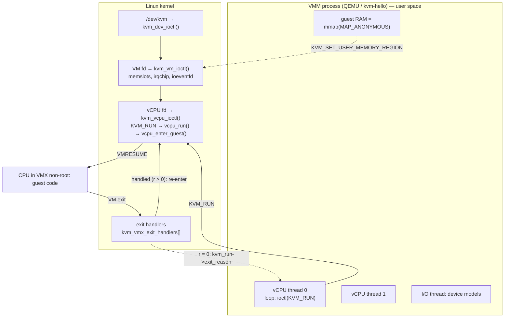

<div dir="rtl">

# ۰۷ — معماری KVM: `/dev/kvm`، file descriptorها و نخ‌های vCPU

> ماژول ۶ · سیستم‌عامل توزیع‌شده و مجازی‌سازی · نسخه‌های ثابت: Linux **v6.18.63** و OpenBSD **`8cada8c`** · هر جا گفته شده **ARCH-SPECIFIC (x86-64)** · نسخهٔ انگلیسی: [`07-kvm-architecture.en.md`](07-kvm-architecture.en.md)

## واژه‌نامه

| اصطلاح | تعریف |
|---|---|
| **KVM** | ماژول‌های کرنل لینوکس (`kvm.ko` به‌اضافهٔ `kvm-intel.ko` یا `kvm-amd.ko`) که کرنل را به hypervisor تبدیل می‌کنند. |
| **VMM فضای کاربر** | پردازه‌ای که صاحب VM است: QEMU، Firecracker، cloud-hypervisor، crosvm یا کلاینت ۱۰۰ خطی آزمایش ۰۴. |
| **vCPU** | CPU مجازی. در KVM هم یک file descriptor است و هم یک نخ میزبان که روی آن `ioctl(KVM_RUN)` صدا می‌زند. |
| **`struct kvm_run`** | صفحه‌ای که (با `mmap` روی fd مربوط به vCPU) بین KVM و فضای کاربر مشترک است و می‌گوید `KVM_RUN` چرا برگشت. |
| **Memory slot** | نگاشت «یک بازهٔ فیزیکیِ مهمان ← یک بازهٔ آدرس مجازیِ همین پردازه» (`KVM_SET_USER_MEMORY_REGION`). |
| **In-kernel irqchip** | شبیه‌سازی local APIC و IOAPIC داخل KVM تا وقفه‌ها به فضای کاربر نیاز نداشته باشند. |
| **ioeventfd / irqfd** | قلاب‌های eventfd: نوشتن مهمان روی یک «زنگ» بدون برگشتن از `KVM_RUN` یک fd را خبر می‌کند؛ نوشتن روی یک fd به مهمان وقفه تزریق می‌کند. |
| **virtio / vhost** | دستگاه‌های paravirtual با صف‌های حافظهٔ مشترک؛ vhost بخش پشتی دستگاه را به یک نخ کرنل منتقل می‌کند. |

## ۱. خلاصه

- KVM یک برنامهٔ hypervisor جداگانه نیست: یک **دستگاه کاراکتری** است که ioctlهایش یک پردازهٔ معمولی لینوکس را به VM و نخ‌هایش را به vCPU تبدیل می‌کند. زمان‌بند، مدیریت حافظه و cgroupهای لینوکس همان‌طور که هستند دوباره استفاده می‌شوند.
- سه سطح fd داریم: `/dev/kvm` (سیستم) ← fd مربوط به VM (`KVM_CREATE_VM`) ← fd مربوط به vCPU (`KVM_CREATE_VCPU`). RAM مهمان حافظهٔ معمولیِ `mmap`شدهٔ پردازهٔ VMM است.
- حلقهٔ اصلی `ioctl(vcpufd, KVM_RUN)` است: وارد مهمان شو، تا جای ممکن exitها را داخل کرنل رسیدگی کن، و فقط وقتی مدل دستگاه لازم است **به فضای کاربر برگرد** (`KVM_EXIT_IO`، `KVM_EXIT_MMIO`، یا `KVM_EXIT_HLT` وقتی irqchip داخل کرنل نیست و…).

## ۲. توضیح مفصل

### ۲.۱ شهود: VM یک پردازه است و vCPU یک نخ

از دید میزبان، یک VM مبتنی بر QEMU/KVM فقط یک پردازه است. `ps -L` برای هر vCPU یک نخ نشان می‌دهد، به‌اضافهٔ نخ‌های I/O؛ `top` زمان CPU مهمان را زمان CPU همان نخ نشان می‌دهد؛ `memory.max` روی cgroup مربوط به VM حافظهٔ مهمان را محدود می‌کند؛ `taskset` vCPUها را روی هسته‌ها سنجاق می‌کند. هر چه در ماژول‌های ۰۲ و ۰۴ یاد گرفتید بدون تغییر اینجا هم درست است. KVM فقط یک «روش اجرای» تازه اضافه می‌کند: نخ به‌جای برگشتن به حالت کاربر، وارد حالت VMX non-root می‌شود (یادداشت ۰۶).

### ۲.۲ سلسله‌مراتب fdها

| fd | سازنده | ioctlهای رایج |
|---|---|---|
| سیستم (`open("/dev/kvm")`) | `open(2)` | `KVM_GET_API_VERSION`، `KVM_CHECK_EXTENSION`، `KVM_CREATE_VM`، `KVM_GET_VCPU_MMAP_SIZE` |
| VM | `KVM_CREATE_VM` | `KVM_SET_USER_MEMORY_REGION`، `KVM_CREATE_VCPU`، `KVM_CREATE_IRQCHIP`، `KVM_IOEVENTFD`، `KVM_IRQFD` |
| vCPU | `KVM_CREATE_VCPU` | `KVM_RUN`، `KVM_GET/SET_REGS`، `KVM_GET/SET_SREGS`، `KVM_SET_CPUID2`؛ با `mmap` به `struct kvm_run` می‌رسیم |

استفاده از file descriptor یعنی مدیریت طول عمر مجانی به دست می‌آید: fd مربوط به VM را ببندید (یا بگذارید پردازه بمیرد) و VM نابود می‌شود؛ fd را از راه یک سوکت UNIX بفرستید و پردازهٔ دیگری می‌تواند آن را بگرداند؛ seccomp و مجوزهای fd هم اعمال می‌شوند.

### ۲.۳ حافظه

فضای کاربر حافظهٔ anonymous را `mmap` می‌کند و به KVM می‌گوید «بازهٔ فیزیکیِ مهمان 0x0 تا 0x3fffffff همین بازهٔ مجازیِ میزبان است». KVM درایه‌های EPT را تنبل (lazily) می‌سازد: اولین دسترسی مهمان به یک صفحه یک EPT violation می‌دهد، KVM آدرس مجازیِ میزبان را با سازوکار معمولی page fault میزبان (شبیه `get_user_pages`) حل می‌کند و نگاشت GPA ← HPA را نصب می‌کند. نتیجه: RAM مهمان می‌تواند swap شود، با KSM ادغام شود، روی huge page باشد یا با cgroup حافظه محدود شود؛ درست مثل حافظهٔ هر پردازهٔ دیگر.

### ۲.۴ حلقهٔ اجرا

مسیر `KVM_RUN` این است: `kvm_vcpu_ioctl()` ← `kvm_arch_vcpu_ioctl_run()` ← `vcpu_run()` ← `vcpu_enter_guest()` ← `kvm_x86_call(vcpu_run)` (در VMX یعنی `vmx_vcpu_run` که `VMRESUME` را اجرا می‌کند) ← exit ← `kvm_x86_call(handle_exit)` ← `kvm_vmx_exit_handlers[reason]`. هر handler یکی از این‌ها را برمی‌گرداند:

- `> 0`: داخل کرنل رسیدگی شد؛ حلقه ادامه دارد و دوباره وارد مهمان می‌شویم؛
- `0`: فضای کاربر باید کاری بکند؛ `kvm_run->exit_reason` دلیل را می‌گوید و `ioctl` برمی‌گردد؛
- `< 0`: خطا.

exitهایی که کاملاً داخل کرنل رسیدگی می‌شوند ارزان‌اند (صدها نانوثانیه، یادداشت ۰۶). exit به فضای کاربر یک برگشت کامل از syscall، یک رفتن به کد VMM و یک `ioctl` دیگر اضافه می‌کند (چند میکروثانیه).

### ۲.۵ کم کردن exit به فضای کاربر

- **irqchip داخل کرنل** (`KVM_CREATE_IRQCHIP`): APIC/IOAPIC/PIC داخل KVM شبیه‌سازی می‌شوند؛ با APICv و posted interrupts سخت‌افزار خیلی از وقفه‌ها را بدون هیچ exitی تحویل می‌دهد.
- **ioeventfd**: نوشتن مهمان روی ثبات «notify» در virtio داخل کرنل تطبیق داده می‌شود و فقط یک eventfd را خبر می‌کند؛ vCPU بلافاصله به مهمان برمی‌گردد.
- **irqfd**: نوشتن روی یک eventfd به مهمان وقفه تزریق می‌کند؛ پس نخ I/O هرگز لازم نیست یک vCPU را متوقف کند.
- **virtio**: درایور مهمان می‌داند مجازی است و درخواست‌ها را در حلقه‌های مشترک (vring) می‌گذارد، به‌جای اینکه یکی‌یکی به ثبات‌های شبیه‌سازی‌شده دست بزند.
- **vhost / vhost-user**: بخش پشتی virtio در یک نخ کرنل (`vhost-net`) یا پردازهٔ دیگر اجرا می‌شود، پس بسته‌ها اصلاً از QEMU رد نمی‌شوند.

### ۲.۶ ترکیب vmm(4) و vmd(8) در OpenBSD

OpenBSD طراحی کوچک‌تری دارد: `vmm(4)` در کرنل و `vmd(8)` در فضای کاربر (یک پردازه برای هر VM، با تفکیک امتیاز و `pledge`). کرنل CPU، EPT و چند exit را رسیدگی می‌کند؛ **هر exit مربوط به پورت I/O به vmd برمی‌گردد**: تابع `vmx_handle_inout()` ساختار `vcpu->vc_exit.vei` (پورت، اندازه، جهت، داده) را پر می‌کند و `VMM_ACTION_ASSIST` برمی‌گرداند. معادلی برای ioeventfd یا vhost داخل کرنل وجود ندارد؛ این کرنل را کوچک نگه می‌دارد ولی exit بیشتری به فضای کاربر می‌دهد (بخش ۴.۳).

## ۳. نمودار

</div>



<div dir="rtl">

## ۴. مثال کاربردی

### ۴.۱ سورس واقعی: ioctl شمارهٔ KVM_RUN

`linux/virt/kvm/kvm_main.c · kvm_vcpu_ioctl() · v6.18.63` ([Elixir L4471](https://elixir.bootlin.com/linux/v6.18.63/source/virt/kvm/kvm_main.c#L4471))، خط‌های ۴۴۷۱ تا ۴۵۰۴، کوتاه‌شده:

</div>

```c
	case KVM_RUN: {
		struct pid *oldpid;
		r = -EINVAL;
		if (arg)
			goto out;
		/* ... comment on vcpu->pid locking ... */
		oldpid = vcpu->pid;
		if (unlikely(oldpid != task_pid(current))) {
			/* The thread running this VCPU changed. */
			struct pid *newpid;

			r = kvm_arch_vcpu_run_pid_change(vcpu);
			if (r)
				break;

			newpid = get_task_pid(current, PIDTYPE_PID);
			write_lock(&vcpu->pid_lock);
			vcpu->pid = newpid;
			write_unlock(&vcpu->pid_lock);

			put_pid(oldpid);
		}
		vcpu->wants_to_run = !READ_ONCE(vcpu->run->immediate_exit__unsafe);
		r = kvm_arch_vcpu_ioctl_run(vcpu);
		vcpu->wants_to_run = false;

		trace_kvm_userspace_exit(vcpu->run->exit_reason, r);
		break;
```

<div dir="rtl">

- `vcpu->pid` ثبت می‌کند **کدام نخ میزبان** این vCPU را اجرا می‌کند. KVM از آن برای directed yield استفاده می‌کند (vCPUای که روی یک قفل می‌چرخد می‌تواند به نخ صاحب قفل نوبت بدهد)؛ یعنی vCPU واقعاً *یک نخ است*.
- اگر نخ دیگری `KVM_RUN` را صدا بزند، اول hook معماری اجرا می‌شود؛ جابه‌جا کردن vCPU بین نخ‌ها مجاز است ولی کم پیش می‌آید.
- پیش از این switch، ioctl قفل `vcpu->mutex` را گرفته است (خط ۴۴۶۸): دو نخ نمی‌توانند هم‌زمان یک vCPU را اجرا کنند.
- `kvm_arch_vcpu_ioctl_run()` ورودی x86 به حلقهٔ اجراست و فقط وقتی برمی‌گردد که فضای کاربر لازم باشد.
- `trace_kvm_userspace_exit` همان tracepoint به نام `kvm:kvm_userspace_exit` است که `perf kvm stat` و `bpftrace` می‌توانند بشمارند.

`linux/arch/x86/kvm/x86.c · vcpu_enter_guest() · v6.18.63`؛ دو خط دور و بر جابه‌جایی سخت‌افزاری ([L11014](https://elixir.bootlin.com/linux/v6.18.63/source/arch/x86/kvm/x86.c#L11014) و [L11132](https://elixir.bootlin.com/linux/v6.18.63/source/arch/x86/kvm/x86.c#L11132)):

</div>

```c
		exit_fastpath = kvm_x86_call(vcpu_run)(vcpu, run_flags);
	/* ... */
	r = kvm_x86_call(handle_exit)(vcpu, exit_fastpath);
	return r;
```

<div dir="rtl">

`kvm_x86_call(vcpu_run)` همان hook وابسته به سازنده است (`vmx_vcpu_run` یا `svm_vcpu_run`) که وارد مهمان می‌شود و با exit بعدی برمی‌گردد؛ `handle_exit` بر اساس دلیل exit تصمیم می‌گیرد. وقتی یک exit به فضای کاربر نیاز دارد، handler دلیل را در صفحهٔ مشترک می‌نویسد و ۰ برمی‌گرداند؛ همان کاری که `emulator_pio_in_out()` برای پورت I/O می‌کند ([L8081](https://elixir.bootlin.com/linux/v6.18.63/source/arch/x86/kvm/x86.c#L8081)):

</div>

```c
	vcpu->run->exit_reason = KVM_EXIT_IO;
	vcpu->run->io.direction = in ? KVM_EXIT_IO_IN : KVM_EXIT_IO_OUT;
	vcpu->run->io.size = size;
	vcpu->run->io.data_offset = KVM_PIO_PAGE_OFFSET * PAGE_SIZE;
	vcpu->run->io.count = count;
	vcpu->run->io.port = port;
	return 0;
```

<div dir="rtl">

`data_offset` به صفحهٔ دوم نگاشت vCPU اشاره می‌کند؛ به همین دلیل `KVM_GET_VCPU_MMAP_SIZE` روی x86 مقدار `PAGE_SIZE + PAGE_SIZE` برمی‌گرداند («pio data page»، در `kvm_dev_ioctl()` خط‌های ۵۵۶۶ تا ۵۵۶۹).

### ۴.۲ همین پروتکل از سمت فضای کاربر: `labs/04-kvm-client/kvm-hello.c`

VMM آزمایش (با `gcc -Wall -Wextra -O2` و بدون هیچ هشداری کامپایل می‌شود) دقیقاً همین مسیر fdها را طی می‌کند:

</div>

```c
	int kvm = open("/dev/kvm", O_RDWR | O_CLOEXEC);
	int vmfd = ioctl(kvm, KVM_CREATE_VM, 0UL);            /* VM fd   */
	uint8_t *mem = mmap(NULL, 0x1000, PROT_READ | PROT_WRITE,
	                    MAP_SHARED | MAP_ANONYMOUS, -1, 0); /* guest RAM */
	ioctl(vmfd, KVM_SET_USER_MEMORY_REGION, &region);     /* GPA 0x1000 -> mem */
	int vcpufd = ioctl(vmfd, KVM_CREATE_VCPU, 0UL);       /* vCPU fd */
	struct kvm_run *run = mmap(NULL, run_size, PROT_READ | PROT_WRITE,
	                           MAP_SHARED, vcpufd, 0);    /* shared exit page */
	/* ... set CS base 0, RIP = 0x1000, RAX = RBX = 2 ... */
	ioctl(vcpufd, KVM_RUN, 0);                            /* loop on run->exit_reason */
```

<div dir="rtl">

مهمان real-mode فقط ۱۲ بایت است: `mov $0x3f8,%dx; add %bl,%al; add $'0',%al; out %al,(%dx); mov $'\n',%al; out %al,(%dx); hlt`. هر `out` یک `EXIT_REASON_IO_INSTRUCTION` است ← `handle_io()` ← روی پورت 0x3f8 دستگاهی داخل کرنل نیست ← `KVM_EXIT_IO` به فضای کاربر، که بایت را از `run + run->io.data_offset` چاپ می‌کند. دستور `hlt` چون آزمایش irqchip داخل کرنل نمی‌سازد، `KVM_EXIT_HLT` برمی‌گرداند. پس برنامه باید `4` چاپ کند و سه exit به فضای کاربر گزارش دهد.

**خروجی اجرا UNVERIFIED است.** نه VM به نام aos-lab (VirtualBox روی Hyper-V، بدون VT-x تودرتو) و نه VMِ WSL2 مربوط به Docker Desktop روی میزبان درس، `/dev/kvm` ندارند (بررسی در 2026-11-15: `ls: cannot access '/dev/kvm'`). کد بدون هشدار کامپایل می‌شود ولی اجرایش گرفته نشده است. روی ماشینی که KVM دارد با `ls /dev/kvm` و `./kvm-hello` بررسی کنید.

### ۴.۳ OpenBSD: هر exit مربوط به I/O به vmd می‌رود

`openbsd/sys/arch/amd64/amd64/vmm_machdep.c · vmx_handle_exit() · 8cada8c` (خط‌های ۴۷۸۶ تا ۴۸۱۲، کوتاه‌شده):

</div>

```c
	switch (exit_reason) {
	/* ... */
	case VMX_EXIT_EPT_VIOLATION:
		action = vmx_handle_np_fault(vcpu);
		break;
	case VMX_EXIT_CPUID:
		action = vmm_handle_cpuid(vcpu);
		break;
	case VMX_EXIT_IO:
		action = vmx_handle_inout(vcpu);
		break;
	/* ... */
	case VMX_EXIT_HLT:
		action = vmx_handle_hlt(vcpu);
		break;
```

<div dir="rtl">

شکلش همان جدول لینوکس است، فقط به‌صورت `switch` نوشته شده. `vmx_handle_inout()` exit qualification را در `vcpu->vc_exit.vei` رمزگشایی می‌کند (`vei_port`، `vei_dir`، `vei_size`، `vei_data`) و `VMM_ACTION_ASSIST` برمی‌گرداند (خط ۵۵۰۵): ioctl به نام `VMM_IOC_RUN` (در `sys/dev/vmm/vmm.c` خط ۸۵۱، تابع `vm_run()`) به vmd برمی‌گردد، vmd دستگاه را شبیه‌سازی می‌کند و vCPU را دوباره اجرا می‌کند.

| انتخاب طراحی | Linux KVM | OpenBSD vmm/vmd | بده‌بستان |
|---|---|---|---|
| پورت I/O | دستگاه‌های داخل کرنل (PIT، PIC، ioeventfd) یا exit به فضای کاربر | همیشه exit به vmd | exit کمتر در برابر سطح حملهٔ کوچک‌تر در کرنل |
| کنترل‌کنندهٔ وقفه | APIC/IOAPIC داخل کرنل، posted interrupts | بیشترش در vmd | تأخیر در برابر سادگی |
| بخش پشتی paravirtual | vhost در نخ‌های کرنل | دستگاه‌های virtio در vmd | توان عملیاتی در برابر جداسازی (vmd با pledge محدود است) |
| API | یک fd برای هر VM و هر vCPU | ioctlهای `/dev/vmm` (fd مربوط به VM از طریق `vm_ioctl`) | هر دو بر پایهٔ ioctl |

## ۵. حالت‌های خاص و دام‌ها

- **نبودن `/dev/kvm`**: یعنی VT-x/AMD-V نیست، در BIOS خاموش است، یا hypervisor بیرونی مجازی‌سازی تودرتو نمی‌دهد (حالت ما). با `grep -c -w -E 'vmx|svm' /proc/cpuinfo` ببینید مهمان این قابلیت را می‌بیند یا نه.
- **`KVM_EXIT_FAIL_ENTRY`**: وضعیت مهمان در VMCS نامعتبر است (مثلاً segmentها بد تنظیم شده‌اند) و CPU ورود به VM را رد کرده. `hardware_entry_failure_reason` می‌گوید کدام بررسی شکست خورد.
- **`KVM_EXIT_INTERNAL_ERROR`**: شبیه‌ساز دستور KVM نتوانسته چیزی را شبیه‌سازی کند (اغلب اجرای کد از MMIO).
- **فراموش کردن `rflags = 0x2`**: بیت ۱ در RFLAGS رزرو است و باید ۱ باشد؛ اگر صفر بماند، ورود شکست می‌خورد.
- **خواندن `kvm_run` بعد از exit اشتباه**: فیلدهای union (`io`، `mmio` و…) فقط برای `exit_reason` متناظرشان معتبرند.
- **پایداری API:** `KVM_GET_API_VERSION` سال‌هاست ۱۲ است؛ قابلیت‌های تازه با `KVM_CHECK_EXTENSION` کشف می‌شوند، نه با شمارهٔ نسخه (قابلیت‌ها VERSION-DEPENDENT هستند).
- **«KVM یک hypervisor نوع ۲ است».** برچسب نوع ۱/نوع ۲ خوب جور نمی‌شود: KVM در کرنل میزبان با امتیاز کامل اجرا می‌شود (شبیه نوع ۱)، ولی برای زمان‌بندی و درایورها از یک سیستم‌عامل همه‌منظوره استفاده می‌کند.

## ۶. نکته‌های امتحانی

- KVM = ماژول‌های کرنل + API مبتنی بر ioctl؛ VM یک پردازه است و vCPU نخی است که `KVM_RUN` را صدا می‌زند.
- سلسله‌مراتب fd: `/dev/kvm` ← fd مربوط به VM ← fd مربوط به vCPU؛ `mmap(vcpufd)` ساختار `struct kvm_run` را می‌دهد (به‌اضافهٔ صفحهٔ داده‌های PIO روی x86).
- RAM مهمان = حافظهٔ کاربرِ میزبان که به شکل memslot ثبت شده؛ EPT با EPT violationها به‌تدریج پر می‌شود.
- `KVM_RUN` ← `kvm_arch_vcpu_ioctl_run` ← `vcpu_run` ← `vcpu_enter_guest` ← `vmx_vcpu_run` … `handle_exit`؛ handler اگر مقدار مثبت برگرداند دوباره وارد مهمان می‌شویم و اگر ۰ برگرداند به فضای کاربر می‌رویم.
- exit به فضای کاربر گران است؛ irqchip داخل کرنل، ioeventfd/irqfd، virtio و vhost آن را کم می‌کنند.
- `vcpu->pid` و `vcpu->mutex`: هر بار فقط یک نخ یک vCPU را اجرا می‌کند؛ برای directed yield هم استفاده می‌شود.
- vmm در OpenBSD: همان انتخاب handler بر اساس دلیل exit، ولی I/O همیشه به vmd می‌رود (`VMM_ACTION_ASSIST`).

## ۷. پیوندها

- درس: [`../lesson.fa.md`](../lesson.fa.md) بخش ۴.۷ (KVM)
- مرور کد کرنل: [`../kernel-walkthrough.fa.md`](../kernel-walkthrough.fa.md) (زنجیرهٔ فراخوانی KVM و مقایسه با vmm در OpenBSD)
- آزمایش‌ها: [`../labs/04-kvm-client/`](../labs/04-kvm-client/) (VMM صدخطی)، [`../labs/05-vmexit-cost/`](../labs/05-vmexit-cost/) (بخش `perf kvm stat`)
- آزمون: [`../quiz.fa.md`](../quiz.fa.md) پرسش ۷ (خواندن بخش KVM_RUN)، پرسش ۱۴ (اشکال‌زدایی کلاینت KVMی که چیزی چاپ نمی‌کند)
- قبلی / بعدی: [`06-hypervisors-vtx-ept.fa.md`](06-hypervisors-vtx-ept.fa.md) · [`08-containers-namespaces-cgroups.fa.md`](08-containers-namespaces-cgroups.fa.md)

</div>
