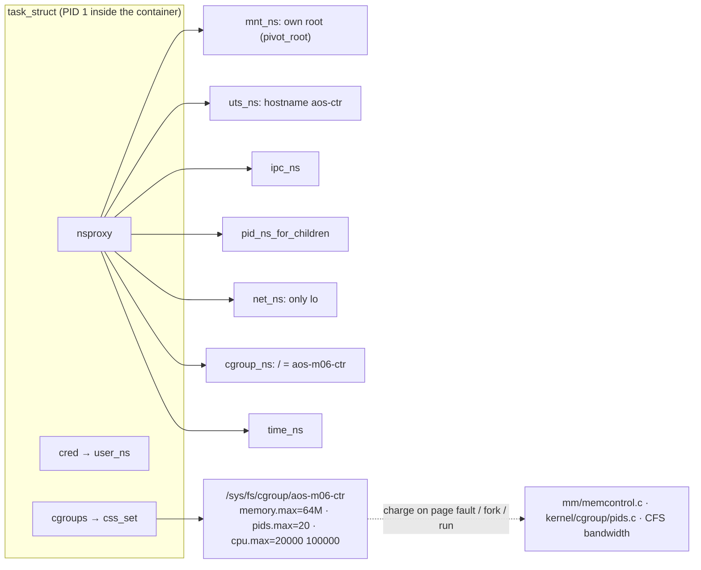

# 08 — Containers = namespaces + cgroups v2

> Module 06 · Distributed OS & Virtualization · pins: Linux **v6.18.63**, OpenBSD **`8cada8c`** · Farsi: [`08-containers-namespaces-cgroups.fa.md`](08-containers-namespaces-cgroups.fa.md)

## Glossary

| Term | Meaning |
|---|---|
| **Namespace** | A kernel object that gives a group of processes its own *view* of one global resource (PIDs, mounts, hostname, network…). |
| **`struct nsproxy`** | Per-task pointer bundle to the task's mount, UTS, IPC, PID-for-children, cgroup, net and time namespaces (the user namespace hangs off the credentials). |
| **`clone()` / `unshare()` / `setns()`** | Create a child in new namespaces / move the caller into new namespaces / join an existing namespace via an fd from `/proc/<pid>/ns/`. |
| **cgroup v2** | One unified hierarchy at `/sys/fs/cgroup`; each directory is a group, files inside are controller knobs. |
| **Controller** | A resource policy attached to the hierarchy: `memory`, `cpu`, `pids`, `io`, `cpuset`, … |
| **`pivot_root(2)`** | Swap the root mount of the caller's mount namespace; the old root is moved under the new one and can then be unmounted. |
| **User namespace** | Maps UIDs/GIDs; root inside it holds capabilities only over resources owned by that namespace. |

## 1. Summary

- A container is **not a kernel object**. It is an ordinary process tree whose task structs point at *new namespaces* (what it can see) and whose cgroup has *limits* (how much it can use), plus a root filesystem switched with `pivot_root`.
- Namespaces are created by `clone(CLONE_NEW*)` or `unshare(CLONE_NEW*)`; in the kernel both end up in `create_new_namespaces()` in `kernel/nsproxy.c`, which copies or creates each of the namespace pointers.
- cgroup v2 limits are plain file writes: `memory.max`, `pids.max`, `cpu.max`. A process joins a group by writing its PID to `cgroup.procs`. Containers share one kernel, so the isolation boundary is the syscall interface — much weaker than a VM's (note 06).

## 2. Detailed explanation

### 2.1 Intuition: same kernel, different views, different budgets

A VM gives the guest a fake *machine*. A container gives a process a fake *view of one kernel*. `ps` in a new PID namespace starts at PID 1; `hostname` in a new UTS namespace changes only there; a new network namespace has only a `lo` interface that is down. Meanwhile the scheduler, page cache and drivers are the same for everyone. cgroups add the second half: accounting and limits, so one container can't take all memory, PIDs or CPU.

### 2.2 The namespace types (v6.18)

| Type | Flag | Isolates | Since |
|---|---|---|---|
| mount | `CLONE_NEWNS` | mount table | 2.4.19 |
| UTS | `CLONE_NEWUTS` | hostname, domainname | 2.6.19 |
| IPC | `CLONE_NEWIPC` | SysV IPC, POSIX mqueues | 2.6.19 |
| PID | `CLONE_NEWPID` | PID numbers | 2.6.24 |
| network | `CLONE_NEWNET` | interfaces, routes, sockets, netfilter | 2.6.29 |
| user | `CLONE_NEWUSER` | UID/GID mappings, capabilities | 3.8 |
| cgroup | `CLONE_NEWCGROUP` | the visible root of the cgroup tree | 4.6 |
| time | `CLONE_NEWTIME` | `CLOCK_MONOTONIC`/`BOOTTIME` offsets | 5.6 |

Each process's namespaces appear as symlinks in `/proc/<pid>/ns/`; the inode number in `pid:[4026532467]` *is* the namespace's identity. Two processes are in the same namespace exactly when the inode numbers match.

### 2.3 Mechanism: `nsproxy`

`task_struct->nsproxy` points to a shared, refcounted `struct nsproxy`. `fork()` without `CLONE_NEW*` flags just takes another reference (`copy_namespaces()`). With any `CLONE_NEW*` flag, `create_new_namespaces()` allocates a new nsproxy and, for each type, calls `copy_<type>(flags, …)`: the function returns the old namespace with a reference *or* a brand-new one if its flag is set (§4.1). `unshare()` calls the same function through `unshare_nsproxy_namespaces()`, after a `CAP_SYS_ADMIN` check **in the target user namespace** (§4.1). `setns(fd)` switches one pointer to an existing namespace.

### 2.4 The PID-namespace subtlety

`nsproxy` has `pid_ns_for_children`, not `pid_ns`. A process's own PID namespace is fixed for life (its `struct pid` was allocated at fork). `unshare(CLONE_NEWPID)` therefore changes only where **future children** go: the first child becomes **PID 1** of the new namespace — its *init*. If that init exits, the namespace is dead and further `fork()`s into it fail with `ENOMEM` (shown as "Cannot fork" in §4.3). That is why `unshare(1)` has `--fork`, and why the PID-1 process of a container must reap orphans and handle signals.

### 2.5 User namespaces and capabilities

An unprivileged user can `unshare(CLONE_NEWUSER)`, becomes UID 0 *inside* (with a mapping written to `/proc/<pid>/uid_map`), and gets a full capability set — but `ns_capable(ns, CAP_…)` checks only succeed for resources owned by that user namespace. That is how rootless containers create mount/net/PID namespaces without real root. VERSION-DEPENDENT: Ubuntu 24.04 restricts unprivileged user namespaces via AppArmor (`kernel.apparmor_restrict_unprivileged_userns`).

### 2.6 cgroup v2

- One hierarchy, mounted at `/sys/fs/cgroup`. `cgroup.controllers` lists what is available in a group; writing `+memory` to the parent's `cgroup.subtree_control` enables it for the children.
- **No internal processes:** a non-root group that delegates controllers to children can't hold processes itself; processes live in leaves.
- Core knobs used in Lab 03:
  - `memory.max` — hard limit; above it the kernel reclaims in the group, then OOM-kills inside the group (`memory.events: oom_kill`). `memory.high` throttles instead of killing.
  - `pids.max` — `fork()`/`clone()` fail with `EAGAIN` once the group (and every ancestor) is at its limit.
  - `cpu.max` — `"$QUOTA $PERIOD"` in µs, CFS-bandwidth style throttling; `cpu.weight` is the proportional share.
  - `io.max` — per-device bandwidth/IOPS limits.
- **Joining:** write a PID to `cgroup.procs` (whole thread group) or a TID to `cgroup.threads` (threaded groups). The write goes through `__cgroup_procs_write()` (§4.2).
- **Delegation:** chown a subtree to a user and they can manage it (systemd does this for user sessions); the permission check uses the credentials of the **opener** of the file.

### 2.7 OpenBSD: no namespaces, no cgroups

OpenBSD has neither. Its isolation answers are different tools: `chroot(2)` for the filesystem view, **`pledge(2)`** (restrict which *syscall families* a process may use) and **`unveil(2)`** (restrict which *paths* it may see), and `vmm(4)` when a real boundary is needed. Pledge is a self-imposed sandbox, not a resource view: it is checked on every syscall in `pledge_syscall()` (§4.4).

## 3. Diagram



## 4. Worked example

### 4.1 Real source: one function creates all namespaces

`linux/kernel/nsproxy.c · create_new_namespaces() · v6.18.63` ([Elixir L67](https://elixir.bootlin.com/linux/v6.18.63/source/kernel/nsproxy.c#L67)), lines 74–101:

```c
	new_nsp = create_nsproxy();
	if (!new_nsp)
		return ERR_PTR(-ENOMEM);

	new_nsp->mnt_ns = copy_mnt_ns(flags, tsk->nsproxy->mnt_ns, user_ns, new_fs);
	if (IS_ERR(new_nsp->mnt_ns)) {
		err = PTR_ERR(new_nsp->mnt_ns);
		goto out_ns;
	}

	new_nsp->uts_ns = copy_utsname(flags, user_ns, tsk->nsproxy->uts_ns);
	if (IS_ERR(new_nsp->uts_ns)) {
		err = PTR_ERR(new_nsp->uts_ns);
		goto out_uts;
	}

	new_nsp->ipc_ns = copy_ipcs(flags, user_ns, tsk->nsproxy->ipc_ns);
	/* ... */
	new_nsp->pid_ns_for_children =
		copy_pid_ns(flags, user_ns, tsk->nsproxy->pid_ns_for_children);
```

- A new `nsproxy` is allocated; every field is then filled by a `copy_*()` helper that looks at `flags`.
- The pattern is uniform: if the flag (e.g. `CLONE_NEWUTS`) is clear, the helper returns the **old** namespace with an extra reference; if set, a new one (a copy of the old, for UTS and mount).
- Errors unwind with a `goto` ladder in reverse order, releasing what was already taken.
- Note the field name `pid_ns_for_children`; the next helper shows why.

`linux/kernel/pid_namespace.c · copy_pid_ns() · v6.18.63` ([Elixir L175](https://elixir.bootlin.com/linux/v6.18.63/source/kernel/pid_namespace.c#L175)):

```c
struct pid_namespace *copy_pid_ns(u64 flags,
	struct user_namespace *user_ns, struct pid_namespace *old_ns)
{
	if (!(flags & CLONE_NEWPID))
		return get_pid_ns(old_ns);
	if (task_active_pid_ns(current) != old_ns)
		return ERR_PTR(-EINVAL);
	return create_pid_namespace(user_ns, old_ns);
}
```

- No flag → share. With the flag, the new namespace becomes a **child** of `old_ns` (`create_pid_namespace(user_ns, old_ns)`): PID namespaces nest; a parent sees all descendants' processes, with different numbers.
- The `-EINVAL` check: you can only create a new PID namespace if you haven't already redirected your children elsewhere (`unshare(CLONE_NEWPID)` twice without forking fails).

`linux/kernel/nsproxy.c · unshare_nsproxy_namespaces() · v6.18.63` ([L209–216](https://elixir.bootlin.com/linux/v6.18.63/source/kernel/nsproxy.c#L209)):

```c
	if (!(unshare_flags & (CLONE_NEWNS | CLONE_NEWUTS | CLONE_NEWIPC |
			       CLONE_NEWNET | CLONE_NEWPID | CLONE_NEWCGROUP |
			       CLONE_NEWTIME)))
		return 0;

	user_ns = new_cred ? new_cred->user_ns : current_user_ns();
	if (!ns_capable(user_ns, CAP_SYS_ADMIN))
		return -EPERM;
```

`CLONE_NEWUSER` is not in this list: it is handled earlier through the credentials (`new_cred`). The capability check is against the **new** user namespace if one is being created in the same call — which is why `unshare --user --map-root-user --pid …` works without real root.

### 4.2 Real source: joining a cgroup and enforcing a limit

`linux/kernel/cgroup/cgroup.c · __cgroup_procs_write() · v6.18.63` ([Elixir L5390](https://elixir.bootlin.com/linux/v6.18.63/source/kernel/cgroup/cgroup.c#L5390)), lines 5409–5427:

```c
	/* find the source cgroup */
	spin_lock_irq(&css_set_lock);
	src_cgrp = task_cgroup_from_root(task, &cgrp_dfl_root);
	spin_unlock_irq(&css_set_lock);

	/*
	 * Process and thread migrations follow same delegation rule. Check
	 * permissions using the credentials from file open to protect against
	 * inherited fd attacks.
	 */
	saved_cred = override_creds(of->file->f_cred);
	ret = cgroup_attach_permissions(src_cgrp, dst_cgrp,
					of->file->f_path.dentry->d_sb,
					threadgroup, ctx->ns);
	revert_creds(saved_cred);
	if (ret)
		goto out_finish;

	ret = cgroup_attach_task(dst_cgrp, task, threadgroup);
```

`echo $PID > cgroup.procs` is this function: find where the task is now, check delegation rights *with the opener's credentials* (so a privileged fd handed to an unprivileged process can't be abused), then migrate.

`linux/kernel/cgroup/pids.c · pids_try_charge() · v6.18.63` ([Elixir L166](https://elixir.bootlin.com/linux/v6.18.63/source/kernel/cgroup/pids.c#L166)), lines 170–182:

```c
	for (p = pids; parent_pids(p); p = parent_pids(p)) {
		int64_t new = atomic64_add_return(num, &p->counter);
		int64_t limit = atomic64_read(&p->limit);

		/*
		 * Since new is capped to the maximum number of pid_t, if
		 * p->limit is %PIDS_MAX then we know that this test will never
		 * fail.
		 */
		if (new > limit) {
			*fail = p;
			goto revert;
		}
```

The charge walks **up** the hierarchy: a fork must fit under the limit of every ancestor. On failure the charges already made are reverted and `fork()` returns `EAGAIN`. `mm/memcontrol.c · memory_max_write()` (L4437) shows the memory side: writing a new `memory.max` lowers the limit with `xchg()` and then actively reclaims (`try_to_free_mem_cgroup_pages`) until usage fits, finally raising an OOM event in the group.

### 4.3 Real output: PID namespaces need a fork

Captured 2026-11-15 in a privileged `ubuntu:24.04` container on Docker Desktop (WSL2 kernel `6.18.58.1-microsoft-standard-WSL2`):

```
$ ls -l /proc/self/ns        # (trimmed to the link targets)
cgroup -> cgroup:[4026532468]
ipc -> ipc:[4026532466]
mnt -> mnt:[4026532463]
net -> net:[4026532469]
pid -> pid:[4026532467]
pid_for_children -> pid:[4026532467]
time -> time:[4026532537]
time_for_children -> time:[4026532537]
user -> user:[4026531837]
uts -> uts:[4026532465]
$ cat /proc/self/cgroup; cat /sys/fs/cgroup/cgroup.controllers
0::/
cpuset cpu io memory hugetlb pids rdma
$ unshare --pid --fork --mount-proc ps -ef
UID          PID    PPID  C STIME TTY          TIME CMD
root           1       0  0 15:37 ?        00:00:00 ps -ef
$ unshare --pid sh -c 'echo "shell pid in parent ns: $$"; sh -c "echo first child: pid \$\$"; sh -c "echo second child: pid \$\$"'
shell pid in parent ns: 7
first child: pid 1
sh: 1: Cannot fork
```

- `pid` and `pid_for_children` are separate links: the second is `nsproxy->pid_ns_for_children`.
- `user:[4026531837]` is the initial user namespace (Docker didn't create one); the other inodes differ from the host's because Docker created those namespaces.
- `0::/` is cgroup v2 ("hierarchy 0") seen through Docker's cgroup namespace: the container's group looks like the root.
- With `--fork`, `ps` is PID 1 and `--mount-proc` gives a `/proc` that shows only the new namespace.
- Without `--fork`: `sh` stays PID 7 in the old namespace; its first child becomes PID 1 (init) of the new one, exits, and the namespace dies — the next `fork()` fails. This is §2.4 live.

The full container (cgroup limits, `pivot_root`, OOM kill, `pids.max` refusals) is Lab 03.

### 4.4 OpenBSD contrast: pledge instead of namespaces

`openbsd/sys/kern/kern_pledge.c · pledge_syscall() · 8cada8c` (L536–554):

```c
int
pledge_syscall(struct proc *p, int code, uint64_t *tval)
{
	p->p_pledge_syscall = code;
	*tval = 0;

	if (code < 0 || code > SYS_MAXSYSCALL - 1)
		return (EINVAL);

	if (pledge_syscalls[code] == PLEDGE_ALWAYS)
		return (0);

	p->p_pledge = READ_ONCE(p->p_p->ps_pledge); /* pledge checks are per-thread */
	if (p->p_pledge & pledge_syscalls[code])
		return (0);

	*tval = pledge_syscalls[code];
	return (EPERM);
}
```

Every syscall number maps to a promise bit (`stdio`, `rpath`, `inet`, …); a syscall is allowed if the process holds that bit. Linux namespaces *change what a resource name means*; pledge *removes whole classes of syscalls*.

| Design choice | Linux | OpenBSD | Trade-off |
|---|---|---|---|
| Isolation unit | namespaces per resource type | none; `chroot` + pledge/unveil | rich virtual views vs tiny, auditable mechanism |
| Resource limits | cgroup v2 hierarchy | per-process `setrlimit`, login classes | group accounting vs simplicity |
| Who sets it up | an outside runtime (runc, systemd) | the program itself (self-sandboxing) | containerize any binary vs needs code changes |
| Strong boundary | VM (KVM) | VM (vmm/vmd) | same answer on both |

## 5. Edge cases & pitfalls

- **`pivot_root: Invalid argument`**: `new_root` is not a mount point (bind-mount it onto itself first), or the current root is a *shared* mount (run `mount --make-rprivate /` first), or `put_old` is not below `new_root`.
- **PID 1 semantics**: signals without a handler are ignored by init of a PID namespace; `kill -TERM 1` inside does nothing unless the program handles it. Orphans are reparented to it.
- **`memory.max` without `memory.swap.max=0`**: the group can swap instead of being OOM-killed, so the "limit" seems not to work.
- **Moving a process into a cgroup doesn't move its existing memory charge** in v2; pages stay charged where they were first touched.
- **`cgroup.procs` write fails with `EBUSY`** in a group that has children with controllers enabled (no internal processes).
- **CLONE_NEWCGROUP order**: create the cgroup namespace *after* joining the target cgroup, otherwise its root is the old group (Lab 03 C solution does `unshare(CLONE_NEWCGROUP)` after the move).
- **Containers share the kernel**: a kernel bug reachable by syscalls breaks all containers; seccomp, LSMs and user namespaces reduce the surface (Module 07).

## 6. Exam-style key points

- Container = processes + namespaces (view) + cgroups (limits) + a root filesystem (`pivot_root`). No `struct container` exists.
- 8 namespace types: mnt, uts, ipc, pid, net, user, cgroup, time. Identity = inode in `/proc/<pid>/ns/`.
- `clone`/`unshare` → `create_new_namespaces()` → `copy_*()` per type: share (refcount) or create.
- `unshare(CLONE_NEWPID)` affects children only (`pid_ns_for_children`); first child = PID 1; init exit kills the namespace.
- Capability checks are `ns_capable(user_ns, …)`: root in a user namespace is root only over that namespace's resources.
- cgroup v2: unified tree, `subtree_control`, no internal processes, join via `cgroup.procs`, permissions checked with the opener's creds.
- `pids.max` charge walks all ancestors; `memory.max` reclaims then OOM-kills inside the group; `cpu.max` = quota/period throttling.
- OpenBSD: no namespaces/cgroups; pledge (syscall classes) + unveil (paths) + chroot; vmm for strong isolation.

## 7. Links

- Lesson: [`../lesson.en.md`](../lesson.en.md) §4.8 (containers)
- Kernel walkthrough: [`../kernel-walkthrough.en.md`](../kernel-walkthrough.en.md) (nsproxy, cgroup attach, OpenBSD pledge)
- Lab: [`../labs/03-mini-container/`](../labs/03-mini-container/) (unshare + pivot_root + cgroup v2 limits; C extension with `clone()`)
- Quiz: [`../quiz.en.md`](../quiz.en.md) Q8 (`copy_pid_ns`), Q11 (`pivot_root` EINVAL), Q12 (`memory.max` not enforced), oral O1 (containers vs VMs), O3 (OpenBSD isolation)
- Previous: [`07-kvm-architecture.en.md`](07-kvm-architecture.en.md) · Index: [`INDEX.en.md`](INDEX.en.md)
