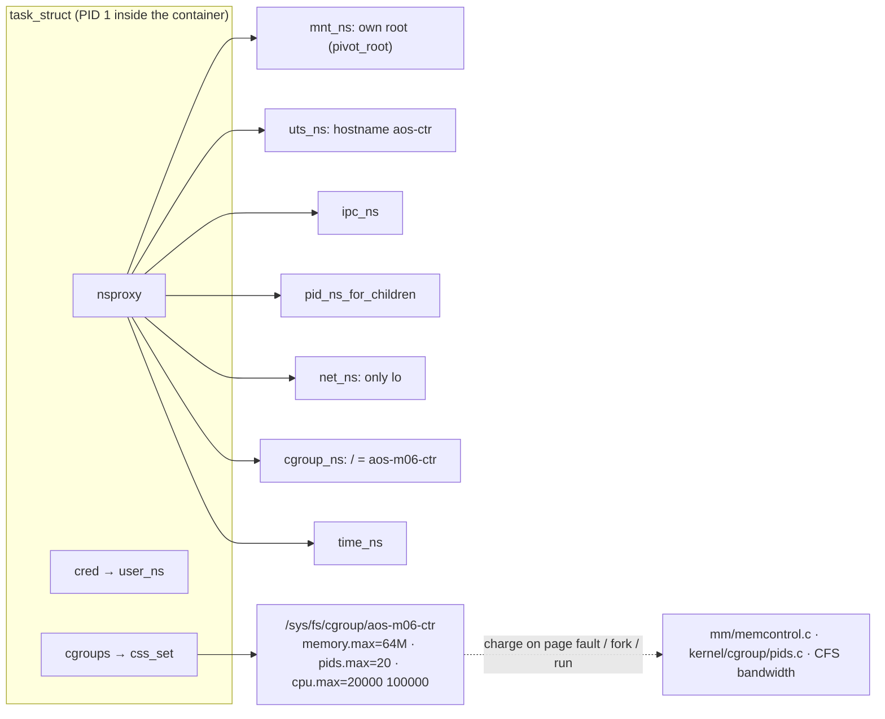

<div dir="rtl">

# ۰۸ — Container یعنی namespaceها به‌اضافهٔ cgroup v2

> ماژول ۶ · سیستم‌عامل توزیع‌شده و مجازی‌سازی · نسخه‌های ثابت: Linux **v6.18.63** و OpenBSD **`8cada8c`** · نسخهٔ انگلیسی: [`08-containers-namespaces-cgroups.en.md`](08-containers-namespaces-cgroups.en.md)

## واژه‌نامه

| اصطلاح | تعریف |
|---|---|
| **Namespace** | شیئی در کرنل که به گروهی از پردازه‌ها *نمای* مخصوص خودشان از یک منبع سراسری می‌دهد (PIDها، mountها، hostname، شبکه…). |
| **`struct nsproxy`** | مجموعه‌ای از اشاره‌گرها در هر task به namespaceهای mount، UTS، IPC، PID-for-children، cgroup، net و time (user namespace از طریق credentials وصل است). |
| **`clone()` / `unshare()` / `setns()`** | ساختن فرزند در namespaceهای تازه / بردن خود فراخواننده به namespaceهای تازه / پیوستن به یک namespace موجود با fdی از `/proc/<pid>/ns/`. |
| **cgroup v2** | یک سلسله‌مراتب یکپارچه در `/sys/fs/cgroup`؛ هر پوشه یک گروه است و فایل‌های داخلش پیچ‌های تنظیم controllerها. |
| **Controller** | سیاست منبعی که به سلسله‌مراتب وصل می‌شود: `memory`، `cpu`، `pids`، `io`، `cpuset` و… |
| **`pivot_root(2)`** | عوض کردن mount ریشه در mount namespace فراخواننده؛ ریشهٔ قبلی زیر ریشهٔ تازه منتقل می‌شود و بعد می‌شود unmountش کرد. |
| **User namespace** | UID/GIDها را نگاشت می‌کند؛ root درون آن فقط روی منابعی که مال همان namespace هستند capability دارد. |

## ۱. خلاصه

- Container **شیء کرنل نیست**. یک درخت پردازهٔ معمولی است که task structهایش به *namespaceهای تازه* اشاره می‌کنند (چه چیزی می‌بیند) و cgroupش *محدودیت* دارد (چقدر می‌تواند مصرف کند)، به‌اضافهٔ یک سیستم‌فایل ریشه که با `pivot_root` عوض شده است.
- namespaceها با `clone(CLONE_NEW*)` یا `unshare(CLONE_NEW*)` ساخته می‌شوند؛ داخل کرنل هر دو به `create_new_namespaces()` در `kernel/nsproxy.c` می‌رسند که هر اشاره‌گر namespace را کپی می‌کند یا تازه می‌سازد.
- محدودیت‌های cgroup v2 نوشتن ساده روی فایل‌اند: `memory.max`، `pids.max`، `cpu.max`. پردازه با نوشتن PIDش در `cgroup.procs` به گروه می‌پیوندد. containerها یک کرنل را شریک‌اند، پس مرز جداسازی رابط syscall است؛ خیلی ضعیف‌تر از مرز یک VM (یادداشت ۰۶).

## ۲. توضیح مفصل

### ۲.۱ شهود: یک کرنل، نماهای متفاوت، بودجه‌های متفاوت

VM به مهمان یک *ماشین* جعلی می‌دهد. container به یک پردازه یک *نمای* جعلی از یک کرنل می‌دهد. `ps` در یک PID namespace تازه از PID 1 شروع می‌شود؛ `hostname` در یک UTS namespace تازه فقط همان‌جا عوض می‌شود؛ یک network namespace تازه فقط رابط `lo` دارد که خاموش است. در همین حال زمان‌بند، page cache و درایورها برای همه یکی است. cgroupها نیمهٔ دوم را اضافه می‌کنند: حسابداری و محدودیت، تا یک container نتواند همهٔ حافظه، PIDها یا CPU را بگیرد.

### ۲.۲ انواع namespace (در v6.18)

| نوع | پرچم | چه چیزی را جدا می‌کند | از نسخهٔ |
|---|---|---|---|
| mount | `CLONE_NEWNS` | جدول mountها | 2.4.19 |
| UTS | `CLONE_NEWUTS` | hostname و domainname | 2.6.19 |
| IPC | `CLONE_NEWIPC` | IPC سیستم V و صف‌های پیام POSIX | 2.6.19 |
| PID | `CLONE_NEWPID` | شمارهٔ PIDها | 2.6.24 |
| network | `CLONE_NEWNET` | رابط‌ها، مسیرها، سوکت‌ها، netfilter | 2.6.29 |
| user | `CLONE_NEWUSER` | نگاشت UID/GID و capabilityها | 3.8 |
| cgroup | `CLONE_NEWCGROUP` | ریشهٔ قابل‌دیدِ درخت cgroup | 4.6 |
| time | `CLONE_NEWTIME` | جابه‌جایی `CLOCK_MONOTONIC`/`BOOTTIME` | 5.6 |

namespaceهای هر پردازه به شکل symlink در `/proc/<pid>/ns/` دیده می‌شوند؛ شمارهٔ inode در `pid:[4026532467]` *هویت* همان namespace است. دو پردازه دقیقاً وقتی در یک namespace هستند که این شماره‌ها یکی باشند.

### ۲.۳ سازوکار: `nsproxy`

`task_struct->nsproxy` به یک `struct nsproxy` مشترک با شمارندهٔ ارجاع اشاره می‌کند. `fork()` بدون پرچم‌های `CLONE_NEW*` فقط یک ارجاع دیگر می‌گیرد (`copy_namespaces()`). با هر پرچم `CLONE_NEW*`، تابع `create_new_namespaces()` یک nsproxy تازه می‌سازد و برای هر نوع، `copy_<type>(flags, …)` را صدا می‌زند: این تابع یا همان namespace قبلی را با یک ارجاع اضافه برمی‌گرداند، یا اگر پرچمش روشن باشد یک namespace کاملاً تازه (بخش ۴.۱). `unshare()` همین تابع را از راه `unshare_nsproxy_namespaces()` صدا می‌زند، بعد از بررسی `CAP_SYS_ADMIN` **در user namespace مقصد** (بخش ۴.۱). `setns(fd)` یک اشاره‌گر را به namespace موجود عوض می‌کند.

### ۲.۴ ظرافت PID namespace

در `nsproxy` فیلد `pid_ns_for_children` داریم، نه `pid_ns`. PID namespace خود هر پردازه برای همهٔ عمرش ثابت است (چون `struct pid`ش هنگام fork تخصیص یافته). پس `unshare(CLONE_NEWPID)` فقط جای **فرزندهای آینده** را عوض می‌کند: اولین فرزند **PID 1** در namespace تازه می‌شود، یعنی *init* آن. اگر این init خارج شود، namespace مرده است و `fork()`های بعدی در آن با `ENOMEM` شکست می‌خورند (در بخش ۴.۳ به شکل «Cannot fork» می‌بینید). به همین دلیل `unshare(1)` گزینهٔ `--fork` دارد، و به همین دلیل پردازهٔ PID 1 در یک container باید یتیم‌ها را جمع کند (reap) و سیگنال‌ها را رسیدگی کند.

### ۲.۵ User namespace و capabilityها

یک کاربر بی‌امتیاز می‌تواند `unshare(CLONE_NEWUSER)` کند، *درون* آن UID صفر شود (با نگاشتی که در `/proc/<pid>/uid_map` نوشته می‌شود) و مجموعهٔ کامل capabilityها را بگیرد؛ ولی بررسی‌های `ns_capable(ns, CAP_…)` فقط برای منابعی موفق می‌شوند که مال همان user namespace هستند. containerهای rootless همین‌طور mount/net/PID namespace می‌سازند بدون اینکه root واقعی باشند. VERSION-DEPENDENT: اوبونتو 24.04 user namespaceهای بی‌امتیاز را با AppArmor محدود می‌کند (`kernel.apparmor_restrict_unprivileged_userns`).

### ۲.۶ cgroup v2

- یک سلسله‌مراتب واحد که در `/sys/fs/cgroup` mount شده است. فایل `cgroup.controllers` فهرست controllerهای موجود در یک گروه را می‌دهد؛ نوشتن `+memory` در `cgroup.subtree_control` والد، آن را برای فرزندها روشن می‌کند.
- **قاعدهٔ «بدون پردازهٔ داخلی»:** گروه غیرریشه‌ای که controllerها را به فرزندانش واگذار کرده نمی‌تواند خودش پردازه داشته باشد؛ پردازه‌ها در برگ‌ها زندگی می‌کنند.
- پیچ‌های اصلی که در آزمایش ۰۳ استفاده می‌شوند:
  - `memory.max`: محدودیت سخت؛ بالاتر از آن کرنل داخل گروه حافظه را بازپس می‌گیرد (reclaim) و بعد داخل همان گروه OOM-kill می‌کند (`memory.events: oom_kill`). `memory.high` به‌جای کشتن، کند می‌کند.
  - `pids.max`: وقتی گروه (و هر جدِ آن) به حد رسیده باشد، `fork()`/`clone()` با `EAGAIN` شکست می‌خورد.
  - `cpu.max`: به شکل `"$QUOTA $PERIOD"` بر حسب میکروثانیه، محدودسازی به سبک CFS bandwidth؛ `cpu.weight` سهم نسبی است.
  - `io.max`: محدودیت پهنای باند یا IOPS برای هر دستگاه.
- **پیوستن:** نوشتن PID در `cgroup.procs` (کل گروه نخ‌ها) یا TID در `cgroup.threads` (در گروه‌های threaded). این نوشتن از `__cgroup_procs_write()` می‌گذرد (بخش ۴.۲).
- **واگذاری (delegation):** یک زیردرخت را chown کنید تا یک کاربر بتواند مدیریتش کند (systemd برای نشست‌های کاربر همین کار را می‌کند)؛ بررسی مجوز با credentials **بازکنندهٔ** فایل انجام می‌شود.

### ۲.۷ OpenBSD: نه namespace دارد نه cgroup

OpenBSD هیچ‌کدام را ندارد. پاسخش به جداسازی ابزارهای دیگری است: `chroot(2)` برای نمای سیستم‌فایل، **`pledge(2)`** (محدود کردن اینکه پردازه از کدام *خانواده‌های syscall* استفاده کند) و **`unveil(2)`** (محدود کردن *مسیرهایی* که می‌بیند)، و `vmm(4)` وقتی مرز واقعی لازم است. pledge یک sandbox خودخواسته است، نه نمایی از منابع: در هر syscall داخل `pledge_syscall()` بررسی می‌شود (بخش ۴.۴).

## ۳. نمودار

</div>



<div dir="rtl">

## ۴. مثال کاربردی

### ۴.۱ سورس واقعی: یک تابع همهٔ namespaceها را می‌سازد

`linux/kernel/nsproxy.c · create_new_namespaces() · v6.18.63` ([Elixir L67](https://elixir.bootlin.com/linux/v6.18.63/source/kernel/nsproxy.c#L67))، خط‌های ۷۴ تا ۱۰۱:

</div>

```c
	new_nsp = create_nsproxy();
	if (!new_nsp)
		return ERR_PTR(-ENOMEM);

	new_nsp->mnt_ns = copy_mnt_ns(flags, tsk->nsproxy->mnt_ns, user_ns, new_fs);
	if (IS_ERR(new_nsp->mnt_ns)) {
		err = PTR_ERR(new_nsp->mnt_ns);
		goto out_ns;
	}

	new_nsp->uts_ns = copy_utsname(flags, user_ns, tsk->nsproxy->uts_ns);
	if (IS_ERR(new_nsp->uts_ns)) {
		err = PTR_ERR(new_nsp->uts_ns);
		goto out_uts;
	}

	new_nsp->ipc_ns = copy_ipcs(flags, user_ns, tsk->nsproxy->ipc_ns);
	/* ... */
	new_nsp->pid_ns_for_children =
		copy_pid_ns(flags, user_ns, tsk->nsproxy->pid_ns_for_children);
```

<div dir="rtl">

- یک `nsproxy` تازه تخصیص می‌یابد؛ بعد هر فیلد با یک تابع `copy_*()` پر می‌شود که به `flags` نگاه می‌کند.
- الگو یکسان است: اگر پرچم (مثلاً `CLONE_NEWUTS`) خاموش باشد، تابع همان namespace **قبلی** را با یک ارجاع اضافه برمی‌گرداند؛ اگر روشن باشد، یک namespace تازه (برای UTS و mount، کپی‌ای از قبلی).
- خطاها با نردبانی از `goto` به ترتیب معکوس برگردانده می‌شوند و هر چه گرفته شده بود آزاد می‌شود.
- به نام فیلد `pid_ns_for_children` دقت کنید؛ تابع بعدی دلیلش را نشان می‌دهد.

`linux/kernel/pid_namespace.c · copy_pid_ns() · v6.18.63` ([Elixir L175](https://elixir.bootlin.com/linux/v6.18.63/source/kernel/pid_namespace.c#L175)):

</div>

```c
struct pid_namespace *copy_pid_ns(u64 flags,
	struct user_namespace *user_ns, struct pid_namespace *old_ns)
{
	if (!(flags & CLONE_NEWPID))
		return get_pid_ns(old_ns);
	if (task_active_pid_ns(current) != old_ns)
		return ERR_PTR(-EINVAL);
	return create_pid_namespace(user_ns, old_ns);
}
```

<div dir="rtl">

- بدون پرچم یعنی اشتراک. با پرچم، namespace تازه **فرزند** `old_ns` می‌شود (`create_pid_namespace(user_ns, old_ns)`): PID namespaceها تودرتو هستند و والد همهٔ پردازه‌های نسل‌های بعد را می‌بیند، با شماره‌های متفاوت.
- بررسی `-EINVAL`: فقط وقتی می‌توانید PID namespace تازه بسازید که فرزندانتان را از قبل جای دیگری هدایت نکرده باشید (دو بار `unshare(CLONE_NEWPID)` بدون fork شکست می‌خورد).

`linux/kernel/nsproxy.c · unshare_nsproxy_namespaces() · v6.18.63` ([خط‌های ۲۰۹ تا ۲۱۶](https://elixir.bootlin.com/linux/v6.18.63/source/kernel/nsproxy.c#L209)):

</div>

```c
	if (!(unshare_flags & (CLONE_NEWNS | CLONE_NEWUTS | CLONE_NEWIPC |
			       CLONE_NEWNET | CLONE_NEWPID | CLONE_NEWCGROUP |
			       CLONE_NEWTIME)))
		return 0;

	user_ns = new_cred ? new_cred->user_ns : current_user_ns();
	if (!ns_capable(user_ns, CAP_SYS_ADMIN))
		return -EPERM;
```

<div dir="rtl">

`CLONE_NEWUSER` در این فهرست نیست: پیش‌تر و از راه credentials (`new_cred`) رسیدگی شده است. بررسی capability در برابر user namespace **تازه** انجام می‌شود، اگر در همان فراخوانی ساخته شده باشد؛ برای همین `unshare --user --map-root-user --pid …` بدون root واقعی کار می‌کند.

### ۴.۲ سورس واقعی: پیوستن به cgroup و اعمال محدودیت

`linux/kernel/cgroup/cgroup.c · __cgroup_procs_write() · v6.18.63` ([Elixir L5390](https://elixir.bootlin.com/linux/v6.18.63/source/kernel/cgroup/cgroup.c#L5390))، خط‌های ۵۴۰۹ تا ۵۴۲۷:

</div>

```c
	/* find the source cgroup */
	spin_lock_irq(&css_set_lock);
	src_cgrp = task_cgroup_from_root(task, &cgrp_dfl_root);
	spin_unlock_irq(&css_set_lock);

	/*
	 * Process and thread migrations follow same delegation rule. Check
	 * permissions using the credentials from file open to protect against
	 * inherited fd attacks.
	 */
	saved_cred = override_creds(of->file->f_cred);
	ret = cgroup_attach_permissions(src_cgrp, dst_cgrp,
					of->file->f_path.dentry->d_sb,
					threadgroup, ctx->ns);
	revert_creds(saved_cred);
	if (ret)
		goto out_finish;

	ret = cgroup_attach_task(dst_cgrp, task, threadgroup);
```

<div dir="rtl">

دستور `echo $PID > cgroup.procs` همین تابع است: پیدا کن task الان کجاست، حق واگذاری را *با credentials بازکنندهٔ فایل* بررسی کن (تا fd ممتازی که به یک پردازهٔ بی‌امتیاز داده شده سوءاستفاده نشود)، و بعد منتقل کن.

`linux/kernel/cgroup/pids.c · pids_try_charge() · v6.18.63` ([Elixir L166](https://elixir.bootlin.com/linux/v6.18.63/source/kernel/cgroup/pids.c#L166))، خط‌های ۱۷۰ تا ۱۸۲:

</div>

```c
	for (p = pids; parent_pids(p); p = parent_pids(p)) {
		int64_t new = atomic64_add_return(num, &p->counter);
		int64_t limit = atomic64_read(&p->limit);

		/*
		 * Since new is capped to the maximum number of pid_t, if
		 * p->limit is %PIDS_MAX then we know that this test will never
		 * fail.
		 */
		if (new > limit) {
			*fail = p;
			goto revert;
		}
```

<div dir="rtl">

شارژ به سمت **بالای** سلسله‌مراتب می‌رود: یک fork باید زیر محدودیت همهٔ اجداد جا شود. در صورت شکست، شارژهای انجام‌شده برگردانده می‌شوند و `fork()` مقدار `EAGAIN` برمی‌گرداند. `mm/memcontrol.c · memory_max_write()` (خط ۴۴۳۷) سمت حافظه را نشان می‌دهد: نوشتن یک `memory.max` تازه حد را با `xchg()` پایین می‌آورد و بعد فعالانه حافظه بازپس می‌گیرد (`try_to_free_mem_cgroup_pages`) تا مصرف جا شود، و در آخر داخل گروه رخداد OOM ثبت می‌کند.

### ۴.۳ خروجی واقعی: PID namespace به fork نیاز دارد

گرفته‌شده در 2026-11-15 داخل یک container ممتاز `ubuntu:24.04` روی Docker Desktop (کرنل WSL2 با نسخهٔ `6.18.58.1-microsoft-standard-WSL2`):

</div>

```
$ ls -l /proc/self/ns        # (trimmed to the link targets)
cgroup -> cgroup:[4026532468]
ipc -> ipc:[4026532466]
mnt -> mnt:[4026532463]
net -> net:[4026532469]
pid -> pid:[4026532467]
pid_for_children -> pid:[4026532467]
time -> time:[4026532537]
time_for_children -> time:[4026532537]
user -> user:[4026531837]
uts -> uts:[4026532465]
$ cat /proc/self/cgroup; cat /sys/fs/cgroup/cgroup.controllers
0::/
cpuset cpu io memory hugetlb pids rdma
$ unshare --pid --fork --mount-proc ps -ef
UID          PID    PPID  C STIME TTY          TIME CMD
root           1       0  0 15:37 ?        00:00:00 ps -ef
$ unshare --pid sh -c 'echo "shell pid in parent ns: $$"; sh -c "echo first child: pid \$\$"; sh -c "echo second child: pid \$\$"'
shell pid in parent ns: 7
first child: pid 1
sh: 1: Cannot fork
```

<div dir="rtl">

- `pid` و `pid_for_children` دو پیوند جدا هستند؛ دومی همان `nsproxy->pid_ns_for_children` است.
- `user:[4026531837]` user namespace اولیه است (Docker user namespace نساخته)؛ بقیهٔ inodeها با میزبان فرق دارند چون Docker آن namespaceها را ساخته است.
- `0::/` یعنی cgroup v2 («سلسله‌مراتب ۰») که از پشت cgroup namespace مربوط به Docker دیده می‌شود: گروه container ریشه به نظر می‌رسد.
- با `--fork`، برنامهٔ `ps` همان PID 1 است و `--mount-proc` یک `/proc` می‌دهد که فقط namespace تازه را نشان می‌دهد.
- بدون `--fork`: خود `sh` در namespace قدیمی با PID 7 می‌ماند؛ اولین فرزندش PID 1 (یعنی init) در namespace تازه می‌شود، خارج می‌شود و namespace می‌میرد؛ `fork()` بعدی شکست می‌خورد. این همان بخش ۲.۴ است، زنده.

container کامل (محدودیت‌های cgroup، `pivot_root`، OOM kill و ردشدن‌های `pids.max`) در آزمایش ۰۳ است.

### ۴.۴ مقایسه با OpenBSD: pledge به‌جای namespace

`openbsd/sys/kern/kern_pledge.c · pledge_syscall() · 8cada8c` (خط‌های ۵۳۶ تا ۵۵۴):

</div>

```c
int
pledge_syscall(struct proc *p, int code, uint64_t *tval)
{
	p->p_pledge_syscall = code;
	*tval = 0;

	if (code < 0 || code > SYS_MAXSYSCALL - 1)
		return (EINVAL);

	if (pledge_syscalls[code] == PLEDGE_ALWAYS)
		return (0);

	p->p_pledge = READ_ONCE(p->p_p->ps_pledge); /* pledge checks are per-thread */
	if (p->p_pledge & pledge_syscalls[code])
		return (0);

	*tval = pledge_syscalls[code];
	return (EPERM);
}
```

<div dir="rtl">

هر شمارهٔ syscall به یک بیت «قول» نگاشت می‌شود (`stdio`، `rpath`، `inet` و…)؛ syscall مجاز است اگر پردازه آن بیت را داشته باشد. namespaceهای لینوکس *معنای نام یک منبع را عوض می‌کنند*؛ pledge *کل دسته‌هایی از syscallها را حذف می‌کند*.

| انتخاب طراحی | Linux | OpenBSD | بده‌بستان |
|---|---|---|---|
| واحد جداسازی | namespace برای هر نوع منبع | ندارد؛ `chroot` + pledge/unveil | نماهای مجازی غنی در برابر سازوکار کوچک و قابل‌ممیزی |
| محدودیت منابع | سلسله‌مراتب cgroup v2 | `setrlimit` برای هر پردازه، login classها | حسابداری گروهی در برابر سادگی |
| چه کسی راه‌اندازی می‌کند | یک runtime بیرونی (runc، systemd) | خود برنامه (self-sandboxing) | container کردن هر باینری در برابر نیاز به تغییر کد |
| مرز قوی | VM (KVM) | VM (vmm/vmd) | پاسخ هر دو یکی است |

## ۵. حالت‌های خاص و دام‌ها

- **`pivot_root: Invalid argument`**: `new_root` نقطهٔ mount نیست (اول آن را روی خودش bind-mount کنید)، یا ریشهٔ فعلی یک mount از نوع *shared* است (اول `mount --make-rprivate /`)، یا `put_old` زیر `new_root` نیست.
- **رفتار PID 1**: init یک PID namespace سیگنال‌هایی را که handler ندارند نادیده می‌گیرد؛ `kill -TERM 1` در داخل کاری نمی‌کند مگر برنامه آن را رسیدگی کند. یتیم‌ها به آن سپرده می‌شوند.
- **`memory.max` بدون `memory.swap.max=0`**: گروه به‌جای OOM-kill شدن swap می‌کند و به نظر می‌رسد «محدودیت» کار نمی‌کند.
- **انتقال پردازه به cgroup شارژ حافظهٔ موجودش را جابه‌جا نمی‌کند** (در v2)؛ صفحه‌ها همان‌جا شارژ می‌مانند که اولین بار لمس شدند.
- **نوشتن در `cgroup.procs` با `EBUSY` شکست می‌خورد** در گروهی که فرزندانی با controllerهای روشن دارد (قاعدهٔ بدون پردازهٔ داخلی).
- **ترتیب CLONE_NEWCGROUP**: cgroup namespace را *بعد* از پیوستن به cgroup مقصد بسازید، وگرنه ریشه‌اش همان گروه قدیمی است (راه‌حل C آزمایش ۰۳ بعد از انتقال `unshare(CLONE_NEWCGROUP)` می‌کند).
- **containerها کرنل را شریک‌اند**: یک باگ کرنل که از راه syscall قابل‌دسترسی باشد همهٔ containerها را می‌شکند؛ seccomp، LSMها و user namespaceها سطح حمله را کم می‌کنند (ماژول ۰۷).

## ۶. نکته‌های امتحانی

- Container = پردازه‌ها + namespaceها (نما) + cgroupها (محدودیت) + یک سیستم‌فایل ریشه (`pivot_root`). هیچ `struct container`ی وجود ندارد.
- ۸ نوع namespace: mnt، uts، ipc، pid، net، user، cgroup، time. هویت = inode در `/proc/<pid>/ns/`.
- `clone`/`unshare` ← `create_new_namespaces()` ← یک `copy_*()` برای هر نوع: اشتراک (شمارندهٔ ارجاع) یا ساختن.
- `unshare(CLONE_NEWPID)` فقط روی فرزندان اثر دارد (`pid_ns_for_children`)؛ اولین فرزند = PID 1؛ خروج init یعنی مرگ namespace.
- بررسی‌های capability به شکل `ns_capable(user_ns, …)` هستند: root در یک user namespace فقط روی منابع همان namespace root است.
- cgroup v2: درخت یکپارچه، `subtree_control`، بدون پردازهٔ داخلی، پیوستن با `cgroup.procs`، بررسی مجوز با credentials بازکنندهٔ فایل.
- شارژ `pids.max` از همهٔ اجداد می‌گذرد؛ `memory.max` اول reclaim می‌کند و بعد داخل گروه OOM-kill؛ `cpu.max` محدودسازی quota/period است.
- OpenBSD: نه namespace نه cgroup؛ pledge (دسته‌های syscall) + unveil (مسیرها) + chroot؛ و vmm برای جداسازی قوی.

## ۷. پیوندها

- درس: [`../lesson.fa.md`](../lesson.fa.md) بخش ۴.۸ (containerها)
- مرور کد کرنل: [`../kernel-walkthrough.fa.md`](../kernel-walkthrough.fa.md) (nsproxy، پیوستن به cgroup، pledge در OpenBSD)
- آزمایش: [`../labs/03-mini-container/`](../labs/03-mini-container/) (unshare + pivot_root + محدودیت‌های cgroup v2؛ تمرین تکمیلی با `clone()` در C)
- آزمون: [`../quiz.fa.md`](../quiz.fa.md) پرسش ۸ (`copy_pid_ns`)، پرسش ۱۱ (خطای EINVAL در `pivot_root`)، پرسش ۱۲ (اعمال‌نشدن `memory.max`)، پرسش شفاهی O1 (container در برابر VM) و O3 (جداسازی در OpenBSD)
- قبلی: [`07-kvm-architecture.fa.md`](07-kvm-architecture.fa.md) · فهرست: [`INDEX.fa.md`](INDEX.fa.md)

</div>
