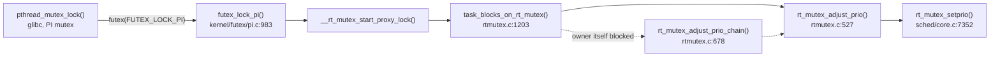
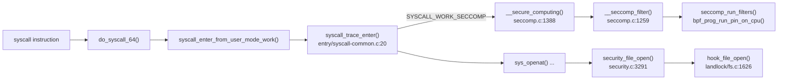

# 07 — Kernel walkthrough: PI mutexes, PREEMPT_RT, SCHED_DEADLINE, seccomp, Landlock

> Pins: Linux **v6.18.63** (`_shared/sources/linux`), OpenBSD **`8cada8c`** (`_shared/sources/openbsd`). Arch: **x86-64**.
> Every excerpt below was printed with `bash _shared/sources/cite.sh ...` from the local checkout; line numbers are real. Farsi version: [`kernel-walkthrough.fa.md`](kernel-walkthrough.fa.md).

Five stops, in the order a real-time or sandboxed program meets them:

| # | Stop | File | Why it matters |
|---|---|---|---|
| 1 | Is this kernel RT? | `kernel/Kconfig.preempt`, `init/Makefile` | what `uname -v` tells you, and what `PREEMPT_RT` changes |
| 2 | Priority inheritance | `kernel/futex/pi.c`, `kernel/locking/rtmutex.c`, `kernel/sched/core.c` | how `PTHREAD_PRIO_INHERIT` (lab 02) boosts the lock owner |
| 3 | Sleeping spinlocks | `kernel/locking/spinlock_rt.c` | the core trick of `PREEMPT_RT` |
| 4 | `SCHED_DEADLINE` | `kernel/sched/deadline.c` | admission control and runtime throttling (CBS) |
| 5 | Sandboxing | `kernel/entry/syscall-common.c`, `kernel/seccomp.c`, `security/landlock/` | where seccomp runs on every syscall, and how Landlock hooks `open()` |

Then the OpenBSD comparison: `pledge(2)` / `unveil(2)` vs seccomp / Landlock.

---

## 1. Is this kernel RT? `Kconfig.preempt` and the `uname -v` flag

```text
linux/kernel/Kconfig.preempt · config PREEMPT_RT · v6.18.63 · L89-92
   89  config PREEMPT_RT
   90  	bool "Fully Preemptible Kernel (Real-Time)"
   91  	depends on EXPERT && ARCH_SUPPORTS_RT && !COMPILE_TEST
   92  	select PREEMPTION
```

Link: <https://elixir.bootlin.com/linux/v6.18.63/source/kernel/Kconfig.preempt#L89>

| Line | Meaning |
|---|---|
| 89 | the option is a normal Kconfig symbol in mainline. No out-of-tree patch set is needed any more (it became selectable in mainline in v6.12; see `VERSION-DEPENDENT` note below) |
| 91 | `EXPERT`: hidden unless you opt in to expert options; `ARCH_SUPPORTS_RT`: only architectures that select it (x86-64 does: `arch/x86/Kconfig` L133); `!COMPILE_TEST`: not for build-only test configs |
| 92 | RT forces the full preemption machinery (`PREEMPTION`, `PREEMPT_COUNT`) on |

The help text that follows (L93-104) says what RT does: it replaces "spinlocks, rwlocks, etc." with "preemptible priority-inheritance aware variants", forces interrupt threading, and breaks up long non-preemptible sections.

How you see it at runtime — the build writes the preemption model into the version string:

```text
linux/init/Makefile · L28-30 · v6.18.63
   28  preempt-flag-$(CONFIG_PREEMPT_BUILD)	:= PREEMPT
   29  preempt-flag-$(CONFIG_PREEMPT_DYNAMIC)	:= PREEMPT_DYNAMIC
   30  preempt-flag-$(CONFIG_PREEMPT_RT)	:= PREEMPT_RT
```

Make assigns these in order, so the **last enabled one wins**: an RT kernel prints `PREEMPT_RT`, a dynamic one prints `PREEMPT_DYNAMIC`. Our VM prints `SMP PREEMPT_DYNAMIC` (lab 01). There is **no** `/sys/kernel/realtime` file in v6.18.63 (`git grep -n realtime -- kernel/ksysfs.c` finds nothing; older out-of-tree RT patch sets had such a file — `UNVERIFIED` history) — use `uname -v` or `/boot/config-$(uname -r)`.

`PREEMPT_DYNAMIC` (L126-147 of the same file) lets one binary switch between `none`, `voluntary`, `full` and `lazy` at boot (`preempt=`) or at runtime through `/sys/kernel/debug/sched/preempt`. It does **not** include RT: RT changes lock types at compile time and cannot be switched on later.

> `VERSION-DEPENDENT`: "selectable in mainline since 6.12" comes from the v6.12 merge history (the RT Kconfig no longer depends on an out-of-tree patch). In our pinned tree we only verified the current form above.

---

## 2. Priority inheritance: from `pthread_mutex_lock()` to `rt_mutex_setprio()`

Call chain for a `PTHREAD_PRIO_INHERIT` mutex under contention (lab 02 shows it in `strace` as `futex(..., FUTEX_LOCK_PI_PRIVATE, ...)`):



### 2.1 The futex enters the rt_mutex world

```text
linux/kernel/futex/pi.c · futex_lock_pi() · v6.18.63 · L975-983 (comment) and L1095
  975   * Userspace tried a 0 -> TID atomic transition of the futex value
  976   * and failed. The kernel side here does the whole locking operation:
  977   * if there are waiters then it will block as a consequence of relying
  978   * on rt-mutexes, it does PI, etc. (Due to races the kernel might see
  979   * a 0 value of the futex too.).
  ...
  983  int futex_lock_pi(u32 __user *uaddr, unsigned int flags, ktime_t *time, int trylock)
  ...
 1095  		ret = __rt_mutex_start_proxy_lock(&q.pi_state->pi_mutex, &rt_waiter, current, &wake_q);
```

Link: <https://elixir.bootlin.com/linux/v6.18.63/source/kernel/futex/pi.c#L983>

- L975: the **fast path is in user space**: an uncontended lock is one atomic compare-and-swap of `0 → TID` with no syscall. That is why the futex word holds the owner's **thread ID**: the kernel needs to know *whom* to boost.
- L976-978: only on contention does the kernel build a `pi_state` with a real `rt_mutex` inside.
- L1095: the waiter (`current`) is enqueued on that `rt_mutex`. From here on, a PI futex and an in-kernel rt_mutex use the same code (`__rt_mutex_start_proxy_lock()` in `rtmutex_api.c` calls `task_blocks_on_rt_mutex()`).

### 2.2 The blocking task donates its priority

```text
linux/kernel/locking/rtmutex.c · task_blocks_on_rt_mutex() · v6.18.63 · L1265-1275
 1265  	raw_spin_lock(&owner->pi_lock);
 1266  	if (waiter == rt_mutex_top_waiter(lock)) {
 1267  		rt_mutex_dequeue_pi(owner, top_waiter);
 1268  		rt_mutex_enqueue_pi(owner, waiter);
 1269  
 1270  		rt_mutex_adjust_prio(lock, owner);
 1271  		if (owner->pi_blocked_on)
 1272  			chain_walk = 1;
 1273  	} else if (rt_mutex_cond_detect_deadlock(waiter, chwalk)) {
 1274  		chain_walk = 1;
 1275  	}
```

Link: <https://elixir.bootlin.com/linux/v6.18.63/source/kernel/locking/rtmutex.c#L1265>

| Line | Meaning |
|---|---|
| 1265 | lock the **owner's** `pi_lock`: we are about to change another task's priority |
| 1266 | only if the new waiter is now the **highest-priority** waiter on this lock does anything change |
| 1267-1268 | each task keeps a tree `pi_waiters` of the top waiter of every lock it owns. Replace the old top waiter of this lock with the new one |
| 1270 | recompute the owner's effective priority (2.3) |
| 1271-1272 | if the owner is **itself blocked** on another rt_mutex, the boost must travel further: walk the chain (`rt_mutex_adjust_prio_chain()`, L678, whose header comment L606-677 lists the 13 locking steps). This is **transitive** inheritance |
| 1273-1274 | even if no boost is needed, deadlock detection may still need the walk (`-EDEADLK`) |

### 2.3 Boost = take the top waiter's priority

```text
linux/kernel/locking/rtmutex.c · rt_mutex_adjust_prio() · v6.18.63 · L527-540
  527  static __always_inline void rt_mutex_adjust_prio(struct rt_mutex_base *lock,
  528  						 struct task_struct *p)
  529  {
  530  	struct task_struct *pi_task = NULL;
  531  
  532  	lockdep_assert_held(&lock->wait_lock);
  533  	lockdep_assert(rt_mutex_owner(lock) == p);
  534  	lockdep_assert_held(&p->pi_lock);
  535  
  536  	if (task_has_pi_waiters(p))
  537  		pi_task = task_top_pi_waiter(p)->task;
  538  
  539  	rt_mutex_setprio(p, pi_task);
  540  }
```

Link: <https://elixir.bootlin.com/linux/v6.18.63/source/kernel/locking/rtmutex.c#L527>

- L532-534: three lock assertions document the locking rule: lock `wait_lock`, then the owner's `pi_lock` (the "normal locking order" in the chain-walk comment).
- L536-537: the donor is the **top** of the owner's `pi_waiters` tree, across all locks it holds.
- L539: `pi_task == NULL` means "no waiters left": that call **de-boosts** the owner back to its normal priority on unlock.

```text
linux/kernel/sched/core.c · rt_mutex_setprio() · v6.18.63 · L7352-7367
 7352  void rt_mutex_setprio(struct task_struct *p, struct task_struct *pi_task)
 7353  {
 7354  	int prio, oldprio, queue_flag =
 7355  		DEQUEUE_SAVE | DEQUEUE_MOVE | DEQUEUE_NOCLOCK;
 7356  	const struct sched_class *prev_class, *next_class;
 7357  	struct rq_flags rf;
 7358  	struct rq *rq;
 7359  
 7360  	/* XXX used to be waiter->prio, not waiter->task->prio */
 7361  	prio = __rt_effective_prio(pi_task, p->normal_prio);
 7362  
 7363  	/*
 7364  	 * If nothing changed; bail early.
 7365  	 */
 7366  	if (p->pi_top_task == pi_task && prio == p->prio && !dl_prio(prio))
 7367  		return;
```

Link: <https://elixir.bootlin.com/linux/v6.18.63/source/kernel/sched/core.c#L7352>

- L7361: effective priority = the better of the donor's priority and the task's own `normal_prio`. The comment above the function (L7341-7351) stresses that it changes `->prio` only, **not** `->normal_prio`: the boost is temporary.
- L7366: no change → no runqueue work. Otherwise the function goes on to fire the `trace_sched_pi_setprio()` tracepoint (L7407) and may even move the task to another **scheduling class** (`__setscheduler_class()`, L7414): a `SCHED_OTHER` owner boosted by a `SCHED_FIFO` waiter becomes an RT task for the duration. Lab 02 watches that tracepoint with bpftrace.

---

## 3. PREEMPT_RT's core trick: `spinlock_t` becomes a sleeping rt_mutex

```text
linux/kernel/locking/spinlock_rt.c · rt_spin_lock() · v6.18.63 · L38-59
   38  static __always_inline void rtlock_lock(struct rt_mutex_base *rtm)
   39  {
   40  	lockdep_assert(!current->pi_blocked_on);
   41  
   42  	if (unlikely(!rt_mutex_cmpxchg_acquire(rtm, NULL, current)))
   43  		rtlock_slowlock(rtm);
   44  }
   45  
   46  static __always_inline void __rt_spin_lock(spinlock_t *lock)
   47  {
   48  	rtlock_might_resched();
   49  	rtlock_lock(&lock->lock);
   50  	rcu_read_lock();
   51  	migrate_disable();
   52  }
   53  
   54  void __sched rt_spin_lock(spinlock_t *lock) __acquires(RCU)
   55  {
   56  	spin_acquire(&lock->dep_map, 0, 0, _RET_IP_);
   57  	__rt_spin_lock(lock);
   58  }
```

Link: <https://elixir.bootlin.com/linux/v6.18.63/source/kernel/locking/spinlock_rt.c#L38>

| Line | Meaning |
|---|---|
| 42 | fast path: one `cmpxchg` of the owner field from `NULL` to `current`, exactly like a futex |
| 43 | slow path: **sleep** on an rt_mutex, with priority inheritance, instead of spinning with preemption off |
| 48 | "might resched": this lock is allowed to schedule, so it must not be taken in truly atomic context |
| 50-51 | what *is* kept from spinlock semantics: an RCU read-side section and **no migration** to another CPU (per-CPU data stays valid). Preemption stays **on** |

On a non-RT kernel, `spin_lock()` disables preemption for the whole critical section, so any long section is a latency source for every higher-priority task on that CPU. On RT, only `raw_spinlock_t` (scheduler, low-level IRQ code) still does that. Documentation: `Documentation/locking/locktypes.rst` (in the checkout).

---

## 4. `SCHED_DEADLINE`: admission control and CBS throttling

### 4.1 Parameter check: runtime ≤ deadline ≤ period

```text
linux/kernel/sched/deadline.c · __checkparam_dl() · v6.18.63 · L3580-3592
 3580  	period = attr->sched_period;
 3581  	if (!period)
 3582  		period = attr->sched_deadline;
 3583  
 3584  	/* runtime <= deadline <= period (if period != 0) */
 3585  	if (period < attr->sched_deadline ||
 3586  	    attr->sched_deadline < attr->sched_runtime)
 3587  		return false;
 3588  
 3589  	max = (u64)READ_ONCE(sysctl_sched_dl_period_max) * NSEC_PER_USEC;
 3590  	min = (u64)READ_ONCE(sysctl_sched_dl_period_min) * NSEC_PER_USEC;
 3591  
 3592  	if (period < min || period > max)
```

Link: <https://elixir.bootlin.com/linux/v6.18.63/source/kernel/sched/deadline.c#L3553>

- L3581-3582: period 0 means "implicit-deadline task": period = deadline.
- L3585-3587: the classic constraint of the task model (`C ≤ D ≤ T`). `sched_setattr()` fails with `EINVAL` otherwise.
- L3589-3592: bounds from `/proc/sys/kernel/sched_deadline_period_{min,max}_us`.

### 4.2 Admission: would total bandwidth overflow?

```text
linux/kernel/sched/deadline.c · __dl_overflow() · v6.18.63 · L212-217
  212  static inline bool
  213  __dl_overflow(struct dl_bw *dl_b, unsigned long cap, u64 old_bw, u64 new_bw)
  214  {
  215  	return dl_b->bw != -1 &&
  216  	       cap_scale(dl_b->bw, cap) < dl_b->total_bw - old_bw + new_bw;
  217  }
```

- `new_bw` is `runtime/period` as a fixed-point ratio (`to_ratio(period, runtime)` in `sched_dl_overflow()`, L3453).
- `dl_b->bw` is the allowed fraction, `to_ratio(global_rt_period(), global_rt_runtime())` (deadline.c L518-521), i.e. `sched_rt_runtime_us / sched_rt_period_us` (950000/1000000 = 95 % on our VM), scaled by the CPU capacity of the root domain (`cap_scale`). `-1` means "unlimited".
- If the sum of all deadline tasks' bandwidth plus the new one exceeds the limit, `sched_setattr()` returns **`EBUSY`**. This is the utilization test `Σ Cᵢ/Tᵢ ≤ m·U_max` of global EDF — a necessary condition, not a proof that every deadline is met on SMP (see note 02).

### 4.3 Run out of budget → throttle until the next period

```text
linux/kernel/sched/deadline.c · update_curr_dl_se() · v6.18.63 · L1480-1489
 1480  throttle:
 1481  	if (dl_runtime_exceeded(dl_se) || dl_se->dl_yielded) {
 1482  		dl_se->dl_throttled = 1;
 1483  
 1484  		/* If requested, inform the user about runtime overruns. */
 1485  		if (dl_runtime_exceeded(dl_se) &&
 1486  		    (dl_se->flags & SCHED_FLAG_DL_OVERRUN))
 1487  			dl_se->dl_overrun = 1;
 1488  
 1489  		dequeue_dl_entity(dl_se, 0);
```

- `dl_runtime_exceeded()` (L1356) is just `dl_se->runtime <= 0`: the task used its budget.
- L1482, L1489: the task is **throttled** and removed from the runqueue; the replenish timer (`start_dl_timer()`) puts it back at the next period with a full budget. This is the **Constant Bandwidth Server**: a misbehaving deadline task cannot steal more than `runtime/period`, so it cannot break the others' guarantees.
- L1486: `SCHED_FLAG_DL_OVERRUN` makes the kernel send `SIGXCPU` to report overruns.

---

## 5. Sandboxing on the syscall path: seccomp and Landlock



### 5.1 Where seccomp runs

```text
linux/kernel/entry/syscall-common.c · syscall_trace_enter() · v6.18.63 · L45-53
   45  	/* Do seccomp after ptrace, to catch any tracer changes. */
   46  	if (work & SYSCALL_WORK_SECCOMP) {
   47  		ret = __secure_computing();
   48  		if (ret == -1L)
   49  			return ret;
   50  	}
   51  
   52  	/* Either of the above might have changed the syscall number */
   53  	syscall = syscall_get_nr(current, regs);
```

Link: <https://elixir.bootlin.com/linux/v6.18.63/source/kernel/entry/syscall-common.c#L45>

- L46: a per-thread work flag. Threads **without** a filter pay nothing beyond this bit test (it is folded into the general "syscall work" check).
- L45: seccomp runs **after** ptrace, so a tracer cannot change the syscall to bypass the filter.
- L48: `-1` = skip the syscall (errno already set, or the task is being killed).

### 5.2 Running the filters: the lowest action wins

```text
linux/kernel/seccomp.c · seccomp_run_filters() · v6.18.63 · L404-431
  404  static u32 seccomp_run_filters(const struct seccomp_data *sd,
  405  			       struct seccomp_filter **match)
  406  {
  407  	u32 ret = SECCOMP_RET_ALLOW;
  408  	/* Make sure cross-thread synced filter points somewhere sane. */
  409  	struct seccomp_filter *f =
  410  			READ_ONCE(current->seccomp.filter);
  411  
  412  	/* Ensure unexpected behavior doesn't result in failing open. */
  413  	if (WARN_ON(f == NULL))
  414  		return SECCOMP_RET_KILL_PROCESS;
  415  
  416  	if (seccomp_cache_check_allow(f, sd))
  417  		return SECCOMP_RET_ALLOW;
  418  
  419  	/*
  420  	 * All filters in the list are evaluated and the lowest BPF return
  421  	 * value always takes priority (ignoring the DATA).
  422  	 */
  423  	for (; f; f = f->prev) {
  424  		u32 cur_ret = bpf_prog_run_pin_on_cpu(f->prog, sd);
  425  
  426  		if (ACTION_ONLY(cur_ret) < ACTION_ONLY(ret)) {
  427  			ret = cur_ret;
  428  			*match = f;
  429  		}
  430  	}
  431  	return ret;
```

Link: <https://elixir.bootlin.com/linux/v6.18.63/source/kernel/seccomp.c#L404>

| Line | Meaning |
|---|---|
| 413-414 | **fail closed**: a missing filter in filter mode kills, never allows |
| 416-417 | per-filter bitmap cache: syscalls that the filter *always* allows (independent of arguments) skip BPF entirely |
| 423 | filters form a **stack** (`f->prev`): every `seccomp()` call adds one, none can be removed. A child inherits the whole list across `fork()` and `execve()` |
| 424 | the classic-BPF program (converted to eBPF internally, often JITed) runs over `struct seccomp_data` |
| 426 | `ACTION_ONLY()` (L394) casts to `s32`, so `KILL_PROCESS` (`0x80000000`) is negative and sorts lowest: lower action = more restrictive (`KILL_PROCESS` < `KILL_THREAD` < `TRAP` < `ERRNO` < `USER_NOTIF` < `TRACE` < `LOG` < `ALLOW`). So a later filter can only **tighten**, never loosen |

### 5.3 Acting on the verdict

```text
linux/kernel/seccomp.c · __seccomp_filter() · v6.18.63 · L1274-1285
 1274  	filter_ret = seccomp_run_filters(&sd, &match);
 1275  	data = filter_ret & SECCOMP_RET_DATA;
 1276  	action = filter_ret & SECCOMP_RET_ACTION_FULL;
 1277  
 1278  	switch (action) {
 1279  	case SECCOMP_RET_ERRNO:
 1280  		/* Set low-order bits as an errno, capped at MAX_ERRNO. */
 1281  		if (data > MAX_ERRNO)
 1282  			data = MAX_ERRNO;
 1283  		syscall_set_return_value(current, current_pt_regs(),
 1284  					 -data, 0);
 1285  		goto skip;
```

- L1275-1276: the 32-bit return value splits into action (high bits) and 16 bits of data. Lab 03's `SCMP_ACT_ERRNO(EACCES)` puts `13` in the data.
- L1283-1285: the syscall **never runs**; user space sees `-1` with `errno = EACCES`.
- Later in the same switch (L1355-1366), `KILL_PROCESS` sets `SECCOMP_MODE_DEAD` and forces `SIGSYS` with a core dump. Lab 03 sees this as `Bad system call (core dumped)`.

Also note `seccomp_prepare_filter()` (L691-693): installing a filter requires `no_new_privs` **or** `CAP_SYS_ADMIN` in the user namespace — the reason every lab program calls `prctl(PR_SET_NO_NEW_PRIVS, 1)` first.

### 5.4 Landlock: an LSM that unprivileged processes configure

```text
linux/security/landlock/syscalls.c · landlock_restrict_self() · v6.18.63 · L491-497
  491  	/*
  492  	 * Similar checks as for seccomp(2), except that an -EPERM may be
  493  	 * returned.
  494  	 */
  495  	if (!task_no_new_privs(current) &&
  496  	    !ns_capable_noaudit(current_user_ns(), CAP_SYS_ADMIN))
  497  		return -EPERM;
```

Link: <https://elixir.bootlin.com/linux/v6.18.63/source/security/landlock/syscalls.c#L478>

- Same rule as seccomp: no privilege needed, only `no_new_privs`.
- Further down (L548) the new ruleset is **merged** into the existing domain (`landlock_merge_ruleset()`): like seccomp filters, Landlock layers stack and can only restrict more.
- `landlock_abi_version = 7` (L164) in this tree. `landlock_create_ruleset(NULL, 0, LANDLOCK_CREATE_RULESET_VERSION)` returns it; lab 04 prints it.

The check itself is an LSM hook on `open()`:

```text
linux/security/landlock/fs.c · hook_file_open() · v6.18.63 · L1626-1636
 1626  static int hook_file_open(struct file *const file)
 1627  {
 1628  	struct layer_access_masks layer_masks = {};
 1629  	access_mask_t open_access_request, full_access_request, allowed_access,
 1630  		optional_access;
 1631  	const struct landlock_cred_security *const subject =
 1632  		landlock_get_applicable_subject(file->f_cred, any_fs, NULL);
 1633  	struct landlock_request request = {};
 1634  
 1635  	if (!subject)
 1636  		return 0;
```

- L1631-1636: an unsandboxed task has no Landlock domain in its credentials → return immediately (cost ≈ one pointer check).
- L1655-1660 (not shown): `is_access_to_paths_allowed()` walks from the file up to the root, collecting the rights granted by `LANDLOCK_RULE_PATH_BENEATH` rules in each layer. Access is allowed only if **every** layer grants it.
- Registration: `LSM_HOOK_INIT(file_open, hook_file_open)` at fs.c L1869; called from `security_file_open()` (security/security.c L3291-3294) through `call_int_hook`.

**seccomp vs Landlock:** seccomp sees *syscall numbers and raw argument values* (it cannot dereference a path pointer safely — TOCTOU). Landlock sees *kernel objects* (resolved paths, files, ports) after lookup. Real sandboxes (Chrome, systemd, Firefox) combine both.

---

## 6. OpenBSD comparison: `pledge(2)` and `unveil(2)`

OpenBSD solves the same problem with two system calls designed for **programmers retrofitting their own code**, not for policy writers.

### 6.1 Where the check happens

<table>
<tr><th>Linux: seccomp on the syscall path</th><th>OpenBSD: pledge on the syscall path</th></tr>
<tr><td>

```c
/* linux/kernel/entry/syscall-common.c
   syscall_trace_enter() · v6.18.63 · L46-50 */
if (work & SYSCALL_WORK_SECCOMP) {
	ret = __secure_computing();
	if (ret == -1L)
		return ret;
}
```

</td><td>

```c
/* openbsd/sys/sys/syscall_mi.h
   mi_syscall() · 8cada8c · L167-172 */
pledged = (p->p_p->ps_flags & PS_PLEDGE);
if (pledged && (error = pledge_syscall(p, code, &tval))) {
	KERNEL_LOCK();
	error = pledge_fail(p, error, tval);
	KERNEL_UNLOCK();
	return (error);
}
```

</td></tr>
</table>

Both are one flag test on the hot path. The difference is what runs next.

### 6.2 The decision

```text
openbsd/sys/kern/kern_pledge.c · pledge_syscall() · 8cada8c · L537-554
  537  pledge_syscall(struct proc *p, int code, uint64_t *tval)
  538  {
  539  	p->p_pledge_syscall = code;
  540  	*tval = 0;
  541  
  542  	if (code < 0 || code > SYS_MAXSYSCALL - 1)
  543  		return (EINVAL);
  544  
  545  	if (pledge_syscalls[code] == PLEDGE_ALWAYS)
  546  		return (0);
  547  
  548  	p->p_pledge = READ_ONCE(p->p_p->ps_pledge); /* pledge checks are per-thread */
  549  	if (p->p_pledge & pledge_syscalls[code])
  550  		return (0);
  551  
  552  	*tval = pledge_syscalls[code];
  553  	return (EPERM);
  554  }
```

Link: <https://github.com/openbsd/src/blob/8cada8c/sys/kern/kern_pledge.c#L537>

- L545: a fixed kernel table `pledge_syscalls[]` (L97 onward) maps each syscall to a **promise bit** (`PLEDGE_STDIO`, `PLEDGE_RPATH`, ...). `PLEDGE_ALWAYS` (e.g. `exit`, `pledge`) is never blocked.
- L549: allowed if the process promised that bit. No program, no interpreter: a bitwise AND.
- On failure `pledge_fail()` (L557) prints `pledge "<promise>", syscall N`, sends **uncatchable `SIGABRT`** for a core dump (L585), and clears all promises. Compare seccomp's `SIGSYS`.
- Finer checks (e.g. "`rpath` lets `open()` read but not write") live in other hooks, e.g. `pledge_namei()` (L669), called from path lookup.

`unveil(2)` is OpenBSD's Landlock: path-based visibility. `unveil_check_final()` (`kern_unveil.c` L645) runs at the end of `namei()` and returns `ENOENT` for paths outside every unveiled tree (the file "does not exist"), or `EACCES` when the path is unveiled with the wrong permissions (L678-682).

### 6.3 Trade-off table

| Design choice | Linux (seccomp + Landlock) | OpenBSD (pledge + unveil) | Trade-off |
|---|---|---|---|
| Policy language | BPF program over syscall nr + args (seccomp); access-right bitmasks per path (Landlock) | ~30 named promises (`"stdio rpath inet"`) + path strings | Linux: anything expressible, easy to get wrong (missing arch check, new syscalls). OpenBSD: one line, but only the shapes the kernel authors foresaw |
| Who maintains the syscall→category map | the **filter author** (and libseccomp) | the **kernel** (`pledge_syscalls[]` table) | a new Linux syscall is silently allowed by a deny-list filter; a new OpenBSD syscall is categorized by the kernel developers |
| Argument inspection | raw values only; no pointer dereference | kernel-side semantic checks (`pledge_namei`, ioctl lists) | OpenBSD can check paths safely; seccomp needs Landlock for that |
| Failure | per rule: errno, trap, notify user-space supervisor, kill | uncatchable `SIGABRT` + core (or `ENOSYS` with `error` promise) | Linux supports supervisors (container runtimes); OpenBSD optimizes for "crash loudly so the bug gets fixed" |
| Stacking | filters and Landlock layers stack; only tighten | `pledge` can only drop promises; `unveil` locks with `unveil(NULL, NULL)` | same monotonic principle in both |
| Inheritance across exec | always inherited | separate `execpromises` argument | OpenBSD lets a shell pledge itself without crippling the programs it runs |
| Adoption | containers (Docker default profile), systemd `SystemCallFilter=`, browsers | most of the OpenBSD base system is pledged | Linux: mechanism for platform builders; OpenBSD: tool for every programmer |

Real-time side: the OpenBSD tree has **no real-time scheduling class**. `git grep -n SCHED_FIFO -- sys` at `8cada8c` returns nothing; scheduling is the priority-decay scheduler in `sys/kern/sched_bsd.c` (Module 02). Whether OpenBSD's libpthread implements `PTHREAD_PRIO_INHERIT` is `UNVERIFIED` (`lib/librthread` is not in our sparse checkout; check with `git -C _shared/sources/openbsd sparse-checkout add lib/librthread` then `git grep PRIO_INHERIT lib/librthread`).
