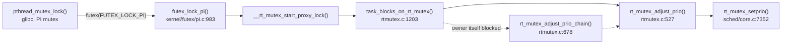
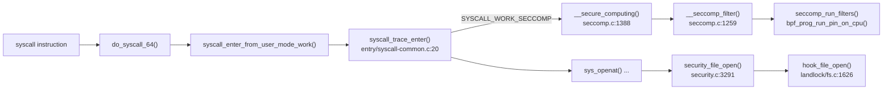

<div dir="rtl">

# ۰۷ — گشت در کد کرنل: mutexهای PI، ‏PREEMPT_RT، ‏SCHED_DEADLINE، ‏seccomp و Landlock

> نسخه‌های ثابت: Linux **v6.18.63** (`_shared/sources/linux`) و OpenBSD **`8cada8c`** (`_shared/sources/openbsd`). معماری: **x86-64**.
> همهٔ بخش‌های کد زیر با `bash _shared/sources/cite.sh ...` از checkout محلی چاپ شده‌اند و شمارهٔ خط‌ها واقعی است. نسخهٔ انگلیسی: [`kernel-walkthrough.en.md`](kernel-walkthrough.en.md).

پنج ایستگاه، به همان ترتیبی که یک برنامهٔ real-time یا sandboxشده به آن‌ها می‌رسد:

| # | ایستگاه | فایل | چرا مهم است |
|---|---|---|---|
| ۱ | این کرنل RT است؟ | `kernel/Kconfig.preempt` و `init/Makefile` | `uname -v` چه می‌گوید و `PREEMPT_RT` چه چیزی را عوض می‌کند |
| ۲ | Priority inheritance | `kernel/futex/pi.c`، `kernel/locking/rtmutex.c`، `kernel/sched/core.c` | `PTHREAD_PRIO_INHERIT` (آزمایش ۰۲) چطور اولویت صاحب قفل را بالا می‌برد |
| ۳ | spinlockی که می‌خوابد | `kernel/locking/spinlock_rt.c` | ترفند اصلی `PREEMPT_RT` |
| ۴ | `SCHED_DEADLINE` | `kernel/sched/deadline.c` | admission control و throttle کردن بودجه (CBS) |
| ۵ | Sandboxing | `kernel/entry/syscall-common.c`، `kernel/seccomp.c`، `security/landlock/` | seccomp کجای مسیر هر syscall اجرا می‌شود و Landlock چطور به `open()` قلاب می‌شود |

در پایان مقایسه با OpenBSD: ‏`pledge(2)` و `unveil(2)` در برابر seccomp و Landlock.

---

## ۱. این کرنل RT است؟ `Kconfig.preempt` و پرچم `uname -v`

</div>

```text
linux/kernel/Kconfig.preempt · config PREEMPT_RT · v6.18.63 · L89-92
   89  config PREEMPT_RT
   90  	bool "Fully Preemptible Kernel (Real-Time)"
   91  	depends on EXPERT && ARCH_SUPPORTS_RT && !COMPILE_TEST
   92  	select PREEMPTION
```

<div dir="rtl">

پیوند: <https://elixir.bootlin.com/linux/v6.18.63/source/kernel/Kconfig.preempt#L89>

| خط | معنی |
|---|---|
| ۸۹ | این گزینه یک نماد معمولی Kconfig در mainline است و دیگر patch بیرونی لازم ندارد (از v6.12 در mainline قابل انتخاب شد؛ یادداشت `VERSION-DEPENDENT` پایین را ببینید) |
| ۹۱ | `EXPERT`: تا گزینه‌های حرفه‌ای را روشن نکنید پنهان است. `ARCH_SUPPORTS_RT`: فقط معماری‌هایی که آن را select می‌کنند (x86-64 می‌کند: `arch/x86/Kconfig` خط ۱۳۳). `!COMPILE_TEST`: برای پیکربندی‌های صرفاً آزمایشیِ build نیست |
| ۹۲ | RT کل سازوکار preemption (یعنی `PREEMPTION` و `PREEMPT_COUNT`) را اجباری روشن می‌کند |

متن help بعدی (خط ۹۳ تا ۱۰۴) می‌گوید RT چه می‌کند: «spinlockها، rwlockها و غیره» را با «نسخه‌های preemptible و آگاه از priority inheritance» عوض می‌کند، interruptها را اجباری به thread تبدیل می‌کند (threaded IRQ) و بخش‌های طولانیِ غیرقابل‌preempt را می‌شکند.

در زمان اجرا از کجا بفهمیم؟ build مدل preemption را در رشتهٔ نسخه می‌نویسد:

</div>

```text
linux/init/Makefile · L28-30 · v6.18.63
   28  preempt-flag-$(CONFIG_PREEMPT_BUILD)	:= PREEMPT
   29  preempt-flag-$(CONFIG_PREEMPT_DYNAMIC)	:= PREEMPT_DYNAMIC
   30  preempt-flag-$(CONFIG_PREEMPT_RT)	:= PREEMPT_RT
```

<div dir="rtl">

make این‌ها را به ترتیب مقدار می‌دهد، پس **آخرین گزینهٔ روشن برنده است**: کرنل RT عبارت `PREEMPT_RT` و کرنل dynamic عبارت `PREEMPT_DYNAMIC` را چاپ می‌کند. VM ما `SMP PREEMPT_DYNAMIC` چاپ می‌کند (آزمایش ۰۱). در v6.18.63 فایلی به نام `/sys/kernel/realtime` **وجود ندارد** (`git grep -n realtime -- kernel/ksysfs.c` چیزی پیدا نمی‌کند؛ اینکه patchهای قدیمی RT چنین فایلی داشتند `UNVERIFIED` است). از `uname -v` یا `/boot/config-$(uname -r)` استفاده کنید.

`PREEMPT_DYNAMIC` (خط ۱۲۶ تا ۱۴۷ همان فایل) اجازه می‌دهد یک باینری بین `none`، `voluntary`، `full` و `lazy` جابه‌جا شود؛ هنگام بوت با `preempt=` یا در زمان اجرا با `/sys/kernel/debug/sched/preempt`. ولی RT جزو این حالت‌ها **نیست**: RT نوع قفل‌ها را هنگام compile عوض می‌کند و بعداً روشن‌شدنی نیست.

> `VERSION-DEPENDENT`: جملهٔ «از 6.12 در mainline» از تاریخچهٔ merge نسخهٔ 6.12 می‌آید. در درخت ثابت ما فقط شکل فعلی بالا را بررسی کرده‌ایم.

---

## ۲. Priority inheritance: از `pthread_mutex_lock()` تا `rt_mutex_setprio()`

زنجیرهٔ فراخوانی برای یک mutex با `PTHREAD_PRIO_INHERIT` وقتی رقابت هست (در آزمایش ۰۲ در `strace` به شکل `futex(..., FUTEX_LOCK_PI_PRIVATE, ...)` دیده می‌شود):

</div>



<div dir="rtl">

### ۲.۱ futex وارد دنیای rt_mutex می‌شود

</div>

```text
linux/kernel/futex/pi.c · futex_lock_pi() · v6.18.63 · L975-983 (comment) and L1095
  975   * Userspace tried a 0 -> TID atomic transition of the futex value
  976   * and failed. The kernel side here does the whole locking operation:
  977   * if there are waiters then it will block as a consequence of relying
  978   * on rt-mutexes, it does PI, etc. (Due to races the kernel might see
  979   * a 0 value of the futex too.).
  ...
  983  int futex_lock_pi(u32 __user *uaddr, unsigned int flags, ktime_t *time, int trylock)
  ...
 1095  		ret = __rt_mutex_start_proxy_lock(&q.pi_state->pi_mutex, &rt_waiter, current, &wake_q);
```

<div dir="rtl">

پیوند: <https://elixir.bootlin.com/linux/v6.18.63/source/kernel/futex/pi.c#L983>

- خط ۹۷۵: **مسیر سریع در فضای کاربر است**: قفلِ بدون رقیب فقط یک compare-and-swap اتمیک از `0` به `TID` است و هیچ syscallی ندارد. به همین دلیل کلمهٔ futex **شناسهٔ thread** صاحب قفل را نگه می‌دارد: کرنل باید بداند اولویتِ *چه کسی* را بالا ببرد.
- خط ۹۷۶ تا ۹۷۸: فقط وقتی رقابت هست کرنل یک `pi_state` می‌سازد که داخلش یک `rt_mutex` واقعی است.
- خط ۱۰۹۵: thread منتظر (`current`) روی همان `rt_mutex` صف می‌شود. از اینجا به بعد futex نوع PI و rt_mutexِ داخل کرنل یک کد مشترک دارند (`__rt_mutex_start_proxy_lock()` در `rtmutex_api.c` خودش `task_blocks_on_rt_mutex()` را صدا می‌زند).

### ۲.۲ thread مسدودشده اولویتش را قرض می‌دهد

</div>

```text
linux/kernel/locking/rtmutex.c · task_blocks_on_rt_mutex() · v6.18.63 · L1265-1275
 1265  	raw_spin_lock(&owner->pi_lock);
 1266  	if (waiter == rt_mutex_top_waiter(lock)) {
 1267  		rt_mutex_dequeue_pi(owner, top_waiter);
 1268  		rt_mutex_enqueue_pi(owner, waiter);
 1269  
 1270  		rt_mutex_adjust_prio(lock, owner);
 1271  		if (owner->pi_blocked_on)
 1272  			chain_walk = 1;
 1273  	} else if (rt_mutex_cond_detect_deadlock(waiter, chwalk)) {
 1274  		chain_walk = 1;
 1275  	}
```

<div dir="rtl">

پیوند: <https://elixir.bootlin.com/linux/v6.18.63/source/kernel/locking/rtmutex.c#L1265>

| خط | معنی |
|---|---|
| ۱۲۶۵ | قفل `pi_lock` **صاحب قفل** را می‌گیرد، چون می‌خواهیم اولویت task دیگری را عوض کنیم |
| ۱۲۶۶ | فقط اگر منتظر جدید حالا **بالاترین اولویت** را بین منتظرهای این قفل دارد، چیزی تغییر می‌کند |
| ۱۲۶۷-۱۲۶۸ | هر task یک درخت `pi_waiters` دارد که منتظرِ اولِ هر قفلی را که در اختیار دارد نگه می‌دارد. منتظر اول قبلی این قفل با منتظر جدید جایگزین می‌شود |
| ۱۲۷۰ | اولویت مؤثر صاحب قفل دوباره حساب می‌شود (بخش ۲.۳) |
| ۱۲۷۱-۱۲۷۲ | اگر صاحب قفل **خودش** روی rt_mutex دیگری مسدود است، افزایش اولویت باید جلوتر برود: زنجیره پیمایش می‌شود (`rt_mutex_adjust_prio_chain()` در خط ۶۷۸ که توضیح بالای آن، خط ۶۰۶ تا ۶۷۷، سیزده گام قفل‌گذاری را فهرست می‌کند). این یعنی وراثت **تراگذر** (transitive) |
| ۱۲۷۳-۱۲۷۴ | حتی اگر افزایش اولویت لازم نباشد، ممکن است تشخیص deadlock به پیمایش نیاز داشته باشد (`-EDEADLK`) |

### ۲.۳ افزایش اولویت = گرفتن اولویت منتظر اول

</div>

```text
linux/kernel/locking/rtmutex.c · rt_mutex_adjust_prio() · v6.18.63 · L527-540
  527  static __always_inline void rt_mutex_adjust_prio(struct rt_mutex_base *lock,
  528  						 struct task_struct *p)
  529  {
  530  	struct task_struct *pi_task = NULL;
  531  
  532  	lockdep_assert_held(&lock->wait_lock);
  533  	lockdep_assert(rt_mutex_owner(lock) == p);
  534  	lockdep_assert_held(&p->pi_lock);
  535  
  536  	if (task_has_pi_waiters(p))
  537  		pi_task = task_top_pi_waiter(p)->task;
  538  
  539  	rt_mutex_setprio(p, pi_task);
  540  }
```

<div dir="rtl">

پیوند: <https://elixir.bootlin.com/linux/v6.18.63/source/kernel/locking/rtmutex.c#L527>

- خط ۵۳۲ تا ۵۳۴: سه assertion قانون قفل‌گذاری را مستند می‌کنند: اول `wait_lock`، بعد `pi_lock` صاحب قفل.
- خط ۵۳۶ تا ۵۳۷: اهداکنندهٔ اولویت، **رأس** درخت `pi_waiters` صاحب قفل است؛ روی همهٔ قفل‌هایی که در دست دارد.
- خط ۵۳۹: اگر `pi_task == NULL` باشد یعنی «منتظری نمانده»؛ همین فراخوانی هنگام unlock اولویت صاحب قفل را به حالت عادی **برمی‌گرداند** (de-boost).

</div>

```text
linux/kernel/sched/core.c · rt_mutex_setprio() · v6.18.63 · L7352-7367
 7352  void rt_mutex_setprio(struct task_struct *p, struct task_struct *pi_task)
 7353  {
 7354  	int prio, oldprio, queue_flag =
 7355  		DEQUEUE_SAVE | DEQUEUE_MOVE | DEQUEUE_NOCLOCK;
 7356  	const struct sched_class *prev_class, *next_class;
 7357  	struct rq_flags rf;
 7358  	struct rq *rq;
 7359  
 7360  	/* XXX used to be waiter->prio, not waiter->task->prio */
 7361  	prio = __rt_effective_prio(pi_task, p->normal_prio);
 7362  
 7363  	/*
 7364  	 * If nothing changed; bail early.
 7365  	 */
 7366  	if (p->pi_top_task == pi_task && prio == p->prio && !dl_prio(prio))
 7367  		return;
```

<div dir="rtl">

پیوند: <https://elixir.bootlin.com/linux/v6.18.63/source/kernel/sched/core.c#L7352>

- خط ۷۳۶۱: اولویت مؤثر = بهترینِ اولویت اهداکننده و `normal_prio` خود task. توضیح بالای تابع (خط ۷۳۴۱ تا ۷۳۵۱) تأکید می‌کند که فقط `->prio` عوض می‌شود و **نه** `->normal_prio`؛ افزایش اولویت موقت است.
- خط ۷۳۶۶: اگر چیزی عوض نشده، کاری روی runqueue لازم نیست. در غیر این صورت تابع tracepoint ‏`trace_sched_pi_setprio()` را فعال می‌کند (خط ۷۴۰۷) و حتی ممکن است task را به **کلاس زمان‌بندی** دیگری ببرد (`__setscheduler_class()`، خط ۷۴۱۴): صاحب قفلی با `SCHED_OTHER` که منتظری با `SCHED_FIFO` دارد، تا آزادشدن قفل یک task از نوع RT می‌شود. آزمایش ۰۲ همین tracepoint را با bpftrace تماشا می‌کند.

---

## ۳. ترفند اصلی PREEMPT_RT: ‏`spinlock_t` به یک rt_mutexِ خوابنده تبدیل می‌شود

</div>

```text
linux/kernel/locking/spinlock_rt.c · rt_spin_lock() · v6.18.63 · L38-59
   38  static __always_inline void rtlock_lock(struct rt_mutex_base *rtm)
   39  {
   40  	lockdep_assert(!current->pi_blocked_on);
   41  
   42  	if (unlikely(!rt_mutex_cmpxchg_acquire(rtm, NULL, current)))
   43  		rtlock_slowlock(rtm);
   44  }
   45  
   46  static __always_inline void __rt_spin_lock(spinlock_t *lock)
   47  {
   48  	rtlock_might_resched();
   49  	rtlock_lock(&lock->lock);
   50  	rcu_read_lock();
   51  	migrate_disable();
   52  }
   53  
   54  void __sched rt_spin_lock(spinlock_t *lock) __acquires(RCU)
   55  {
   56  	spin_acquire(&lock->dep_map, 0, 0, _RET_IP_);
   57  	__rt_spin_lock(lock);
   58  }
```

<div dir="rtl">

پیوند: <https://elixir.bootlin.com/linux/v6.18.63/source/kernel/locking/spinlock_rt.c#L38>

| خط | معنی |
|---|---|
| ۴۲ | مسیر سریع: یک `cmpxchg` روی فیلد owner از `NULL` به `current`، درست مثل futex |
| ۴۳ | مسیر کند: به‌جای چرخیدن با preemption خاموش، روی یک rt_mutex **می‌خوابد**، همراه با priority inheritance |
| ۴۸ | «might resched»: این قفل اجازهٔ schedule دارد، پس نباید در context واقعاً اتمیک گرفته شود |
| ۵۰-۵۱ | آنچه از معنای spinlock حفظ *می‌شود*: یک بخش خواندن RCU و **عدم مهاجرت** به CPU دیگر (تا دادهٔ per-CPU معتبر بماند). preemption **روشن** می‌ماند |

در کرنل غیر RT، ‏`spin_lock()` در کل بخش بحرانی preemption را خاموش می‌کند؛ پس هر بخش طولانی برای همهٔ taskهای پراولویت‌تر روی آن CPU منبع تأخیر است. در RT فقط `raw_spinlock_t` (زمان‌بند، کد سطح پایین IRQ) هنوز این کار را می‌کند. مستندات: `Documentation/locking/locktypes.rst` (در checkout موجود است).

---

## ۴. ‏`SCHED_DEADLINE`: ‏admission control و throttle کردن CBS

### ۴.۱ بررسی پارامترها: runtime ≤ deadline ≤ period

</div>

```text
linux/kernel/sched/deadline.c · __checkparam_dl() · v6.18.63 · L3580-3592
 3580  	period = attr->sched_period;
 3581  	if (!period)
 3582  		period = attr->sched_deadline;
 3583  
 3584  	/* runtime <= deadline <= period (if period != 0) */
 3585  	if (period < attr->sched_deadline ||
 3586  	    attr->sched_deadline < attr->sched_runtime)
 3587  		return false;
 3588  
 3589  	max = (u64)READ_ONCE(sysctl_sched_dl_period_max) * NSEC_PER_USEC;
 3590  	min = (u64)READ_ONCE(sysctl_sched_dl_period_min) * NSEC_PER_USEC;
 3591  
 3592  	if (period < min || period > max)
```

<div dir="rtl">

پیوند: <https://elixir.bootlin.com/linux/v6.18.63/source/kernel/sched/deadline.c#L3553>

- خط ۳۵۸۱ تا ۳۵۸۲: period صفر یعنی «task با deadline ضمنی»: period برابر deadline می‌شود.
- خط ۳۵۸۵ تا ۳۵۸۷: قید کلاسیک مدل task یعنی `C ≤ D ≤ T`. در غیر این صورت `sched_setattr()` با `EINVAL` شکست می‌خورد.
- خط ۳۵۸۹ تا ۳۵۹۲: حد بالا و پایین از `/proc/sys/kernel/sched_deadline_period_{min,max}_us`.

### ۴.۲ پذیرش: آیا پهنای باند کل سرریز می‌کند؟

</div>

```text
linux/kernel/sched/deadline.c · __dl_overflow() · v6.18.63 · L212-217
  212  static inline bool
  213  __dl_overflow(struct dl_bw *dl_b, unsigned long cap, u64 old_bw, u64 new_bw)
  214  {
  215  	return dl_b->bw != -1 &&
  216  	       cap_scale(dl_b->bw, cap) < dl_b->total_bw - old_bw + new_bw;
  217  }
```

<div dir="rtl">

- `new_bw` همان `runtime/period` به شکل نسبت fixed-point است (`to_ratio(period, runtime)` در `sched_dl_overflow()`، خط ۳۴۵۳).
- `dl_b->bw` سهم مجاز است، یعنی `to_ratio(global_rt_period(), global_rt_runtime())` (خط ۵۱۸ تا ۵۲۱)، یعنی `sched_rt_runtime_us / sched_rt_period_us` (روی VM ما 950000/1000000 = ۹۵٪) که با ظرفیت CPUهای root domain مقیاس می‌شود (`cap_scale`). مقدار `-1` یعنی «نامحدود».
- اگر مجموع پهنای باند همهٔ taskهای deadline به‌اضافهٔ task جدید از حد بگذرد، ‏`sched_setattr()` خطای **`EBUSY`** برمی‌گرداند. این همان آزمون بهره‌وری `Σ Cᵢ/Tᵢ ≤ m·U_max` در global EDF است: شرط لازم است، نه اثبات اینکه روی SMP همهٔ deadlineها رعایت می‌شوند (یادداشت ۰۲).

### ۴.۳ بودجه تمام شد ← تا دورهٔ بعد throttle

</div>

```text
linux/kernel/sched/deadline.c · update_curr_dl_se() · v6.18.63 · L1480-1489
 1480  throttle:
 1481  	if (dl_runtime_exceeded(dl_se) || dl_se->dl_yielded) {
 1482  		dl_se->dl_throttled = 1;
 1483  
 1484  		/* If requested, inform the user about runtime overruns. */
 1485  		if (dl_runtime_exceeded(dl_se) &&
 1486  		    (dl_se->flags & SCHED_FLAG_DL_OVERRUN))
 1487  			dl_se->dl_overrun = 1;
 1488  
 1489  		dequeue_dl_entity(dl_se, 0);
```

<div dir="rtl">

- `dl_runtime_exceeded()` (خط ۱۳۵۶) فقط `dl_se->runtime <= 0` است: task بودجه‌اش را مصرف کرده.
- خط ۱۴۸۲ و ۱۴۸۹: task **throttle** می‌شود و از runqueue بیرون می‌رود؛ تایمر replenish (`start_dl_timer()`) آن را در دورهٔ بعد با بودجهٔ کامل برمی‌گرداند. این همان **Constant Bandwidth Server** است: یک task بدرفتار نمی‌تواند بیش از `runtime/period` بردارد، پس تضمین بقیه را نمی‌شکند.
- خط ۱۴۸۶: با `SCHED_FLAG_DL_OVERRUN` کرنل برای گزارش overrun سیگنال `SIGXCPU` می‌فرستد.

---

## ۵. Sandboxing روی مسیر syscall: ‏seccomp و Landlock

</div>



<div dir="rtl">

### ۵.۱ seccomp کجا اجرا می‌شود

</div>

```text
linux/kernel/entry/syscall-common.c · syscall_trace_enter() · v6.18.63 · L45-53
   45  	/* Do seccomp after ptrace, to catch any tracer changes. */
   46  	if (work & SYSCALL_WORK_SECCOMP) {
   47  		ret = __secure_computing();
   48  		if (ret == -1L)
   49  			return ret;
   50  	}
   51  
   52  	/* Either of the above might have changed the syscall number */
   53  	syscall = syscall_get_nr(current, regs);
```

<div dir="rtl">

پیوند: <https://elixir.bootlin.com/linux/v6.18.63/source/kernel/entry/syscall-common.c#L45>

- خط ۴۶: یک پرچم «کار» برای هر thread. threadهای **بدون** فیلتر چیزی بیش از تست این بیت نمی‌پردازند (این تست در بررسی کلیِ syscall work ادغام شده است).
- خط ۴۵: seccomp **بعد از** ptrace اجرا می‌شود تا tracer نتواند با عوض‌کردن شمارهٔ syscall فیلتر را دور بزند.
- خط ۴۸: ‏`-1` یعنی syscall اجرا نشود (errno تنظیم شده یا task در حال کشته‌شدن است).

### ۵.۲ اجرای فیلترها: سخت‌گیرانه‌ترین نتیجه برنده است

</div>

```text
linux/kernel/seccomp.c · seccomp_run_filters() · v6.18.63 · L404-431
  404  static u32 seccomp_run_filters(const struct seccomp_data *sd,
  405  			       struct seccomp_filter **match)
  406  {
  407  	u32 ret = SECCOMP_RET_ALLOW;
  408  	/* Make sure cross-thread synced filter points somewhere sane. */
  409  	struct seccomp_filter *f =
  410  			READ_ONCE(current->seccomp.filter);
  411  
  412  	/* Ensure unexpected behavior doesn't result in failing open. */
  413  	if (WARN_ON(f == NULL))
  414  		return SECCOMP_RET_KILL_PROCESS;
  415  
  416  	if (seccomp_cache_check_allow(f, sd))
  417  		return SECCOMP_RET_ALLOW;
  418  
  419  	/*
  420  	 * All filters in the list are evaluated and the lowest BPF return
  421  	 * value always takes priority (ignoring the DATA).
  422  	 */
  423  	for (; f; f = f->prev) {
  424  		u32 cur_ret = bpf_prog_run_pin_on_cpu(f->prog, sd);
  425  
  426  		if (ACTION_ONLY(cur_ret) < ACTION_ONLY(ret)) {
  427  			ret = cur_ret;
  428  			*match = f;
  429  		}
  430  	}
  431  	return ret;
```

<div dir="rtl">

پیوند: <https://elixir.bootlin.com/linux/v6.18.63/source/kernel/seccomp.c#L404>

| خط | معنی |
|---|---|
| ۴۱۳-۴۱۴ | **fail closed**: اگر در حالت filter فیلتری نباشد، نتیجه kill است، هرگز allow |
| ۴۱۶-۴۱۷ | cache بیتی برای هر فیلتر: syscallهایی که فیلتر *همیشه* (مستقل از آرگومان) اجازه می‌دهد اصلاً BPF را اجرا نمی‌کنند |
| ۴۲۳ | فیلترها یک **پشته** می‌سازند (`f->prev`): هر فراخوانی `seccomp()` یکی اضافه می‌کند و هیچ‌کدام حذف‌شدنی نیست. فرزند کل فهرست را در `fork()` و `execve()` به ارث می‌برد |
| ۴۲۴ | برنامهٔ classic BPF (که داخل کرنل به eBPF تبدیل و معمولاً JIT می‌شود) روی `struct seccomp_data` اجرا می‌شود |
| ۴۲۶ | ماکروی `ACTION_ONLY()` (خط ۳۹۴) مقدار را به `s32` تبدیل می‌کند، پس `KILL_PROCESS` (`0x80000000`) منفی و کوچک‌ترین است: عدد کمتر = سخت‌گیرانه‌تر (`KILL_PROCESS` < `KILL_THREAD` < `TRAP` < `ERRNO` < `USER_NOTIF` < `TRACE` < `LOG` < `ALLOW`). پس فیلتر بعدی فقط می‌تواند **سخت‌تر** کند، نه شل‌تر |

### ۵.۳ عمل بر اساس حکم

</div>

```text
linux/kernel/seccomp.c · __seccomp_filter() · v6.18.63 · L1274-1285
 1274  	filter_ret = seccomp_run_filters(&sd, &match);
 1275  	data = filter_ret & SECCOMP_RET_DATA;
 1276  	action = filter_ret & SECCOMP_RET_ACTION_FULL;
 1277  
 1278  	switch (action) {
 1279  	case SECCOMP_RET_ERRNO:
 1280  		/* Set low-order bits as an errno, capped at MAX_ERRNO. */
 1281  		if (data > MAX_ERRNO)
 1282  			data = MAX_ERRNO;
 1283  		syscall_set_return_value(current, current_pt_regs(),
 1284  					 -data, 0);
 1285  		goto skip;
```

<div dir="rtl">

- خط ۱۲۷۵ تا ۱۲۷۶: مقدار ۳۲ بیتی به action (بیت‌های بالا) و ۱۶ بیت data تقسیم می‌شود. در آزمایش ۰۳، ‏`SCMP_ACT_ERRNO(EACCES)` عدد `13` را در data می‌گذارد.
- خط ۱۲۸۳ تا ۱۲۸۵: syscall **هرگز اجرا نمی‌شود**؛ فضای کاربر `-1` با `errno = EACCES` می‌بیند.
- جلوتر در همین switch (خط ۱۳۵۵ تا ۱۳۶۶)، ‏`KILL_PROCESS` حالت `SECCOMP_MODE_DEAD` را می‌گذارد و `SIGSYS` با core dump می‌فرستد. آزمایش ۰۳ این را به شکل `Bad system call (core dumped)` می‌بیند.

همچنین در `seccomp_prepare_filter()` (خط ۶۹۱ تا ۶۹۳): نصب فیلتر به `no_new_privs` **یا** `CAP_SYS_ADMIN` در user namespace نیاز دارد. به همین دلیل همهٔ برنامه‌های آزمایش اول `prctl(PR_SET_NO_NEW_PRIVS, 1)` را صدا می‌زنند.

### ۵.۴ ‏Landlock: یک LSM که پردازهٔ بدون امتیاز خودش پیکربندی می‌کند

</div>

```text
linux/security/landlock/syscalls.c · landlock_restrict_self() · v6.18.63 · L491-497
  491  	/*
  492  	 * Similar checks as for seccomp(2), except that an -EPERM may be
  493  	 * returned.
  494  	 */
  495  	if (!task_no_new_privs(current) &&
  496  	    !ns_capable_noaudit(current_user_ns(), CAP_SYS_ADMIN))
  497  		return -EPERM;
```

<div dir="rtl">

پیوند: <https://elixir.bootlin.com/linux/v6.18.63/source/security/landlock/syscalls.c#L478>

- همان قانون seccomp: امتیاز لازم نیست، فقط `no_new_privs`.
- پایین‌تر (خط ۵۴۸) ruleset جدید با دامنهٔ موجود **ادغام** می‌شود (`landlock_merge_ruleset()`): مثل فیلترهای seccomp، لایه‌های Landlock روی هم جمع می‌شوند و فقط محدودتر می‌کنند.
- در این درخت `landlock_abi_version = 7` است (خط ۱۶۴). فراخوانی `landlock_create_ruleset(NULL, 0, LANDLOCK_CREATE_RULESET_VERSION)` همین را برمی‌گرداند و آزمایش ۰۴ چاپش می‌کند.

خود بررسی یک hook از نوع LSM روی `open()` است:

</div>

```text
linux/security/landlock/fs.c · hook_file_open() · v6.18.63 · L1626-1636
 1626  static int hook_file_open(struct file *const file)
 1627  {
 1628  	struct layer_access_masks layer_masks = {};
 1629  	access_mask_t open_access_request, full_access_request, allowed_access,
 1630  		optional_access;
 1631  	const struct landlock_cred_security *const subject =
 1632  		landlock_get_applicable_subject(file->f_cred, any_fs, NULL);
 1633  	struct landlock_request request = {};
 1634  
 1635  	if (!subject)
 1636  		return 0;
```

<div dir="rtl">

- خط ۱۶۳۱ تا ۱۶۳۶: task بدون sandbox در credentialهایش دامنهٔ Landlock ندارد، پس فوراً برمی‌گردد (هزینه تقریباً یک بررسی اشاره‌گر).
- خط ۱۶۵۵ تا ۱۶۶۰ (نشان داده نشده): ‏`is_access_to_paths_allowed()` از فایل تا ریشه بالا می‌رود و حق‌هایی را که قانون‌های `LANDLOCK_RULE_PATH_BENEATH` در هر لایه می‌دهند جمع می‌کند. دسترسی فقط وقتی مجاز است که **همهٔ** لایه‌ها آن را بدهند.
- ثبت: `LSM_HOOK_INIT(file_open, hook_file_open)` در fs.c خط ۱۸۶۹؛ از `security_file_open()` (security/security.c خط ۳۲۹۱ تا ۳۲۹۴) با `call_int_hook` صدا زده می‌شود.

**seccomp در برابر Landlock:** ‏seccomp فقط *شمارهٔ syscall و مقدار خام آرگومان‌ها* را می‌بیند و نمی‌تواند اشاره‌گر مسیر را امن dereference کند (مشکل TOCTOU). ‏Landlock *اشیای کرنل* (مسیر resolveشده، فایل، پورت) را بعد از lookup می‌بیند. sandboxهای واقعی (Chrome، systemd، Firefox) هر دو را ترکیب می‌کنند.

---

## ۶. مقایسه با OpenBSD: ‏`pledge(2)` و `unveil(2)`

OpenBSD همین مسئله را با دو syscall حل می‌کند که برای **برنامه‌نویسی که کد خودش را مقاوم می‌کند** طراحی شده‌اند، نه برای نویسندهٔ سیاست امنیتی.

### ۶.۱ بررسی کجا انجام می‌شود

</div>

<table>
<tr><th>Linux: seccomp on the syscall path</th><th>OpenBSD: pledge on the syscall path</th></tr>
<tr><td>

```c
/* linux/kernel/entry/syscall-common.c
   syscall_trace_enter() · v6.18.63 · L46-50 */
if (work & SYSCALL_WORK_SECCOMP) {
	ret = __secure_computing();
	if (ret == -1L)
		return ret;
}
```

</td><td>

```c
/* openbsd/sys/sys/syscall_mi.h
   mi_syscall() · 8cada8c · L167-172 */
pledged = (p->p_p->ps_flags & PS_PLEDGE);
if (pledged && (error = pledge_syscall(p, code, &tval))) {
	KERNEL_LOCK();
	error = pledge_fail(p, error, tval);
	KERNEL_UNLOCK();
	return (error);
}
```

</td></tr>
</table>

<div dir="rtl">

هر دو روی مسیر داغ فقط یک تست پرچم‌اند. تفاوت در چیزی است که بعد اجرا می‌شود.

### ۶.۲ تصمیم‌گیری

</div>

```text
openbsd/sys/kern/kern_pledge.c · pledge_syscall() · 8cada8c · L537-554
  537  pledge_syscall(struct proc *p, int code, uint64_t *tval)
  538  {
  539  	p->p_pledge_syscall = code;
  540  	*tval = 0;
  541  
  542  	if (code < 0 || code > SYS_MAXSYSCALL - 1)
  543  		return (EINVAL);
  544  
  545  	if (pledge_syscalls[code] == PLEDGE_ALWAYS)
  546  		return (0);
  547  
  548  	p->p_pledge = READ_ONCE(p->p_p->ps_pledge); /* pledge checks are per-thread */
  549  	if (p->p_pledge & pledge_syscalls[code])
  550  		return (0);
  551  
  552  	*tval = pledge_syscalls[code];
  553  	return (EPERM);
  554  }
```

<div dir="rtl">

پیوند: <https://github.com/openbsd/src/blob/8cada8c/sys/kern/kern_pledge.c#L537>

- خط ۵۴۵: یک جدول ثابت در کرنل، ‏`pledge_syscalls[]` (از خط ۹۷)، هر syscall را به یک **بیت promise** نگاشت می‌کند (`PLEDGE_STDIO`، `PLEDGE_RPATH`، ...). syscallهای `PLEDGE_ALWAYS` (مثل `exit` و `pledge`) هرگز مسدود نمی‌شوند.
- خط ۵۴۹: اگر پردازه آن بیت را قول داده باشد مجاز است. نه برنامه‌ای، نه مفسری: فقط یک AND بیتی.
- در صورت شکست، `pledge_fail()` (خط ۵۵۷) پیام `pledge "<promise>", syscall N` را چاپ می‌کند، برای core dump سیگنال **`SIGABRT` غیرقابل‌گرفتن** می‌فرستد (خط ۵۸۵) و همهٔ promiseها را پاک می‌کند. با `SIGSYS` در seccomp مقایسه کنید.
- بررسی‌های ریزتر (مثلاً «`rpath` اجازهٔ خواندن با `open()` می‌دهد، نه نوشتن») در hookهای دیگرند، مثل `pledge_namei()` (خط ۶۶۹) که از path lookup صدا زده می‌شود.

‏`unveil(2)` همتای Landlock در OpenBSD است: دیده‌شدن بر اساس مسیر. ‏`unveil_check_final()` (‏`kern_unveil.c` خط ۶۴۵) در انتهای `namei()` اجرا می‌شود و برای مسیرهای بیرون از همهٔ درخت‌های unveilشده `ENOENT` برمی‌گرداند (فایل «وجود ندارد»)، و اگر مسیر با مجوز اشتباه unveil شده باشد `EACCES` (خط ۶۷۸ تا ۶۸۲).

### ۶.۳ جدول بده‌بستان

| انتخاب طراحی | Linux (seccomp + Landlock) | OpenBSD (pledge + unveil) | بده‌بستان |
|---|---|---|---|
| زبان سیاست | برنامهٔ BPF روی شمارهٔ syscall و آرگومان‌ها (seccomp)؛ ماسک بیتی حق دسترسی برای هر مسیر (Landlock) | حدود ۳۰ promise نام‌دار (`"stdio rpath inet"`) و رشتهٔ مسیر | Linux: هر چیزی قابل بیان است ولی اشتباه کردن آسان است (فراموش‌کردن بررسی arch، syscallهای جدید). OpenBSD: یک خط، ولی فقط شکل‌هایی که نویسندگان کرنل پیش‌بینی کرده‌اند |
| نگاشت syscall به دسته را چه کسی نگه می‌دارد | **نویسندهٔ فیلتر** (و libseccomp) | **کرنل** (جدول `pledge_syscalls[]`) | syscall جدید لینوکس در فیلتر deny-list بی‌صدا مجاز می‌شود؛ syscall جدید OpenBSD را توسعه‌دهندگان کرنل دسته‌بندی می‌کنند |
| بررسی آرگومان | فقط مقدار خام، بدون dereference اشاره‌گر | بررسی معنایی در کرنل (`pledge_namei`، فهرست ioctlها) | OpenBSD می‌تواند مسیر را امن بررسی کند؛ seccomp برای این کار به Landlock نیاز دارد |
| شکست | برای هر قانون: errno، ‏trap، اطلاع به ناظر فضای کاربر، kill | ‏`SIGABRT` غیرقابل‌گرفتن و core (یا `ENOSYS` با promise ‏`error`) | Linux از ناظرها پشتیبانی می‌کند (runtimeهای container)؛ OpenBSD برای «با صدای بلند crash کن تا باگ درست شود» بهینه شده |
| انباشت | فیلترها و لایه‌های Landlock روی هم جمع می‌شوند؛ فقط سخت‌تر | ‏`pledge` فقط می‌تواند promise کم کند؛ `unveil` با `unveil(NULL, NULL)` قفل می‌شود | هر دو یک اصل یکنوا دارند |
| وراثت در exec | همیشه به ارث می‌رسد | آرگومان جداگانهٔ `execpromises` | OpenBSD اجازه می‌دهد shell خودش را pledge کند بی‌آنکه برنامه‌هایی که اجرا می‌کند فلج شوند |
| کاربرد | containerها (profile پیش‌فرض Docker)، ‏`SystemCallFilter=` در systemd، مرورگرها | بیشتر سیستم پایهٔ OpenBSD pledge شده | Linux: سازوکار برای سازندگان پلتفرم؛ OpenBSD: ابزار برای هر برنامه‌نویس |

از سمت real-time: درخت OpenBSD **هیچ کلاس زمان‌بندی real-time ندارد**. ‏`git grep -n SCHED_FIFO -- sys` در `8cada8c` چیزی برنمی‌گرداند؛ زمان‌بندی همان زمان‌بند priority-decay در `sys/kern/sched_bsd.c` است (ماژول ۰۲). اینکه libpthread در OpenBSD ‏`PTHREAD_PRIO_INHERIT` را پیاده کرده یا نه `UNVERIFIED` است (`lib/librthread` در sparse checkout ما نیست؛ با `git -C _shared/sources/openbsd sparse-checkout add lib/librthread` و سپس `git grep PRIO_INHERIT lib/librthread` بررسی کنید).

</div>
