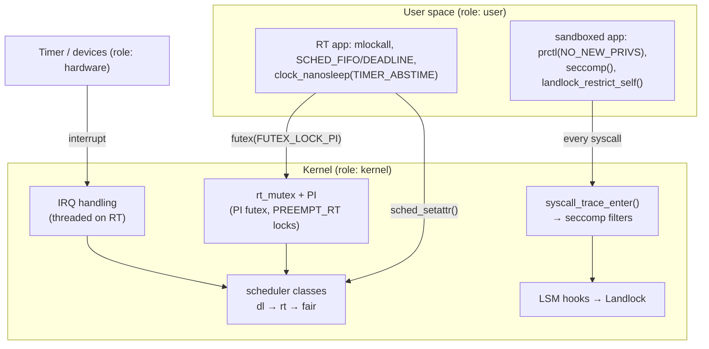

# 07 — Real-Time & Research Topics

> Course: Advanced Operating Systems · Term 1 · Pins: Linux **v6.18.63**, OpenBSD **`8cada8c`** · Arch: **x86-64** · Time: ~11 h
> Farsi: [`lesson.fa.md`](lesson.fa.md) · Notes: [`notes/INDEX.en.md`](notes/INDEX.en.md) · Walkthrough: [`kernel-walkthrough.en.md`](kernel-walkthrough.en.md) · Slides: [`slides/`](slides/)

**Depends on:**
- **Module 02** (scheduling classes `stop/dl/rt/fair/ext/idle`, `SCHED_FIFO`, `sched_setattr`, EEVDF);
- **Module 03** (futex fast path/slow path, mutex vs spinlock, deadlock and lock chains);
- **Module 01** (syscall entry path `do_syscall_64()`, user/kernel boundary) for the sandboxing half;
- **Module 06** (namespaces and cgroups) to place seccomp/Landlock among the isolation tools.

## Learning goals

- Explain hard / firm / soft real-time with the `(C, D, T)` task model, and say what WCET and scheduling latency are and which one the OS controls.
- Decide whether a task set is schedulable under RMS and EDF, and predict what `SCHED_DEADLINE` does with it (`EINVAL`, `EBUSY`, throttle).
- Reproduce unbounded priority inversion on Linux and remove it with `PTHREAD_PRIO_INHERIT`; trace the boost through `rt_mutex_setprio()`.
- Say what `PREEMPT_RT` changes in the kernel (sleeping spinlocks, threaded IRQs) and measure latency with `cyclictest`.
- Build a seccomp-BPF filter and a Landlock sandbox, and compare them with OpenBSD's `pledge`/`unveil`.
- Read an OS paper in three passes and write a one-page review that maps it onto today's kernel.

## Glossary

| Term | Definition |
|---|---|
| **Real-time** | correctness depends on *when* a result is produced, not only on its value |
| **Hard / firm / soft RT** | a missed deadline is a failure / makes the result worthless / degrades it |
| **WCET** | worst-case execution time of one job on given hardware, without interference |
| **Scheduling latency** | delay from an event (timer, IRQ) until the woken task runs |
| **Jitter** | variation of that latency between activations |
| **RMS** | Rate-Monotonic Scheduling: fixed priority, shorter period = higher priority |
| **EDF** | Earliest Deadline First: run the job with the nearest absolute deadline |
| **CBS** | Constant Bandwidth Server: budget `runtime` per `period`; throttle when exhausted |
| **`SCHED_DEADLINE`** | Linux scheduling policy = EDF + CBS + admission control |
| **Priority inversion** | a high-priority task waits on a low-priority one; unbounded if medium tasks intervene |
| **Priority inheritance (PI)** | lock owner temporarily runs at the top waiter's priority |
| **Priority ceiling** | taking a lock raises you to the lock's ceiling priority immediately |
| **`rt_mutex`** | the kernel's PI-aware mutex (`kernel/locking/rtmutex.c`) |
| **PI futex** | `FUTEX_LOCK_PI`: user-space futex backed by an `rt_mutex` on contention |
| **`PREEMPT_RT`** | compile-time option making spinlocks sleepable and IRQs threaded |
| **`PREEMPT_DYNAMIC`** | one kernel binary that switches none/voluntary/full/lazy at boot or runtime |
| **Threaded IRQ** | interrupt handler running as a schedulable kernel thread `irq/N-name` |
| **`cyclictest`** | rt-tests tool measuring wake-up latency of periodic RT threads |
| **seccomp-BPF** | per-process BPF filter run on every syscall entry |
| **`no_new_privs`** | per-task flag: `execve()` can never grant more privileges (setuid ignored) |
| **LSM** | Linux Security Module: hooks such as `security_file_open()` |
| **Landlock** | LSM that an unprivileged process configures to restrict itself |
| **`pledge` / `unveil`** | OpenBSD's promise-based syscall restriction / path visibility |
| **Three-pass method** | Keshav's way to read a paper: skim, understand, re-create |

## Big picture

Two halves, one theme: **guarantees the kernel can give a process** — about *time* (real-time) and about *reach* (isolation). The research part teaches how to judge claims about both.

## 4. Concepts

### 4.1 When is a system real-time?

*Question: an airbag fires in 12 ms on average but once took 40 ms. Is it real-time?* Not if its deadline is 30 ms: real-time correctness is about the **maximum**. Model work as tasks `(C, D, T)`; a job is on time iff its response time `R ≤ D`. Hard = a miss is a failure; firm = a late result is worthless; soft = it degrades. → [note 01](notes/01-hard-soft-realtime-wcet.en.md)

### 4.2 What does the OS add to a deadline miss?

*Question: a `SCHED_FIFO` 80 thread asks to wake at t = 1.000 ms; why does it run at 1.040 ms?* Timer IRQ → wake-up → wait until the CPU can preempt → context switch. On a normal kernel the wait is unbounded (preempt-off and IRQ-off sections). `cyclictest` measures exactly this, as a histogram: report the **max** under load.

| Metric | Use |
|---|---|
| min | hardware + kernel floor |
| avg | almost useless for RT |
| **max** (long run, under load) | the number a designer budgets |

### 4.3 Which tasks can meet their deadlines? RMS vs EDF

*Question: three tasks use 90.8 % of a CPU; can fixed priorities schedule them?* RMS bound for n = 3 is 78 %, response-time analysis says the lowest task misses (R = 10 > D = 9); EDF schedules them because U ≤ 1. Linux: RMS by hand with `SCHED_FIFO`; EDF as `SCHED_DEADLINE` with `runtime ≤ deadline ≤ period`, admission control (`EBUSY`) and CBS throttling. On SMP, global EDF only guarantees bounded tardiness (Dhall's effect). → [note 02](notes/02-rt-scheduling-rms-edf-deadline.en.md)

### 4.4 Why did Mars Pathfinder keep rebooting?

*Question: how can a medium-priority task delay a high-priority one that it never interacts with?* H waits for a lock held by L; M preempts L. Fix: priority inheritance — L runs at H's priority while H waits. Linux: `PTHREAD_PRIO_INHERIT` → `FUTEX_LOCK_PI` → `rt_mutex` → `rt_mutex_setprio()`. Lab 02 reproduces it. → [note 03](notes/03-priority-inversion-inheritance.en.md)

### 4.5 What does `PREEMPT_RT` change?

*Question: why can't `SCHED_FIFO` 99 preempt a `spin_lock()` section on a normal kernel?* `spin_lock()` disables preemption. RT turns `spinlock_t`/`rwlock_t` into sleeping PI locks, threads interrupt and softirq handling, and leaves only `raw_spinlock_t` spinning.

| | non-RT (`PREEMPT_DYNAMIC` full) | `PREEMPT_RT` |
|---|---|---|
| `spin_lock()` | spins, preemption off | `rt_mutex`, sleeps, PI, preemptible |
| IRQ handlers | hard-IRQ context | thread `irq/N`, FIFO 50 |
| worst-case latency | unbounded (ms spikes) | bounded in practice (µs, bare metal) |
| throughput | higher | lower |
| switch at runtime? | yes (none/voluntary/full/lazy) | no, compile time |

→ [note 04](notes/04-preempt-rt.en.md)

### 4.6 How does a process limit itself?

*Question: a parser gets exploited; how do we make sure it cannot open sockets or write files?* Before parsing, it installs a **seccomp** filter (syscall allow/deny by number, checked in `syscall_trace_enter()`) and a **Landlock** ruleset (path-based rights, checked in LSM hooks like `hook_file_open()`). Both need `no_new_privs`, stack, can only tighten, and survive `execve()`. OpenBSD: `pledge("stdio rpath")` + `unveil()`. → [note 05](notes/05-seccomp-lsm-landlock.en.md)

### 4.7 How do I read a paper like a reviewer?

*Question: is "Linux scheduler wastes cores" still true in 6.18?* Three passes (10 min / 1 h / hours), a one-page review (problem, insight, mechanism, evaluation, limits, today, verdict), and a check against the current source: the paper's load balancer is now `sched_balance_rq()` in `kernel/sched/fair.c`. → [note 06](notes/06-reading-os-papers.en.md)

## 5. Where this lives in Linux

| Topic | File · function | Walkthrough |
|---|---|---|
| RT config, `uname -v` flag | `kernel/Kconfig.preempt` L89 · `init/Makefile` L28-30 | [§1](kernel-walkthrough.en.md#1-is-this-kernel-rt-kconfigpreempt-and-the-uname--v-flag) |
| PI futex → rt_mutex | `kernel/futex/pi.c` · `futex_lock_pi()` L983 | [§2.1](kernel-walkthrough.en.md) |
| PI boost | `kernel/locking/rtmutex.c` · `task_blocks_on_rt_mutex()` L1203, `rt_mutex_adjust_prio()` L527; `kernel/sched/core.c` · `rt_mutex_setprio()` L7352 | [§2.2–2.3](kernel-walkthrough.en.md) |
| Sleeping spinlocks | `kernel/locking/spinlock_rt.c` · `rt_spin_lock()` L54 | [§3](kernel-walkthrough.en.md) |
| `SCHED_DEADLINE` | `kernel/sched/deadline.c` · `__checkparam_dl()` L3553, `__dl_overflow()` L213, `update_curr_dl_se()` L1426 | [§4](kernel-walkthrough.en.md) |
| seccomp | `kernel/entry/syscall-common.c` · `syscall_trace_enter()` L20; `kernel/seccomp.c` · `seccomp_run_filters()` L404 | [§5.1–5.3](kernel-walkthrough.en.md) |
| Landlock | `security/landlock/syscalls.c` L478; `security/landlock/fs.c` · `hook_file_open()` L1626 | [§5.4](kernel-walkthrough.en.md) |
| OpenBSD | `sys/kern/kern_pledge.c` · `pledge_syscall()` L537; `sys/kern/kern_unveil.c` · `unveil_check_final()` L645 | [§6](kernel-walkthrough.en.md) |

Labs: [01 cyclictest](labs/01-cyclictest/README.md) · [02 priority inversion](labs/02-priority-inversion/README.md) · [03 seccomp-BPF](labs/03-seccomp-bpf/README.md) · [04 Landlock](labs/04-landlock/README.md) · [05 paper review](labs/05-paper-review/README.md)

## 6. Common misconceptions

| Misconception | Reality |
|---|---|
| "Real-time means fast." | It means *predictable*; RT kernels have lower throughput and slightly higher average latency. |
| "`SCHED_FIFO` 99 makes my thread real-time." | Not on a kernel with long non-preemptible sections, and not without `mlockall` and absolute sleeps. |
| "`PREEMPT_DYNAMIC` full = `PREEMPT_RT`." | `full` still runs spinlock sections and softirqs with preemption off; RT is a compile-time change of lock types. |
| "Priority inheritance removes inversion." | It *bounds* it to the owner's critical section. |
| "A `pthread_mutex_t` has PI." | Only with `PTHREAD_PRIO_INHERIT`; the default is `PTHREAD_PRIO_NONE`. Semaphores and condvars can't have it. |
| "`SCHED_DEADLINE` admission means no deadline is ever missed." | On SMP it guarantees bounded tardiness only (Dhall's effect); misses are possible. |
| "seccomp can block opening `/etc/shadow`." | It sees only a pointer; use Landlock (or an LSM) for paths. |
| "Landlock needs root." | It needs only `no_new_privs`. |
| "A VM gives real latency numbers." | The host scheduler dominates; VM numbers show shape, not bounds. |

## 7. Self-check questions

1. A task has `C = 3 ms`, `T = D = 10 ms`. What are its `SCHED_DEADLINE` parameters, and which kernel function rejects `runtime = 12 ms`?
2. Why does lab 02 pin all threads to one CPU? What would you see without `taskset`?
3. Which line of `rt_mutex_setprio()` makes the boost temporary?
4. Name two kernel changes `PREEMPT_RT` makes and one it cannot make (hint: semaphores).
5. Your seccomp filter returns `ERRNO(EACCES)` for `socket`. Where in the kernel is the syscall skipped, and what does user space see?
6. A Landlock-sandboxed shell fails on `echo hi 2>/dev/null`. Why?
7. In pass 1 of a paper, what five things do you decide?

Answers are in the notes and in [`quiz.en.md`](quiz.en.md).
