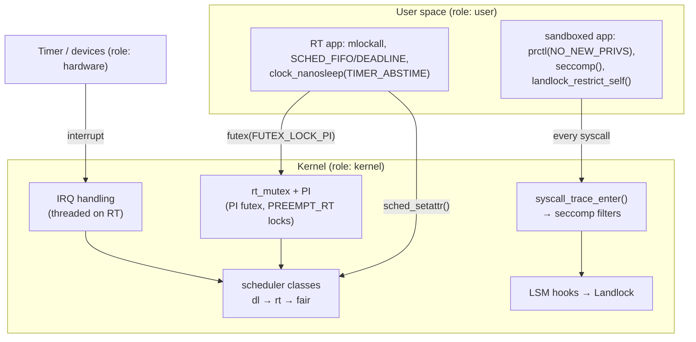

# ۰۷ — Real-Time و موضوعات پژوهشی

> درس: سیستم‌عامل پیشرفته · ترم ۱ · نسخه‌های ثابت: Linux **v6.18.63** و OpenBSD **`8cada8c`** · معماری: **x86-64** · زمان: حدود ۱۱ ساعت
> نسخهٔ انگلیسی: [`lesson.en.md`](lesson.en.md) · یادداشت‌ها: [`notes/INDEX.fa.md`](notes/INDEX.fa.md) · گشت کد: [`kernel-walkthrough.fa.md`](kernel-walkthrough.fa.md) · اسلایدها: [`slides/`](slides/)

**وابستگی‌ها:**
- **ماژول ۰۲** (کلاس‌های زمان‌بندی `stop/dl/rt/fair/ext/idle`، ‏`SCHED_FIFO`، ‏`sched_setattr`، ‏EEVDF)؛
- **ماژول ۰۳** (مسیر سریع و کند futex، ‏mutex در برابر spinlock، ‏deadlock و زنجیرهٔ قفل‌ها)؛
- **ماژول ۰۱** (مسیر ورود syscall یعنی `do_syscall_64()` و مرز کاربر/کرنل) برای نیمهٔ sandboxing؛
- **ماژول ۰۶** (namespace و cgroup) تا جای seccomp و Landlock را میان ابزارهای جداسازی بفهمیم.

## هدف‌های یادگیری

- real-time سخت، نیمه‌سخت و نرم را با مدل task ‏`(C, D, T)` توضیح دهید و بگویید WCET و scheduling latency چیستند و سیستم‌عامل کدام را کنترل می‌کند.
- تشخیص دهید یک مجموعه task زیر RMS و EDF زمان‌بندپذیر است یا نه، و پیش‌بینی کنید `SCHED_DEADLINE` با آن چه می‌کند (`EINVAL`، ‏`EBUSY`، throttle).
- وارونگی نامحدود اولویت را روی لینوکس بازتولید کنید، با `PTHREAD_PRIO_INHERIT` برطرفش کنید و boost را تا `rt_mutex_setprio()` ردیابی کنید.
- بگویید `PREEMPT_RT` چه چیزی را در کرنل عوض می‌کند (spinlockِ خوابنده، IRQِ threadی) و latency را با `cyclictest` اندازه بگیرید.
- یک فیلتر seccomp-BPF و یک sandboxِ Landlock بسازید و آن‌ها را با `pledge` و `unveil` در OpenBSD مقایسه کنید.
- یک مقالهٔ سیستم‌عامل را در سه گذر بخوانید و داوری یک‌صفحه‌ای بنویسید که آن را روی کرنل امروز نگاشت کند.

## واژه‌نامه

| اصطلاح | تعریف |
|---|---|
| **Real-time** | سیستمی که درستی‌اش به *زمانِ* تولید نتیجه هم بستگی دارد، نه فقط به مقدار آن. |
| **Hard / Firm / Soft RT** | از دست رفتن deadline به ترتیب یعنی شکست سیستم / بی‌ارزش شدن نتیجه / افت کیفیت. |
| **WCET** | بدترین زمان اجرای یک job روی سخت‌افزار مشخص، بدون مزاحمت taskهای دیگر. |
| **Scheduling latency** | فاصلهٔ یک رخداد (timer یا IRQ) تا لحظه‌ای که task بیدارشده واقعاً اجرا می‌شود. |
| **Jitter** | تغییرات همین latency از یک فعال‌سازی تا فعال‌سازی بعد. |
| **RMS** | زمان‌بندی Rate-Monotonic: اولویت ثابت، دورهٔ کوتاه‌تر = اولویت بالاتر. |
| **EDF** | Earliest Deadline First: jobی که deadline مطلقش نزدیک‌تر است اول اجرا می‌شود. |
| **CBS** | Constant Bandwidth Server: بودجهٔ `runtime` در هر `period`؛ با تمام شدن بودجه، throttle. |
| **`SCHED_DEADLINE`** | policy زمان‌بندی لینوکس = ‏EDF + CBS + آزمون پذیرش (admission control). |
| **Priority inversion** | task پراولویت منتظر task کم‌اولویت می‌ماند؛ اگر taskهای میانی دخالت کنند نامحدود می‌شود. |
| **Priority inheritance (PI)** | صاحب قفل موقتاً با اولویت بالاترین منتظرش اجرا می‌شود. |
| **Priority ceiling** | گرفتن قفل فوراً اولویت شما را تا «سقف» آن قفل بالا می‌برد. |
| **`rt_mutex`** | mutexِ دارای PI در کرنل (`kernel/locking/rtmutex.c`). |
| **PI futex** | ‏`FUTEX_LOCK_PI`: futexِ فضای کاربر که هنگام رقابت پشتش یک `rt_mutex` قرار می‌گیرد. |
| **`PREEMPT_RT`** | گزینهٔ زمان compile که spinlockها را خوابنده و IRQها را threadی می‌کند. |
| **`PREEMPT_DYNAMIC`** | یک باینری کرنل که بین none/voluntary/full/lazy هنگام بوت یا در زمان اجرا جابه‌جا می‌شود. |
| **Threaded IRQ** | handler وقفه که به شکل thread قابل‌زمان‌بندیِ کرنل (`irq/N-name`) اجرا می‌شود. |
| **`cyclictest`** | ابزار rt-tests که latency بیدار شدنِ threadهای دوره‌ای RT را اندازه می‌گیرد. |
| **seccomp-BPF** | فیلتر BPF برای هر پردازه که روی ورود هر syscall اجرا می‌شود. |
| **`no_new_privs`** | پرچم task: ‏`execve()` هرگز امتیاز بیشتری نمی‌دهد (setuid نادیده گرفته می‌شود). |
| **LSM** | Linux Security Module: ‏hookهایی مثل `security_file_open()`. |
| **Landlock** | LSMی که پردازهٔ بدون امتیاز برای محدود کردن خودش پیکربندی می‌کند. |
| **`pledge` / `unveil`** | در OpenBSD: محدود کردن syscallها با «قول» / محدود کردن دیده‌شدن مسیرها. |
| **روش سه‌گذره** | روش Keshav برای خواندن مقاله: مرور، فهم، بازسازی. |

## تصویر کلی

دو نیمه، یک موضوع: **تضمین‌هایی که کرنل می‌تواند به یک پردازه بدهد**؛ دربارهٔ *زمان* (real-time) و دربارهٔ *دسترسی* (جداسازی). بخش پژوهشی یاد می‌دهد ادعاها دربارهٔ هر دو را چطور قضاوت کنیم.

## ۴. مفاهیم

### ۴.۱ سیستم کی real-time است؟

*پرسش: کیسهٔ هوا به‌طور میانگین در ۱۲ میلی‌ثانیه باز می‌شود ولی یک بار ۴۰ میلی‌ثانیه طول کشید. real-time است؟* اگر deadlineش ۳۰ میلی‌ثانیه باشد، نه: درستی real-time دربارهٔ **بیشینه** است. کار را به شکل taskهای `(C, D, T)` مدل کنید؛ یک job به‌موقع است اگر و فقط اگر زمان پاسخش `R ≤ D` باشد. Hard یعنی از دست رفتن = شکست؛ firm یعنی نتیجهٔ دیر بی‌ارزش؛ soft یعنی کیفیت افت می‌کند. ← [یادداشت ۰۱](notes/01-hard-soft-realtime-wcet.fa.md)

### ۴.۲ سیستم‌عامل چه چیزی به دیرکرد اضافه می‌کند؟

*پرسش: یک thread با `SCHED_FIFO` و اولویت ۸۰ می‌خواهد در t = 1.000 ms بیدار شود؛ چرا در 1.040 ms اجرا می‌شود؟* ‏IRQِ timer ← بیدار شدن ← انتظار تا CPU بتواند preempt کند ← context switch. در کرنل معمولی این انتظار نامحدود است (بخش‌های preempt-off و IRQ-off). ‏`cyclictest` دقیقاً همین را به شکل هیستوگرام اندازه می‌گیرد: **بیشینه** را زیر بار گزارش کنید.

| معیار | کاربرد |
|---|---|
| کمینه | کفِ سخت‌افزار و کرنل |
| میانگین | برای RT تقریباً بی‌فایده |
| **بیشینه** (اجرای طولانی، زیر بار) | عددی که طراح برایش بودجه می‌گذارد |

### ۴.۳ کدام taskها به deadline می‌رسند؟ ‏RMS در برابر EDF

*پرسش: سه task ‏۹۰٫۸٪ یک CPU را مصرف می‌کنند؛ اولویت ثابت می‌تواند زمان‌بندی‌شان کند؟* کران RMS برای n = 3 برابر ۷۸٪ است و تحلیل زمان پاسخ می‌گوید task پایینی deadline را از دست می‌دهد (R = 10 > D = 9)؛ ‏EDF زمان‌بندی‌شان می‌کند چون U ≤ 1. در لینوکس: ‏RMS را با `SCHED_FIFO` دستی بسازید؛ ‏EDF همان `SCHED_DEADLINE` است با `runtime ≤ deadline ≤ period`، آزمون پذیرش (`EBUSY`) و throttle کردن CBS. روی SMP، ‏global EDF فقط تأخیر محدود را تضمین می‌کند (اثر Dhall). ← [یادداشت ۰۲](notes/02-rt-scheduling-rms-edf-deadline.fa.md)

### ۴.۴ چرا Mars Pathfinder مدام reboot می‌شد؟

*پرسش: یک task میان‌اولویت چطور taskی پراولویت را که هیچ ارتباطی با آن ندارد عقب می‌اندازد؟* ‏H منتظر قفلی است که دست L است؛ M جای L را می‌گیرد. راه‌حل: ‏priority inheritance؛ تا وقتی H منتظر است، L با اولویت H اجرا می‌شود. در لینوکس: ‏`PTHREAD_PRIO_INHERIT` ← ‏`FUTEX_LOCK_PI` ← ‏`rt_mutex` ← ‏`rt_mutex_setprio()`. آزمایش ۰۲ این را بازتولید می‌کند. ← [یادداشت ۰۳](notes/03-priority-inversion-inheritance.fa.md)

### ۴.۵ ‏`PREEMPT_RT` چه چیزی را عوض می‌کند؟

*پرسش: چرا در کرنل معمولی `SCHED_FIFO` با اولویت ۹۹ نمی‌تواند یک بخش `spin_lock()` را preempt کند؟* چون `spin_lock()` ‏preemption را خاموش می‌کند. ‏RT قفل‌های `spinlock_t` و `rwlock_t` را به قفل‌های خوابندهٔ دارای PI تبدیل می‌کند، پردازش interrupt و softirq را threadی می‌کند و فقط `raw_spinlock_t` را چرخان نگه می‌دارد.

| | غیر RT (`PREEMPT_DYNAMIC` full) | `PREEMPT_RT` |
|---|---|---|
| `spin_lock()` | می‌چرخد، preemption خاموش | `rt_mutex`، می‌خوابد، PI، قابل preempt |
| handlerهای IRQ | context وقفهٔ سخت | thread ‏`irq/N` با FIFO 50 |
| latency بدترین حالت | نامحدود (جهش چندمیلی‌ثانیه‌ای) | در عمل محدود (میکروثانیه، روی سخت‌افزار واقعی) |
| توان عملیاتی | بیشتر | کمتر |
| جابه‌جایی در زمان اجرا؟ | بله (none/voluntary/full/lazy) | نه، زمان compile |

← [یادداشت ۰۴](notes/04-preempt-rt.fa.md)

### ۴.۶ پردازه چطور خودش را محدود می‌کند؟

*پرسش: یک parser هک می‌شود؛ چطور مطمئن شویم نمی‌تواند socket باز کند یا فایل بنویسد؟* پیش از parse کردن، یک فیلتر **seccomp** نصب می‌کند (اجازه/منع syscall بر اساس شماره، بررسی در `syscall_trace_enter()`) و یک ruleset ‏**Landlock** (حق‌های مسیرمحور، بررسی در hookهای LSM مثل `hook_file_open()`). هر دو `no_new_privs` لازم دارند، روی هم جمع می‌شوند، فقط سخت‌تر می‌کنند و از `execve()` عبور می‌کنند. در OpenBSD: ‏`pledge("stdio rpath")` به‌اضافهٔ `unveil()`. ← [یادداشت ۰۵](notes/05-seccomp-lsm-landlock.fa.md)

### ۴.۷ مقاله را چطور مثل یک داور بخوانم؟

*پرسش: آیا «زمان‌بند لینوکس هسته‌ها را هدر می‌دهد» در 6.18 هنوز درست است؟* سه گذر (۱۰ دقیقه / ۱ ساعت / چند ساعت)، یک داوری یک‌صفحه‌ای (مسئله، بینش، سازوکار، ارزیابی، محدودیت‌ها، امروز، نظر نهایی) و یک بررسی روی سورس فعلی: ‏load balancerِ مقاله حالا `sched_balance_rq()` در `kernel/sched/fair.c` است. ← [یادداشت ۰۶](notes/06-reading-os-papers.fa.md)

## ۵. این‌ها کجای لینوکس‌اند

| موضوع | فایل · تابع | گشت کد |
|---|---|---|
| پیکربندی RT و پرچم `uname -v` | `kernel/Kconfig.preempt` خط ۸۹ · ‏`init/Makefile` خط ۲۸ تا ۳۰ | [بخش ۱](kernel-walkthrough.fa.md) |
| ‏PI futex ← ‏rt_mutex | `kernel/futex/pi.c` · ‏`futex_lock_pi()` خط ۹۸۳ | [بخش ۲.۱](kernel-walkthrough.fa.md) |
| boost در PI | `kernel/locking/rtmutex.c` · ‏`task_blocks_on_rt_mutex()` خط ۱۲۰۳ و `rt_mutex_adjust_prio()` خط ۵۲۷؛ ‏`kernel/sched/core.c` · ‏`rt_mutex_setprio()` خط ۷۳۵۲ | [بخش ۲.۲ تا ۲.۳](kernel-walkthrough.fa.md) |
| spinlockِ خوابنده | `kernel/locking/spinlock_rt.c` · ‏`rt_spin_lock()` خط ۵۴ | [بخش ۳](kernel-walkthrough.fa.md) |
| `SCHED_DEADLINE` | `kernel/sched/deadline.c` · ‏`__checkparam_dl()` خط ۳۵۵۳، ‏`__dl_overflow()` خط ۲۱۳، ‏`update_curr_dl_se()` خط ۱۴۲۶ | [بخش ۴](kernel-walkthrough.fa.md) |
| seccomp | `kernel/entry/syscall-common.c` · ‏`syscall_trace_enter()` خط ۲۰؛ ‏`kernel/seccomp.c` · ‏`seccomp_run_filters()` خط ۴۰۴ | [بخش ۵.۱ تا ۵.۳](kernel-walkthrough.fa.md) |
| Landlock | `security/landlock/syscalls.c` خط ۴۷۸؛ ‏`security/landlock/fs.c` · ‏`hook_file_open()` خط ۱۶۲۶ | [بخش ۵.۴](kernel-walkthrough.fa.md) |
| OpenBSD | `sys/kern/kern_pledge.c` · ‏`pledge_syscall()` خط ۵۳۷؛ ‏`sys/kern/kern_unveil.c` · ‏`unveil_check_final()` خط ۶۴۵ | [بخش ۶](kernel-walkthrough.fa.md) |

آزمایش‌ها: [۰۱ cyclictest](labs/01-cyclictest/README.md) · [۰۲ وارونگی اولویت](labs/02-priority-inversion/README.md) · [۰۳ seccomp-BPF](labs/03-seccomp-bpf/README.md) · [۰۴ Landlock](labs/04-landlock/README.md) · [۰۵ داوری مقاله](labs/05-paper-review/README.md)

## ۶. برداشت‌های نادرست رایج

| برداشت نادرست | واقعیت |
|---|---|
| «real-time یعنی سریع.» | یعنی *قابل پیش‌بینی*؛ کرنل‌های RT توان عملیاتی کمتر و latency میانگین کمی بیشتری دارند. |
| «‏`SCHED_FIFO` با اولویت ۹۹ thread مرا real-time می‌کند.» | نه روی کرنلی با بخش‌های طولانیِ غیرقابل‌preempt، و نه بدون `mlockall` و خواب با زمان مطلق. |
| «‏`PREEMPT_DYNAMIC` full همان `PREEMPT_RT` است.» | ‏`full` هنوز بخش‌های spinlock و softirqها را با preemption خاموش اجرا می‌کند؛ RT تغییر نوع قفل‌ها در زمان compile است. |
| «priority inheritance وارونگی را حذف می‌کند.» | آن را به اندازهٔ بخش بحرانی صاحب قفل *محدود* می‌کند. |
| «‏`pthread_mutex_t` خودش PI دارد.» | فقط با `PTHREAD_PRIO_INHERIT`؛ پیش‌فرض `PTHREAD_PRIO_NONE` است. semaphore و condvar نمی‌توانند PI داشته باشند. |
| «پذیرش در `SCHED_DEADLINE` یعنی هیچ deadlineی از دست نمی‌رود.» | روی SMP فقط تأخیر محدود را تضمین می‌کند (اثر Dhall)؛ از دست رفتن ممکن است. |
| «seccomp می‌تواند باز کردن `/etc/shadow` را ممنوع کند.» | فقط یک اشاره‌گر می‌بیند؛ برای مسیر از Landlock (یا یک LSM) استفاده کنید. |
| «Landlock دسترسی root می‌خواهد.» | فقط `no_new_privs` لازم دارد. |
| «VM عدد latency واقعی می‌دهد.» | زمان‌بند میزبان غالب است؛ عددهای VM شکل را نشان می‌دهند، نه کران را. |

## ۷. پرسش‌های خودسنجی

۱. یک task ‏`C = 3 ms` و `T = D = 10 ms` دارد. پارامترهای `SCHED_DEADLINE` آن چیست، و کدام تابع کرنل `runtime = 12 ms` را رد می‌کند؟
۲. چرا آزمایش ۰۲ همهٔ threadها را به یک CPU می‌بندد؟ بدون `taskset` چه می‌دیدید؟
۳. کدام خط `rt_mutex_setprio()` افزایش اولویت را موقت می‌کند؟
۴. دو تغییری را که `PREEMPT_RT` در کرنل می‌دهد و یکی را که نمی‌تواند بدهد نام ببرید (راهنما: semaphore).
۵. فیلتر seccomp شما برای `socket` مقدار `ERRNO(EACCES)` برمی‌گرداند. syscall کجای کرنل رد می‌شود و فضای کاربر چه می‌بیند؟
۶. یک shellِ sandboxشده با Landlock روی `echo hi 2>/dev/null` شکست می‌خورد. چرا؟
۷. در گذر اول یک مقاله دربارهٔ کدام پنج چیز تصمیم می‌گیرید؟

پاسخ‌ها در یادداشت‌ها و در [`quiz.fa.md`](quiz.fa.md) هستند.

