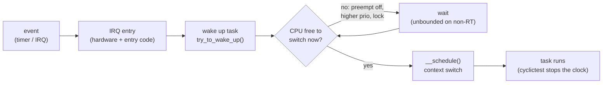

# Note 01 — Hard, firm and soft real-time; WCET and latency

## 1. Summary

- A real-time system is correct only if its results are **on time**: the deadline is part of the specification, like the output value.
- *Hard*, *firm* and *soft* say what a missed deadline costs: failure of the system, a useless result, or a worse result.
- What you can measure on Linux is **latency** (how late a task starts after its event); what you must bound for hard real-time is the **worst case** (WCET + worst-case latency), which measurement alone cannot prove.

## 2. Detailed explanation

### Intuition: "fast" is not "real-time"

A web server that answers 99.9 % of requests in 2 ms is fast. An airbag controller that must fire within 10 ms of the crash sensor, **every** time, is real-time. The airbag controller can be slower on average than the web server and still be correct; the web server can have a 3-second outlier and still be "fine". Real-time is about the **tail**, specifically about the *maximum*.

### The task model

Real-time theory describes work as **tasks** that release **jobs**:

| Symbol | Name | Meaning |
|---|---|---|
| `T` | period | time between two releases (periodic task) or minimum inter-arrival time (sporadic task) |
| `C` | WCET | worst-case execution time of one job, on this hardware, with no interference |
| `D` | relative deadline | the job must finish within `D` after its release; often `D = T` ("implicit deadline") |
| `U = C/T` | utilization | fraction of one CPU the task needs |
| `R` | response time | release → finish; the job is on time if `R ≤ D` |

Linux's `SCHED_DEADLINE` uses exactly this model: `sched_runtime ≈ C`, `sched_deadline = D`, `sched_period = T` (note 02).

### Hard, firm, soft

| Class | A missed deadline means | Example | Typical platform |
|---|---|---|---|
| **Hard** | system failure, possibly physical harm | ABS brakes, flight control, pacemaker | certified RTOS (e.g. a small preemptive kernel with static analysis), or bare metal |
| **Firm** | the late result is worthless, but occasional misses are tolerated | video frame decode, a radar sample | RTOS or `PREEMPT_RT` Linux |
| **Soft** | the late result is still useful, quality degrades | audio mixing on a desktop, game frame, trading quote | `PREEMPT_RT` or a well-tuned normal Linux |

Firm vs soft is about the **value of a late result**: zero for firm, decaying for soft.

### WCET: why it is hard

WCET is the longest time a job can take. Two ways to get it:

1. **Static analysis**: model the code paths and the hardware (pipeline, caches, branch predictor) and compute a safe upper bound. Feasible for simple in-order CPUs; very pessimistic or impossible for an out-of-order x86 with shared L3, SMT and DRAM refresh.
2. **Measurement**: run it many times under stress and take the maximum, plus a safety margin. Cheap, but it only shows the worst case you *happened to see*.

Linux systems use measurement. That is why the RT community says Linux gives you "**demonstrated** latency bounds", not proven ones.

### Latency: the part the OS controls

Even with a perfect WCET, a job can start late. The **scheduling latency** (or *wake-up latency*) is the delay between the event (timer expiry, interrupt) and the moment the task actually runs. Its parts:

```
event ─► IRQ latency ─► handler ─► wake-up ─► [wait: non-preemptible section, higher-prio task, lock] ─► context switch ─► task runs
```

On a normal Linux kernel the big, unbounded part is the wait: code running with **preemption disabled** (spinlocks, softirqs, `local_irq_disable()`). `PREEMPT_RT` attacks exactly this part (note 04). `cyclictest` measures the whole chain from user space: it sleeps until an absolute time and records how late it woke up (lab 01).

### Measured latency is a distribution

A latency measurement is a histogram, not a number. Report **min / avg / max** and the shape of the tail. For real-time, the **max over a long run under worst-case load** is the number that matters; the average is almost irrelevant.

## 3. Diagram



## 4. Worked example

From lab 01, `latency.c` (our ~70-line mini-cyclictest) on the shared VM, `SCHED_FIFO` priority 80, 1 ms period:

> Captured on aos-lab (VirtualBox on Hyper-V, Ubuntu 24.04, Linux 6.18.63 `PREEMPT_DYNAMIC`, 8 vCPU, shared with other users), 2026-11-15. Your numbers will differ.

```text
$ sudo ./latency 80 1000 10000
policy=SCHED_FIFO prio=80 interval=1000us loops=10000 overruns=6323
latency us: min=35 avg=1012 max=159033
  <     5 us : 0
  <    10 us : 0
  <    20 us : 0
  <    50 us : 7
  <   100 us : 84
  <   500 us : 5379
  <  1000 us : 1543
  >= 1000 us : 2987
```

Read it like a real-time engineer:

- The **min** (35 µs) is the floor: timer interrupt + wake-up + context switch on this virtual CPU. On bare metal the floor is a few microseconds.
- The **avg** (1.0 ms!) and **max** (159 ms) are not Linux numbers: this run happened on the shared VirtualBox-on-Hyper-V guest under a load average of ~8 from other users; the same guest stopped answering SSH several times that day. The vCPU was simply not running for long stretches. That is the lesson: a VM measures the host.
- **Bucket counts and overruns**: 2987 of 10 000 wake-ups were more than 1 ms late, and the loop had to skip 6323 whole periods (`overruns`). A 1 ms control loop on this machine would be useless, whatever the kernel's preemption model.
- 10 000 samples should take 10 s; with 6323 skipped periods it took ~16 s. A real qualification run is hours or days under load, on the target hardware.

## 5. Edge cases & pitfalls

- **Average-case thinking.** "Avg 5 µs" says nothing about whether a 1 ms deadline is met. Always look at max and the histogram tail.
- **Measuring on an idle machine.** Latency is a property of the system *under load*. Lab 01 runs with and without `stress-ng` to show the difference.
- **Virtual machines.** A vCPU can be descheduled by the host for milliseconds. Numbers from a VM bound nothing; they show only the *shape* of the effect. Every number in this module carries that caveat.
- **Relative sleeps drift.** `nanosleep(1 ms)` in a loop accumulates the latency of every iteration; real-time loops use `clock_nanosleep(..., TIMER_ABSTIME, ...)` (lab 01 code).
- **Page faults are latency.** The first touch of a page costs a fault (Module 04). RT programs call `mlockall(MCL_CURRENT | MCL_FUTURE)` and pre-fault their stack and heap.
- **"Real-time" ≠ "high priority".** `SCHED_FIFO` 99 on a kernel that disables preemption for 5 ms still misses a 1 ms deadline.

## 6. Exam-style key points

- Real-time correctness = right value **and** on time.
- Hard: miss = failure. Firm: late result worthless. Soft: late result degraded.
- Task model: `(C, D, T)`, utilization `U = C/T`, on time iff response time `R ≤ D`.
- WCET by static analysis (safe, pessimistic, hard on modern CPUs) or measurement (cheap, not a proof).
- Scheduling latency = event → task running. On non-RT Linux the unbounded part is non-preemptible kernel code.
- Measure latency as a distribution under worst-case load; report max.
- RT programs: `mlockall`, absolute-time sleeps, fixed priority (`SCHED_FIFO`) or `SCHED_DEADLINE`.

## 7. Links

- Lesson: [`lesson.en.md` §4.1–4.2](../lesson.en.md)
- Lab: [`labs/01-cyclictest`](../labs/01-cyclictest/README.md)
- Quiz: questions 1, 2, 7 in [`quiz.en.md`](../quiz.en.md)
- Next note: [02 — RT scheduling: RMS, EDF, `SCHED_DEADLINE`](02-rt-scheduling-rms-edf-deadline.en.md)
