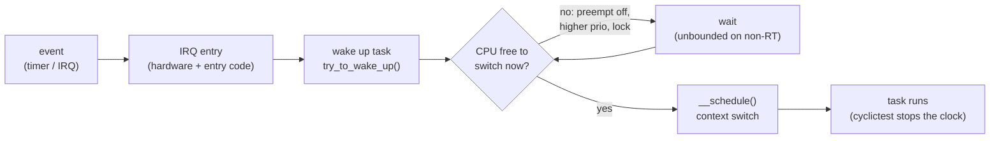

<div dir="rtl">

# یادداشت ۰۱ — real-time سخت، نیمه‌سخت و نرم؛ WCET و latency

## ۱. خلاصه

- یک سیستم real-time فقط وقتی درست است که نتیجه‌اش **به‌موقع** باشد: deadline بخشی از مشخصات است، درست مثل مقدار خروجی.
- *سخت* (hard)، *نیمه‌سخت* (firm) و *نرم* (soft) می‌گویند از دست رفتن deadline چه هزینه‌ای دارد: شکست سیستم، نتیجهٔ بی‌ارزش، یا نتیجهٔ بدتر.
- آنچه روی لینوکس می‌شود اندازه گرفت **latency** است (task چقدر دیرتر از رخدادش شروع می‌شود)؛ آنچه برای real-time سخت باید محدود شود **بدترین حالت** است (WCET به‌اضافهٔ بدترین latency)، و اندازه‌گیری به‌تنهایی آن را ثابت نمی‌کند.

## ۲. توضیح مفصل

### شهود: «سریع» یعنی real-time نیست

وب‌سروری که به ۹۹٫۹٪ درخواست‌ها در ۲ میلی‌ثانیه جواب می‌دهد سریع است. کنترل‌گر کیسهٔ هوا که باید ظرف ۱۰ میلی‌ثانیه پس از سیگنال حسگر تصادف عمل کند، آن هم **هر بار**، real-time است. کنترل‌گر کیسهٔ هوا ممکن است به‌طور میانگین از وب‌سرور کندتر باشد و باز هم درست باشد؛ وب‌سرور ممکن است یک بار ۳ ثانیه طول بکشد و باز «مشکلی نیست». real-time دربارهٔ **دُم توزیع** است، دقیق‌تر بگوییم دربارهٔ *بیشینه*.

### مدل task

نظریهٔ real-time کار را به شکل **task**هایی توصیف می‌کند که **job** آزاد می‌کنند:

| نماد | نام | معنی |
|---|---|---|
| `T` | period | فاصلهٔ دو آزادسازی (task دوره‌ای) یا کمترین فاصلهٔ ورود (task پراکنده یا sporadic) |
| `C` | WCET | بدترین زمان اجرای یک job روی این سخت‌افزار، بدون مزاحمت |
| `D` | deadline نسبی | job باید ظرف `D` پس از آزادسازی تمام شود؛ اغلب `D = T` («deadline ضمنی») |
| `U = C/T` | utilization | سهمی از یک CPU که task لازم دارد |
| `R` | response time | از آزادسازی تا پایان؛ job به‌موقع است اگر `R ≤ D` |

`SCHED_DEADLINE` در لینوکس دقیقاً همین مدل را به کار می‌برد: `sched_runtime ≈ C`، `sched_deadline = D` و `sched_period = T` (یادداشت ۰۲).

### سخت، نیمه‌سخت، نرم

| رده | از دست رفتن deadline یعنی | مثال | سکوی معمول |
|---|---|---|---|
| **Hard** | شکست سیستم، شاید آسیب فیزیکی | ترمز ABS، کنترل پرواز، ضربان‌ساز | RTOS گواهی‌شده (مثلاً یک کرنل preemptive کوچک با تحلیل ایستا) یا bare metal |
| **Firm** | نتیجهٔ دیر بی‌ارزش است، ولی گاهی از دست رفتن قابل‌تحمل است | decode یک فریم ویدیو، یک نمونهٔ رادار | RTOS یا لینوکس با `PREEMPT_RT` |
| **Soft** | نتیجهٔ دیر هنوز مفید است ولی کیفیت افت می‌کند | میکس صدا روی دسکتاپ، فریم بازی، قیمت لحظه‌ای بورس | `PREEMPT_RT` یا لینوکس معمولیِ خوب تنظیم‌شده |

فرق firm و soft در **ارزش نتیجهٔ دیر** است: برای firm صفر، برای soft رو به کاهش.

### چرا WCET سخت است

WCET طولانی‌ترین زمانی است که یک job ممکن است بگیرد. دو راه برای به دست آوردنش هست:

۱. **تحلیل ایستا**: مسیرهای کد و سخت‌افزار (pipeline، cache، branch predictor) را مدل کنید و یک کران بالای امن حساب کنید. برای CPUهای ساده و in-order شدنی است؛ برای x86 با اجرای out-of-order، ‏L3 مشترک، SMT و refresh حافظهٔ DRAM بسیار بدبینانه یا ناممکن است.
۲. **اندازه‌گیری**: بارها زیر فشار اجرا کنید، بیشینه را بگیرید و حاشیهٔ اطمینان اضافه کنید. ارزان است، ولی فقط بدترین حالتی را نشان می‌دهد که *اتفاقاً دیده‌اید*.

سیستم‌های لینوکسی از اندازه‌گیری استفاده می‌کنند. به همین دلیل جامعهٔ RT می‌گوید لینوکس کران latencyِ «**نشان‌داده‌شده**» می‌دهد، نه اثبات‌شده.

### Latency: بخشی که دست سیستم‌عامل است

حتی با WCET کامل، ممکن است job دیر شروع شود. **scheduling latency** (یا *wake-up latency*) فاصلهٔ رخداد (انقضای timer، interrupt) تا لحظه‌ای است که task واقعاً اجرا می‌شود. اجزای آن:

</div>

```
event ─► IRQ latency ─► handler ─► wake-up ─► [wait: non-preemptible section, higher-prio task, lock] ─► context switch ─► task runs
```

<div dir="rtl">

در کرنل معمولی لینوکس، بخش بزرگ و نامحدود همان انتظار است: کدی که با **preemption خاموش** اجرا می‌شود (spinlockها، softirqها، `local_irq_disable()`). ‏`PREEMPT_RT` دقیقاً همین بخش را هدف می‌گیرد (یادداشت ۰۴). ‏`cyclictest` کل این زنجیره را از فضای کاربر اندازه می‌گیرد: تا یک زمان مطلق می‌خوابد و ثبت می‌کند چقدر دیر بیدار شده (آزمایش ۰۱).

### latencyِ اندازه‌گیری‌شده یک توزیع است

اندازه‌گیری latency یک هیستوگرام است، نه یک عدد. **کمینه / میانگین / بیشینه** و شکل دُم را گزارش کنید. برای real-time، **بیشینه در یک اجرای طولانی زیر بدترین بار** عدد مهم است؛ میانگین تقریباً بی‌اهمیت است.

## ۳. نمودار

</div>



<div dir="rtl">

## ۴. مثال کاربردی

از آزمایش ۰۱، برنامهٔ `latency.c` (یک mini-cyclictest حدوداً هفتادخطی) روی VM مشترک، با `SCHED_FIFO` اولویت ۸۰ و دورهٔ ۱ میلی‌ثانیه:

</div>

> گرفته‌شده روی aos-lab (‏VirtualBox روی Hyper-V، ‏Ubuntu 24.04، ‏Linux 6.18.63 با `PREEMPT_DYNAMIC`، ‏۸ vCPU، مشترک با کاربران دیگر)، ۲۰۲۶-۱۱-۱۵. عددهای شما فرق خواهد کرد.

```text
$ sudo ./latency 80 1000 10000
policy=SCHED_FIFO prio=80 interval=1000us loops=10000 overruns=6323
latency us: min=35 avg=1012 max=159033
  <     5 us : 0
  <    10 us : 0
  <    20 us : 0
  <    50 us : 7
  <   100 us : 84
  <   500 us : 5379
  <  1000 us : 1543
  >= 1000 us : 2987
```

<div dir="rtl">

مثل یک مهندس real-time بخوانید:

- **کمینه** (۳۵ میکروثانیه) کف است: interruptِ timer به‌اضافهٔ بیدار شدن و context switch روی این CPUِ مجازی. روی سخت‌افزار واقعی این کف چند میکروثانیه است.
- **میانگین** (۱٫۰ میلی‌ثانیه!) و **بیشینه** (۱۵۹ میلی‌ثانیه) عدد لینوکس نیستند: این اجرا روی VMِ مشترکِ VirtualBox روی Hyper-V با load average حدود ۸ از کاربران دیگر انجام شد؛ همین مهمان آن روز چند بار به SSH جواب نداد. ‏vCPU مدت‌های طولانی اصلاً اجرا نمی‌شد. درس همین است: VM میزبان را اندازه می‌گیرد.
- **شمارش خانه‌ها و overrunها**: ۲۹۸۷ بیدار شدن از ۱۰٬۰۰۰ بیش از ۱ میلی‌ثانیه دیر بودند و حلقه مجبور شد ۶۳۲۳ دورهٔ کامل را رد کند (`overruns`). یک حلقهٔ کنترل ۱ میلی‌ثانیه‌ای روی این ماشین بی‌فایده است، مدل preemption کرنل هر چه باشد.
- ده هزار نمونه باید ۱۰ ثانیه طول بکشد؛ با ۶۳۲۳ دورهٔ ردشده حدود ۱۶ ثانیه شد. یک اجرای واقعیِ ارزیابی ساعت‌ها یا روزها زیر بار و روی سخت‌افزار هدف طول می‌کشد.

## ۵. حالت‌های خاص و دام‌ها

- **فکر کردن با میانگین.** «میانگین ۵ میکروثانیه» هیچ چیزی دربارهٔ رعایت deadline یک میلی‌ثانیه‌ای نمی‌گوید. همیشه بیشینه و دُم هیستوگرام را ببینید.
- **اندازه‌گیری روی ماشین بیکار.** latency ویژگی سیستم *زیر بار* است. آزمایش ۰۱ با و بدون `stress-ng` اجرا می‌شود تا تفاوت را نشان دهد.
- **ماشین مجازی.** میزبان ممکن است یک vCPU را برای چند میلی‌ثانیه کنار بگذارد. عددهای VM هیچ چیزی را محدود نمی‌کنند؛ فقط *شکل* اثر را نشان می‌دهند. همهٔ عددهای این ماژول این هشدار را دارند.
- **خواب نسبی رانش دارد.** ‏`nanosleep(1 ms)` در حلقه latencyِ هر دور را روی هم جمع می‌کند؛ حلقه‌های real-time از `clock_nanosleep(..., TIMER_ABSTIME, ...)` استفاده می‌کنند (کد آزمایش ۰۱).
- **page fault هم latency است.** اولین دسترسی به یک صفحه یک fault دارد (ماژول ۰۴). برنامه‌های RT ‏`mlockall(MCL_CURRENT | MCL_FUTURE)` را صدا می‌زنند و stack و heap را از قبل fault می‌کنند.
- **«real-time» یعنی «اولویت بالا» نیست.** ‏`SCHED_FIFO` با اولویت ۹۹ روی کرنلی که ۵ میلی‌ثانیه preemption را خاموش می‌کند، باز هم deadline یک میلی‌ثانیه‌ای را از دست می‌دهد.

## ۶. نکته‌های کلیدی امتحانی

- درستی real-time = مقدار درست **و** به‌موقع.
- Hard: از دست رفتن = شکست. Firm: نتیجهٔ دیر بی‌ارزش. Soft: نتیجهٔ دیر کم‌کیفیت.
- مدل task: ‏`(C, D, T)`، ‏utilization ‏`U = C/T`؛ به‌موقع اگر و فقط اگر `R ≤ D`.
- WCET با تحلیل ایستا (امن، بدبینانه، روی CPUهای امروزی دشوار) یا اندازه‌گیری (ارزان، بدون اثبات).
- scheduling latency = از رخداد تا اجرای task. در لینوکس غیر RT بخش نامحدود کدِ غیرقابل‌preempt کرنل است.
- latency را به شکل توزیع و زیر بدترین بار اندازه بگیرید؛ بیشینه را گزارش کنید.
- برنامه‌های RT: ‏`mlockall`، خواب با زمان مطلق، اولویت ثابت (`SCHED_FIFO`) یا `SCHED_DEADLINE`.

## ۷. پیوندها

- درس: [`lesson.fa.md` بخش ۴.۱ تا ۴.۲](../lesson.fa.md)
- آزمایش: [`labs/01-cyclictest`](../labs/01-cyclictest/README.md)
- آزمون: پرسش‌های ۱، ۲ و ۷ در [`quiz.fa.md`](../quiz.fa.md)
- یادداشت بعدی: [۰۲ — زمان‌بندی RT: ‏RMS، EDF و `SCHED_DEADLINE`](02-rt-scheduling-rms-edf-deadline.fa.md)

</div>
