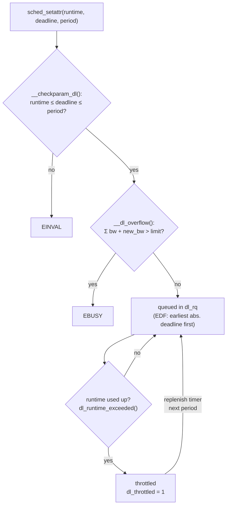

# Note 02 — Real-time scheduling: RMS, EDF and `SCHED_DEADLINE`

## 1. Summary

- **Rate-Monotonic Scheduling (RMS)** gives fixed priorities by period (shorter period = higher priority); it is optimal among fixed-priority schemes and is what `SCHED_FIFO` lets you build by hand.
- **Earliest Deadline First (EDF)** always runs the job with the nearest absolute deadline; on one CPU it schedules any task set with total utilization ≤ 1.
- Linux implements EDF plus a **Constant Bandwidth Server** as `SCHED_DEADLINE`, with an admission test on utilization that guarantees *bounded tardiness* on SMP, not zero misses.

## 2. Detailed explanation

### The question a scheduler must answer

Given periodic tasks `τᵢ = (Cᵢ, Dᵢ, Tᵢ)` (note 01), is there an order of execution in which **every job meets its deadline**, and can we know that **before** running? This is *schedulability analysis*. General-purpose schedulers (EEVDF, Module 02) optimize fairness and throughput; they never answer this question.

### Fixed priority: RMS

Assign each task a static priority: the shorter the period, the higher the priority. Liu and Layland (1973) proved two things for independent, preemptible, implicit-deadline tasks on one CPU:

1. RMS is **optimal among fixed-priority** assignments: if any fixed-priority order works, RMS works.
2. A sufficient (not necessary) utilization test:

```
U = Σ Cᵢ/Tᵢ ≤ n (2^(1/n) − 1)        n=1: 1.000   n=2: 0.828   n=3: 0.780   n→∞: ln 2 ≈ 0.693
```

If the test fails, the set may still be schedulable. The exact test is **response-time analysis** (RTA): iterate

```
Rᵢ = Cᵢ + Σ_{j higher prio} ⌈Rᵢ / Tⱼ⌉ · Cⱼ
```

until it converges; the task is schedulable iff `Rᵢ ≤ Dᵢ`.

On Linux, RMS = `SCHED_FIFO` priorities chosen by period (`chrt -f`). The kernel does no analysis; it just runs the highest-priority runnable task (`kernel/sched/rt.c`).

### Dynamic priority: EDF

At every scheduling point, run the ready job whose **absolute deadline** is the earliest. On one CPU, with implicit deadlines, EDF is **optimal**: the set is schedulable iff `U ≤ 1`. That is up to ~30 % more load than RMS's worst-case bound. The price: priorities change at runtime, and under **overload** EDF degrades badly (a domino of misses), while RMS sacrifices only the lowest-priority tasks.

### `SCHED_DEADLINE` = EDF + CBS + admission control

Linux 3.14 added `SCHED_DEADLINE` (`kernel/sched/deadline.c`). A task declares three numbers with `sched_setattr()`:

| Field | Model | Role |
|---|---|---|
| `sched_runtime` | `C` (budget, ≥ WCET) | CPU time per period the task may consume |
| `sched_deadline` | `D` | relative deadline; EDF orders by `release + D` |
| `sched_period` | `T` | replenishment period |

Three mechanisms, all visible in the walkthrough (§4):

1. **Parameter check** (`__checkparam_dl()`): `runtime ≤ deadline ≤ period`, else `EINVAL`.
2. **Admission control** (`__dl_overflow()`): the sum of `runtime/period` of all deadline tasks in a root domain must stay ≤ `M × sched_rt_runtime_us/sched_rt_period_us` (95 % of each CPU by default), else `EBUSY`.
3. **CBS throttling** (`update_curr_dl_se()`): a task that uses its whole `runtime` is *throttled* until its next period. A buggy task cannot overrun into others — this is **temporal isolation**, the property fixed priorities lack.

`SCHED_DEADLINE` tasks sit **above** `SCHED_FIFO` in the class order (`stop > dl > rt > fair > ext > idle`, Module 02).

### The multiprocessor catch

`Documentation/scheduler/sched-deadline.rst` §3.3 (in our checkout) explains it with **Dhall's effect**: with M CPUs, one heavy task `(P,P,P)` plus M tiny tasks with slightly earlier deadlines makes global EDF miss a deadline at total utilization just above 1, no matter how large M is. So Linux's utilization test (`U ≤ M`) does **not** guarantee zero misses on SMP. What it guarantees, quoting the doc: "if the total utilization is smaller or equal than M then the response times of the tasks are limited" — **bounded tardiness**. For hard guarantees on SMP, partition: pin each deadline task to one CPU with an exclusive cpuset and analyze each CPU as a uniprocessor.

## 3. Diagram



## 4. Worked example

**RMS vs EDF on paper.** Task set: `τ1 = (C=2, T=5)`, `τ2 = (2, 7)`, `τ3 = (2, 9)`, deadlines = periods.

- `U = 2/5 + 2/7 + 2/9 = 0.400 + 0.286 + 0.222 = 0.908`.
- Liu–Layland bound for n = 3 is 0.780 → the RMS test is **inconclusive**.
- RTA for the lowest-priority task τ3: start `R = 6` → `2 + ⌈6/5⌉·2 + ⌈6/7⌉·2 = 8` → `2 + ⌈8/5⌉·2 + ⌈8/7⌉·2 = 10` → `2 + ⌈10/5⌉·2 + ⌈10/7⌉·2 = 10` (converged). `R3 = 10 > D3 = 9`: **τ3 misses under RMS**.
- EDF: `U = 0.908 ≤ 1` → **schedulable under EDF** on one CPU.

**Admission control on the VM** (`chrt` from util-linux sets `SCHED_DEADLINE`; times are in ns):

> Captured on aos-lab (VirtualBox on Hyper-V, Ubuntu 24.04, Linux 6.18.63 `PREEMPT_DYNAMIC`, 8 vCPU, shared with other users), 2026-11-15. Your numbers will differ.

```text
$ sudo chrt -d --sched-runtime 1100000 --sched-deadline 1000000 --sched-period 1000000 0 true
chrt: failed to set pid 0's policy: Invalid argument
$ for i in $(seq 1 9); do sudo chrt -d --sched-runtime 900000 --sched-deadline 1000000 \
      --sched-period 1000000 0 sleep 20 2>&1 | sed "s/^/[$i] /" & sleep 0.3; done
[9] chrt: failed to set pid 0's policy: Device or resource busy
$ ps -eo pid,cls,cmd | grep "[D]L.*sleep 20" | wc -l
8
```

Runtime 1.1 ms > deadline 1 ms → `EINVAL` from `__checkparam_dl()`. Each `sleep` reserves 0.9 CPU although it never runs; the limit on this 8-vCPU VM is 8 × 0.95 = 7.6, so eight reservations (7.2) fit and the ninth (8.1) is refused with `EBUSY` by `__dl_overflow()`. Admission control counts **reservations**, not usage.

## 5. Edge cases & pitfalls

- **runtime is not WCET.** Set `sched_runtime` a bit above the measured WCET; the task is throttled the moment it exceeds it, and then it misses its deadline by design.
- **`fork()` is refused.** A `SCHED_DEADLINE` task cannot fork children that inherit the policy (they would break admission accounting) unless reset-on-fork is set; `sched_fork()` returns `-EAGAIN` for a child that would still have `dl_prio()` (`kernel/sched/core.c` L4736-4737).
- **No `sched_setaffinity()` to a subset of the root domain.** Admission is per root domain; `dl_task_check_affinity()` (`kernel/sched/syscalls.c` L1129) rejects a mask smaller than the root domain, so restricting a deadline task's affinity needs an exclusive cpuset (cgroup v2 `cpuset.cpus.partition = root`).
- **Priority inheritance with deadline tasks** is approximate: an rt_mutex owner boosted by a deadline waiter runs with the waiter's parameters (`dl_prio()` checks in `rt_mutex_setprio()`), but bandwidth isolation during the boost is still listed as future work ("refinements to deadline inheritance, especially regarding the possibility of retaining bandwidth isolation", sched-deadline.rst L719-720).
- **RMS bound abuse.** `0.69` is a *sufficient* bound for *any* n; many sets above it are fine. Use RTA before declaring failure.
- **Overload.** Under EDF, one overrunning job can delay everyone; CBS prevents that in Linux by throttling.

## 6. Exam-style key points

- RMS: static priority by period; optimal among fixed priorities; `U ≤ n(2^(1/n)−1)` sufficient; RTA exact.
- EDF: run earliest absolute deadline; optimal on one CPU; `U ≤ 1` necessary and sufficient (implicit deadlines).
- `SCHED_DEADLINE` = EDF + CBS; parameters `runtime ≤ deadline ≤ period`.
- `EINVAL` = bad parameters (`__checkparam_dl`); `EBUSY` = admission failed (`__dl_overflow`).
- CBS gives **temporal isolation**: overrun → throttle until next period.
- Global EDF on SMP: Dhall's effect; Linux guarantees bounded tardiness, not zero misses. Partition for hard guarantees.

## 7. Links

- Lesson: [`lesson.en.md` §4.3](../lesson.en.md)
- Walkthrough: [`kernel-walkthrough.en.md` §4](../kernel-walkthrough.en.md)
- Lab: extension of [`labs/01-cyclictest`](../labs/01-cyclictest/README.md)
- Quiz: questions 3, 8, 12 in [`quiz.en.md`](../quiz.en.md)
- Primary source: `linux/Documentation/scheduler/sched-deadline.rst` §3.3 (v6.18.63)
