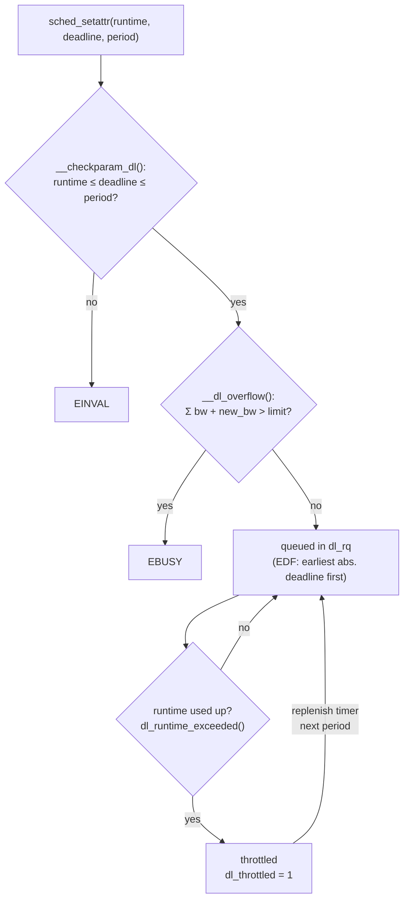

<div dir="rtl">

# یادداشت ۰۲ — زمان‌بندی real-time: ‏RMS، ‏EDF و `SCHED_DEADLINE`

## ۱. خلاصه

- **Rate-Monotonic Scheduling (RMS)** اولویت ثابت را بر اساس دوره می‌دهد (دورهٔ کوتاه‌تر = اولویت بالاتر)؛ در میان روش‌های اولویت‌ثابت بهینه است و همان چیزی است که با `SCHED_FIFO` دستی می‌سازید.
- **Earliest Deadline First (EDF)** همیشه jobی را اجرا می‌کند که deadline مطلقش از همه نزدیک‌تر است؛ روی یک CPU هر مجموعه taskی را با utilization کل ≤ ۱ زمان‌بندی می‌کند.
- لینوکس EDF را همراه با یک **Constant Bandwidth Server** به نام `SCHED_DEADLINE` پیاده کرده، با آزمون پذیرش بر پایهٔ utilization که روی SMP *تأخیر محدود* (bounded tardiness) را تضمین می‌کند، نه صفر بودن deadlineهای ازدست‌رفته را.

## ۲. توضیح مفصل

### پرسشی که زمان‌بند باید جواب دهد

taskهای دوره‌ای `τᵢ = (Cᵢ, Dᵢ, Tᵢ)` داریم (یادداشت ۰۱). آیا ترتیبی از اجرا هست که در آن **هر job به deadlineش برسد**، و آیا می‌توانیم این را **قبل از** اجرا بدانیم؟ به این *تحلیل زمان‌بندپذیری* (schedulability analysis) می‌گویند. زمان‌بندهای همه‌منظوره (EEVDF در ماژول ۰۲) برای عدالت و توان عملیاتی بهینه شده‌اند و هرگز به این پرسش جواب نمی‌دهند.

### اولویت ثابت: RMS

به هر task یک اولویت ایستا بدهید: هر چه دوره کوتاه‌تر، اولویت بالاتر. ‏Liu و Layland (۱۹۷۳) برای taskهای مستقل، preemptible و با deadline ضمنی روی یک CPU دو چیز را ثابت کردند:

۱. RMS **در میان انتساب‌های اولویت‌ثابت بهینه است**: اگر هر ترتیب اولویت‌ثابتی جواب دهد، RMS هم جواب می‌دهد.
۲. یک آزمون utilization کافی (ولی نه لازم):

</div>

```
U = Σ Cᵢ/Tᵢ ≤ n (2^(1/n) − 1)        n=1: 1.000   n=2: 0.828   n=3: 0.780   n→∞: ln 2 ≈ 0.693
```

<div dir="rtl">

اگر آزمون رد شود، باز هم ممکن است مجموعه زمان‌بندپذیر باشد. آزمون دقیق **تحلیل زمان پاسخ** (Response-Time Analysis یا RTA) است: این رابطه را

</div>

```
Rᵢ = Cᵢ + Σ_{j higher prio} ⌈Rᵢ / Tⱼ⌉ · Cⱼ
```

<div dir="rtl">

تا همگرایی تکرار کنید؛ task زمان‌بندپذیر است اگر و فقط اگر `Rᵢ ≤ Dᵢ`.

در لینوکس، RMS یعنی اولویت‌های `SCHED_FIFO` که بر اساس دوره انتخاب شده‌اند (`chrt -f`). کرنل هیچ تحلیلی نمی‌کند؛ فقط taskِ قابل‌اجرا با بالاترین اولویت را اجرا می‌کند (`kernel/sched/rt.c`).

### اولویت پویا: EDF

در هر نقطهٔ زمان‌بندی، jobِ آماده‌ای را اجرا کنید که **deadline مطلقش** زودتر است. روی یک CPU و با deadline ضمنی، EDF **بهینه** است: مجموعه زمان‌بندپذیر است اگر و فقط اگر `U ≤ 1`. این تا حدود ۳۰٪ بار بیشتر از کران بدترین‌حالت RMS است. هزینه‌اش: اولویت‌ها در زمان اجرا عوض می‌شوند، و در **اضافه‌بار** EDF بد افت می‌کند (زنجیره‌ای از deadlineهای ازدست‌رفته)، در حالی که RMS فقط taskهای کم‌اولویت را قربانی می‌کند.

### ‏`SCHED_DEADLINE` = ‏EDF + CBS + admission control

لینوکس `SCHED_DEADLINE` را در `kernel/sched/deadline.c` دارد. task سه عدد را با `sched_setattr()` اعلام می‌کند:

| فیلد | در مدل | نقش |
|---|---|---|
| `sched_runtime` | `C` (بودجه، ≥ WCET) | زمان CPU که task در هر دوره مجاز است مصرف کند |
| `sched_deadline` | `D` | deadline نسبی؛ EDF بر اساس `release + D` مرتب می‌کند |
| `sched_period` | `T` | دورهٔ پرشدن دوبارهٔ بودجه |

سه سازوکار، همه در گشت کد (بخش ۴) دیده می‌شوند:

۱. **بررسی پارامترها** (`__checkparam_dl()`): ‏`runtime ≤ deadline ≤ period`، وگرنه `EINVAL`.
۲. **Admission control** (`__dl_overflow()`): مجموع `runtime/period` همهٔ taskهای deadline در یک root domain باید ≤ ‏`M × sched_rt_runtime_us/sched_rt_period_us` بماند (به‌طور پیش‌فرض ۹۵٪ هر CPU)، وگرنه `EBUSY`.
۳. **throttle کردن CBS** (`update_curr_dl_se()`): taskی که کل `runtime` را مصرف کند تا دورهٔ بعد *throttle* می‌شود. یک task باگ‌دار نمی‌تواند وقت دیگران را بخورد. این همان **جداسازی زمانی** (temporal isolation) است که اولویت ثابت ندارد.

taskهای `SCHED_DEADLINE` در ترتیب کلاس‌ها **بالای** `SCHED_FIFO` هستند (`stop > dl > rt > fair > ext > idle`، ماژول ۰۲).

### دام چندپردازنده‌ای

‏`Documentation/scheduler/sched-deadline.rst` بخش ۳.۳ (در checkout ما) این را با **اثر Dhall** توضیح می‌دهد: با M تا CPU، یک task سنگین `(P,P,P)` به‌اضافهٔ M تا task کوچک با deadline کمی زودتر کاری می‌کند که global EDF با utilization کلِ کمی بیشتر از ۱ یک deadline را از دست بدهد، مهم نیست M چقدر بزرگ باشد. پس آزمون utilization لینوکس (`U ≤ M`) روی SMP صفر بودن deadlineهای ازدست‌رفته را **تضمین نمی‌کند**. آنچه تضمین می‌کند، به نقل از همان سند: «if the total utilization is smaller or equal than M then the response times of the tasks are limited»، یعنی **تأخیر محدود**. برای تضمین سخت روی SMP، تقسیم‌بندی کنید (partition): هر task deadline را با یک cpuset انحصاری به یک CPU ببندید و هر CPU را مثل یک تک‌پردازنده تحلیل کنید.

## ۳. نمودار

</div>



<div dir="rtl">

## ۴. مثال کاربردی

**RMS در برابر EDF روی کاغذ.** مجموعه task: ‏`τ1 = (C=2, T=5)`، ‏`τ2 = (2, 7)`، ‏`τ3 = (2, 9)`، deadline برابر دوره.

- ‏`U = 2/5 + 2/7 + 2/9 = 0.400 + 0.286 + 0.222 = 0.908`.
- کران Liu–Layland برای n = 3 برابر 0.780 است ← آزمون RMS **بی‌نتیجه** است.
- RTA برای taskِ کم‌اولویت τ3: از `R = 6` شروع کنید ← `2 + ⌈6/5⌉·2 + ⌈6/7⌉·2 = 8` ← `2 + ⌈8/5⌉·2 + ⌈8/7⌉·2 = 10` ← `2 + ⌈10/5⌉·2 + ⌈10/7⌉·2 = 10` (همگرا شد). ‏`R3 = 10 > D3 = 9`: **τ3 زیر RMS deadline را از دست می‌دهد**.
- EDF: ‏`U = 0.908 ≤ 1` ← روی یک CPU **با EDF زمان‌بندپذیر است**.

**Admission control روی VM** (ابزار `chrt` از util-linux، ‏`SCHED_DEADLINE` را تنظیم می‌کند؛ زمان‌ها به نانوثانیه):

</div>

> گرفته‌شده روی aos-lab (‏VirtualBox روی Hyper-V، ‏Ubuntu 24.04، ‏Linux 6.18.63 با `PREEMPT_DYNAMIC`، ‏۸ vCPU، مشترک با کاربران دیگر)، ۲۰۲۶-۱۱-۱۵. عددهای شما فرق خواهد کرد.

```text
$ sudo chrt -d --sched-runtime 1100000 --sched-deadline 1000000 --sched-period 1000000 0 true
chrt: failed to set pid 0's policy: Invalid argument
$ for i in $(seq 1 9); do sudo chrt -d --sched-runtime 900000 --sched-deadline 1000000 \
      --sched-period 1000000 0 sleep 20 2>&1 | sed "s/^/[$i] /" & sleep 0.3; done
[9] chrt: failed to set pid 0's policy: Device or resource busy
$ ps -eo pid,cls,cmd | grep "[D]L.*sleep 20" | wc -l
8
```

<div dir="rtl">

runtime ‏۱٫۱ میلی‌ثانیه > deadline ‏۱ میلی‌ثانیه ← `EINVAL` از `__checkparam_dl()`. هر `sleep` ‏۰٫۹ CPU رزرو می‌کند با اینکه اصلاً اجرا نمی‌شود؛ حد روی این VM با ۸ vCPU برابر 8 × 0.95 = 7.6 است، پس هشت رزرو (۷٫۲) جا می‌شوند و نهمی (۸٫۱) با `EBUSY` از `__dl_overflow()` رد می‌شود. پذیرش **رزرو** را می‌شمارد، نه مصرف را.

</div>

<div dir="rtl">

## ۵. حالت‌های خاص و دام‌ها

- **runtime همان WCET نیست.** ‏`sched_runtime` را کمی بالاتر از WCETِ اندازه‌گیری‌شده بگذارید؛ task لحظه‌ای که از آن بگذرد throttle می‌شود و طبق طراحی deadlineش را از دست می‌دهد.
- **‏`fork()` رد می‌شود.** taskِ `SCHED_DEADLINE` نمی‌تواند فرزندی بسازد که policy را به ارث ببرد (حساب admission به هم می‌ریزد)، مگر با reset-on-fork؛ ‏`sched_fork()` برای فرزندی که هنوز `dl_prio()` دارد `-EAGAIN` برمی‌گرداند (`kernel/sched/core.c` خط ۴۷۳۶ تا ۴۷۳۷).
- **‏`sched_setaffinity()` به زیرمجموعه‌ای از root domain ممنوع است.** admission برای هر root domain حساب می‌شود؛ ‏`dl_task_check_affinity()` (`kernel/sched/syscalls.c` خط ۱۱۲۹) ماسکی کوچک‌تر از root domain را رد می‌کند، پس برای محدود کردن affinity یک task deadline به cpuset انحصاری نیاز دارید (در cgroup v2: ‏`cpuset.cpus.partition = root`).
- **Priority inheritance با taskهای deadline** تقریبی است: صاحب rt_mutex که یک منتظر deadline دارد با پارامترهای منتظر اجرا می‌شود (بررسی‌های `dl_prio()` در `rt_mutex_setprio()`)، ولی حفظ جداسازی پهنای باند در زمان boost هنوز کار آینده است («refinements to deadline inheritance, especially regarding the possibility of retaining bandwidth isolation»، ‏sched-deadline.rst خط ۷۱۹ تا ۷۲۰).
- **سوءاستفاده از کران RMS.** عدد `0.69` کرانی *کافی* برای *هر* n است؛ خیلی از مجموعه‌های بالای آن هم مشکلی ندارند. قبل از اعلام شکست RTA را انجام دهید.
- **اضافه‌بار.** در EDF یک job که از بودجه‌اش بگذرد می‌تواند همه را عقب بیندازد؛ در لینوکس CBS با throttle جلوی این را می‌گیرد.

## ۶. نکته‌های کلیدی امتحانی

- RMS: اولویت ایستا بر اساس دوره؛ بهینه در میان اولویت‌های ثابت؛ ‏`U ≤ n(2^(1/n)−1)` کافی است؛ RTA دقیق است.
- EDF: deadline مطلقِ زودتر اول؛ روی یک CPU بهینه؛ ‏`U ≤ 1` لازم و کافی (deadline ضمنی).
- ‏`SCHED_DEADLINE` = ‏EDF + CBS؛ پارامترها: ‏`runtime ≤ deadline ≤ period`.
- ‏`EINVAL` = پارامتر بد (`__checkparam_dl`)؛ ‏`EBUSY` = پذیرش رد شد (`__dl_overflow`).
- CBS **جداسازی زمانی** می‌دهد: عبور از بودجه ← throttle تا دورهٔ بعد.
- global EDF روی SMP: اثر Dhall؛ لینوکس تأخیر محدود را تضمین می‌کند، نه صفر deadline ازدست‌رفته. برای تضمین سخت partition کنید.

## ۷. پیوندها

- درس: [`lesson.fa.md` بخش ۴.۳](../lesson.fa.md)
- گشت کد: [`kernel-walkthrough.fa.md` بخش ۴](../kernel-walkthrough.fa.md)
- آزمایش: تمرین تکمیلی [`labs/01-cyclictest`](../labs/01-cyclictest/README.md)
- آزمون: پرسش‌های ۳، ۸ و ۱۲ در [`quiz.fa.md`](../quiz.fa.md)
- منبع اصلی: ‏`linux/Documentation/scheduler/sched-deadline.rst` بخش ۳.۳ (v6.18.63)

</div>
