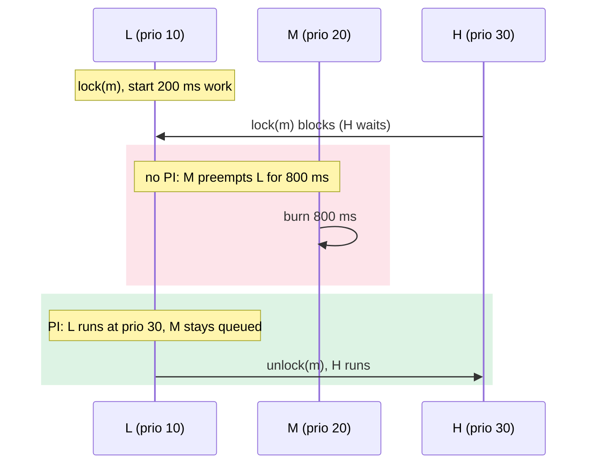

# Note 03 — Priority inversion and priority inheritance (Mars Pathfinder)

## 1. Summary

- **Priority inversion**: a high-priority task waits for a lock held by a low-priority task, and **medium-priority** tasks that never touch the lock keep the owner from running, so the wait has no bound.
- **Priority inheritance (PI)**: while a task holds a lock that a higher-priority task waits for, it runs at the waiter's priority; the medium tasks can no longer preempt it.
- Linux implements PI in `rt_mutex` (`kernel/locking/rtmutex.c`); user space gets it through `PTHREAD_PRIO_INHERIT` mutexes, which become `FUTEX_LOCK_PI` futexes.

## 2. Detailed explanation

### Intuition

Three tasks on one CPU: **H** (high), **M** (medium), **L** (low). L takes mutex `m`. H wakes up, preempts L, tries `m`, blocks. Fair enough: H must wait for L to finish its critical section — that is *bounded* inversion, at most the length of L's critical section. Now M wakes up. M has higher priority than L and doesn't need `m`, so it preempts L. H is still blocked behind L, and L cannot run until M is done. If there are many M-type tasks, H can wait **forever**. That is *unbounded* priority inversion: the priority order H > M > L is effectively inverted to M > H.

### Mars Pathfinder, 1997

The classic real case. The lander ran VxWorks on an RS6000 single-board computer. Per Glenn Reeves (flight software lead) in his 1997 email "What really happened on Mars?" and his 1999 Dr. Dobb's article "Priority Inversion: How We Found It, How We Fixed It":

- a high-priority bus-distribution task (`bc_dist`) needed a mutex that protected the `select()`/`pipe()` mechanism used for inter-task communication;
- the low-priority meteorological data task (ASI/MET) held that mutex;
- medium-priority tasks preempted ASI/MET while it held the mutex;
- the high-priority task missed its schedule, the system detected it and **reset the spacecraft**, repeatedly.

The JPL team reproduced it on a ground replica in under 18 hours. The fix was to **enable priority inheritance** on the semaphore used by `select()` — in VxWorks a creation flag, which they turned on by changing a global variable through an upload to the spacecraft. Reeves: there was no conscious decision to leave it off; "we just missed it".

### Three solutions

| Protocol | Idea | Cost | POSIX |
|---|---|---|---|
| **None** | do nothing | unbounded inversion | `PTHREAD_PRIO_NONE` (default) |
| **Priority inheritance (PI)** | on contention, boost the owner to the top waiter's priority; drop back on unlock | boost only on contention; chains (transitive) and deadlock detection need a chain walk | `PTHREAD_PRIO_INHERIT` |
| **Priority ceiling (PCP / "protect")** | each lock has a ceiling = highest priority of any user; taking the lock raises you to the ceiling immediately | raise on *every* lock, even uncontended (a syscall each time on Linux); needs static knowledge of users; prevents deadlock and chained blocking | `PTHREAD_PRIO_PROTECT` + `pthread_mutexattr_setprioceiling()` |

PI is the default choice in Linux because it needs no static knowledge.

### How Linux implements PI

`rt_mutex` (walkthrough §2) is the kernel's PI lock:

1. **Fast path** (no contention): `cmpxchg` the owner field from `NULL` to `current`. For a PI futex the same happens in user space on the futex word (`0 → TID`). No kernel entry.
2. **Contention**: the waiter is queued in the lock's waiter tree (ordered by priority), `task->pi_blocked_on` points at its waiter, and `task_blocks_on_rt_mutex()` puts it in the owner's `pi_waiters` tree if it is now the top waiter of that lock.
3. **Boost**: `rt_mutex_adjust_prio()` picks the top of `owner->pi_waiters` and calls `rt_mutex_setprio()`, which changes `owner->prio` (not `normal_prio`) and may move it into the RT class. The tracepoint `sched:sched_pi_setprio` fires.
4. **Chain**: if the owner is itself blocked on another rt_mutex (`owner->pi_blocked_on`), `rt_mutex_adjust_prio_chain()` walks the chain, boosting each owner, and detects cycles (`-EDEADLK`).
5. **Unlock**: the lock is handed to the top waiter, and the old owner is de-boosted (`rt_mutex_adjust_prio()` with no waiters → `pi_task = NULL`).

`PREEMPT_RT` uses the same `rt_mutex` for almost every kernel lock (`spinlock_t`, `rwlock_t`, `mutex`), so PI is everywhere in an RT kernel (note 04).

## 3. Diagram



## 4. Worked example

Lab 02, `inversion.c`: L (FIFO 10) needs 200 ms of CPU inside the lock, H (FIFO 30) blocks on it at t ≈ 20 ms, M (FIFO 20) burns 800 ms. All pinned to one CPU with `taskset`. Real run on the VM:

> Captured on aos-lab (VirtualBox on Hyper-V, Ubuntu 24.04, Linux 6.18.63 `PREEMPT_DYNAMIC`, 8 vCPU, shared with other users), 2026-11-15. Your numbers will differ.

```text
$ sudo taskset -c 7 ./inversion none
protocol=none cpu=7
     0.1 ms  L  locked, working 200 ms (CPU time)
    23.1 ms  H  wants the lock
    25.1 ms  M  start, burning 800 ms (no lock)
   825.2 ms  M  done
  1000.7 ms  L  unlock
  1000.7 ms  H  got the lock after 977.6 ms
$ sudo taskset -c 7 ./inversion inherit
protocol=inherit cpu=7
     0.1 ms  L  locked, working 200 ms (CPU time)
    20.7 ms  H  wants the lock
   202.2 ms  L  unlock
   202.2 ms  H  got the lock after 181.6 ms
   202.3 ms  M  start, burning 800 ms (no lock)
  1002.3 ms  M  done
```

Read the numbers: without a protocol H's wait ≈ M's 800 ms + L's remaining work. With `PTHREAD_PRIO_INHERIT` it shrinks to L's remaining work only, and M runs **after** H.

The kernel side of the boost, as seen by the `sched_pi_setprio` tracepoint during the `inherit` run (kernel priorities: `prio = 99 − rt_priority`, so 89 = FIFO 10, 69 = FIFO 30):

> Captured on aos-lab (VirtualBox on Hyper-V, Ubuntu 24.04, Linux 6.18.63 `PREEMPT_DYNAMIC`, 8 vCPU, shared with other users), 2026-11-15. Your numbers will differ.

```text
$ sudo bpftrace -e 'tracepoint:sched:sched_pi_setprio { printf("%s pid=%d prio %d -> %d\n", str(args.comm), args.pid, args.oldprio, args.newprio); }'
Attaching 1 probe...
inversion pid=9760 prio 89 -> 69
inversion pid=9760 prio 69 -> 89
```

## 5. Edge cases & pitfalls

- **Default mutexes have no PI.** `pthread_mutex_init(&m, NULL)` gives `PTHREAD_PRIO_NONE`. Go's `sync.Mutex` and Rust's `std::sync::Mutex` have no PI either.
- **Condition variables and semaphores have no owner**, so they cannot do PI. A `sem_wait()` that waits for a low-priority poster can invert without remedy.
- **Inversion needs a busy medium task on the same CPU.** On an idle multi-core machine, L simply runs on another CPU, and the lab shows nothing — that's why it pins all three threads to one CPU.
- **PI bounds the inversion, it doesn't remove it.** H still waits for L's critical section. Keep critical sections short.
- **Nested locks** make the chain walk expensive and are where deadlocks hide. PCP avoids both, at the cost of static configuration.
- **`SCHED_OTHER` owners.** A normal-priority owner is boosted into the RT class while it holds a lock an RT task needs. If you see a nice-0 task briefly running as RT in `top`, that's PI.

## 6. Exam-style key points

- Unbounded inversion requires three priorities: H blocked by L, L preempted by M.
- Bounded inversion (H waits for L's critical section) is unavoidable with locks; unbounded is a bug.
- PI: owner inherits the top waiter's priority; transitive across lock chains; de-boost on unlock.
- PCP: lock raises to its ceiling immediately; prevents deadlock and chained blocking; needs static analysis.
- Linux: `rt_mutex` → `task_blocks_on_rt_mutex()` → `rt_mutex_adjust_prio()` → `rt_mutex_setprio()` changes `p->prio`, not `normal_prio`.
- User space: `PTHREAD_PRIO_INHERIT` → `FUTEX_LOCK_PI` → `futex_lock_pi()`; futex word holds the owner TID.
- Pathfinder: VxWorks, `select()` semaphore without PI, repeated resets; fixed by enabling PI remotely.

## 7. Links

- Lesson: [`lesson.en.md` §4.4](../lesson.en.md)
- Walkthrough: [`kernel-walkthrough.en.md` §2](../kernel-walkthrough.en.md)
- Lab: [`labs/02-priority-inversion`](../labs/02-priority-inversion/README.md)
- Quiz: questions 4, 9, 13 in [`quiz.en.md`](../quiz.en.md)
- Primary sources: G. Reeves, "Priority Inversion: How We Found It, How We Fixed It", Dr. Dobb's Journal, Nov 1999 (<https://jacobfilipp.com/DrDobbs/articles/DDJ/1999/9911/9911a/9911as1.htm>); `linux/Documentation/locking/rt-mutex-design.rst` (v6.18.63)
