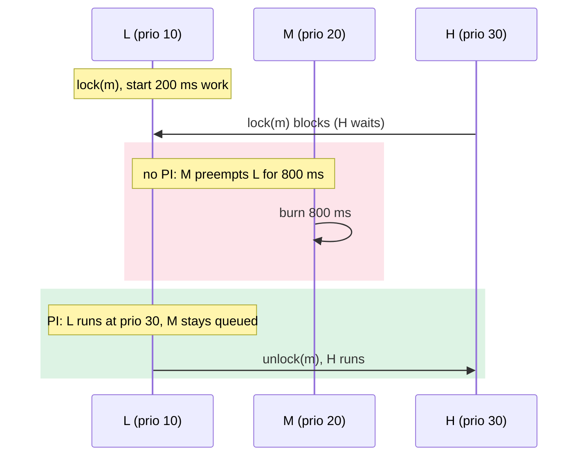

<div dir="rtl">

# یادداشت ۰۳ — Priority inversion و priority inheritance (کاوشگر Mars Pathfinder)

## ۱. خلاصه

- **Priority inversion** (وارونگی اولویت): یک task پراولویت منتظر قفلی است که دست یک task کم‌اولویت است، و taskهای **میان‌اولویتی** که اصلاً به آن قفل کاری ندارند نمی‌گذارند صاحب قفل اجرا شود؛ پس انتظار حدی ندارد.
- **Priority inheritance (PI)** (وراثت اولویت): تا وقتی taskی قفلی را نگه داشته که task پراولویت‌تری منتظرش است، با اولویت آن منتظر اجرا می‌شود؛ taskهای میانی دیگر نمی‌توانند آن را کنار بزنند.
- لینوکس PI را در `rt_mutex` پیاده کرده (`kernel/locking/rtmutex.c`)؛ فضای کاربر از راه mutexهای `PTHREAD_PRIO_INHERIT` به آن می‌رسد که به futexهای `FUTEX_LOCK_PI` تبدیل می‌شوند.

## ۲. توضیح مفصل

### شهود

سه task روی یک CPU: ‏**H** (بالا)، **M** (میانی)، **L** (پایین). ‏L قفل `m` را می‌گیرد. ‏H بیدار می‌شود، L را کنار می‌زند، `m` را می‌خواهد و مسدود می‌شود. تا اینجا منصفانه است: H باید صبر کند تا بخش بحرانی L تمام شود؛ این وارونگیِ *محدود* است، حداکثر به اندازهٔ بخش بحرانی L. حالا M بیدار می‌شود. ‏M از L پراولویت‌تر است و `m` را لازم ندارد، پس L را کنار می‌زند. ‏H هنوز پشت L مسدود است و L تا M تمام نشود اجرا نمی‌شود. اگر چند task از نوع M باشد، H ممکن است **برای همیشه** صبر کند. این وارونگیِ *نامحدود* است: ترتیب H > M > L عملاً به M > H وارونه شده است.

### ‏Mars Pathfinder، سال ۱۹۹۷

نمونهٔ واقعی کلاسیک. سطح‌نشین روی یک کامپیوتر تک‌بُردی RS6000 سیستم‌عامل VxWorks اجرا می‌کرد. به روایت Glenn Reeves (سرپرست نرم‌افزار پرواز) در ایمیل ۱۹۹۷ با عنوان «What really happened on Mars?» و مقالهٔ ۱۹۹۹ او در Dr. Dobb's با عنوان «Priority Inversion: How We Found It, How We Fixed It»:

- یک task پراولویتِ توزیع روی bus (‏`bc_dist`) به mutexی نیاز داشت که از سازوکار `select()`/`pipe()` برای ارتباط بین taskها محافظت می‌کرد؛
- task کم‌اولویتِ دادهٔ هواشناسی (ASI/MET) آن mutex را در دست داشت؛
- taskهای میان‌اولویت در همان زمان ASI/MET را کنار می‌زدند؛
- task پراولویت از برنامهٔ زمانی‌اش عقب ماند، سیستم این را تشخیص داد و فضاپیما را **reset کرد**، بارها.

تیم JPL مشکل را روی یک نسخهٔ زمینی در کمتر از ۱۸ ساعت بازتولید کرد. راه‌حل **روشن کردن priority inheritance** روی semaphoreِ مورد استفادهٔ `select()` بود؛ در VxWorks این یک پرچم هنگام ساخت semaphore است و آن‌ها با تغییر یک متغیر سراسری و بارگذاری آن روی فضاپیما روشنش کردند. ‏Reeves می‌گوید تصمیم آگاهانه‌ای برای خاموش گذاشتنش نبود؛ «we just missed it».

### سه راه‌حل

| پروتکل | ایده | هزینه | POSIX |
|---|---|---|---|
| **None** | هیچ کاری نکن | وارونگی نامحدود | `PTHREAD_PRIO_NONE` (پیش‌فرض) |
| **Priority inheritance (PI)** | هنگام رقابت، اولویت صاحب قفل را تا اولویت منتظرِ اول بالا ببر؛ هنگام unlock برگردان | فقط هنگام رقابت boost می‌شود؛ زنجیره‌ها (تراگذری) و تشخیص deadlock به پیمایش زنجیره نیاز دارند | `PTHREAD_PRIO_INHERIT` |
| **Priority ceiling (PCP یا «protect»)** | هر قفل یک سقف دارد = بالاترین اولویت میان همهٔ کاربرانش؛ گرفتن قفل فوراً شما را تا سقف بالا می‌برد | بالا بردن در *هر* قفل، حتی بدون رقیب (در لینوکس هر بار یک syscall)؛ به دانش ایستا از کاربران قفل نیاز دارد؛ جلوی deadlock و انسداد زنجیره‌ای را می‌گیرد | `PTHREAD_PRIO_PROTECT` به‌اضافهٔ `pthread_mutexattr_setprioceiling()` |

PI انتخاب پیش‌فرض لینوکس است چون دانش ایستا لازم ندارد.

### لینوکس PI را چطور پیاده می‌کند

‏`rt_mutex` (گشت کد بخش ۲) قفل PIِ کرنل است:

۱. **مسیر سریع** (بدون رقابت): ‏`cmpxchg` روی فیلد owner از `NULL` به `current`. برای futexِ PI همین کار در فضای کاربر روی کلمهٔ futex انجام می‌شود (`0 → TID`). بدون ورود به کرنل.
۲. **رقابت**: منتظر در درخت منتظرهای قفل (مرتب بر اساس اولویت) صف می‌شود، ‏`task->pi_blocked_on` به waiterش اشاره می‌کند، و `task_blocks_on_rt_mutex()` اگر حالا منتظرِ اولِ این قفل است آن را در درخت `pi_waiters` صاحب قفل می‌گذارد.
۳. **Boost**: ‏`rt_mutex_adjust_prio()` رأس `owner->pi_waiters` را برمی‌دارد و `rt_mutex_setprio()` را صدا می‌زند که `owner->prio` را عوض می‌کند (نه `normal_prio`) و ممکن است آن را به کلاس RT ببرد. tracepoint ‏`sched:sched_pi_setprio` فعال می‌شود.
۴. **زنجیره**: اگر صاحب قفل خودش روی rt_mutex دیگری مسدود باشد (`owner->pi_blocked_on`)، ‏`rt_mutex_adjust_prio_chain()` زنجیره را پیمایش می‌کند، صاحب هر قفل را boost می‌کند و چرخه را تشخیص می‌دهد (`-EDEADLK`).
۵. **Unlock**: قفل به منتظر اول داده می‌شود و صاحب قبلی de-boost می‌شود (`rt_mutex_adjust_prio()` بدون منتظر ← `pi_task = NULL`).

‏`PREEMPT_RT` همین `rt_mutex` را برای تقریباً همهٔ قفل‌های کرنل به کار می‌برد (`spinlock_t`، ‏`rwlock_t`، ‏`mutex`)، پس در کرنل RT، ‏PI همه‌جا هست (یادداشت ۰۴).

## ۳. نمودار

</div>



<div dir="rtl">

## ۴. مثال کاربردی

آزمایش ۰۲، برنامهٔ `inversion.c`: ‏L (FIFO 10) داخل قفل ۲۰۰ میلی‌ثانیه CPU لازم دارد، H (FIFO 30) در حدود t ≈ 20 ms روی آن مسدود می‌شود، و M (FIFO 20) ‏۸۰۰ میلی‌ثانیه CPU می‌سوزاند. همه با `taskset` به یک CPU بسته شده‌اند. اجرای واقعی روی VM:

</div>

> گرفته‌شده روی aos-lab (‏VirtualBox روی Hyper-V، ‏Ubuntu 24.04، ‏Linux 6.18.63 با `PREEMPT_DYNAMIC`، ‏۸ vCPU، مشترک با کاربران دیگر)، ۲۰۲۶-۱۱-۱۵. عددهای شما فرق خواهد کرد.

```text
$ sudo taskset -c 7 ./inversion none
protocol=none cpu=7
     0.1 ms  L  locked, working 200 ms (CPU time)
    23.1 ms  H  wants the lock
    25.1 ms  M  start, burning 800 ms (no lock)
   825.2 ms  M  done
  1000.7 ms  L  unlock
  1000.7 ms  H  got the lock after 977.6 ms
$ sudo taskset -c 7 ./inversion inherit
protocol=inherit cpu=7
     0.1 ms  L  locked, working 200 ms (CPU time)
    20.7 ms  H  wants the lock
   202.2 ms  L  unlock
   202.2 ms  H  got the lock after 181.6 ms
   202.3 ms  M  start, burning 800 ms (no lock)
  1002.3 ms  M  done
```

<div dir="rtl">

عددها را بخوانید: بدون پروتکل، انتظار H ≈ ‏۸۰۰ میلی‌ثانیهٔ M به‌اضافهٔ باقی کار L است. با `PTHREAD_PRIO_INHERIT` فقط به باقی کار L کوچک می‌شود و M **بعد از** H اجرا می‌شود.

سمت کرنلِ boost، آن‌طور که tracepoint ‏`sched_pi_setprio` در اجرای `inherit` نشان می‌دهد (اولویت‌های کرنل: ‏`prio = 99 − rt_priority`، پس 89 یعنی FIFO 10 و 69 یعنی FIFO 30):

</div>

> گرفته‌شده روی aos-lab (‏VirtualBox روی Hyper-V، ‏Ubuntu 24.04، ‏Linux 6.18.63 با `PREEMPT_DYNAMIC`، ‏۸ vCPU، مشترک با کاربران دیگر)، ۲۰۲۶-۱۱-۱۵. عددهای شما فرق خواهد کرد.

```text
$ sudo bpftrace -e 'tracepoint:sched:sched_pi_setprio { printf("%s pid=%d prio %d -> %d\n", str(args.comm), args.pid, args.oldprio, args.newprio); }'
Attaching 1 probe...
inversion pid=9760 prio 89 -> 69
inversion pid=9760 prio 69 -> 89
```

<div dir="rtl">

## ۵. حالت‌های خاص و دام‌ها

- **mutexهای پیش‌فرض PI ندارند.** ‏`pthread_mutex_init(&m, NULL)` همان `PTHREAD_PRIO_NONE` است. ‏`sync.Mutex` در Go و `std::sync::Mutex` در Rust هم PI ندارند.
- **condition variable و semaphore صاحب ندارند**، پس PI برایشان ممکن نیست. ‏`sem_wait()` که منتظر یک post از task کم‌اولویت است بدون درمان وارونه می‌شود.
- **وارونگی به یک task میانیِ پرکار روی همان CPU نیاز دارد.** روی ماشین چندهسته‌ای بیکار، L روی CPU دیگری اجرا می‌شود و آزمایش چیزی نشان نمی‌دهد؛ به همین دلیل هر سه thread به یک CPU بسته می‌شوند.
- **PI وارونگی را محدود می‌کند، حذفش نمی‌کند.** ‏H هنوز منتظر بخش بحرانی L است. بخش‌های بحرانی را کوتاه نگه دارید.
- **قفل‌های تودرتو** پیمایش زنجیره را گران می‌کنند و جای پنهان شدن deadlockاند. ‏PCP هر دو را حذف می‌کند، به بهای پیکربندی ایستا.
- **صاحب‌های `SCHED_OTHER`.** صاحب قفلِ با اولویت عادی، تا وقتی قفلی را که یک task RT لازم دارد نگه داشته، به کلاس RT برده می‌شود. اگر در `top` دیدید یک task با nice 0 لحظه‌ای RT شد، این همان PI است.

## ۶. نکته‌های کلیدی امتحانی

- وارونگی نامحدود سه اولویت لازم دارد: H پشت L مسدود است، و M جای L را می‌گیرد.
- وارونگی محدود (H منتظر بخش بحرانی L) با قفل اجتناب‌ناپذیر است؛ نامحدودش باگ است.
- PI: صاحب قفل اولویت منتظر اول را به ارث می‌برد؛ در زنجیرهٔ قفل‌ها تراگذر است؛ هنگام unlock برمی‌گردد.
- PCP: قفل فوراً تا سقف بالا می‌برد؛ جلوی deadlock و انسداد زنجیره‌ای را می‌گیرد؛ تحلیل ایستا لازم دارد.
- لینوکس: ‏`rt_mutex` ← ‏`task_blocks_on_rt_mutex()` ← ‏`rt_mutex_adjust_prio()` ← ‏`rt_mutex_setprio()` که `p->prio` را عوض می‌کند، نه `normal_prio`.
- فضای کاربر: ‏`PTHREAD_PRIO_INHERIT` ← ‏`FUTEX_LOCK_PI` ← ‏`futex_lock_pi()`؛ کلمهٔ futex شناسهٔ thread صاحب را نگه می‌دارد.
- Pathfinder: ‏VxWorks، semaphoreِ `select()` بدون PI، resetهای تکراری؛ با روشن کردن PI از راه دور درست شد.

## ۷. پیوندها

- درس: [`lesson.fa.md` بخش ۴.۴](../lesson.fa.md)
- گشت کد: [`kernel-walkthrough.fa.md` بخش ۲](../kernel-walkthrough.fa.md)
- آزمایش: [`labs/02-priority-inversion`](../labs/02-priority-inversion/README.md)
- آزمون: پرسش‌های ۴، ۹ و ۱۳ در [`quiz.fa.md`](../quiz.fa.md)
- منابع اصلی: ‏G. Reeves، «Priority Inversion: How We Found It, How We Fixed It»، ‏Dr. Dobb's Journal، نوامبر ۱۹۹۹ (<https://jacobfilipp.com/DrDobbs/articles/DDJ/1999/9911/9911a/9911as1.htm>)؛ ‏`linux/Documentation/locking/rt-mutex-design.rst` (v6.18.63)

</div>
