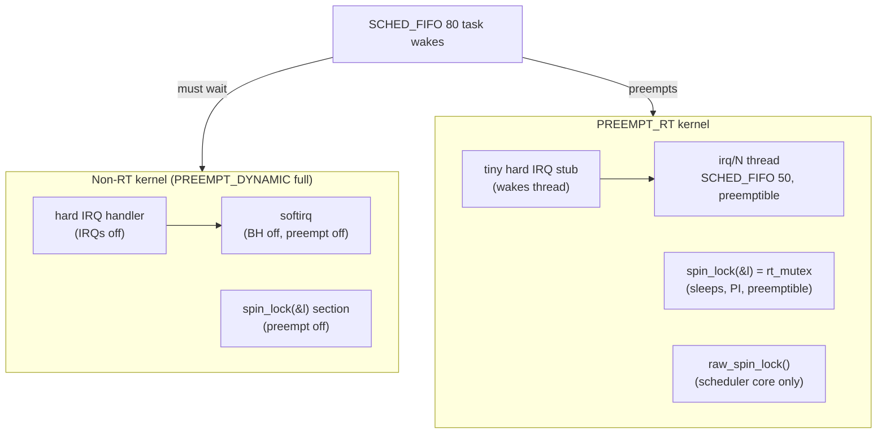

# Note 04 — `PREEMPT_RT`: making (almost) the whole kernel preemptible

## 1. Summary

- On a normal kernel, latency is unbounded because large parts of the kernel run with **preemption or interrupts disabled** (spinlocks, hard and soft interrupts).
- `PREEMPT_RT` turns `spinlock_t`/`rwlock_t`/`local_lock` into sleeping, priority-inheriting `rt_mutex` locks and runs interrupt handlers in **threads**, so a high-priority task can preempt almost anything.
- It is a compile-time option in mainline (`CONFIG_PREEMPT_RT`, `kernel/Kconfig.preempt` L89), visible as `PREEMPT_RT` in `uname -v`; it cannot be switched on at runtime like the `PREEMPT_DYNAMIC` modes.

## 2. Detailed explanation

### Intuition: where the latency hides

When a timer fires for your `SCHED_FIFO` 80 task, the kernel wakes it and sets "need resched". The task runs at the next **preemption point**. If the CPU is inside a `spin_lock()` section, inside a softirq that processes 64 network packets, or in code with interrupts off, the next preemption point may be milliseconds away. That wait is the unbounded part of scheduling latency (note 01).

### The preemption models

`kernel/Kconfig.preempt` in v6.18.63 offers:

| Model | Kconfig | Where the kernel can be preempted | Typical use |
|---|---|---|---|
| none | `PREEMPT_NONE` | only at return to user space and explicit `cond_resched()` | throughput servers |
| voluntary | `PREEMPT_VOLUNTARY` | plus `might_sleep()` points | old desktop default |
| full | `PREEMPT` | anywhere preemption is not disabled (`preempt_count() == 0`) | desktop / low latency |
| lazy | `PREEMPT_LAZY` | like full for RT tasks; fair tasks are preempted at the next tick or return to user | throughput with full-preemption machinery |
| **RT** | `PREEMPT_RT` | full, **and** most of the "preemption disabled" regions are themselves made preemptible | real-time |

`PREEMPT_DYNAMIC` (Ubuntu's default, and our VM's) builds the full-preemption machinery and patches the call sites at boot (`preempt=none|voluntary|full|lazy`) or at runtime (`/sys/kernel/debug/sched/preempt`). It **does not** include RT: RT changes the lock implementations themselves.

### What `PREEMPT_RT` changes

1. **Sleeping spinlocks.** `spinlock_t` and `rwlock_t` become `rt_mutex`-based (`kernel/locking/spinlock_rt.c`): contended lockers sleep with PI instead of spinning with preemption off. Only `raw_spinlock_t` still spins (scheduler, IRQ core, timer core). From `Documentation/locking/locktypes.rst`: "On PREEMPT_RT kernels, these lock types are converted to sleeping locks: local_lock, spinlock_t, rwlock_t".
2. **Threaded interrupts.** Interrupt handlers run as kernel threads (`irq/<n>-<name>`, `SCHED_FIFO` 50 by default: `irq_thread()` calls `sched_set_fifo()`, kernel/irq/manage.c L1257, which uses `MAX_RT_PRIO / 2`, kernel/sched/syscalls.c L855) and can be preempted or re-prioritized with `chrt`. In `include/linux/interrupt.h` L511-512, `force_irqthreads()` is hard-wired to `true` under `CONFIG_PREEMPT_RT`; on other kernels it is a boot option (`threadirqs`).
3. **Softirqs in thread context**, with per-CPU local locks instead of "disable bottom halves" sections (`PREEMPT_RT_NEEDS_BH_LOCK`, Kconfig.preempt L106, controls how strictly softirqs are serialized).
4. **Preemptible RCU** read sides, and long non-preemptible sections broken up.

The result, per the Kconfig help text: everything "except very low level and critical code paths (entry code, scheduler, low level interrupt handling)" becomes preemptible.

### What it costs

- **Throughput**: sleeping locks and IRQ threads add context switches; RT kernels are typically slower on throughput benchmarks.
- **Semantics**: code that relied on `spin_lock()` disabling preemption (e.g. per-CPU access under a spinlock) must use `local_lock` or `migrate_disable()` (which `rt_spin_lock()` does, walkthrough §3).
- **Semaphores and completions** still have no owner, so no PI (locktypes.rst: "PREEMPT_RT does not change the semaphore implementation").

### History in one line

Developed out of tree for about 20 years (the "RT patch"), merged piece by piece; the final Kconfig switch became selectable in mainline in v6.12 (2024). `VERSION-DEPENDENT`: older kernels need the external patch; in our pinned v6.18.63 it is plain Kconfig.

### How to know what you run

```
uname -v                              # ... SMP PREEMPT_RT ...   (init/Makefile L30)
grep PREEMPT /boot/config-$(uname -r)
cat /sys/kernel/debug/sched/preempt   # PREEMPT_DYNAMIC only
ps -eo pid,cls,rtprio,comm | grep irq/   # threaded IRQs (always on RT)
```

There is no `/sys/kernel/realtime` in v6.18.63.

## 3. Diagram



## 4. Worked example

Our VM runs a `PREEMPT_DYNAMIC` kernel, not RT. What it reports:

> Captured on aos-lab (VirtualBox on Hyper-V, Ubuntu 24.04, Linux 6.18.63 `PREEMPT_DYNAMIC`, 8 vCPU, shared with other users), 2026-11-15. Your numbers will differ.

```text
$ uname -v
#202611101835 SMP PREEMPT_DYNAMIC Tue Nov 10 19:12:55 UTC 2026
$ sudo cat /sys/kernel/debug/sched/preempt
none (voluntary) full lazy
$ grep -E "^CONFIG_PREEMPT" /boot/config-$(uname -r)
CONFIG_PREEMPT_BUILD=y
CONFIG_PREEMPT_VOLUNTARY=y
CONFIG_PREEMPT_COUNT=y
CONFIG_PREEMPTION=y
CONFIG_PREEMPT_DYNAMIC=y
CONFIG_PREEMPT_RCU=y
CONFIG_PREEMPT_NOTIFIERS=y
$ ls /sys/kernel/realtime
ls: cannot access '/sys/kernel/realtime': No such file or directory
```

`cyclictest` on the same VM under `stress-ng` load, for each `PREEMPT_DYNAMIC` mode (lab 01, `compare-preempt.sh`, 30 s each, original mode restored afterwards):

> Captured on aos-lab (VirtualBox on Hyper-V, Ubuntu 24.04, Linux 6.18.63 `PREEMPT_DYNAMIC`, 8 vCPU, shared with other users), 2026-11-15. Your numbers will differ.

```text
$ sudo bash compare-preempt.sh 30 2,3 "none voluntary full"
original: none (voluntary) full lazy
(none) voluntary full lazy  avg_us=[02205 02541]  max_us=[433118 1363610]
none (voluntary) full lazy  avg_us=[03492 03606]  max_us=[998221 997993]
none voluntary (full) lazy  avg_us=[02602 02526]  max_us=[1484984 1484192]
restored: none (voluntary) full lazy
# ^ printed minutes later: the restoring write blocked (see pitfalls)
$ sudo cat /sys/kernel/debug/sched/preempt
none (voluntary) full lazy
```

Read it honestly: there is **no** ordering here (none 1.36 s, voluntary 1.00 s, full 1.48 s max). Maxima of a second or more mean the vCPUs were not running at all: the host, not the guest's preemption model, decided the latency. In this run the `--hdd` stressor also died with `SIGILL` (VirtualBox CPU-feature gap; the scripts now use `--iomix`), so the load was CPU-only. On bare metal you would expect `none` ≥ `voluntary` ≥ `full` for the max under kernel-heavy load.

**`PREEMPT_RT` numbers: `UNVERIFIED`.** No RT kernel is installed on the shared VM (the rules forbid changing its kernel). To get them, build the RT flavor from 00-setup lab 03 in your own VM:

```bash
bash 00-setup/labs/03-build-kernel/build-kernel.sh --rt   # 6.18.63-aos-rt
sudo reboot; uname -v                                     # must contain PREEMPT_RT
sudo bash 07-realtime-research/labs/01-cyclictest/run-cyclictest.sh 300
```

On bare metal, RT kernels typically keep the max latency in the tens of microseconds under load, where non-RT kernels show occasional millisecond spikes. In a VM, the hypervisor's own scheduling often dominates both.

## 5. Edge cases & pitfalls

- **"RT makes my program fast."** It makes the *worst case* small and the average slightly worse.
- **RT kernel + bad application** = no RT. Without `mlockall`, absolute sleeps, proper priorities and CPU isolation (`isolcpus=`, `nohz_full=`, cpusets) the kernel can't help.
- **IRQ thread priority.** On RT, your FIFO 80 task can preempt the network IRQ thread at 50. If your task needs the network, raise that IRQ thread (`chrt -f -p 85 <pid>`).
- **`spin_lock()` in atomic context on RT.** Code that takes a `spinlock_t` with interrupts hard-disabled triggers "BUG: sleeping function called from invalid context". That is why such code must use `raw_spinlock_t`.
- **Virtualized measurements** show the host, not the guest kernel. Treat all VM numbers as shape-only.
- **Confusing `PREEMPT_DYNAMIC=full` with RT.** `full` still runs softirqs and spinlock sections non-preemptibly.

## 6. Exam-style key points

- Non-RT latency is unbounded because of preempt-off and IRQ-off regions.
- `PREEMPT_RT`: `spinlock_t`, `rwlock_t`, `local_lock` → sleeping `rt_mutex` with PI; `raw_spinlock_t` still spins.
- Forced threaded IRQs (`force_irqthreads()` = true on RT), softirqs in threads, preemptible RCU.
- Kconfig: `depends on EXPERT && ARCH_SUPPORTS_RT && !COMPILE_TEST`, `select PREEMPTION`.
- `uname -v` shows `PREEMPT_RT` (last of the `preempt-flag-` assignments in `init/Makefile`).
- `PREEMPT_DYNAMIC` switches none/voluntary/full/lazy at boot or runtime, never RT.
- Trade-off: lower worst-case latency, lower throughput.

## 7. Links

- Lesson: [`lesson.en.md` §4.5](../lesson.en.md)
- Walkthrough: [`kernel-walkthrough.en.md` §1, §3](../kernel-walkthrough.en.md)
- Lab: [`labs/01-cyclictest`](../labs/01-cyclictest/README.md); build: [`00-setup/labs/03-build-kernel`](../../00-setup/labs/03-build-kernel/README.md)
- Quiz: questions 5, 10 and oral O1 in [`quiz.en.md`](../quiz.en.md)
