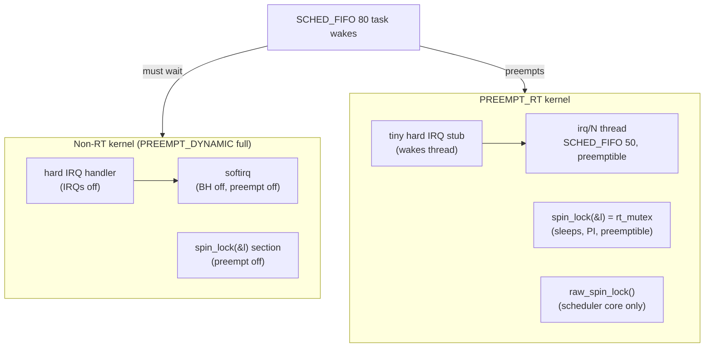

<div dir="rtl">

# یادداشت ۰۴ — ‏`PREEMPT_RT`: قابل‌preempt کردن (تقریباً) کل کرنل

## ۱. خلاصه

- در کرنل معمولی latency نامحدود است، چون بخش‌های بزرگی از کرنل با **preemption یا interrupt خاموش** اجرا می‌شوند (spinlockها، interruptهای سخت و نرم).
- ‏`PREEMPT_RT` قفل‌های `spinlock_t`، ‏`rwlock_t` و `local_lock` را به قفل‌های `rt_mutex`ِ خوابنده و دارای priority inheritance تبدیل می‌کند و handlerهای interrupt را در **thread** اجرا می‌کند، تا یک task پراولویت بتواند تقریباً هر چیزی را preempt کند.
- این یک گزینهٔ زمان compile در mainline است (`CONFIG_PREEMPT_RT`، ‏`kernel/Kconfig.preempt` خط ۸۹) که در `uname -v` به شکل `PREEMPT_RT` دیده می‌شود؛ برخلاف حالت‌های `PREEMPT_DYNAMIC` نمی‌شود آن را در زمان اجرا روشن کرد.

## ۲. توضیح مفصل

### شهود: latency کجا پنهان است

وقتی timer برای task شما با `SCHED_FIFO` و اولویت ۸۰ فعال می‌شود، کرنل آن را بیدار می‌کند و پرچم «need resched» را می‌گذارد. task در **نقطهٔ preemption** بعدی اجرا می‌شود. اگر CPU داخل یک بخش `spin_lock()` باشد، یا داخل softirqی که ۶۴ بستهٔ شبکه را پردازش می‌کند، یا در کدی با interrupt خاموش، نقطهٔ preemption بعدی ممکن است چند میلی‌ثانیه دورتر باشد. همین انتظار بخش نامحدود scheduling latency است (یادداشت ۰۱).

### مدل‌های preemption

فایل `kernel/Kconfig.preempt` در v6.18.63 این‌ها را دارد:

| مدل | Kconfig | کرنل کجا قابل preempt است | کاربرد معمول |
|---|---|---|---|
| none | `PREEMPT_NONE` | فقط هنگام بازگشت به فضای کاربر و `cond_resched()` صریح | سرورهای توان‌محور |
| voluntary | `PREEMPT_VOLUNTARY` | به‌اضافهٔ نقطه‌های `might_sleep()` | پیش‌فرض قدیمی دسکتاپ |
| full | `PREEMPT` | هر جا preemption خاموش نباشد (`preempt_count() == 0`) | دسکتاپ و latency پایین |
| lazy | `PREEMPT_LAZY` | برای taskهای RT مثل full؛ taskهای fair در tick بعدی یا بازگشت به کاربر preempt می‌شوند | توان عملیاتی با سازوکار full |
| **RT** | `PREEMPT_RT` | مثل full، **و** بیشتر ناحیه‌های «preemption خاموش» خودشان قابل‌preempt می‌شوند | real-time |

‏`PREEMPT_DYNAMIC` (پیش‌فرض اوبونتو و VM ما) سازوکار full-preemption را می‌سازد و محل‌های فراخوانی را هنگام بوت (`preempt=none|voluntary|full|lazy`) یا در زمان اجرا (`/sys/kernel/debug/sched/preempt`) patch می‌کند. ولی RT را **شامل نمی‌شود**: RT خود پیاده‌سازی قفل‌ها را عوض می‌کند.

### ‏`PREEMPT_RT` چه چیزی را عوض می‌کند

۱. **spinlockهای خوابنده.** ‏`spinlock_t` و `rwlock_t` بر پایهٔ `rt_mutex` می‌شوند (`kernel/locking/spinlock_rt.c`): کسی که در رقابت می‌ماند به‌جای چرخیدن با preemption خاموش، همراه با PI می‌خوابد. فقط `raw_spinlock_t` هنوز می‌چرخد (زمان‌بند، هستهٔ IRQ، هستهٔ timer). از `Documentation/locking/locktypes.rst`: «On PREEMPT_RT kernels, these lock types are converted to sleeping locks: local_lock, spinlock_t, rwlock_t».
۲. **interruptهای threadی.** handlerهای interrupt به شکل thread کرنل اجرا می‌شوند (`irq/<n>-<name>`، به‌طور پیش‌فرض `SCHED_FIFO` با اولویت ۵۰: ‏`irq_thread()` تابع `sched_set_fifo()` را صدا می‌زند (kernel/irq/manage.c خط ۱۲۵۷) که از `MAX_RT_PRIO / 2` استفاده می‌کند (kernel/sched/syscalls.c خط ۸۵۵)) و می‌شود آن‌ها را preempt کرد یا با `chrt` اولویتشان را عوض کرد. در `include/linux/interrupt.h` خط ۵۱۱ تا ۵۱۲، زیر `CONFIG_PREEMPT_RT` مقدار `force_irqthreads()` ثابتِ `true` است؛ در کرنل‌های دیگر یک گزینهٔ بوت است (`threadirqs`).
۳. **softirqها در context thread**، با local lockهای per-CPU به‌جای بخش‌های «bottom half خاموش» (‏`PREEMPT_RT_NEEDS_BH_LOCK` در Kconfig.preempt خط ۱۰۶ تعیین می‌کند softirqها چقدر سخت‌گیرانه سریالی شوند).
۴. **RCUِ قابل‌preempt** در بخش خواندن، و شکستن بخش‌های طولانیِ غیرقابل‌preempt.

نتیجه، طبق متن help در Kconfig: همه چیز «except very low level and critical code paths (entry code, scheduler, low level interrupt handling)» قابل preempt می‌شود.

### هزینه‌اش چیست

- **توان عملیاتی**: قفل‌های خوابنده و threadهای IRQ context switch اضافه می‌کنند؛ کرنل‌های RT معمولاً در benchmarkهای توان عملیاتی کندترند.
- **معنا**: کدی که به اینکه `spin_lock()` preemption را خاموش می‌کند تکیه داشت (مثلاً دسترسی per-CPU زیر spinlock) باید از `local_lock` یا `migrate_disable()` استفاده کند (که `rt_spin_lock()` همین کار را می‌کند، گشت کد بخش ۳).
- **semaphore و completion** هنوز صاحب ندارند، پس PI ندارند (locktypes.rst: «PREEMPT_RT does not change the semaphore implementation»).

### تاریخچه در یک خط

حدود ۲۰ سال بیرون از درخت اصلی توسعه یافت («RT patch») و تکه‌تکه merge شد؛ کلید نهایی Kconfig در v6.12 (سال ۲۰۲۴) در mainline قابل انتخاب شد. ‏`VERSION-DEPENDENT`: کرنل‌های قدیمی‌تر patch بیرونی لازم دارند؛ در v6.18.63ِ ثابت ما یک Kconfig ساده است.

### از کجا بفهمیم چه اجرا می‌کنیم

</div>

```
uname -v                              # ... SMP PREEMPT_RT ...   (init/Makefile L30)
grep PREEMPT /boot/config-$(uname -r)
cat /sys/kernel/debug/sched/preempt   # PREEMPT_DYNAMIC only
ps -eo pid,cls,rtprio,comm | grep irq/   # threaded IRQs (always on RT)
```

<div dir="rtl">

در v6.18.63 فایل `/sys/kernel/realtime` وجود ندارد.

## ۳. نمودار

</div>



<div dir="rtl">

## ۴. مثال کاربردی

VM ما کرنل `PREEMPT_DYNAMIC` اجرا می‌کند، نه RT. آنچه گزارش می‌دهد:

</div>

> گرفته‌شده روی aos-lab (‏VirtualBox روی Hyper-V، ‏Ubuntu 24.04، ‏Linux 6.18.63 با `PREEMPT_DYNAMIC`، ‏۸ vCPU، مشترک با کاربران دیگر)، ۲۰۲۶-۱۱-۱۵. عددهای شما فرق خواهد کرد.

```text
$ uname -v
#202611101835 SMP PREEMPT_DYNAMIC Tue Nov 10 19:12:55 UTC 2026
$ sudo cat /sys/kernel/debug/sched/preempt
none (voluntary) full lazy
$ grep -E "^CONFIG_PREEMPT" /boot/config-$(uname -r)
CONFIG_PREEMPT_BUILD=y
CONFIG_PREEMPT_VOLUNTARY=y
CONFIG_PREEMPT_COUNT=y
CONFIG_PREEMPTION=y
CONFIG_PREEMPT_DYNAMIC=y
CONFIG_PREEMPT_RCU=y
CONFIG_PREEMPT_NOTIFIERS=y
$ ls /sys/kernel/realtime
ls: cannot access '/sys/kernel/realtime': No such file or directory
```

<div dir="rtl">

‏`cyclictest` روی همان VM زیر بار `stress-ng`، برای هر حالت `PREEMPT_DYNAMIC` (آزمایش ۰۱، ‏`compare-preempt.sh`، هر کدام ۳۰ ثانیه، و حالت اصلی پس از آن برگردانده شد):

</div>

> گرفته‌شده روی aos-lab (‏VirtualBox روی Hyper-V، ‏Ubuntu 24.04، ‏Linux 6.18.63 با `PREEMPT_DYNAMIC`، ‏۸ vCPU، مشترک با کاربران دیگر)، ۲۰۲۶-۱۱-۱۵. عددهای شما فرق خواهد کرد.

```text
$ sudo bash compare-preempt.sh 30 2,3 "none voluntary full"
original: none (voluntary) full lazy
(none) voluntary full lazy  avg_us=[02205 02541]  max_us=[433118 1363610]
none (voluntary) full lazy  avg_us=[03492 03606]  max_us=[998221 997993]
none voluntary (full) lazy  avg_us=[02602 02526]  max_us=[1484984 1484192]
restored: none (voluntary) full lazy
# ^ printed minutes later: the restoring write blocked (see pitfalls)
$ sudo cat /sys/kernel/debug/sched/preempt
none (voluntary) full lazy
```

<div dir="rtl">

صادقانه بخوانید: اینجا **هیچ** ترتیبی دیده نمی‌شود (بیشینهٔ none ‏۱٫۳۶ ثانیه، voluntary ‏۱٫۰۰ ثانیه، full ‏۱٫۴۸ ثانیه). بیشینهٔ یک ثانیه یا بیشتر یعنی vCPUها اصلاً اجرا نمی‌شدند: میزبان latency را تعیین کرد، نه مدل preemption مهمان. در این اجرا stressorِ `--hdd` هم با `SIGILL` مُرد (کمبود یک ویژگی CPU در VirtualBox؛ اسکریپت‌ها حالا از `--iomix` استفاده می‌کنند)، پس بار فقط CPU بود. روی سخت‌افزار واقعی انتظار دارید زیر بار سنگینِ کرنلی برای بیشینه داشته باشید none ≥ voluntary ≥ full.

</div>

<div dir="rtl">

**عددهای `PREEMPT_RT`: ‏`UNVERIFIED`.** روی VMِ مشترک کرنل RT نصب نیست (قوانین تغییر کرنل آن را ممنوع می‌کنند). برای به دست آوردنشان، گونهٔ RT را با آزمایش ۰۳ از 00-setup در VM خودتان بسازید:

</div>

```bash
bash 00-setup/labs/03-build-kernel/build-kernel.sh --rt   # 6.18.63-aos-rt
sudo reboot; uname -v                                     # must contain PREEMPT_RT
sudo bash 07-realtime-research/labs/01-cyclictest/run-cyclictest.sh 300
```

<div dir="rtl">

روی سخت‌افزار واقعی، کرنل‌های RT معمولاً بیشینهٔ latency را زیر بار در حد ده‌ها میکروثانیه نگه می‌دارند، در حالی که کرنل‌های غیر RT گاهی جهش‌های چندمیلی‌ثانیه‌ای نشان می‌دهند. در VM، زمان‌بندی خود hypervisor اغلب بر هر دو غالب است.

## ۵. حالت‌های خاص و دام‌ها

- **«RT برنامه‌ام را سریع می‌کند.»** *بدترین حالت* را کوچک می‌کند و میانگین را کمی بدتر.
- **کرنل RT + برنامهٔ بد** = بدون RT. بدون `mlockall`، خواب با زمان مطلق، اولویت درست و جداسازی CPU (`isolcpus=`، ‏`nohz_full=`، cpusetها) کرنل کمکی نمی‌تواند بکند.
- **اولویت thread IRQ.** روی RT، task شما با FIFO 80 می‌تواند thread IRQِ شبکه با اولویت ۵۰ را preempt کند. اگر task شما به شبکه نیاز دارد، اولویت آن thread را بالا ببرید (`chrt -f -p 85 <pid>`).
- **‏`spin_lock()` در context اتمیک روی RT.** کدی که `spinlock_t` را با interrupt خاموشِ سخت می‌گیرد خطای «BUG: sleeping function called from invalid context» می‌دهد. برای همین چنین کدی باید از `raw_spinlock_t` استفاده کند.
- **اندازه‌گیری در VM** میزبان را نشان می‌دهد، نه کرنل مهمان را. همهٔ عددهای VM را فقط از نظر شکل ببینید.
- **یکی گرفتن `PREEMPT_DYNAMIC=full` با RT.** حالت `full` هنوز softirqها و بخش‌های spinlock را غیرقابل‌preempt اجرا می‌کند.

## ۶. نکته‌های کلیدی امتحانی

- latencyِ غیر RT به خاطر ناحیه‌های preempt-off و IRQ-off نامحدود است.
- ‏`PREEMPT_RT`: ‏`spinlock_t`، ‏`rwlock_t` و `local_lock` ← ‏`rt_mutex`ِ خوابنده با PI؛ ‏`raw_spinlock_t` هنوز می‌چرخد.
- IRQهای اجباری threadی (`force_irqthreads()` روی RT برابر true)، softirq در thread، ‏RCUِ قابل‌preempt.
- Kconfig: ‏`depends on EXPERT && ARCH_SUPPORTS_RT && !COMPILE_TEST` و `select PREEMPTION`.
- ‏`uname -v` عبارت `PREEMPT_RT` را نشان می‌دهد (آخرین انتساب `preempt-flag-` در `init/Makefile`).
- ‏`PREEMPT_DYNAMIC` بین none/voluntary/full/lazy هنگام بوت یا در زمان اجرا جابه‌جا می‌شود، هرگز RT.
- بده‌بستان: latency بدترین‌حالت پایین‌تر، توان عملیاتی کمتر.

## ۷. پیوندها

- درس: [`lesson.fa.md` بخش ۴.۵](../lesson.fa.md)
- گشت کد: [`kernel-walkthrough.fa.md` بخش ۱ و ۳](../kernel-walkthrough.fa.md)
- آزمایش: [`labs/01-cyclictest`](../labs/01-cyclictest/README.md)؛ ساخت کرنل: [`00-setup/labs/03-build-kernel`](../../00-setup/labs/03-build-kernel/README.md)
- آزمون: پرسش‌های ۵ و ۱۰ و پرسش شفاهی O1 در [`quiz.fa.md`](../quiz.fa.md)

</div>
