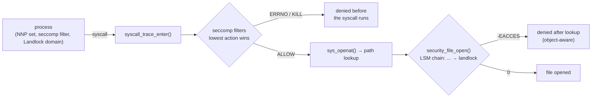

# Note 05 — Isolation: seccomp-BPF, LSM and Landlock

## 1. Summary

- **seccomp-BPF** lets a process attach a small BPF program that the kernel runs on **every syscall entry**; it sees the syscall number and raw arguments and returns allow / errno / trap / notify / kill.
- **LSMs** (Linux Security Modules: SELinux, AppArmor, Yama, BPF-LSM, Landlock …) are hooks deep inside the kernel (`security_file_open()` …) that see **resolved objects** such as files and sockets.
- **Landlock** is the LSM that an **unprivileged** process configures for itself: "from now on, this process tree may only read `/usr` and write `/tmp/x`". Both seccomp and Landlock stack, can only tighten, and need `no_new_privs`.

## 2. Detailed explanation

### Intuition: least privilege after start-up

A PDF renderer needs `open()` for its fonts at start-up, then only `read()`, `write()` and `mmap()` on what it already has. If it is exploited, the attacker inherits every right the process still holds. **Self-sandboxing** means the program drops rights it no longer needs, so a later compromise gets less. This is the attack-surface view of Module 01's syscall boundary: every syscall the process can make is kernel code an attacker can reach.

### seccomp: filter on the syscall boundary

History in brief: *strict mode* (2005) allowed only `read`, `write`, `_exit`, `sigreturn`. *Filter mode* (seccomp-BPF, Linux 3.5) attaches a classic-BPF program:

```c
struct seccomp_data {      /* include/uapi/linux/seccomp.h */
	int   nr;                  /* syscall number */
	__u32 arch;                /* AUDIT_ARCH_* */
	__u64 instruction_pointer;
	__u64 args[6];             /* raw register values */
};
```

The kernel path (walkthrough §5): `syscall_trace_enter()` → `__secure_computing()` → `__seccomp_filter()` → `seccomp_run_filters()` runs **every** attached filter and keeps the **most restrictive** result. Actions, from strongest to weakest:

| Action | Effect |
|---|---|
| `KILL_PROCESS` / `KILL_THREAD` | `SIGSYS`, core dump; the syscall never runs |
| `TRAP` | `SIGSYS` delivered to the thread, handler can emulate |
| `ERRNO(n)` | syscall skipped, returns `-n` |
| `USER_NOTIF` | a supervisor process (via a listener fd) decides — used by container runtimes |
| `TRACE` | ptrace tracer decides |
| `LOG` | allowed, logged |
| `ALLOW` | allowed |

Two rules are enforced by `seccomp_prepare_filter()` and friends:

- **`no_new_privs` or `CAP_SYS_ADMIN`** is required. Otherwise an unprivileged user could install a filter that makes `setuid()` fail inside a setuid-root binary and trick it.
- **Filters are inherited** across `fork()`/`clone()` and `execve()` and can never be removed.

What seccomp **cannot** do: dereference pointers. `openat(AT_FDCWD, "/etc/shadow", ...)` arrives as a pointer value; reading the string would be a time-of-check-to-time-of-use race (another thread rewrites it after the check). So seccomp can say "no `openat` at all" but not "no `openat` of `/etc/shadow`".

### Arch confusion — the classic seccomp bug

On x86-64 a process can also enter via the i386 `int 0x80` ABI, where the syscall numbers are different (e.g. `uname` is 63 in `syscall_64.tbl` but 122 in `syscall_32.tbl`). A filter that checks only `nr` is bypassable. Every correct filter first checks `arch == AUDIT_ARCH_X86_64` (lab 03 `raw-bpf.c` instruction [0]-[1]); libseccomp generates this for you.

### LSM: hooks on objects

The LSM framework (`security/security.c`) puts `security_*()` calls at hundreds of points: `security_file_open()`, `security_socket_connect()`, `security_bprm_check()` … Each enabled LSM registers callbacks (`LSM_HOOK_INIT(file_open, hook_file_open)`); `call_int_hook()` runs them in order and the first error denies. The active list is in `/sys/kernel/security/lsm`. Classic LSMs (SELinux, AppArmor) are **mandatory access control** configured by the administrator.

### Landlock: unprivileged, stackable LSM

Landlock (mainline since 5.13) is the LSM that **any process** can configure for itself, with three syscalls:

1. `landlock_create_ruleset(attr, size, 0)` → fd. `attr.handled_access_fs` says which rights this ruleset **governs** (everything it handles is denied unless a rule grants it).
2. `landlock_add_rule(fd, LANDLOCK_RULE_PATH_BENEATH, {allowed_access, parent_fd}, 0)` grants rights beneath a directory (or `LANDLOCK_RULE_NET_PORT` for TCP bind/connect).
3. `prctl(PR_SET_NO_NEW_PRIVS)` then `landlock_restrict_self(fd, 0)`: the calling thread's credentials get a new **domain** layer (`landlock_merge_ruleset()`).

Checks happen in LSM hooks such as `hook_file_open()` (security/landlock/fs.c L1626): walk from the file up towards the root, collecting rights from each layer; allow only if every layer grants the access.

**ABI versions.** New rights arrive with new ABI numbers. `landlock_create_ruleset(NULL, 0, LANDLOCK_CREATE_RULESET_VERSION)` returns the running kernel's ABI (7 in v6.18.63: `landlock_abi_version` in syscalls.c L164). Programs must **drop rights the kernel does not know**, or `landlock_create_ruleset()` fails with `EINVAL` on older kernels ("best effort" sandboxing).

### seccomp vs Landlock vs namespaces

| Mechanism | Sees | Who configures | Typical use |
|---|---|---|---|
| seccomp-BPF | syscall nr + raw args | the process itself (needs NNP) | reduce kernel attack surface |
| Landlock | files, dirs, TCP ports | the process itself (needs NNP) | restrict what resources the process can reach |
| SELinux / AppArmor | labels / paths, everything | administrator | system-wide MAC |
| namespaces (Module 06) | a different *view* of resources | root or user namespace owner | containers |

## 3. Diagram



## 4. Worked example

Lab 03 (`sandbox.c`, libseccomp) and lab 04 (`landlock-sandbox.c`, raw syscalls), real runs on the VM:

> Captured on aos-lab (VirtualBox on Hyper-V, Ubuntu 24.04, Linux 6.18.63 `PREEMPT_DYNAMIC`, 8 vCPU, shared with other users), 2026-11-15. Your numbers will differ.

```text
$ ./sandbox grep -E "^(NoNewPrivs|Seccomp)" /proc/self/status
NoNewPrivs:	1
Seccomp:	2
Seccomp_filters:	1
$ ./sandbox python3 -c "import socket; socket.socket()"
Traceback (most recent call last):
  ...
PermissionError: [Errno 13] Permission denied
$ ./sandbox mkdir /tmp/seccomp-test; echo "exit=$?"
bash: line 1:  2244 Bad system call         (core dumped) ./sandbox mkdir /tmp/seccomp-test
exit=159
$ ./sandbox strace -f true 2>&1 | tail -2
strace: PTRACE_SETOPTIONS: Operation not permitted
strace: cleanup: waitpid(-1, __WALL): No child processes
$ SANDBOX_DUMP=1 ./sandbox true 2>&1 | head -30
# filter for arch x86_64 (3221225534)
if ($arch == 3221225534)
  # filter for syscall "mkdirat" (258) [priority: 65535]
  if ($syscall == 258)
    action KILL_PROCESS;
  ...
  # filter for syscall "socket" (41) [priority: 65535]
  if ($syscall == 41)
    action ERRNO(13);
  # default action
  action ALLOW;
# invalid architecture action
action KILL;
$ ./raw-bpf
filter loaded: 7 instructions
getpid() = 5367
uname: Operation not permitted
```

> Captured on aos-lab (VirtualBox on Hyper-V, Ubuntu 24.04, Linux 6.18.63 `PREEMPT_DYNAMIC`, 8 vCPU, shared with other users), 2026-11-15. Your numbers will differ.

```text
$ cat /sys/kernel/security/lsm; echo
lockdown,capability,landlock,yama,apparmor,ima,evm
$ ./landlock-sandbox /tmp/ll-rw sh -c '...'
landlock ABI version: 7
write inside: ok
sh: 3: cannot create /tmp/ll-b: Permission denied
write outside: denied
aos-lab
read outside: ok
remove inside: ok
mkdir: cannot create directory ‘/tmp/ll-dir’: Permission denied
mkdir outside: denied
$ ./landlock-sandbox /tmp/ll-rw sh -c 'echo hi 2>/dev/null'; echo "exit=$?"
landlock ABI version: 7
sh: 1: cannot create /dev/null: Permission denied
exit=2
```

Note how the two fail differently: seccomp's `KILL_PROCESS` kills `mkdir` with `SIGSYS` before the syscall runs; Landlock lets `open()` run path lookup and then returns `EACCES` ("Permission denied") from the LSM hook.

## 5. Edge cases & pitfalls

- **Deny-lists age badly.** A filter that blocks `open` but not `openat`, or `clone` but not `clone3`, is bypassed. Prefer allow-lists for untrusted code; return `ENOSYS` (not kill) for unknown syscalls so libc can fall back.
- **Forgetting the arch check** (raw BPF) — see above.
- **libc changes under you.** The libc decides which syscall implements a function: glibc implements `open()` with `openat`, and newer versions prefer `clone3` for threads. Test filters with `strace` on the target distribution.
- **Landlock handles what you name.** Rights not in `handled_access_fs` stay **allowed**. Lab 04 handles only file-system rights; network access is untouched.
- **`/dev/null` is a file too.** Under lab 04's ruleset, `2>/dev/null` fails because writing to `/dev/null` needs `WRITE_FILE` there.
- **Already-open fds are not re-checked.** Both mechanisms restrict future operations; an fd opened before `landlock_restrict_self()` keeps working.
- **Threads.** seccomp and Landlock apply to the calling thread (and its future children). Use `SECCOMP_FILTER_FLAG_TSYNC` to apply a filter to all threads; Landlock in v6.18.63 has no thread-sync flag (`include/uapi/linux/landlock.h` defines only the three `LANDLOCK_RESTRICT_SELF_LOG_*` flags), so restrict **before** creating threads (`VERSION-DEPENDENT`).

## 6. Exam-style key points

- seccomp runs in `syscall_trace_enter()`, after ptrace; filters stack; lowest action wins; inherited across exec.
- Needs `no_new_privs` or `CAP_SYS_ADMIN` (setuid-confusion attack otherwise).
- seccomp sees raw values only (no pointer deref, TOCTOU); always check `arch` first.
- LSM = object hooks (`security_file_open()`); `/sys/kernel/security/lsm` lists active modules.
- Landlock: unprivileged, stackable LSM; `create_ruleset` → `add_rule` → `restrict_self`; ABI 7 in v6.18.63; best-effort for older ABIs.
- seccomp = attack-surface reduction; Landlock = resource access control; combine both.

## 7. Links

- Lesson: [`lesson.en.md` §4.6](../lesson.en.md)
- Walkthrough: [`kernel-walkthrough.en.md` §5, §6 (OpenBSD pledge/unveil)](../kernel-walkthrough.en.md)
- Labs: [`labs/03-seccomp-bpf`](../labs/03-seccomp-bpf/README.md), [`labs/04-landlock`](../labs/04-landlock/README.md)
- Quiz: questions 6, 11, 14 and oral O3 in [`quiz.en.md`](../quiz.en.md)
- Docs: `linux/Documentation/userspace-api/landlock.rst` and `seccomp_filter.rst` are **not** in our sparse checkout (`UNVERIFIED` locally); online at docs.kernel.org/userspace-api/landlock.html
