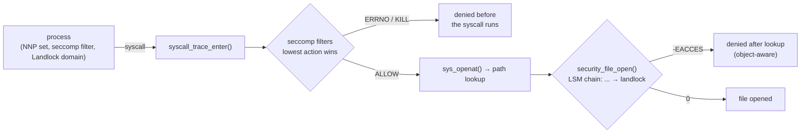

<div dir="rtl">

# یادداشت ۰۵ — جداسازی: ‏seccomp-BPF، ‏LSM و Landlock

## ۱. خلاصه

- **seccomp-BPF** به پردازه اجازه می‌دهد یک برنامهٔ کوچک BPF وصل کند که کرنل آن را روی **ورود هر syscall** اجرا می‌کند؛ شمارهٔ syscall و آرگومان‌های خام را می‌بیند و allow / errno / trap / notify / kill برمی‌گرداند.
- **LSMها** (Linux Security Module: ‏SELinux، AppArmor، Yama، BPF-LSM، Landlock و ...) hookهایی در عمق کرنل‌اند (`security_file_open()` و ...) که **اشیای resolveشده** مثل فایل و socket را می‌بینند.
- **Landlock** آن LSMی است که یک پردازهٔ **بدون امتیاز** برای خودش پیکربندی می‌کند: «از این به بعد این درخت پردازه فقط می‌تواند `/usr` را بخواند و در `/tmp/x` بنویسد». ‏seccomp و Landlock هر دو روی هم جمع می‌شوند، فقط سخت‌تر می‌کنند و `no_new_privs` لازم دارند.

## ۲. توضیح مفصل

### شهود: حداقل امتیاز بعد از راه‌اندازی

یک renderer برای PDF هنگام شروع برای فونت‌هایش `open()` لازم دارد و بعد فقط `read()` و `write()` و `mmap()` روی چیزهایی که دارد. اگر exploit شود، مهاجم هر حقی را که پردازه هنوز دارد به ارث می‌برد. **Self-sandboxing** یعنی برنامه حق‌هایی را که دیگر لازم ندارد کنار بگذارد تا نفوذ بعدی چیز کمتری گیرش بیاید. این همان نگاهِ «سطح حمله» به مرز syscall در ماژول ۰۱ است: هر syscallی که پردازه می‌تواند بزند کد کرنلی است که مهاجم به آن دسترسی دارد.

### ‏seccomp: فیلتر روی مرز syscall

تاریخچهٔ کوتاه: *حالت strict* (۲۰۰۵) فقط `read`، ‏`write`، ‏`_exit` و `sigreturn` را مجاز می‌کرد. *حالت filter* (‏seccomp-BPF) یک برنامهٔ classic BPF وصل می‌کند که روی این ساختار اجرا می‌شود:

</div>

```c
struct seccomp_data {      /* include/uapi/linux/seccomp.h */
	int   nr;                  /* syscall number */
	__u32 arch;                /* AUDIT_ARCH_* */
	__u64 instruction_pointer;
	__u64 args[6];             /* raw register values */
};
```

<div dir="rtl">

مسیر کرنل (گشت کد بخش ۵): ‏`syscall_trace_enter()` ← ‏`__secure_computing()` ← ‏`__seccomp_filter()` ← ‏`seccomp_run_filters()` که **همهٔ** فیلترهای وصل‌شده را اجرا می‌کند و **سخت‌گیرانه‌ترین** نتیجه را نگه می‌دارد. actionها از قوی به ضعیف:

| Action | اثر |
|---|---|
| `KILL_PROCESS` / `KILL_THREAD` | ‏`SIGSYS` و core dump؛ syscall هرگز اجرا نمی‌شود |
| `TRAP` | ‏`SIGSYS` به thread تحویل می‌شود و handler می‌تواند شبیه‌سازی کند |
| `ERRNO(n)` | syscall رد می‌شود و `-n` برمی‌گرداند |
| `USER_NOTIF` | یک پردازهٔ ناظر (از راه یک fd شنونده) تصمیم می‌گیرد؛ runtimeهای container از آن استفاده می‌کنند |
| `TRACE` | tracerِ ptrace تصمیم می‌گیرد |
| `LOG` | مجاز، با ثبت در log |
| `ALLOW` | مجاز |

دو قانون را `seccomp_prepare_filter()` و توابع همراهش اجرا می‌کنند:

- **‏`no_new_privs` یا `CAP_SYS_ADMIN`** لازم است. وگرنه کاربر بی‌امتیاز می‌توانست فیلتری نصب کند که `setuid()` را داخل یک باینری setuid-root شکست دهد و آن را فریب دهد.
- **فیلترها به ارث می‌رسند**؛ در `fork()`/`clone()` و `execve()`، و هرگز حذف‌شدنی نیستند.

آنچه seccomp **نمی‌تواند**: dereference کردن اشاره‌گر. ‏`openat(AT_FDCWD, "/etc/shadow", ...)` به شکل یک مقدار اشاره‌گر می‌رسد؛ خواندن رشته یک race از نوع time-of-check-to-time-of-use است (thread دیگری بعد از بررسی آن را بازنویسی می‌کند). پس seccomp می‌تواند بگوید «اصلاً `openat` نه» ولی نمی‌تواند بگوید «`openat` روی `/etc/shadow` نه».

### اشتباه arch، باگ کلاسیک seccomp

روی x86-64 پردازه می‌تواند از ABIِ ‏i386 با `int 0x80` هم وارد شود که شمارهٔ syscallهایش فرق دارد (مثلاً `uname` در `syscall_64.tbl` شمارهٔ 63 و در `syscall_32.tbl` شمارهٔ 122 است). فیلتری که فقط `nr` را بررسی کند دورزدنی است. هر فیلتر درست اول `arch == AUDIT_ARCH_X86_64` را بررسی می‌کند (دستورهای [0] و [1] در `raw-bpf.c` آزمایش ۰۳)؛ ‏libseccomp این را خودش تولید می‌کند.

### ‏LSM: hook روی اشیا

چارچوب LSM (`security/security.c`) فراخوانی‌های `security_*()` را در صدها نقطه گذاشته: ‏`security_file_open()`، ‏`security_socket_connect()`، ‏`security_bprm_check()` و ... هر LSMِ فعال callbackهایش را ثبت می‌کند (`LSM_HOOK_INIT(file_open, hook_file_open)`)؛ ‏`call_int_hook()` آن‌ها را به ترتیب اجرا می‌کند و اولین خطا یعنی رد. فهرست فعال در `/sys/kernel/security/lsm` است. LSMهای کلاسیک (SELinux، AppArmor) **کنترل دسترسی اجباری** (MAC) هستند که مدیر سیستم پیکربندی می‌کند.

### ‏Landlock: یک LSMِ بدون امتیاز و قابل‌انباشت

‏Landlock همان LSMی است که **هر پردازه‌ای** با سه syscall برای خودش پیکربندی می‌کند:

۱. ‏`landlock_create_ruleset(attr, size, 0)` ← یک fd. ‏`attr.handled_access_fs` می‌گوید این ruleset کدام حق‌ها را **مدیریت** می‌کند (هر چه مدیریت شود رد است مگر قانونی آن را بدهد).
۲. ‏`landlock_add_rule(fd, LANDLOCK_RULE_PATH_BENEATH, {allowed_access, parent_fd}, 0)` حق‌هایی را زیر یک پوشه می‌دهد (یا `LANDLOCK_RULE_NET_PORT` برای bind/connect در TCP).
۳. ‏`prctl(PR_SET_NO_NEW_PRIVS)` و بعد `landlock_restrict_self(fd, 0)`: credentialهای thread فراخواننده یک لایهٔ **domain** تازه می‌گیرند (`landlock_merge_ruleset()`).

بررسی‌ها در hookهای LSM مثل `hook_file_open()` (security/landlock/fs.c خط ۱۶۲۶) انجام می‌شود: از فایل به سمت ریشه بالا می‌رود و حق‌ها را از هر لایه جمع می‌کند؛ فقط اگر همهٔ لایه‌ها اجازه بدهند مجاز است.

**نسخه‌های ABI.** حق‌های جدید با شمارهٔ ABIِ جدید می‌آیند. ‏`landlock_create_ruleset(NULL, 0, LANDLOCK_CREATE_RULESET_VERSION)` ‏ABIِ کرنل در حال اجرا را برمی‌گرداند (در v6.18.63 برابر ۷: ‏`landlock_abi_version` در syscalls.c خط ۱۶۴). برنامه‌ها باید **حق‌هایی را که کرنل نمی‌شناسد حذف کنند**، وگرنه `landlock_create_ruleset()` روی کرنل قدیمی‌تر با `EINVAL` شکست می‌خورد (sandboxing از نوع «best effort»).

### ‏seccomp در برابر Landlock در برابر namespace

| سازوکار | چه می‌بیند | چه کسی پیکربندی می‌کند | کاربرد معمول |
|---|---|---|---|
| seccomp-BPF | شمارهٔ syscall و آرگومان خام | خود پردازه (با NNP) | کوچک کردن سطح حملهٔ کرنل |
| Landlock | فایل، پوشه، پورت TCP | خود پردازه (با NNP) | محدود کردن منابعی که پردازه به آن‌ها می‌رسد |
| SELinux / AppArmor | برچسب یا مسیر، همه چیز | مدیر سیستم | MACِ کل سیستم |
| namespace (ماژول ۰۶) | *نمای* متفاوتی از منابع | root یا صاحب user namespace | containerها |

## ۳. نمودار

</div>



<div dir="rtl">

## ۴. مثال کاربردی

آزمایش ۰۳ (`sandbox.c` با libseccomp) و آزمایش ۰۴ (`landlock-sandbox.c` با syscallهای خام)، اجرای واقعی روی VM:

</div>

> گرفته‌شده روی aos-lab (‏VirtualBox روی Hyper-V، ‏Ubuntu 24.04، ‏Linux 6.18.63 با `PREEMPT_DYNAMIC`، ‏۸ vCPU، مشترک با کاربران دیگر)، ۲۰۲۶-۱۱-۱۵. عددهای شما فرق خواهد کرد.

```text
$ ./sandbox grep -E "^(NoNewPrivs|Seccomp)" /proc/self/status
NoNewPrivs:	1
Seccomp:	2
Seccomp_filters:	1
$ ./sandbox python3 -c "import socket; socket.socket()"
Traceback (most recent call last):
  ...
PermissionError: [Errno 13] Permission denied
$ ./sandbox mkdir /tmp/seccomp-test; echo "exit=$?"
bash: line 1:  2244 Bad system call         (core dumped) ./sandbox mkdir /tmp/seccomp-test
exit=159
$ ./sandbox strace -f true 2>&1 | tail -2
strace: PTRACE_SETOPTIONS: Operation not permitted
strace: cleanup: waitpid(-1, __WALL): No child processes
$ SANDBOX_DUMP=1 ./sandbox true 2>&1 | head -30
# filter for arch x86_64 (3221225534)
if ($arch == 3221225534)
  # filter for syscall "mkdirat" (258) [priority: 65535]
  if ($syscall == 258)
    action KILL_PROCESS;
  ...
  # filter for syscall "socket" (41) [priority: 65535]
  if ($syscall == 41)
    action ERRNO(13);
  # default action
  action ALLOW;
# invalid architecture action
action KILL;
$ ./raw-bpf
filter loaded: 7 instructions
getpid() = 5367
uname: Operation not permitted
```

> گرفته‌شده روی aos-lab (‏VirtualBox روی Hyper-V، ‏Ubuntu 24.04، ‏Linux 6.18.63 با `PREEMPT_DYNAMIC`، ‏۸ vCPU، مشترک با کاربران دیگر)، ۲۰۲۶-۱۱-۱۵. عددهای شما فرق خواهد کرد.

```text
$ cat /sys/kernel/security/lsm; echo
lockdown,capability,landlock,yama,apparmor,ima,evm
$ ./landlock-sandbox /tmp/ll-rw sh -c '...'
landlock ABI version: 7
write inside: ok
sh: 3: cannot create /tmp/ll-b: Permission denied
write outside: denied
aos-lab
read outside: ok
remove inside: ok
mkdir: cannot create directory ‘/tmp/ll-dir’: Permission denied
mkdir outside: denied
$ ./landlock-sandbox /tmp/ll-rw sh -c 'echo hi 2>/dev/null'; echo "exit=$?"
landlock ABI version: 7
sh: 1: cannot create /dev/null: Permission denied
exit=2
```

<div dir="rtl">

دقت کنید که این دو چطور متفاوت شکست می‌خورند: ‏`KILL_PROCESS`ِ seccomp پیش از اجرای syscall، ‏`mkdir` را با `SIGSYS` می‌کشد؛ ‏Landlock اجازه می‌دهد `open()` جستجوی مسیر را انجام دهد و بعد از hookِ LSM خطای `EACCES` («Permission denied») برمی‌گرداند.

## ۵. حالت‌های خاص و دام‌ها

- **فهرست‌های ممنوعه (deny-list) بد پیر می‌شوند.** فیلتری که `open` را می‌بندد ولی `openat` را نه، یا `clone` را ولی `clone3` را نه، دور زده می‌شود. برای کد نامطمئن allow-list را ترجیح دهید؛ برای syscallهای ناشناخته `ENOSYS` برگردانید (نه kill) تا libc بتواند راه جایگزین برود.
- **فراموش کردن بررسی arch** (در BPF خام)؛ بالا را ببینید.
- **libc زیر پای شما عوض می‌شود.** libc تصمیم می‌گیرد کدام syscall یک تابع را پیاده کند: ‏glibc تابع `open()` را با `openat` پیاده می‌کند و نسخه‌های جدیدتر برای threadها `clone3` را ترجیح می‌دهند. فیلترها را با `strace` روی توزیع مقصد آزمایش کنید.
- **Landlock فقط چیزی را که نام ببرید مدیریت می‌کند.** حق‌هایی که در `handled_access_fs` نیستند **مجاز** می‌مانند. آزمایش ۰۴ فقط حق‌های فایل‌سیستم را مدیریت می‌کند و شبکه دست‌نخورده است.
- **‏`/dev/null` هم فایل است.** با ruleset آزمایش ۰۴، ‏`2>/dev/null` شکست می‌خورد چون نوشتن در `/dev/null` آنجا حق `WRITE_FILE` می‌خواهد.
- **fdهای از قبل باز دوباره بررسی نمی‌شوند.** هر دو سازوکار عملیات آینده را محدود می‌کنند؛ fdی که پیش از `landlock_restrict_self()` باز شده کار می‌کند.
- **threadها.** ‏seccomp و Landlock روی thread فراخواننده (و فرزندان آینده‌اش) اعمال می‌شوند. برای اعمال فیلتر روی همهٔ threadها از `SECCOMP_FILTER_FLAG_TSYNC` استفاده کنید؛ ‏Landlock در v6.18.63 پرچم هم‌گام‌سازی thread ندارد (`include/uapi/linux/landlock.h` فقط سه پرچم `LANDLOCK_RESTRICT_SELF_LOG_*` را تعریف می‌کند)، پس **پیش از** ساختن threadها محدود کنید (`VERSION-DEPENDENT`).

## ۶. نکته‌های کلیدی امتحانی

- seccomp در `syscall_trace_enter()` و بعد از ptrace اجرا می‌شود؛ فیلترها روی هم جمع می‌شوند؛ کمترین action برنده است؛ در exec به ارث می‌رسد.
- ‏`no_new_privs` یا `CAP_SYS_ADMIN` لازم است (وگرنه حملهٔ گیج‌کردن setuid).
- seccomp فقط مقدار خام را می‌بیند (بدون dereference اشاره‌گر، TOCTOU)؛ همیشه اول `arch` را بررسی کنید.
- LSM = hook روی اشیا (`security_file_open()`)؛ ‏`/sys/kernel/security/lsm` ماژول‌های فعال را فهرست می‌کند.
- Landlock: ‏LSMِ بدون امتیاز و قابل‌انباشت؛ ‏`create_ruleset` ← ‏`add_rule` ← ‏`restrict_self`؛ ‏ABI ۷ در v6.18.63؛ برای ABIهای قدیمی‌تر best-effort.
- seccomp = کوچک کردن سطح حمله؛ Landlock = کنترل دسترسی به منابع؛ هر دو را ترکیب کنید.

## ۷. پیوندها

- درس: [`lesson.fa.md` بخش ۴.۶](../lesson.fa.md)
- گشت کد: [`kernel-walkthrough.fa.md` بخش ۵ و ۶ (pledge/unveil در OpenBSD)](../kernel-walkthrough.fa.md)
- آزمایش‌ها: [`labs/03-seccomp-bpf`](../labs/03-seccomp-bpf/README.md) و [`labs/04-landlock`](../labs/04-landlock/README.md)
- آزمون: پرسش‌های ۶، ۱۱ و ۱۴ و پرسش شفاهی O3 در [`quiz.fa.md`](../quiz.fa.md)
- مستندات: ‏`linux/Documentation/userspace-api/landlock.rst` و `seccomp_filter.rst` در sparse checkout ما **نیستند** (به‌صورت محلی `UNVERIFIED`)؛ نسخهٔ آنلاین: docs.kernel.org/userspace-api/landlock.html

</div>
