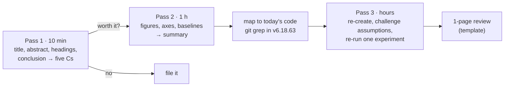

# Note 06 — How to read an OS research paper

## 1. Summary

- Read a paper in **three passes** (Keshav 2007): 5–10 minutes for the shape, about an hour for the content, several hours to reconstruct the work. Most papers only deserve the first pass.
- An OS paper is a claim + evidence: *what problem, what insight, what mechanism, what evaluation, what limits*. Your review must name each one in a sentence.
- For a systems paper, the strongest check is to **map it onto today's code**: find the functions it changed in the current kernel, and test whether the claim still holds.

## 2. Detailed explanation

### Why OS papers are hard to read

They are written for program committees: dense, full of context ("as Corey showed…"), and the evaluation is a set of graphs whose axes matter more than their titles. They also age: a 2010 Linux paper describes a kernel that no longer exists. Reading well means extracting the **durable idea** and checking it against the present.

### The three-pass method (S. Keshav, "How to Read a Paper", ACM SIGCOMM CCR 37(3), 2007)

| Pass | Time | Read | Output: answer the "five Cs" |
|---|---|---|---|
| 1 | 5–10 min | title, abstract, intro, section headings, conclusion, glance at references and figures | **C**ategory (measurement? new system? analysis?), **C**ontext (related work it builds on), **C**orrectness (do the assumptions look valid?), **C**ontributions, **C**larity |
| 2 | ~1 h | whole paper, carefully; figures and axes; skip proofs | a summary you could explain to a colleague; list of unread references to look up |
| 3 | 4–5 h (beginner) | re-create the work: "if I had to build this, how?"; challenge every assumption | hidden assumptions, missing experiments, ideas for follow-up work |

### What to extract from an OS paper (the review template)

Use [`labs/05-paper-review/review-template.md`](../labs/05-paper-review/review-template.md). One page, these headings:

1. **Problem**: one sentence. What breaks, for whom, how badly (numbers).
2. **Insight**: the one idea that makes the solution possible. If you cannot find one sentence, the paper may be an engineering report.
3. **Mechanism**: what they changed or built, at the level of kernel subsystems and data structures.
4. **Evaluation**: hardware, workloads, baselines, metrics. Does the evaluation test the claim, or something easier?
5. **Limits / threats to validity**: what was not measured; would it hold on other hardware, a newer kernel, a VM?
6. **Today**: where is this code in v6.18.63? Was the fix merged, replaced, or made obsolete?
7. **Your verdict + one question** you would ask the authors.

### Reading the evaluation section

- Read **axes and units first**. "Throughput (normalized)" hides absolute numbers; a log scale hides collapse.
- Find the **baseline**. Better than what? A stock kernel of which version, configured how?
- Look for **variance**: error bars, number of runs. One run on one machine is an anecdote.
- Ask what the **workload** stresses. A tmpfs benchmark (as in the OSDI '10 paper) removes disk I/O on purpose: legitimate, but it limits the claim.

### The two papers of lab 05 (both confirmed by search on 2026-11-15)

| | *An Analysis of Linux Scalability to Many Cores* | *The Linux Scheduler: a Decade of Wasted Cores* |
|---|---|---|
| Venue | OSDI '10 (USENIX), Vancouver | EuroSys '16 (ACM), London |
| Authors | Boyd-Wickizer, Clements, Mao, Pesterev, Kaashoek, Morris, Zeldovich (MIT CSAIL) | Lozi, Lepers, Funston, Gaud, Quéma, Fedorova |
| Link | <https://www.usenix.org/conference/osdi10/analysis-linux-scalability-many-cores> (PDF: `.../legacy/events/osdi10/tech/full_papers/Boyd-Wickizer.pdf`) | <https://people.ece.ubc.ca/~sasha/papers/eurosys16-final29.pdf>; code: <https://github.com/jplozi/wastedcores> |
| Claim (from the abstract) | 7 apps (Exim, memcached, Apache, PostgreSQL, gmake, Psearchy, MapReduce) on 48 cores; all but gmake hit kernel bottlenecks; fixed with standard techniques plus *sloppy counters*, 3002 lines of kernel changes; "no scalability reason to give up on traditional operating system organizations just yet" | the invariant "ready threads are scheduled on available cores" is often broken; cores idle for seconds; four bugs (Group Imbalance, Scheduling Group Construction, Overload-on-Wakeup, Missing Scheduling Domains); "many-fold" slowdowns for synchronization-heavy scientific apps, 13 % higher kernel-make latency, 14–23 % lower TPC-H throughput |
| Kernel studied | 2.6.35-rc5 | 3.17 – 4.3 (CFS era) |
| Kernel area | VFS (dentry refcounts, mount table, `lseek` inode mutex), networking | `kernel/sched/fair.c` load balancing, scheduling domains/groups (`kernel/sched/topology.c`) |

Both are **monolithic-kernel defenses** with a twist: the first says "the design scales if you fix the details", the second says "the details are where the bugs are, and normal testing doesn't find them".

## 3. Diagram



## 4. Worked example: mapping a 2016 paper onto v6.18.63

The Wasted Cores bugs live in the CFS load balancer of Linux 4.x. Ten years later, CFS has been replaced by EEVDF for task selection (Module 02), and the balancer functions have been renamed. Find them in our tree:

```text
$ git -C _shared/sources/linux grep -n "^static int sched_balance_rq" kernel/sched/fair.c
kernel/sched/fair.c:12052:static int sched_balance_rq(int this_cpu, struct rq *this_rq,

linux/kernel/sched/fair.c · sched_balance_rq() · v6.18.63 · L12052-12057
12052  static int sched_balance_rq(int this_cpu, struct rq *this_rq,
12053  			struct sched_domain *sd, enum cpu_idle_type idle,
12054  			int *continue_balancing)
12055  {
12056  	int ld_moved, cur_ld_moved, active_balance = 0;
12057  	struct sched_domain *sd_parent = sd->parent;
```

`sched_balance_rq()` (called `load_balance()` in older kernels — `UNVERIFIED` here, check with `git log -S` in a blob-less clone) still balances **per scheduling domain** (`struct sched_domain *sd`), and the "busiest group" choice the Group Imbalance bug was about is now `update_sd_pick_busiest()` (fair.c L10740) inside `sched_balance_find_src_group()` (L11596). The structure the paper criticized is still there; whether each bug is fixed is a pass-3 question (lab 05 extension).

Same exercise for the OSDI '10 paper: its sloppy counters were proposed for dentry reference counts. Today `struct dentry` uses `struct lockref d_lockref` (`include/linux/dcache.h` L113, `lib/lockref.c`), a lock+count updated with one `cmpxchg` — a different fix for the same bottleneck. Per-CPU counters in the sloppy-counter spirit exist as `lib/percpu_counter.c`.

## 5. Edge cases & pitfalls

- **Reading linearly from page 1.** Do pass 1 first; many papers stop there.
- **Trusting the abstract's numbers out of context.** "138×" in one corner case is not "Linux is 138× slower".
- **Ignoring the date.** Kernel papers describe a specific version; check the code you run.
- **Confusing evaluation with proof.** A benchmark shows the claim on *their* hardware; a 48-core AMD box of 2010 is not today's chiplet server.
- **Reviewing the writing instead of the work.** Clarity matters, but the review is about problem, insight and evidence.
- **Not stating your own question.** A review without one question means you have not reached pass 2.

## 6. Exam-style key points

- Three passes: 5–10 min (five Cs), ~1 h (summary, figures), hours (re-create, challenge).
- Five Cs: category, context, correctness, contributions, clarity.
- Review = problem, insight, mechanism, evaluation, limits, today, verdict + question.
- Evaluation checklist: axes/units, baseline, variance, what the workload stresses.
- OSDI '10: 48 cores, MOSBENCH, sloppy counters, 3002 LOC, traditional kernels can scale.
- EuroSys '16: work-conservation invariant broken, four load-balancer bugs, sanity checker + visualizer, Linux 3.17–4.3.

## 7. Links

- Lesson: [`lesson.en.md` §4.7](../lesson.en.md)
- Lab: [`labs/05-paper-review`](../labs/05-paper-review/README.md)
- Quiz: question 15 and oral questions in [`quiz.en.md`](../quiz.en.md)
- Videos: entry 11 in [`videos.md`](../videos.md)
