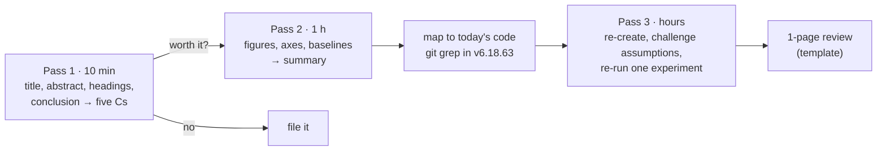

<div dir="rtl">

# یادداشت ۰۶ — چطور یک مقالهٔ پژوهشی سیستم‌عامل بخوانیم

## ۱. خلاصه

- مقاله را در **سه گذر** بخوانید (Keshav، ۲۰۰۷): ۵ تا ۱۰ دقیقه برای شکل کلی، حدود یک ساعت برای محتوا، چند ساعت برای بازسازی کار. بیشتر مقاله‌ها فقط ارزش گذر اول را دارند.
- مقالهٔ سیستم‌عامل یک ادعا به‌اضافهٔ شاهد است: *چه مسئله‌ای، چه بینشی، چه سازوکاری، چه ارزیابی‌ای، چه محدودیت‌هایی*. داوری شما باید هر کدام را در یک جمله نام ببرد.
- برای مقالهٔ سیستمی، قوی‌ترین بررسی **نگاشت آن روی کد امروز** است: توابعی را که تغییر داده در کرنل فعلی پیدا کنید و ببینید ادعا هنوز برقرار است یا نه.

## ۲. توضیح مفصل

### چرا خواندن مقاله‌های سیستم‌عامل سخت است

این مقاله‌ها برای کمیتهٔ داوری نوشته شده‌اند: فشرده، پر از زمینه («همان‌طور که Corey نشان داد...»)، و ارزیابی‌شان مجموعه‌ای از نمودار است که محورهایش از عنوانشان مهم‌ترند. کهنه هم می‌شوند: مقالهٔ لینوکسی سال ۲۰۱۰ کرنلی را توصیف می‌کند که دیگر وجود ندارد. خوب خواندن یعنی بیرون کشیدن **ایدهٔ ماندگار** و سنجیدن آن با امروز.

### روش سه‌گذره (S. Keshav، «How to Read a Paper»، ‏ACM SIGCOMM CCR جلد ۳۷ شمارهٔ ۳، ۲۰۰۷)

| گذر | زمان | چه بخوانید | خروجی: جواب «پنج C» |
|---|---|---|---|
| ۱ | ۵ تا ۱۰ دقیقه | عنوان، چکیده، مقدمه، عنوان بخش‌ها، نتیجه‌گیری، نگاهی به مراجع و شکل‌ها | **C**ategory (اندازه‌گیری؟ سیستم جدید؟ تحلیل؟)، **C**ontext (روی چه کارهایی بنا شده)، **C**orrectness (فرض‌ها معتبر به نظر می‌رسند؟)، **C**ontributions (سهم‌ها)، **C**larity (وضوح) |
| ۲ | حدود ۱ ساعت | کل مقاله با دقت؛ شکل‌ها و محورها؛ اثبات‌ها را رد کنید | خلاصه‌ای که بتوانید برای همکار توضیح دهید؛ فهرست مراجع خوانده‌نشده برای پیگیری |
| ۳ | ۴ تا ۵ ساعت (برای تازه‌کار) | کار را بازسازی کنید: «اگر باید این را می‌ساختم، چطور؟»؛ هر فرضی را به چالش بکشید | فرض‌های پنهان، آزمایش‌های جاافتاده، ایده برای کار بعدی |

### از یک مقالهٔ سیستم‌عامل چه بیرون بکشید (قالب داوری)

از [`labs/05-paper-review/review-template.md`](../labs/05-paper-review/review-template.md) استفاده کنید. یک صفحه با این عنوان‌ها:

۱. **مسئله**: یک جمله. چه چیزی خراب است، برای چه کسی، چقدر بد (با عدد).
۲. **بینش**: همان یک ایده‌ای که راه‌حل را ممکن می‌کند. اگر یک جمله پیدا نمی‌کنید، شاید مقاله یک گزارش مهندسی باشد.
۳. **سازوکار**: چه چیزی را عوض کردند یا ساختند، در سطح زیرسیستم‌های کرنل و ساختمان داده‌ها.
۴. **ارزیابی**: سخت‌افزار، بار کاری، مبنا (baseline)، معیار. ارزیابی خود ادعا را می‌آزماید یا چیزی آسان‌تر را؟
۵. **محدودیت‌ها و تهدیدهای اعتبار**: چه چیزی اندازه‌گیری نشده؛ روی سخت‌افزار دیگر، کرنل جدیدتر یا VM برقرار است؟
۶. **امروز**: این کد در v6.18.63 کجاست؟ merge شد، جایگزین شد یا منسوخ شد؟
۷. **نظر نهایی + یک پرسش** که از نویسندگان می‌پرسید.

### خواندن بخش ارزیابی

- **محورها و واحدها را اول بخوانید.** «Throughput (normalized)» عدد مطلق را پنهان می‌کند؛ مقیاس لگاریتمی فروپاشی را پنهان می‌کند.
- **مبنا** را پیدا کنید. بهتر از چه؟ کرنل استانداردِ کدام نسخه، با چه پیکربندی؟
- دنبال **پراکندگی** بگردید: میلهٔ خطا، تعداد اجرا. یک اجرا روی یک ماشین فقط یک حکایت است.
- بپرسید **بار کاری** چه چیزی را تحت فشار می‌گذارد. benchmark روی tmpfs (مثل مقالهٔ OSDI '10) عمداً I/O دیسک را حذف می‌کند: مشروع است، ولی ادعا را محدود می‌کند.

### دو مقالهٔ آزمایش ۰۵ (هر دو با جستجو در ۲۰۲۶-۱۱-۱۵ تأیید شدند)

| | *An Analysis of Linux Scalability to Many Cores* | *The Linux Scheduler: a Decade of Wasted Cores* |
|---|---|---|
| محل انتشار | ‏OSDI '10 (USENIX)، ونکوور | ‏EuroSys '16 (ACM)، لندن |
| نویسندگان | Boyd-Wickizer، Clements، Mao، Pesterev، Kaashoek، Morris، Zeldovich (MIT CSAIL) | Lozi، Lepers، Funston، Gaud، Quéma، Fedorova |
| پیوند | <https://www.usenix.org/conference/osdi10/analysis-linux-scalability-many-cores> (PDF: ‏`.../legacy/events/osdi10/tech/full_papers/Boyd-Wickizer.pdf`) | <https://people.ece.ubc.ca/~sasha/papers/eurosys16-final29.pdf>؛ کد: <https://github.com/jplozi/wastedcores> |
| ادعا (از چکیده) | ۷ برنامه (Exim، memcached، Apache، PostgreSQL، gmake، Psearchy، MapReduce) روی ۴۸ هسته؛ همه جز gmake به گلوگاه‌های کرنل می‌خورند؛ با تکنیک‌های استاندارد و *sloppy counter* و ۳۰۰۲ خط تغییر در کرنل برطرف شدند؛ «no scalability reason to give up on traditional operating system organizations just yet» | این ناوردا که «ready threads are scheduled on available cores» اغلب شکسته می‌شود؛ هسته‌ها چند ثانیه بیکار می‌مانند؛ چهار باگ (Group Imbalance، ‏Scheduling Group Construction، ‏Overload-on-Wakeup، ‏Missing Scheduling Domains)؛ کندی «چندبرابری» برای برنامه‌های علمیِ پرهمگام‌سازی، ۱۳٪ latency بیشتر برای make کرنل، ۱۴ تا ۲۳٪ کاهش توان TPC-H |
| کرنل مطالعه‌شده | 2.6.35-rc5 | ‏3.17 تا 4.3 (دوران CFS) |
| بخش کرنل | ‏VFS (شمارش ارجاع dentry، جدول mount، ‏mutexِ inode در `lseek`)، شبکه | ‏load balancing در `kernel/sched/fair.c`، دامنه‌ها و گروه‌های زمان‌بندی (`kernel/sched/topology.c`) |

هر دو **دفاع از کرنل یکپارچه**اند، با یک پیچ: اولی می‌گوید «طراحی مقیاس‌پذیر است اگر جزئیات را درست کنید»، دومی می‌گوید «باگ‌ها در همان جزئیات‌اند و آزمون معمولی پیدایشان نمی‌کند».

## ۳. نمودار

</div>



<div dir="rtl">

## ۴. مثال کاربردی: نگاشت یک مقالهٔ ۲۰۱۶ روی v6.18.63

باگ‌های Wasted Cores در load balancerِ CFS در لینوکس 4.x هستند. ده سال بعد، EEVDF جای CFS را در انتخاب task گرفته (ماژول ۰۲) و نام توابع balancer عوض شده است. آن‌ها را در درخت خودمان پیدا کنید:

</div>

```text
$ git -C _shared/sources/linux grep -n "^static int sched_balance_rq" kernel/sched/fair.c
kernel/sched/fair.c:12052:static int sched_balance_rq(int this_cpu, struct rq *this_rq,

linux/kernel/sched/fair.c · sched_balance_rq() · v6.18.63 · L12052-12057
12052  static int sched_balance_rq(int this_cpu, struct rq *this_rq,
12053  			struct sched_domain *sd, enum cpu_idle_type idle,
12054  			int *continue_balancing)
12055  {
12056  	int ld_moved, cur_ld_moved, active_balance = 0;
12057  	struct sched_domain *sd_parent = sd->parent;
```

<div dir="rtl">

‏`sched_balance_rq()` (که در کرنل‌های قدیمی‌تر `load_balance()` نام داشت؛ اینجا `UNVERIFIED`، با `git log -S` در یک clone بدون blob بررسی کنید) هنوز **برای هر دامنهٔ زمان‌بندی** (`struct sched_domain *sd`) توازن برقرار می‌کند، و انتخاب «شلوغ‌ترین گروه» که باگ Group Imbalance دربارهٔ آن بود حالا `update_sd_pick_busiest()` است (fair.c خط ۱۰۷۴۰) داخل `sched_balance_find_src_group()` (خط ۱۱۵۹۶). ساختاری که مقاله نقدش کرد هنوز هست؛ اینکه هر باگ درست شده یا نه پرسشِ گذر سوم است (تمرین تکمیلی آزمایش ۰۵).

همین تمرین برای مقالهٔ OSDI '10: ‏sloppy counterهای آن برای شمارش ارجاع dentry پیشنهاد شدند. امروز `struct dentry` از `struct lockref d_lockref` استفاده می‌کند (`include/linux/dcache.h` خط ۱۱۳ و `lib/lockref.c`)، یعنی قفل و شمارنده که با یک `cmpxchg` به‌روز می‌شوند؛ راه‌حلی متفاوت برای همان گلوگاه. شمارنده‌های per-CPU به روح sloppy counter در `lib/percpu_counter.c` وجود دارند.

## ۵. حالت‌های خاص و دام‌ها

- **خواندن خطی از صفحهٔ ۱.** اول گذر ۱ را انجام دهید؛ خیلی از مقاله‌ها همان‌جا تمام می‌شوند.
- **اعتماد به عددهای چکیده بیرون از زمینه.** «۱۳۸ برابر» در یک حالت گوشه‌ای یعنی «لینوکس ۱۳۸ برابر کندتر است» نیست.
- **نادیده گرفتن تاریخ.** مقاله‌های کرنل یک نسخهٔ خاص را توصیف می‌کنند؛ کدی را که اجرا می‌کنید بررسی کنید.
- **یکی گرفتن ارزیابی با اثبات.** benchmark ادعا را روی سخت‌افزار *آن‌ها* نشان می‌دهد؛ جعبهٔ ۴۸ هسته‌ای AMD سال ۲۰۱۰ سرور chiplet امروزی نیست.
- **داوری نوشتن به‌جای داوری کار.** وضوح مهم است، ولی داوری دربارهٔ مسئله، بینش و شاهد است.
- **نپرسیدن پرسش خودتان.** داوری بدون یک پرسش یعنی هنوز به گذر ۲ نرسیده‌اید.

## ۶. نکته‌های کلیدی امتحانی

- سه گذر: ۵ تا ۱۰ دقیقه (پنج C)، حدود ۱ ساعت (خلاصه، شکل‌ها)، چند ساعت (بازسازی، به چالش کشیدن).
- پنج C: ‏category، ‏context، ‏correctness، ‏contributions، ‏clarity.
- داوری = مسئله، بینش، سازوکار، ارزیابی، محدودیت‌ها، امروز، نظر نهایی + پرسش.
- فهرست بررسی ارزیابی: محورها و واحدها، مبنا، پراکندگی، اینکه بار کاری چه چیزی را فشار می‌دهد.
- ‏OSDI '10: ‏۴۸ هسته، MOSBENCH، ‏sloppy counter، ‏۳۰۰۲ خط کد، کرنل سنتی می‌تواند مقیاس‌پذیر باشد.
- ‏EuroSys '16: ناوردای work-conservation شکسته می‌شود، چهار باگ در load balancer، ‏sanity checker و ابزار نمایش، لینوکس 3.17 تا 4.3.

## ۷. پیوندها

- درس: [`lesson.fa.md` بخش ۴.۷](../lesson.fa.md)
- آزمایش: [`labs/05-paper-review`](../labs/05-paper-review/README.md)
- آزمون: پرسش ۱۵ و پرسش‌های شفاهی در [`quiz.fa.md`](../quiz.fa.md)
- ویدیو: مورد ۱۱ در [`videos.md`](../videos.md)

</div>
