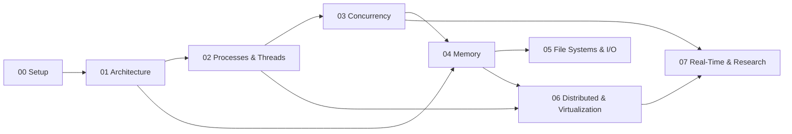

# PLAN — Advanced Operating Systems (Term 1)

> Phase 0 output. **Status: approved 2026-11-15** (defaults: no syllabus yet, libvirt/virt-install, kernel build in VM = yes).
> Progress (2026-11-15): ✅ `00-setup` · ✅ 01 · ✅ 02 · ✅ 03 · ✅ 04 · ✅ 05 · ✅ 06 · ✅ 07 · ✅ `STUDY-SCHEDULE` · ✅ `CHEATSHEET`.
> Test machine: VirtualBox VM `aos-lab` (Ubuntu 24.04 + mainline **6.18.63**, 8 vCPU, no PMU counters, no nested KVM). Lab outputs in READMEs and decks were captured there; see each module's README for exceptions marked `UNVERIFIED`.
> Changes against this plan made during the build are listed in each module's `slides/outline.md` / lab READMEs. The main ones:
> - M04 lab 4 uses timing instead of PMU counters, and M04 lab 5 creates 200k files instead of 1M.
> - M06 lab 5 measures VM-exit cost from inside a guest (`perf kvm stat` moved to the extension).
> - M07 has 5 labs: seccomp and Landlock are separate.
> - OpenBSD `sys/dev/vmm` exists in the checkout (no longer `UNVERIFIED`).
> Pins: Linux **v6.18.63** (`_shared/sources/linux/`), OpenBSD **`8cada8c`** (`_shared/sources/openbsd/`). Arch: **x86-64**.
> Every file/function named here was checked with `grep` in the local checkout on 2026-11-15, except entries marked `UNVERIFIED`.

## 0. Assumptions

| Item | Assumption | Change it if… |
|---|---|---|
| Lab machine | Your Ubuntu server for user-space labs. A **QEMU/KVM or Multipass VM** on it for kernel-module, `PREEMPT_RT`, cgroup-breaking, and OOM labs | you'd rather use a local VM on Windows (WSL2 works for most user-space labs, but not for `perf sched` or module loading) |
| Kernel on the server | Whatever Ubuntu ships. Labs that need **exactly** v6.18 (reading `/sys/kernel/debug/sched/`, new tracepoints) say so and run in the VM with a self-built v6.18.63 | — |
| Languages | C for nearly everything; Go in M2/M3 (goroutines vs threads, channels); Rust in M3 for one atomics lab | — |
| Pace | ~110 h total; one module ≈ 1.5–2 weeks at 60–90 min/day | the semester calendar says otherwise; tell me the exam date |
| Exam style | Azad written + oral; every quiz ends with 2–3 oral-exam questions | your professor's syllabus differs; send it and I'll remap modules |

## 1. Module order, dependencies, hours

| # | Module | Depends on | Lesson + notes | Labs | Total h |
|---|---|---|---|---|---|
| 00 | Setup | — | 1 | 3 | 4 |
| 01 | Architecture & Kernel Structure | 00 | 6 | 7 | 13 |
| 02 | Processes & Threads | 01 | 7 | 9 | 16 |
| 03 | Concurrency & Synchronization | 02 | 8 | 10 | 18 |
| 04 | Memory Management | 01, 03 | 8 | 10 | 18 |
| 05 | File Systems & I/O | 04 | 7 | 9 | 16 |
| 06 | Distributed OS & Virtualization | 02, 04 | 6 | 8 | 14 |
| 07 | Real-Time & Research | 03, 06 | 5 | 6 | 11 |
| | **Total** | | **48** | **62** | **~110** |

Deliverable count: ~60 notes × 2 languages, 36 labs, **14 lesson decks + 72 lab decks** (EN + FA each), 7 quizzes × 2, 7 `videos.md`.

---

## 00-setup (4 h)

- **Labs:** (a) Create the VM (Multipass or `virt-install`), with snapshot and serial console. (b) Install the tool set (`strace ltrace perf bpftrace bcc ftrace gdb valgrind lsof sysstat numactl`) plus `trace-cmd`; check that `perf` matches the running kernel. (c) Build v6.18.63 from the local sparse checkout? **No:** the sparse set lacks `drivers/` and `scripts/`. The VM gets a **separate full shallow clone** of the same tag.
- **Code navigation:** `ctags`/`cscope` over the sparse checkout, `git grep` recipes, Elixir links, and the citation format.
- **Theme:** build `_shared/theme/azad-theme.css` once (design system §4–7, §12), plus a reveal.js starter (§15.1) that every deck reuses.

## 01 — Architecture & Kernel Structure (13 h)

- **Notes (6):**
  1. kernel types (monolithic/micro/hybrid/exokernel)
  2. privilege rings & `CPL`
  3. interrupts vs exceptions vs traps (IDT)
  4. the `syscall` instruction path
  5. context switch (registers, stacks, `CR3`)
  6. Linux source tree map
- **Walkthrough (Linux):**
  - `arch/x86/entry/entry_64.S` (`entry_SYSCALL_64`)
  - `arch/x86/entry/syscall_64.c` (`do_syscall_64()`, line 87)
  - `arch/x86/entry/syscalls/syscall_64.tbl`
  - `kernel/irq/handle.c`
  - `arch/x86/kernel/process_64.c` (`__switch_to`)
- **OpenBSD comparison:** `sys/kern/syscalls.master` vs `syscall_64.tbl`; `sys/arch/amd64/amd64/locore.S` + `trap.c` vs `entry_64.S`.
- **Labs (5):**
  1. `strace -f cat` → map every syscall to a kernel entry
  2. raw `syscall()` in C with inline asm vs libc wrapper (timed)
  3. count interrupts from `/proc/interrupts` + `perf stat -e irq:*`
  4. measure syscall cost (`getpid` loop, `vDSO` `clock_gettime` vs real syscall)
  5. `ftrace` function_graph of `vfs_read`
- **Lesson deck layouts:** `LAYER_STACK` (user/kernel), `FLOW_TIMELINE` (syscall path).

## 02 — Processes & Threads (16 h)

- **Notes (8):**
  1. `task_struct` anatomy
  2. `fork`/`vfork`/`clone` flags
  3. `execve` and ELF loading
  4. process states & `wait`
  5. threads = tasks sharing an `mm`
  6. scheduling classes (`stop/dl/rt/fair/ext/idle`)
  7. **EEVDF** (replaced CFS in 6.6; verified: `kernel/sched/fair.c` comments + `Documentation/scheduler/sched-eevdf.rst`) — lag, eligibility, virtual deadline
  8. IPC (pipes, shm, UNIX sockets, message queues)
- **Walkthrough:**
  - `kernel/fork.c` (`kernel_clone()`, l.2578)
  - `fs/exec.c` (`bprm_execve()`, l.1756)
  - `kernel/sched/core.c` (`__schedule()` l.6801, `context_switch()` l.5293)
  - `kernel/sched/fair.c` (EEVDF pick)
  - `kernel/sched/ext.c` (sched_ext, mention only)
  - `fs/pipe.c`, `ipc/shm.c`
- **OpenBSD:** `sys/kern/kern_fork.c`, `kern_exec.c`, `kern_sched.c` + `sched_bsd.c` (priority-based, no EEVDF) vs Linux → trade-off table.
- **Labs (6):**
  1. fork/exec/pipe program + `/proc/<pid>/{status,maps,fd}`
  2. `clone()` with different flags → see what is shared
  3. context-switch cost via pipe ping-pong (pinned vs unpinned, `taskset`)
  4. `perf sched record/latency` + `bpftrace` on `sched:sched_switch`
  5. nice/`SCHED_FIFO`/`sched_setattr` experiments
  6. goroutines vs OS threads (Go, `GOMAXPROCS`, `/proc/<pid>/task`)

## 03 — Concurrency & Synchronization (18 h)

- **Notes (10):**
  1. race conditions & critical sections
  2. atomics and the C11 memory model
  3. x86-TSO vs weaker models; barriers
  4. spinlocks (ticket/qspinlock)
  5. mutex and its optimistic spinning
  6. semaphores & condition variables
  7. futex: user/kernel split
  8. RCU
  9. deadlock (Coffman, lockdep)
  10. classic problems
- **Walkthrough:**
  - `include/linux/spinlock.h`
  - `kernel/locking/mutex.c` (`mutex_lock()` l.269)
  - `kernel/futex/core.c` + `waitwake.c`
  - `kernel/rcu/tree.c`
  - `kernel/locking/rtmutex.c` (preview for M7)
- **OpenBSD:** `sys/kern/kern_rwlock.c`, `sys_futex.c`, `kern_lock.c`; **RCU vs SMR** (`kern_smr.c`) side by side.
- **Labs (6):**
  1. data race in pthreads → TSan → fix with mutex → fix with atomics → `perf stat` cost
  2. Producer-Consumer: semaphores → condvars → Go channels
  3. Readers-Writers with `pthread_rwlock` and writer starvation
  4. raw `futex()` mutex in ~60 lines of C, traced with `strace`/`bpftrace`
  5. memory-ordering litmus test (store buffering) in C11 and in Rust
  6. deadlock + detection (`gdb` thread dump; lockdep in the VM)

## 04 — Memory Management (18 h)

- **Notes (10):**
  1. virtual address space layout
  2. 4/5-level page tables
  3. TLB, ASID/PCID, shootdowns
  4. the page fault path
  5. demand paging & COW
  6. buddy allocator
  7. SLUB
  8. reclaim: LRU / MGLRU, kswapd
  9. `mmap` (file vs anon, `MAP_SHARED`)
  10. huge pages, NUMA, thrashing & OOM
- **Walkthrough:**
  - `arch/x86/mm/fault.c` (`exc_page_fault` l.1483)
  - `mm/memory.c` (`handle_mm_fault()` l.6490)
  - `mm/mmap.c`, `mm/page_alloc.c`, `mm/slub.c`, `mm/vmscan.c`
- **OpenBSD:** `sys/uvm/uvm_fault.c` (UVM, amap/anon layering) vs Linux `mm/` → trade-off table.
- **Labs (6):**
  1. `perf stat -e page-faults,minor-faults,major-faults` on a touch-every-page program
  2. read `/proc/<pid>/smaps` + `pagemap` to see COW after `fork`
  3. tiny `mmap` demos (file-backed shared counter between processes; anonymous)
  4. TLB-miss cost: stride benchmark with/without huge pages (`perf stat -e dTLB-load-misses`)
  5. `/proc/slabinfo` + `slabtop` while creating 1M files
  6. memory pressure in the VM: cgroup `memory.max`, thrashing, and the OOM killer log

## 05 — File Systems & I/O (16 h)

- **Notes (9):**
  1. VFS objects (superblock/inode/dentry/file)
  2. path lookup (`namei`, RCU-walk)
  3. fd tables & `struct file`
  4. page cache & writeback
  5. block layer & `blk-mq`
  6. I/O schedulers (`none`/`mq-deadline`/`bfq`/`kyber`)
  7. journaling & crash consistency (ext4 modes)
  8. `io_uring` rings
  9. device drivers & char devices
- **Walkthrough:**
  - `fs/read_write.c` (`vfs_read()` l.552)
  - `fs/namei.c`, `fs/dcache.c`, `fs/inode.c`
  - `mm/filemap.c`
  - `block/blk-mq.c`
  - `io_uring/io_uring.c`
  - ext4 is **not in the sparse set**: I'll add `fs/ext4` with `sparse-checkout add` (`fs/` is already full, so this should be present → verify at build time)
- **OpenBSD:** `sys/kern/vfs_syscalls.c`, `vfs_lookup.c`, `vfs_bio.c` (buffer cache) vs Linux page cache.
- **Labs (6):**
  1. full call chain of `read()` with `ftrace` + `bpftrace` (`vfs_read` → `filemap_read`)
  2. page-cache hit/miss: `vmtouch`/`fincore` + `drop_caches` + timing
  3. `fsync` cost & write-back tuning (`dirty_ratio`)
  4. compare I/O schedulers with `fio` on a loop device
  5. `read()` loop vs `io_uring` (liburing) file copy, with `perf` comparison
  6. ext4 crash-consistency demo in the VM (`dm-flakey` or power-off snapshot) — `UNVERIFIED` until I test the tooling

## 06 — Distributed OS & Virtualization (14 h)

- **Notes (8):**
  1. RPC semantics (at-most/at-least-once)
  2. Lamport & vector clocks
  3. clock sync (NTP/PTP, `chrony`)
  4. distributed deadlock & snapshots
  5. fault tolerance basics (replication, consensus preview)
  6. hypervisors: trap-and-emulate, VT-x, EPT
  7. KVM architecture (`/dev/kvm`, vCPU threads)
  8. containers = namespaces + cgroups v2
- **Walkthrough:**
  - `virt/kvm/kvm_main.c`, `arch/x86/kvm/x86.c`
  - `kernel/nsproxy.c`, `kernel/pid_namespace.c`
  - `kernel/cgroup/cgroup.c`
- **OpenBSD:** no namespaces/cgroups. Show the contrast with `vmm(4)` (needs `sparse-checkout add sys/dev/vmm` → `UNVERIFIED` path) and pledge/unveil as the "isolation" answer.
- **Labs (5):**
  1. Lamport & vector clocks in Go across 3 processes on localhost
  2. RPC with timeouts/retries and an idempotency demo (Go)
  3. **mini container without Docker**: `unshare`, `pivot_root`, `/sys/fs/cgroup` limits
  4. a 100-line KVM client in C using `/dev/kvm` that runs real-mode guest code (VM with nested virt)
  5. `perf kvm stat` on a running guest

## 07 — Real-Time & Research Topics (11 h)

- **Notes (6):**
  1. hard/soft/firm real-time & WCET
  2. RT scheduling (RMS/EDF, `SCHED_DEADLINE`)
  3. priority inversion & inheritance (Mars Pathfinder)
  4. `PREEMPT_RT` (merged in mainline 6.12 — **verify** in `kernel/Kconfig.preempt` at build time)
  5. seccomp-BPF, LSM & Landlock
  6. how to read an OS paper (3-pass method + template)
- **Walkthrough:**
  - `kernel/locking/rtmutex.c`
  - `kernel/sched/deadline.c`
  - `kernel/seccomp.c`, `security/landlock/`
- **OpenBSD:** `sys/kern/kern_pledge.c` + `kern_unveil.c` vs seccomp/Landlock → the "simple vs flexible" table.
- **Labs (4):**
  1. `cyclictest` on generic vs `PREEMPT_RT` kernel in the VM (latency histogram)
  2. reproduce priority inversion with pthreads, then fix with `PTHREAD_PRIO_INHERIT`
  3. seccomp-BPF filter in C, plus the same sandbox with Landlock
  4. paper reading + 1-page review of **2 papers** (candidates: *The Linux Scheduler: a Decade of Wasted Cores* (EuroSys '16), *An Analysis of Linux Scalability to Many Cores* (OSDI '10); confirm both via web search at build time)

---

## 2. Videos (per-module `videos.md`)

Search found these sources. **Exact video URLs, durations, and time ranges are verified at build time, per module**, and nothing is listed unless the page is actually opened.

| Source | Use for | Status |
|---|---|---|
| MIT 6.1810 (ex-6.S081, xv6) — course site `pdos.csail.mit.edu/6.1810/` + OCW Fall 2023 | M1–M5 fundamentals | found; per-lecture videos to confirm |
| Berkeley CS162 (Kubiatowicz) — Spring 2021 lecture playlist linked from course site | M2–M6 | found; playlist link to confirm |
| CMU 15-410 / 15-213 | M1, M4 | to search |
| Linux Plumbers / OSPM / LSFMM / Kernel Recipes talks (EEVDF, sched_ext, MGLRU, io_uring) | M2, M4, M5, M7 | no EEVDF talk by Zijlstra found yet; LWN OSPM 2025 coverage links one EEVDF video (Guittot) |
| Brendan Gregg (perf, BPF, flame graphs) | labs in every module | to search |

Written primary sources used alongside: LWN (e.g. EEVDF article lwn.net/Articles/925371), `docs.kernel.org`, the xv6 book, OSTEP.

## 3. Slides (per module)

- `slides/lesson.{en,fa}.html`: 12–18 slides, with ≥ 2 `CODE_WALKTHROUGH` from the files above.
- `slides/labs/NN-*.{en,fa}.html`: 6–10 slides per lab, no solutions.
- Shared SVGs in `slides/assets/`.
- Playwright screenshots + §16 checklist before each module closes.

## 4. Build order & checkpoints

1. You confirm this plan (or change §0 / module scope).
2. `00-setup` + `_shared/theme/azad-theme.css` + deck starter.
3. Modules 01 → 07, one at a time. Each ends with a **5-line status** (built / `UNVERIFIED` / what to review).
4. `STUDY-SCHEDULE.{en,fa}.md` (4-week and 10-week) + `CHEATSHEET.{en,fa}.md`.

## 5. Open questions for you

1. Do you have the **official syllabus** or textbook from your professor (e.g. Silberschatz, Tanenbaum)? If so, I'll align module names and quiz style to it.
2. VM choice on the Ubuntu server: **Multipass** (simplest) or **libvirt/virt-install** (needed for nested KVM in M6 Lab 4)?
3. OK to spend ~1 h in 00-setup building v6.18.63 in the VM (needed for M1 ftrace depth, M7 `PREEMPT_RT`)?

## Fix applied during planning

- The OS prompt's suggested starting point `arch/x86/entry/common.c` **does not exist in v6.18.63**. `do_syscall_64()` now lives in `arch/x86/entry/syscall_64.c`, and `agent-prompt.md` has been corrected.
