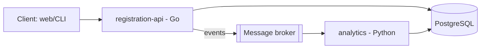

# 00 — Setup: the running project, the tools, and how to cite

> Course: Advanced Software Engineering · Term 1 · Source pins: Linux **v6.18.63**, OpenBSD **`8cada8c`**
> Time: ~4 h · Persian version: [`guide.fa.md`](guide.fa.md) · Decks: [`slides/`](slides/)

## Learning goals

- Know what the **Course Registration Platform** is and how it grows through the eight modules (states `m0` … `m8`).
- Have a toolchain that passes `check_tools.py`, and a working copy of the project that passes `make check`.
- Render diagrams from text (Mermaid, PlantUML, Structurizr) and keep them under `docs/diagrams/`.
- Cite books and source code the way the rest of the course does, so every claim can be checked.
- Know how the decks and labs of this course are generated and checked.

## Glossary

| Term | Meaning |
|---|---|
| **Running project** | One small system, `project/`, that every module changes. Concepts accumulate in code instead of staying on slides |
| **State `m0` … `m8`** | The content of the project after module 0 … 8. Not a Git tag in the course repository (there are none); you create your own in a scratch copy |
| **Scratch copy** | A folder outside the course repository where you `cp -r project`, run `git init` and commit. Your history, your tags |
| **Quality gate** | A command that must succeed before a change is accepted (here `make check`, later also coverage and mutation thresholds) |
| **CI** | Continuous integration: a server runs the quality gates on every push |
| **Mermaid / PlantUML** | Text-to-diagram languages. Mermaid is quick and renders on GitHub; PlantUML is stricter UML |
| **C4 model** | Four zoom levels for architecture diagrams (context, container, component, code), by Simon Brown |
| **Structurizr DSL** | A text language that describes one C4 model and derives several views from it |
| **Pin** | The exact version of a source checkout we cite (a tag or a commit), so a citation never drifts |
| **Citation** | A reference precise enough that you can open the same lines: book chapter and section, or file, function and pin |

## 1. What we build

A system for course registration. Students browse courses and register; a registrar reads enrollment statistics. It is deliberately small, so each module can change one thing (requirements, model, architecture, tests, metrics) and you can see the effect in code.



Colors in all diagrams and decks follow one mapping: **client = teal, service/domain logic = amber, infrastructure = violet, data/storage = green**. The same mapping is used in the C4 file of lab 03.

What exists in `m0` (lab 02): the Go API, a `GET /healthz`, a `GET /courses` over an in-memory catalog, Go tests, a Python analytics stub with unit tests, a `Makefile`, a `Dockerfile` and `docker-compose.yml`, and a CI template. **PostgreSQL, the message broker and the web client are not there yet**: they arrive in module 04 and later. A diagram that shows them is showing the plan, and says so.

## 2. Project states: `m0` … `m8`

| State | Added by | What the project contains |
|---|---|---|
| `m0` | 00-setup | Go service skeleton (health, one `GET /courses`), tests, Python analytics stub, `docker-compose.yml`, `Makefile`, CI workflow |
| `m1` | 01 | CI gates, DORA metrics script, branching/release workflow, `CONTRIBUTING.md` (borrowed from Linux/OpenBSD practice) |
| `m2` | 02 | SRS (IEEE 29148 style), Gherkin acceptance tests, traceability matrix |
| `m3` | 03 | UML/C4 models, TLA+ model of enrollment concurrency, race found and fixed |
| `m4` | 04 | ADRs, modular monolith vs services comparison, ATAM, message broker, CQRS read model |
| `m5` | 05 | Refactoring of a smelly module with before/after metrics |
| `m6` | 06 | Mutation testing, property tests, Pact contracts, fuzzing |
| `m7` | 07 | Quality gates (linters, SonarQube), COCOMO II / function-point estimate, SLO/SLI |
| `m8` | 08 | Repository-mining study report |

**How states work (read this once).** The course repository contains the `project/` folder at its latest state and **no Git tags**. A lab that says "start from `m1`" means:

1. You work in your own scratch copy: `cp -r <course>/project ~/ase-work/registration`, then `git init -b main`, `git add .`, `git commit`, `git tag m0` (lab 02 does exactly this).
2. Each later lab ends with a commit, and the last lab of a module with a tag (`m1`, `m2`, …) in **your** history.
3. If you skipped a lab or want to compare, "state `mN`" means the content of `project/` in the course repository at that point of the build. `git diff m0 m1` in your own repository shows what a module changed.

This keeps the course repository clean, and your history is yours to break and repair.

## 3. Tools

| Tool | Version | Needed for | Check |
|---|---|---|---|
| **Go** | ≥ 1.22 (the module says `go 1.22`; the Dockerfile builds with `golang:1.22-alpine`) | the API, every service lab | `go version` |
| **Python** | ≥ 3.8 (lab programs and analytics use only features of 3.8) | analytics, lab scripts | `python --version` |
| **ruff** | recent; the rules are fixed in a `ruff.toml` | Python lint gate | `ruff --version` |
| **git** | ≥ 2.28 (`git init -b main`) | every lab commits | `git --version` |
| **make** | any (optional: the `Makefile` is short enough to run by hand) | `make check` | `make --version` |
| **Docker** | any recent (optional) | compose labs, PlantUML and Structurizr in lab 03 | `docker --version`, `docker info` |
| **Node.js + npx** | any recent (optional) | Mermaid CLI (`@mermaid-js/mermaid-cli@12.2.0`) | `node --version` |
| **Chrome / Edge / Chromium** | any recent (optional) | Mermaid CLI draws with a browser | — |
| **Java** | optional | only for the PlantUML jar if you do not use Docker | `java -version` |

Diagram tools: **Mermaid** (browser page or mermaid-cli), **PlantUML** (Docker image `plantuml/plantuml`), **Structurizr** (Docker image `structurizr/structurizr`, commands `validate` and `export`). Later modules add: TLA+ tools (module 03), `hypothesis`, `rapid`, Pact, `go test -fuzz`, SonarQube Community (modules 06, 07) and PyDriller (module 08). Each module's first lab installs what it needs.

Lab 01 gives you `check_tools.py`, which prints these versions and flags what is missing. Machine used to write and run the labs: Windows 11 with Git Bash; commands that differ on Linux and macOS carry a note in each lab README.

## 4. How to cite

Everything in this course is checkable. Three kinds of citations:

**Books.** Schach's *Object-Oriented and Classical Software Engineering*, 8th ed. (McGraw-Hill, 2011) is cited by chapter and section, never by page, and only as a short paraphrase: `Schach 8e, ch. 2 §2.9`. When the book and current practice differ, the notes show both in a box: *Schach says X; modern practice says Y*.

**Papers and standards.** Author, year, venue and section (`Parnas 1972`, `IEEE 29148`). Anything not opened by the author is marked `UNVERIFIED` with a way to check it.

**Source code (Linux and OpenBSD).** Two pinned checkouts live in `_shared/sources/` (set them up once with `bash _shared/sources/setup-sources.sh`):

| Repo | Pin | Citation format |
|---|---|---|
| Linux | **v6.18.63** | `linux/<path> · <function> · v6.18.63` |
| OpenBSD | **`8cada8c`** | `openbsd/<path> · <function> · 8cada8c` |

Rules: quote **at most 25 lines**, copied from the checkout and never from memory, with a line-by-line explanation. Print the excerpt and its citation line with `cite.sh`, for example (real output from this repository):

```text
$ bash _shared/sources/cite.sh linux include/linux/kref.h kref_init 8
linux/include/linux/kref.h · kref_init() · v6.18.63 · L29-36
   29  static inline void kref_init(struct kref *kref)
   30  {
   31  	refcount_set(&kref->refcount, 1);
   32  }
   33  
   34  static inline unsigned int kref_read(const struct kref *kref)
   35  {
   36  	return refcount_read(&kref->refcount);
```

`cite.sh` also takes a line number: `bash _shared/sources/cite.sh openbsd share/man/man9/style.9 L1 4`. If a file is not in the sparse checkout, add its folder with `git -C _shared/sources/linux sparse-checkout add <dir>`. Never deepen these checkouts; for history work make a separate clone elsewhere. Online: `https://elixir.bootlin.com/linux/v6.18.63/source/<path>` and `https://github.com/openbsd/src/blob/8cada8c/<path>`.

The case studies of modules 01 and later compare Linux and OpenBSD on the same problem (process and review, coding standards, architecture, patterns, API design, testing, technical debt, metrics). Where the two differ, a table closes the section: design choice → Linux → OpenBSD → trade-off.

## 5. How the decks and labs are built

Every module has the same layout:

```text
NN-module/
  lesson.en.md  lesson.fa.md      theory and diagrams (English first, then Persian)
  notes/  case-study.*.md         one note per sub-topic, real source excerpts
  labs/NN-name/                   README.md, runnable code, solution/
  slides/
    outline.md                    the outline of every deck
    lesson.en.html lesson.fa.html the guide/lesson deck (reveal.js, speaker notes on every slide)
    labs.content.py               one table with the EN and FA text of every lab deck
    labs/NN-name.en.html .fa.html one generated deck per lab
    assets/                       SVG diagrams shared by the EN and FA decks
```

Commands (run from the repository root; `COURSE` selects this course, the default belongs to another course):

```bash
make list   COURSE=term-1/advanced-software-engineering        # modules, notes, labs
make decks  COURSE=term-1/advanced-software-engineering        # re-render lab decks from labs.content.py
make check  COURSE=term-1/advanced-software-engineering        # speaker notes, titles, paths, Python, shell scripts
make deck   COURSE=term-1/advanced-software-engineering M=00 L=fa LAB=02   # open one deck in the browser
make slides COURSE=term-1/advanced-software-engineering        # index of all decks
```

Lab decks are generated, not hand-edited: edit `slides/labs.content.py`, then run `make decks`. Lab decks carry **no solutions**: those stay in each lab's `solution/` folder. Persian decks are right-to-left, with code, commands and identifiers kept left-to-right in English.

The lab README is the source of truth for commands and expected output. Expected output comes from a real run, and the README says on which machine; anything that could not be run is marked `UNVERIFIED`. Python in this repository must pass `ruff check` with the repository's `ruff.toml`.

## 6. The labs, in order

| Lab | Goal | Time |
|---|---|---|
| [01-toolchain-check](labs/01-toolchain-check/README.md) | `check_tools.py` prints versions and flags missing or old tools | 30 min |
| [02-project-skeleton](labs/02-project-skeleton/README.md) | copy `project/`, `make check` green, run the API, tag `m0`, add CI | 60 min |
| [03-diagram-tooling](labs/03-diagram-tooling/README.md) | Mermaid, PlantUML and a C4 model rendered; `docs/diagrams/` convention committed | 60 min |

## 7. Working rules for the whole course

1. Work in your scratch copy, not inside the course repository.
2. Run `make check` before every commit. If it fails in CI but passes locally, the difference is the bug.
3. Read code from a lab before running it, including the solutions in this repository.
4. Diagrams are text: edit the source, render, commit both (lab 03).
5. Treat any number without a source as a claim to verify.

## 8. Done when

- [ ] `python check_tools.py` exits `0`
- [ ] `make check` passes in your copy of the project, and `git tag` shows `m0`
- [ ] `curl localhost:8080/courses` returns the two seeded courses
- [ ] `docs/diagrams/` holds a Mermaid, a PlantUML and a C4 diagram with their SVGs, committed
- [ ] You can explain what `m3` means when the course repository has no tag called `m3`

Next: **Module 01: Software Processes & Lifecycle Models**.
