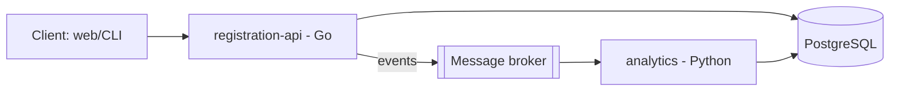

<div dir="rtl">

# ۰۰ — راه‌اندازی: پروژهٔ در حال رشد، ابزارها و شیوهٔ ارجاع

> درس: مهندسی نرم‌افزار پیشرفته · ترم ۱ · نسخه‌های ثابت سورس: Linux **v6.18.63** و OpenBSD **`8cada8c`**
> زمان: حدود ۴ ساعت · نسخهٔ انگلیسی: [`guide.en.md`](guide.en.md) · اسلایدها: [`slides/`](slides/)

## هدف‌های یادگیری

- بدانید **Course Registration Platform** چیست و در هشت ماژول چگونه رشد می‌کند (وضعیت‌های `m0` تا `m8`).
- ابزارهایتان از `check_tools.py` سربلند بیرون بیایند و یک کپی کاری از پروژه داشته باشید که `make check` را رد می‌کند.
- نمودارها را از متن بسازید (Mermaid، PlantUML، Structurizr) و زیر `docs/diagrams/` نگه دارید.
- کتاب و کد را همان‌طور ارجاع بدهید که بقیهٔ درس می‌دهد، تا هر ادعا قابل بررسی باشد.
- بدانید اسلایدها و آزمایش‌های این درس چگونه تولید و بررسی می‌شوند.

## واژه‌نامه

| اصطلاح | تعریف |
|---|---|
| **Running project** | یک سیستم کوچک، یعنی `project/`، که هر ماژول چیزی در آن تغییر می‌دهد. به این ترتیب مفهوم‌ها در کد جمع می‌شوند و روی اسلاید نمی‌مانند. |
| **State `m0` … `m8`** | محتوای پروژه بعد از ماژول ۰ تا ۸. در مخزن درس هیچ Git tag وجود ندارد؛ tagهای خودتان را در یک کپی جداگانه می‌سازید. |
| **Scratch copy** | پوشه‌ای بیرون از مخزن درس که در آن `cp -r project` می‌زنید، `git init` اجرا می‌کنید و commit می‌کنید. تاریخچه و tagها مال خودتان است. |
| **Quality gate** | فرمانی که پیش از پذیرفتن تغییر باید موفق شود (اینجا `make check`؛ بعدتر آستانهٔ coverage و mutation هم). |
| **CI** | Continuous Integration: سرور در هر push دروازه‌های کیفیت را اجرا می‌کند. |
| **Mermaid / PlantUML** | زبان‌هایی که از متن نمودار می‌سازند. Mermaid سریع است و در GitHub نمایش داده می‌شود؛ PlantUML برای UML دقیق‌تر است. |
| **C4 model** | چهار سطح بزرگ‌نمایی برای نمودار معماری (context، container، component، code) از Simon Brown. |
| **Structurizr DSL** | زبان متنی که یک مدل C4 را می‌نویسد و از آن چند view می‌سازد. |
| **Pin** | نسخهٔ دقیق سورسی که ارجاع می‌دهیم (یک tag یا commit)، تا ارجاع هیچ‌وقت جابه‌جا نشود. |
| **Citation** | ارجاعی که آن‌قدر دقیق است که همان خط‌ها را باز کنید: فصل و بخش کتاب، یا فایل، تابع و pin. |

## ۱. چه چیزی می‌سازیم

سیستمی برای ثبت‌نام دروس. دانشجو درس‌ها را مرور و ثبت‌نام می‌کند؛ مسئول آموزش آمار ثبت‌نام را می‌خواند. عمداً کوچک است تا هر ماژول فقط یک چیز را عوض کند (نیازمندی، مدل، معماری، تست، متریک) و اثرش را در کد ببینید.

</div>



<div dir="rtl">

رنگ‌ها در همهٔ نمودارها و اسلایدها یک نگاشت دارند: **client = آبی‌سبز (teal)، service و منطق دامنه = کهربایی (amber)، infrastructure = بنفش، data و ذخیره‌سازی = سبز**. همین نگاشت در فایل C4 آزمایش ۰۳ هم هست.

چه چیزی در `m0` (آزمایش ۰۲) وجود دارد: API نوشته‌شده با Go، مسیر `GET /healthz`، مسیر `GET /courses` روی یک catalog در حافظه، تست‌های Go، یک stub تحلیلی با Python و تست‌های واحد، یک `Makefile`، یک `Dockerfile` و `docker-compose.yml` و یک الگوی CI. **PostgreSQL، message broker و کلاینت وب هنوز نیستند**؛ در ماژول ۰۴ و بعد از آن می‌آیند. نموداری که آن‌ها را نشان می‌دهد، «طرح» را نشان می‌دهد و باید همین را بگوید.

## ۲. وضعیت‌های پروژه: `m0` تا `m8`

| وضعیت | اضافه‌شده در | محتوای پروژه |
|---|---|---|
| `m0` | 00-setup | اسکلت سرویس Go (health و یک `GET /courses`)، تست‌ها، stub تحلیلی Python، `docker-compose.yml`، `Makefile`، workflow مربوط به CI |
| `m1` | 01 | دروازه‌های CI، اسکریپت متریک‌های DORA، روند branching و release، فایل `CONTRIBUTING.md` (برگرفته از رویهٔ Linux و OpenBSD) |
| `m2` | 02 | SRS به سبک IEEE 29148، تست‌های پذیرش Gherkin، ماتریس ردیابی (traceability) |
| `m3` | 03 | مدل‌های UML و C4، مدل TLA+ برای هم‌روندی ثبت‌نام، پیدا کردن و رفع race |
| `m4` | 04 | ADRها، مقایسهٔ modular monolith با سرویس‌ها، ATAM، message broker، read model از نوع CQRS |
| `m5` | 05 | بازآرایی (refactoring) یک ماژول بدبو با متریک‌های قبل و بعد |
| `m6` | 06 | mutation testing، property test، قراردادهای Pact، fuzzing |
| `m7` | 07 | دروازه‌های کیفیت (linter، SonarQube)، برآورد COCOMO II و function point، SLO/SLI |
| `m8` | 08 | گزارش پژوهش بر پایهٔ repository mining |

**وضعیت‌ها چطور کار می‌کنند (یک بار بخوانید).** مخزن درس پوشهٔ `project/` را در آخرین وضعیتش دارد و **هیچ Git tag ندارد**. وقتی آزمایشی می‌گوید «از `m1` شروع کنید» یعنی:

1. در کپی جداگانهٔ خودتان کار می‌کنید: `cp -r <course>/project ~/ase-work/registration` و بعد `git init -b main`، `git add .`، `git commit`، `git tag m0` (آزمایش ۰۲ دقیقاً همین را انجام می‌دهد).
2. هر آزمایش بعدی با یک commit تمام می‌شود، و آخرین آزمایش هر ماژول با یک tag (`m1`، `m2`، …) در تاریخچهٔ **خودتان**.
3. اگر آزمایشی را جا انداخته‌اید یا می‌خواهید مقایسه کنید، «وضعیت `mN`» یعنی محتوای `project/` در مخزن درس در همان نقطهٔ ساخت. `git diff m0 m1` در مخزن خودتان نشان می‌دهد یک ماژول چه چیزی را عوض کرده است.

با این روش مخزن درس تمیز می‌ماند و تاریخچه مال شماست؛ هر وقت خراب کردید می‌توانید درستش کنید.

## ۳. ابزارها

| ابزار | نسخه | برای چه | بررسی |
|---|---|---|---|
| **Go** | ‏≥ 1.22 (ماژول `go 1.22` دارد و Dockerfile با `golang:1.22-alpine` می‌سازد) | API و همهٔ آزمایش‌های سرویس | `go version` |
| **Python** | ‏≥ 3.8 (برنامه‌های آزمایش و تحلیل فقط از امکانات 3.8 استفاده می‌کنند) | تحلیل و اسکریپت‌های آزمایش | `python --version` |
| **ruff** | نسخهٔ جدید؛ قواعد در `ruff.toml` ثابت شده‌اند | دروازهٔ lint برای Python | `ruff --version` |
| **git** | ‏≥ 2.28 (`git init -b main`) | هر آزمایش commit می‌کند | `git --version` |
| **make** | هر نسخه (اختیاری: `Makefile` آن‌قدر کوتاه است که می‌شود دستی اجرایش کرد) | `make check` | `make --version` |
| **Docker** | هر نسخهٔ جدید (اختیاری) | آزمایش‌های compose، و PlantUML و Structurizr در آزمایش ۰۳ | `docker --version` و `docker info` |
| **Node.js و npx** | هر نسخهٔ جدید (اختیاری) | Mermaid CLI ‏(`@mermaid-js/mermaid-cli@12.2.0`) | `node --version` |
| **Chrome / Edge / Chromium** | هر نسخهٔ جدید (اختیاری) | Mermaid CLI با یک مرورگر نقاشی می‌کند | — |
| **Java** | اختیاری | فقط برای jar برنامهٔ PlantUML اگر Docker ندارید | `java -version` |

ابزارهای نمودار: **Mermaid** (صفحهٔ مرورگر یا mermaid-cli)، **PlantUML** (ایمیج Docker با نام `plantuml/plantuml`)، **Structurizr** (ایمیج Docker با نام `structurizr/structurizr` و فرمان‌های `validate` و `export`). ماژول‌های بعد اضافه می‌کنند: ابزارهای TLA+ (ماژول ۰۳)، `hypothesis`، `rapid`، Pact، `go test -fuzz`، SonarQube Community (ماژول‌های ۰۶ و ۰۷) و PyDriller (ماژول ۰۸). اولین آزمایش هر ماژول آنچه را لازم دارد نصب می‌کند.

آزمایش ۰۱ فایل `check_tools.py` را به شما می‌دهد که این نسخه‌ها را چاپ می‌کند و کمبودها را نشان می‌دهد. ماشینی که آزمایش‌ها روی آن نوشته و اجرا شده: Windows 11 با Git Bash؛ فرمان‌هایی که روی Linux و macOS فرق دارند در README هر آزمایش یادداشت دارند.

## ۴. چطور ارجاع بدهیم

همه‌چیز در این درس قابل بررسی است. سه نوع ارجاع داریم:

**کتاب.** کتاب Schach با عنوان *Object-Oriented and Classical Software Engineering* ویراست هشتم (McGraw-Hill، ۲۰۱۱) با فصل و بخش ارجاع داده می‌شود، نه با شمارهٔ صفحه، و فقط به‌صورت خلاصهٔ کوتاه به زبان خودمان: `Schach 8e, ch. 2 §2.9`. هرجا کتاب و رویهٔ امروز فرق داشته باشند، یادداشت‌ها هر دو را در یک کادر می‌آورند: *Schach says X; modern practice says Y*.

**مقاله و استاندارد.** نویسنده، سال، محل انتشار و بخش (`Parnas 1972`، `IEEE 29148`). هر چیزی که نویسنده باز نکرده باشد با `UNVERIFIED` علامت می‌خورد و راه بررسی‌اش نوشته می‌شود.

**کد منبع (Linux و OpenBSD).** دو checkout با نسخهٔ ثابت در `_shared/sources/` هست (یک بار با `bash _shared/sources/setup-sources.sh` آماده‌شان کنید):

| مخزن | Pin | قالب ارجاع |
|---|---|---|
| Linux | **v6.18.63** | `linux/<path> · <function> · v6.18.63` |
| OpenBSD | **`8cada8c`** | `openbsd/<path> · <function> · 8cada8c` |

قاعده‌ها: **حداکثر ۲۵ خط** نقل کنید، از checkout کپی شده نه از حافظه، و خط‌به‌خط توضیح بدهید. قطعه‌کد و خط ارجاعش را با `cite.sh` چاپ کنید؛ برای نمونه (خروجی واقعی همین مخزن):

</div>

```text
$ bash _shared/sources/cite.sh linux include/linux/kref.h kref_init 8
linux/include/linux/kref.h · kref_init() · v6.18.63 · L29-36
   29  static inline void kref_init(struct kref *kref)
   30  {
   31  	refcount_set(&kref->refcount, 1);
   32  }
   33  
   34  static inline unsigned int kref_read(const struct kref *kref)
   35  {
   36  	return refcount_read(&kref->refcount);
```

<div dir="rtl">

`cite.sh` شمارهٔ خط هم می‌گیرد: `bash _shared/sources/cite.sh openbsd share/man/man9/style.9 L1 4`. اگر فایلی در sparse checkout نیست، پوشه‌اش را اضافه کنید: `git -C _shared/sources/linux sparse-checkout add <dir>`. این checkoutها را هرگز عمیق‌تر نکنید؛ برای کار روی تاریخچه جای دیگری یک clone جدا بسازید. لینک آنلاین: `https://elixir.bootlin.com/linux/v6.18.63/source/<path>` و `https://github.com/openbsd/src/blob/8cada8c/<path>`.

مطالعهٔ موردی ماژول ۰۱ به بعد، Linux و OpenBSD را روی یک مسئلهٔ مشترک مقایسه می‌کند (فرایند و review، استاندارد کدنویسی، معماری، الگوها، طراحی API، تست، بدهی فنی، متریک). هرجا این دو فرق دارند جدولی بخش را می‌بندد: انتخاب طراحی ← Linux ← OpenBSD ← trade-off.

## ۵. اسلایدها و آزمایش‌ها چطور ساخته می‌شوند

هر ماژول همین ساختار را دارد:

</div>

```text
NN-module/
  lesson.en.md  lesson.fa.md      theory and diagrams (English first, then Persian)
  notes/  case-study.*.md         one note per sub-topic, real source excerpts
  labs/NN-name/                   README.md, runnable code, solution/
  slides/
    outline.md                    the outline of every deck
    lesson.en.html lesson.fa.html the guide/lesson deck (reveal.js, speaker notes on every slide)
    labs.content.py               one table with the EN and FA text of every lab deck
    labs/NN-name.en.html .fa.html one generated deck per lab
    assets/                       SVG diagrams shared by the EN and FA decks
```

<div dir="rtl">

فرمان‌ها (از ریشهٔ مخزن اجرا کنید؛ `COURSE` همین درس را انتخاب می‌کند و مقدار پیش‌فرضش مال درس دیگری است):

</div>

```bash
make list   COURSE=term-1/advanced-software-engineering        # modules, notes, labs
make decks  COURSE=term-1/advanced-software-engineering        # re-render lab decks from labs.content.py
make check  COURSE=term-1/advanced-software-engineering        # speaker notes, titles, paths, Python, shell scripts
make deck   COURSE=term-1/advanced-software-engineering M=00 L=fa LAB=02   # open one deck in the browser
make slides COURSE=term-1/advanced-software-engineering        # index of all decks
```

<div dir="rtl">

اسلایدهای آزمایش تولید می‌شوند و دستی ویرایش نمی‌شوند: فایل `slides/labs.content.py` را عوض کنید و بعد `make decks` بزنید. اسلایدهای آزمایش **راه‌حل ندارند**؛ راه‌حل‌ها در پوشهٔ `solution/` هر آزمایش می‌مانند. اسلایدهای فارسی راست‌به‌چپ‌اند و کد، فرمان و شناسه‌ها انگلیسی و چپ‌به‌راست می‌مانند.

README هر آزمایش مرجع اصلی فرمان‌ها و خروجی مورد انتظار است. خروجی مورد انتظار از یک اجرای واقعی می‌آید و README می‌گوید روی چه ماشینی؛ هر چیزی که نشد اجرا شود با `UNVERIFIED` علامت می‌خورد. Python در این مخزن باید با `ruff.toml` مخزن از `ruff check` رد شود.

## ۶. آزمایش‌ها به ترتیب

| آزمایش | هدف | زمان |
|---|---|---|
| [01-toolchain-check](labs/01-toolchain-check/README.md) | `check_tools.py` نسخه‌ها را چاپ می‌کند و ابزار گم‌شده یا قدیمی را نشان می‌دهد | ۳۰ دقیقه |
| [02-project-skeleton](labs/02-project-skeleton/README.md) | کپی `project/`، سبز شدن `make check`، اجرای API، tag با نام `m0`، افزودن CI | ۶۰ دقیقه |
| [03-diagram-tooling](labs/03-diagram-tooling/README.md) | رسم Mermaid، PlantUML و یک مدل C4؛ commit کردن قرارداد `docs/diagrams/` | ۶۰ دقیقه |

## ۷. قاعده‌های کار در کل درس

1. در کپی جداگانهٔ خودتان کار کنید، نه داخل مخزن درس.
2. پیش از هر commit، `make check` را اجرا کنید. اگر در CI شکست می‌خورد ولی روی ماشین شما نه، همان تفاوت باگ است.
3. کد هر آزمایش را پیش از اجرا بخوانید، از جمله راه‌حل‌های همین مخزن.
4. نمودار متن است: منبع را ویرایش کنید، رندر بگیرید و هر دو را commit کنید (آزمایش ۰۳).
5. هر عددی که منبع ندارد، ادعایی است که باید بررسی شود.

## ۸. کی تمام شده است

- [ ] `python check_tools.py` با کد `0` تمام می‌شود
- [ ] `make check` در کپی پروژهٔ شما موفق است و `git tag` عنوان `m0` را نشان می‌دهد
- [ ] `curl localhost:8080/courses` دو درس اولیه را برمی‌گرداند
- [ ] `docs/diagrams/` یک نمودار Mermaid، یک PlantUML و یک C4 را با فایل‌های SVGشان دارد و commit شده است
- [ ] می‌توانید توضیح بدهید وقتی مخزن درس tag ای به نام `m3` ندارد، `m3` چه معنایی دارد

بعدی: **ماژول ۰۱: فرایندها و مدل‌های چرخهٔ عمر نرم‌افزار**.

</div>
