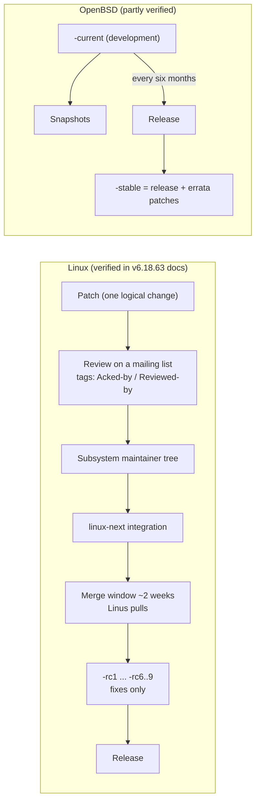

# 01 — Case study: how Linux and OpenBSD write their process down

> Module 01 · Advanced Software Engineering · Term 1 · Farsi: [case-study.fa.md](case-study.fa.md) · Pins: Linux **v6.18.63**, OpenBSD **`8cada8c`**
> Depends on: [lesson](lesson.en.md) §2.7 (open-source and synchronize-and-stabilize), notes [07](notes/07-open-source-and-sync-stabilize.en.md) and [08](notes/08-process-improvement-devops-dora.en.md). Used by: lab [07 CONTRIBUTING guide](labs/07-contributing-guide/README.md), Module 05 (coding standards), Module 07 (technical debt).
> Excerpts are copied by script from the local checkouts in `_shared/sources/` (≤ 25 lines each); line numbers are the real line numbers in those files. Web facts carry a URL and the date they were fetched (2026-11-23). Everything else that is not checked is marked `UNVERIFIED`.

## Glossary

| Term | Definition |
|---|---|
| **Merge window** | The first ~two weeks of a Linux development cycle, when large changes are merged into the mainline. |
| **`-rcN`** | "Release candidate": weekly Linux pre-releases after the merge window; only fixes are accepted. |
| **Maintainer** | Person responsible for a subsystem; collects patches and forwards them upward. |
| **Patch** | One proposed change, sent as text for review (mailing list in Linux). |
| **`Signed-off-by` (SoB)** | A line in a Linux commit in which a person certifies the Developer's Certificate of Origin. |
| **`Reviewed-by`** | A Linux tag by which a reviewer states that they did a technical review (with a defined statement). |
| **KNF** | Kernel Normal Form, OpenBSD's name for its kernel coding style (and originally BSD's). |
| **`-current` / `-stable` / release (OpenBSD)** | Development branch / last release plus errata patches / the version shipped every six months (openbsd.org FAQ 5). |
| **Deprecation** | Marking an interface as one that should no longer be used in new code, while old uses still exist. |
| **DCO** | Developer's Certificate of Origin: a short legal statement a contributor makes about the right to submit the change. |

## 1. Why these two projects

Schach lists Linux and OpenBSD as examples of successful open-source infrastructure software, and describes the open-source model as an informal start followed by postdelivery maintenance by volunteers, "generally" without specifications or design (`Schach 8e, ch. 2 §2.9.4`, pp. 56-59). Both projects are decades old, both are operating systems, and both have large contributor bases, yet they differ sharply in how much process they write down. That makes them a good pair for one question: **what does a mature open-source process look like when you read it in the repository?**

> **Schach says X; modern practice says Y.** Schach (2011): open-source projects have no specification and no design, and succeed because of the exceptional skill of the people. Modern practice, visible in the files below: the "no process" claim is false. Linux v6.18.63 ships a directory of process documents (`Documentation/process/`: release cycle, patch format, review tags, coding style, a list of deprecated interfaces, a code of conduct, maintainer handbooks). The skill argument is not refuted by this, but the process is explicit and the reviewers' time is treated as the scarce resource.



The left half is documented in the files quoted below. In the right half only the branch structure and the six-month cycle are verified (see §6); how a change gets into `-current` is **UNVERIFIED** here.

## 2. Release cycle: stabilization written as text

**Source:** `linux/Documentation/process/2.Process.rst · "How the development process works" (merge window) · v6.18.63`, lines 35-55.

```rst
A relatively straightforward discipline is followed with regard to the
merging of patches for each release.  At the beginning of each development
cycle, the "merge window" is said to be open.  At that time, code which is
deemed to be sufficiently stable (and which is accepted by the development
community) is merged into the mainline kernel.  The bulk of changes for a
new development cycle (and all of the major changes) will be merged during
this time, at a rate approaching 1,000 changes ("patches," or "changesets")
per day.

(As an aside, it is worth noting that the changes integrated during the
merge window do not come out of thin air; they have been collected, tested,
and staged ahead of time.  How that process works will be described in
detail later on).

The merge window lasts for approximately two weeks.  At the end of this
time, Linus Torvalds will declare that the window is closed and release the
first of the "rc" kernels.  For the kernel which is destined to be 5.6,
for example, the release which happens at the end of the merge window will
be called 5.6-rc1.  The -rc1 release is the signal that the time to
merge new features has passed, and that the time to stabilize the next
kernel has begun.
```

**Line by line**

- L35-36: the document calls the discipline "relatively straightforward": one rule per release, not a committee.
- L36-39: the cycle *starts* with the merge window; code is merged only if it is deemed "sufficiently stable" **and** accepted by the development community, i.e. the gate is both technical and social.
- L39-42: the bulk of the changes, and all the major ones, arrive in this window, at a rate approaching 1,000 changes a day: heavy work is concentrated in a short, bounded interval.
- L44-47: nothing arrives "out of thin air": changes were collected, tested and staged earlier. The same file explains how: subsystem trees whose maintainers ask Linus to "pull" when the window opens (L237), and the linux-next integration tree (L298-308).
- L49-55: after about two weeks Linus declares the window closed and releases `-rc1`; that is the signal that "the time to merge new features has passed" and that stabilization has begun (L53-55).
- What the excerpt does not say: the following lines (L57-71) say that for the next six to ten weeks only fixes go in, with weekly `-rc` releases typically up to `-rc6` to `-rc9`. I read those lines but they fall outside this excerpt.

**Link to the lesson.** This is a synchronize-and-stabilize cycle at a very different scale (Schach, §2.9.6: daily synchronization and a stabilization step at the end of each build). The analogy is mine, not Schach's: Microsoft's teams synchronize daily inside one company, Linux integrates thousands of contributors' work in one concentrated window. Both separate the period in which risk is taken from the period in which it is paid down.

## 3. Review and change discipline: `submitting-patches.rst`

### 3.1 One logical change per patch

**Source:** `linux/Documentation/process/submitting-patches.rst · "Separate your changes" · v6.18.63`, lines 168-180.

```rst
Separate your changes
---------------------

Separate each **logical change** into a separate patch.

For example, if your changes include both bug fixes and performance
enhancements for a single driver, separate those changes into two
or more patches.  If your changes include an API update, and a new
driver which uses that new API, separate those into two patches.

On the other hand, if you make a single change to numerous files,
group those changes into a single patch.  Thus a single logical change
is contained within a single patch.
```

**Line by line**

- L168-169: the heading names the rule; it is about *granularity of change*, the unit that is reviewed, tested and, if necessary, reverted.
- L171: "logical change" is the unit, not "file" or "commit size".
- L173-176: examples: split a bug fix from a performance change in the same driver; split an API update from a new driver that uses it. Each can be reviewed and bisected on its own.
- L178-180: the counter-rule: one change that touches many files is **one** patch ("a single logical change is contained within a single patch"). The test is the *meaning*, not the diff size.

This is the same idea as an **increment** (lesson §2.3): a small, complete, reviewable piece. It is also what makes `git bisect` useful (lab [04](labs/04-git-bisect-worktrees/README.md)): one logical change per commit tells you which change broke what.

### 3.2 What a review tag means

**Source:** `linux/Documentation/process/submitting-patches.rst · "Reviewer's statement of oversight" · v6.18.63`, lines 562-575.

```rst
By offering my Reviewed-by: tag, I state that:

	 (a) I have carried out a technical review of this patch to
	     evaluate its appropriateness and readiness for inclusion into
	     the mainline kernel.

	 (b) Any problems, concerns, or questions relating to the patch
	     have been communicated back to the submitter.  I am satisfied
	     with the submitter's response to my comments.

	 (c) While there may be things that could be improved with this
	     submission, I believe that it is, at this time, (1) a
	     worthwhile modification to the kernel, and (2) free of known
	     issues which would argue against its inclusion.
```

**Line by line**

- L562: a `Reviewed-by` is a *statement*, not a click: "By offering my Reviewed-by: tag, I state that".
- L564-566 (a): the reviewer did a technical review for "appropriateness and readiness": both whether the change should exist and whether it is finished.
- L568-570 (b): problems were communicated back and the reviewer is satisfied with the answers: review is a dialogue that ends in agreement.
- L572-575 (c): the reviewer need not think the patch is perfect; it is "worthwhile" and "free of known issues" *at this time*. The bar is stated precisely and honestly.
- Next lines (L577-580, not shown): item (d) says that having reviewed the patch and believing it sound does not mean the reviewer makes any warranty that it works in every situation; the tag is not a guarantee. It falls outside this excerpt.

Another part of the same file explains why the tag matters to contributors: `Reviewed-by` tags, when supplied by reviewers known to understand the subject area and to review thoroughly, "will normally increase the likelihood" of a patch getting in (L587-589). Compare this with CMM level 2's emphasis on measurement (Schach, §3.13): Linux records *who reviewed what* in the history itself, which makes review auditable.

### 3.3 Cost of ignoring the rules

**Source:** `linux/Documentation/process/submitting-patches.rst · "Style-check your changes" · v6.18.63`, lines 201-208.

```rst
Style-check your changes
------------------------

Check your patch for basic style violations, details of which can be
found in Documentation/process/coding-style.rst.
Failure to do so simply wastes
the reviewers time and will get your patch rejected, probably
without even being read.
```

**Line by line**

- L204-205: style is checked **before** posting; the style rules live in `coding-style.rst`.
- L206-208: the stated penalty is that failure "wastes the reviewers time" and the patch will be rejected "probably without even being read". The process protects the scarcest resource (reviewer attention) by making mechanical errors the submitter's problem.

## 4. Coding standards: the same decision, written two ways

### 4.1 Tone and authority

**Linux, source:** `linux/Documentation/process/coding-style.rst · preamble · v6.18.63`, lines 6-10.

```rst
This is a short document describing the preferred coding style for the
linux kernel.  Coding style is very personal, and I won't **force** my
views on anybody, but this is what goes for anything that I have to be
able to maintain, and I'd prefer it for most other things too.  Please
at least consider the points made here.
```

**OpenBSD, source:** `openbsd/share/man/man9/style.9 · DESCRIPTION · 8cada8c`, lines 33-43.

```roff
.Sh DESCRIPTION
This file specifies the preferred style for kernel source files in the
.Ox
source tree.
It is also a guide for preferred userspace code style.
These guidelines should be followed for all new code.
In general, code can be considered
.Dq new code
when it makes up about 50% or more of the file(s) involved.
This is enough to break precedents in the existing code and use the
current style guidelines.
```

**Line by line**

- Linux L6-10: a personal voice ("I won't force my views"), but with a clear authority statement: this is what applies to anything its author must maintain, and the preference for everything else. Style is presented as a maintainer's preference with a rationale.
- OpenBSD L34-37: a neutral voice: "preferred style for kernel source files", with a second use as a guide for user-space code in the same tree. In the man page source, `.Ox` is a macro that prints "OpenBSD".
- OpenBSD L38-43: a rule for *when it applies*: "new code" means code that makes up about 50% or more of the files involved, which is "enough to break precedents". This is an explicit policy for style debt: new code follows the current standard, small edits follow the surrounding file. Linux's excerpt has no equivalent rule in these lines; I did not search the whole file for one.

### 4.2 Indentation, width and whitespace

**Linux, source:** `linux/Documentation/process/coding-style.rst · "1) Indentation" · v6.18.63`, lines 21-39.

```rst
Tabs are 8 characters, and thus indentations are also 8 characters.
There are heretic movements that try to make indentations 4 (or even 2!)
characters deep, and that is akin to trying to define the value of PI to
be 3.

Rationale: The whole idea behind indentation is to clearly define where
a block of control starts and ends.  Especially when you've been looking
at your screen for 20 straight hours, you'll find it a lot easier to see
how the indentation works if you have large indentations.

Now, some people will claim that having 8-character indentations makes
the code move too far to the right, and makes it hard to read on a
80-character terminal screen.  The answer to that is that if you need
more than 3 levels of indentation, you're screwed anyway, and should fix
your program.

In short, 8-char indents make things easier to read, and have the added
benefit of warning you when you're nesting your functions too deep.
Heed that warning.
```

**OpenBSD, source:** `openbsd/share/man/man9/style.9 · indentation paragraph · 8cada8c`, lines 317-330.

```roff
Indentation is an 8 character tab.
Second level indents are four spaces.
All code should fit in 80 columns.
.Bd -literal -offset indent
while (cnt < 20)
	z = a + really + long + statement + that + needs +
	    two + lines + gets + indented + four + spaces +
	    on + the + second + and + subsequent + lines;
.Ed
.Pp
Do not add whitespace at the end of a line, and only use tabs
followed by spaces to form the indentation.
Do not use more spaces than a tab will produce
and do not use spaces in front of tabs.
```

**Linux's machine-readable counterpart:** `linux/.clang-format · v6.18.63`, lines 55, 60, 759, 801-802.

```yaml
ColumnLimit: 80
ContinuationIndentWidth: 8
IndentWidth: 8
TabWidth: 8
UseTab: Always
```

**Line by line**

- Linux L21-23: tabs are 8 characters, and indentation is 8 characters; the text mocks the 4- and 2-character "heretic movements". The rhetoric is colourful; the rule is exact.
- Linux L26-29: the rationale: the point of indentation is to show where a block starts and ends, which is easier with large indents when you have been looking at the screen for 20 straight hours.
- Linux L31-35: the standard objection (8 columns push code to the right on an 80-column terminal) is answered by turning it into a feature: more than three levels of indentation means the program should be fixed. L37-39: the 8-character indent also warns about nesting too deep ("Heed that warning").
- OpenBSD L317-319: three rules in three lines: 8-character tab indents, four-space second-level (continuation) indents, 80 columns.
- OpenBSD L320-325: the example shows the continuation line indented by a tab plus four spaces, aligned with the style rule.
- OpenBSD L327-330: whitespace hygiene: no trailing whitespace; tabs then spaces only; never spaces before a tab. This is exactly the kind of rule a tool can check.
- `.clang-format` L55 / L759 / L801-802: `ColumnLimit: 80`, `IndentWidth: 8`, `TabWidth: 8`, `UseTab: Always`: the prose rules above, as configuration. L60: `ContinuationIndentWidth: 8`, which **differs from OpenBSD's four spaces**. The file is clang-format's approximation of the prose style for editor and tool use; the Linux document that explains the intended relation between the two (`Documentation/dev-tools/clang-format.rst`, referenced at the top of the config) was not opened, so whether the prose or the config wins on continuation lines is **UNVERIFIED**.

**Link to the lesson.** A coding standard is a *process* artifact (lesson §2.8 and Schach's CMM level 3: a defined, documented process). The two projects chose different carriers: Linux writes the argument and ships a tool configuration; OpenBSD writes a manual page in the same documentation system as every other kernel interface (`style(9)`) and points at `indent(1)` (SEE ALSO, below).

### 4.3 Provenance of the OpenBSD standard

**OpenBSD, source:** `openbsd/share/man/man9/style.9 · SEE ALSO and HISTORY · 8cada8c`, lines 602-614.

```roff
.Sh SEE ALSO
.Xr indent 1 ,
.Xr err 3 ,
.Xr queue 3 ,
.Xr warn 3 ,
.Xr mdoc 7
.Sh HISTORY
This man page is largely based on the src/admin/style/style file from the
.Bx 4.4 Lite2
release, with updates to reflect the current practice and
desire of the
.Ox
project.
```

- L609-614: the page says it is "largely based" on a style file from the 4.4BSD Lite2 release, with updates to reflect "the current practice and desire" of the project: the standard is inherited, then adapted by editing the same document.
- L603: the SEE ALSO section lists `indent(1)` (a formatter); whether OpenBSD uses it as an enforced gate is **UNVERIFIED** (not in the checked files).

## 5. Technical debt as a documented list: `deprecated.rst`

**Source:** `linux/Documentation/process/deprecated.rst · introduction · v6.18.63`, lines 9-18.

```rst
In a perfect world, it would be possible to convert all instances of
some deprecated API into the new API and entirely remove the old API in
a single development cycle. However, due to the size of the kernel, the
maintainership hierarchy, and timing, it's not always feasible to do these
kinds of conversions at once. This means that new instances may sneak into
the kernel while old ones are being removed, only making the amount of
work to remove the API grow. In order to educate developers about what
has been deprecated and why, this list has been created as a place to
point when uses of deprecated things are proposed for inclusion in the
kernel.
```

**Source:** `linux/Documentation/process/deprecated.rst · "BUG() and BUG_ON()" · v6.18.63`, lines 32-41.

```rst
BUG() and BUG_ON()
------------------
Use WARN() and WARN_ON() instead, and handle the "impossible"
error condition as gracefully as possible. While the BUG()-family
of APIs were originally designed to act as an "impossible situation"
assert and to kill a kernel thread "safely", they turn out to just be
too risky. (e.g. "In what order do locks need to be released? Have
various states been restored?") Very commonly, using BUG() will
destabilize a system or entirely break it, which makes it impossible
to debug or even get viable crash reports. Linus has `very strong
```

**Line by line**

- L9-11: the ideal is converting every use of an old API and removing the old API in a single development cycle; L11-13 explains why that is not always feasible: "the size of the kernel, the maintainership hierarchy, and timing".
- L13-15: the cost of the delay: new instances "may sneak into the kernel while old ones are being removed", so the amount of work to remove the API grows. This is the textbook shape of debt that accrues interest.
- L15-18: the list exists to educate developers about what is deprecated and why, "a place to point" when someone proposes new use. In process terms it is a review aid: a reviewer links the paragraph instead of re-arguing it.
- `BUG()` section L34-35: the rule ("Use `WARN()` and `WARN_ON()` instead, and handle the 'impossible' error condition as gracefully as possible"). L36-39: the original intent (a "safe" assert that kills a kernel thread) and why it is "too risky": lock order and restored state are unknown. L39-41: the consequence: `BUG()` will often destabilize or break the system and make it impossible to debug or get crash reports. A deprecation entry is a *rule plus a reason plus a replacement*.

**Link to the lesson.** This is postdelivery maintenance as a managed activity (Schach, §1.3.1, perfective/adaptive/corrective). Whether OpenBSD keeps an equivalent list is **UNVERIFIED**; its release notes and manual pages (`HISTORY` sections) would be the places to look, and none were opened.

## 6. What is UNVERIFIED about OpenBSD's process

I fetched two pages from openbsd.org on 2026-11-23 and could verify only the following.

| Claim | Status | Evidence |
|---|---|---|
| A release ships about every six months | VERIFIED (as stated on the FAQ page) | https://www.openbsd.org/faq/faq5.html: "The version of OpenBSD shipped every six months." |
| `-current` is the development branch and is tagged every six months to become the next release | VERIFIED | same page |
| `-stable` = a release plus patches from the errata page; important fixes in `-current` are backported to supported `-stable` branches | VERIFIED | same page |
| Only the two most recent releases receive security and reliability fixes for the base system | VERIFIED | same page |
| Snapshots of `-current` are built between releases | VERIFIED | same page |
| The ISC licence is preferred for new code; GPL-bound software is not considered for the base system | VERIFIED | https://www.openbsd.org/policy.html |
| Who may commit, and what a review looks like before a commit (e.g. an "ok" from another developer in the commit message) | **UNVERIFIED** | no document opened; check `git log` of a mirror (needs a separate clone, see `_shared/sources/README.md`) |
| How a release is assembled and tested (release engineering) | **UNVERIFIED** | the FAQ points to release(8); not opened |
| Whether style is enforced automatically (`indent(1)`, pre-commit hooks) | **UNVERIFIED** | only SEE ALSO in `style.9` |
| Whether there is a regression-test gate before release | **UNVERIFIED** | the tree has `regress/`; its role in the release process was not checked |
| Size, turnover and funding of the developer group | **UNVERIFIED** | not checked |

A claim like "OpenBSD has a small core team and a strict review culture" is plausible and often repeated, but I have no verified source for it; do not repeat it in an exam without a citation.

## 7. Design-choice table

| Design choice | Linux (v6.18.63) | OpenBSD (`8cada8c`) | Trade-off |
|---|---|---|---|
| Release rhythm | Merge window ~2 weeks, then weekly `-rc` until ready (`2.Process.rst`); no fixed date | Release every six months, from the `-current` branch (faq5, fetched 2026-11-23) | Linux: readiness-driven, a release may slip by a few `-rc`s. OpenBSD: date-driven rhythm gives users predictability, but a release may ship with known gaps. |
| Unit of change | One logical change per patch (`submitting-patches.rst` L168-179) | UNVERIFIED | Small patches review and bisect well; many patches need more coordination (series, dependencies). |
| Recording review | Explicit tags with a defined statement (`Reviewed-by`, `Acked-by`, `Signed-off-by`) | UNVERIFIED | Auditable history vs extra ceremony in each commit message. |
| Legal provenance | DCO signed with every patch (`submitting-patches.rst`, L396 onward) | Licence policy: ISC preferred, GPL-bound code not considered for base (policy page) | DCO scales with many occasional contributors; a licence policy keeps the tree uniform but excludes useful GPL code from base. |
| Style authority | Preference with rationale, in the voice of the maintainer; tool config alongside | Normative "should be followed for all new code" in a man page | Persuasion is easier to accept, a flat rule is easier to enforce. |
| Style on old code | No rule in the lines read | "New code" = ≥ 50% of the file; old precedents may be broken | Prevents mixed style inside a file at the cost of reformatting churn. |
| Indent / width | 8-char tab, 80 columns; config `ContinuationIndentWidth: 8` | 8-char tab, 80 columns; continuation lines indented four spaces | Almost the same decision; the small difference shows that standards drift without a single enforced source. |
| Tooling | `.clang-format` in the tree | `indent(1)` in SEE ALSO; enforcement UNVERIFIED | A machine-checkable rule needs no human review time. |
| Technical debt | Explicit list with reasons and replacements (`deprecated.rst`) | UNVERIFIED (release notes? manual `HISTORY`?) | A list reduces repeated argument in review but must be maintained; removal still depends on volunteers. |
| Documentation form | Sphinx/reStructuredText under `Documentation/process/` | Manual pages (`style(9)`) in section 9, "kernel internals" | Different audiences: web-style guide vs the manual page system developers already use. |

## 8. Classic sources (Schach cites them; what did I verify?)

| Source | Status |
|---|---|
| **Royce 1970**, "Managing the Development of Large Software Systems", *Proceedings, IEEE WESCON*, Aug. 1970, pp. 1-9 | **Opened** on 2026-11-23: a reprint PDF at https://www.praxisframework.org/files/royce1970.pdf (copy hosted by a third party; the reprint carries an IEEE copyright line, "Originally published by TRW"). Verified: the simple sequential figure; the sentence that the implementation "is risky and invites failure" and that testing at the end is the first time timing, storage and I/O are experienced rather than analysed; the five additions (Step 1 program design first, Step 2 document the design, Step 3 do it twice, Step 4 plan, control and monitor testing, Step 5 involve the customer); the statement about documentation ("quite a lot"). Schach's citation (title with "Concepts and Techniques", 1970 WESCON Technical Papers, pp. A/1-1 to A/1-9) is in his reference list for ch. 2. |
| **Boehm 1988**, "A Spiral Model of Software Development and Enhancement", *IEEE Computer* 21 (May 1988), pp. 61-72 | **Not opened. UNVERIFIED** beyond Schach's reference-list entry and his summary (§2.9.7, restrictions to internal, large-scale projects, p. 66). To check: open the paper through the IEEE Xplore page for *Computer* May 1988 (library access) and compare its risk-analysis step with Schach's description. |

> **Schach says X; modern practice says Y.** Schach (2011) presents the waterfall as the original model and shows its feedback loops (§2.9.2). Royce's own paper presents the straight-line version first and calls it risky, then adds iteration and a first "pilot" version; the waterfall people criticise today is the first figure, not Royce's recommendation. Modern practice (CI, trunk-based development, continuous delivery) is a descendant of the "do it twice" and "involve the customer" steps, shrunk from months to hours. How much of that lineage is direct is `OPINION / CONTESTED`.

## 9. Questions for this case study

1. Linux says a change must be "sufficiently stable and accepted by the community" to enter the merge window. Which part of that is technical, which social, and what happens to a change that misses it?
2. Rewrite the `Reviewed-by` statement as three checklist items for your own repo's pull-request template (lab 07).
3. OpenBSD says "new code" is ≥ 50% of the files involved. What problem does this rule solve, and what problem does it create for a one-line fix?
4. Which of the ten rows in §7 would you need an external source to fill for OpenBSD? Name the file or page you would open.
5. Pick one row of §7 and map it to a DORA metric (lesson §2.8): does it improve lead time, change fail rate, or neither?
