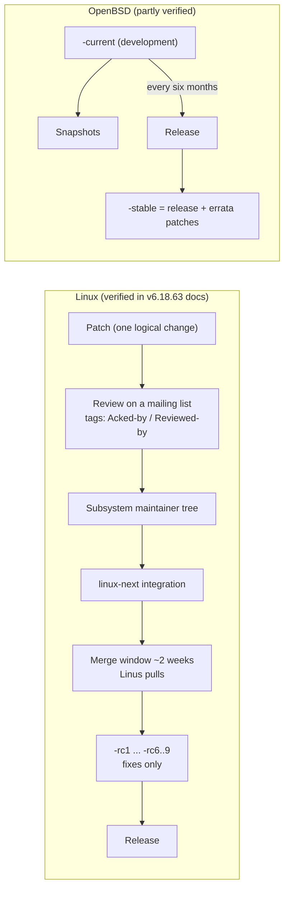

<div dir="rtl">

# ۰۱ — Case study: Linux و OpenBSD فرایندشان را چطور مکتوب کرده‌اند

> ماژول ۰۱ · مهندسی نرم‌افزار پیشرفته · ترم ۱ · نسخهٔ انگلیسی: [case-study.en.md](case-study.en.md) · نسخه‌های ثابت: Linux **v6.18.63**، OpenBSD **`8cada8c`**
> پیش‌نیاز: [lesson](lesson.fa.md) §2.7 (open-source و synchronize-and-stabilize)، یادداشت‌های [07](notes/07-open-source-and-sync-stabilize.fa.md) و [08](notes/08-process-improvement-devops-dora.fa.md). مورد استفاده در: آزمایش [07 CONTRIBUTING guide](labs/07-contributing-guide/README.md)، ماژول ۰۵ (استانداردهای کدنویسی)، ماژول ۰۷ (technical debt).
> excerptها با اسکریپت از checkoutهای محلی `_shared/sources/` کپی شده‌اند (هر کدام حداکثر ۲۵ خط)؛ شمارهٔ خطوط همان شمارهٔ واقعی فایل‌هاست. واقعیت‌های وب URL و تاریخ دریافت (2026-11-23) دارند. هر چیز بررسی‌نشده `UNVERIFIED` علامت خورده است.

## واژه‌نامه

| اصطلاح | تعریف |
|---|---|
| **Merge window** | حدود دو هفتهٔ اول هر چرخهٔ توسعهٔ Linux که تغییرهای بزرگ در mainline merge می‌شوند. |
| **`-rcN`** | «release candidate»: pre-releaseهای هفتگی Linux بعد از merge window؛ فقط رفع باگ پذیرفته می‌شود. |
| **Maintainer** | کسی که مسئول یک زیرسیستم است؛ patchها را جمع می‌کند و به بالا می‌فرستد. |
| **Patch** | یک تغییر پیشنهادی که برای review به‌صورت متن فرستاده می‌شود (در Linux از طریق mailing list). |
| **`Signed-off-by` (SoB)** | خطی در commit لینوکس که با آن شخص Developer's Certificate of Origin را تأیید می‌کند. |
| **`Reviewed-by`** | برچسبی در Linux که با آن reviewer (با متن مشخصی) اعلام می‌کند review فنی انجام داده است. |
| **KNF** | Kernel Normal Form؛ نام سبک کدنویسی کرنل در OpenBSD (و در اصل BSD). |
| **`-current` / `-stable` / release (در OpenBSD)** | شاخهٔ توسعه / آخرین release به‌اضافهٔ patchهای errata / نسخه‌ای که هر شش ماه منتشر می‌شود (openbsd.org FAQ 5). |
| **Deprecation** | علامت‌گذاری یک interface به‌عنوان چیزی که در کد جدید نباید استفاده شود، در حالی که استفاده‌های قدیمی هنوز هست. |
| **DCO** | Developer's Certificate of Origin: بیانیهٔ حقوقیِ کوتاهی که مشارکت‌کننده دربارهٔ حق ارسال تغییر می‌دهد. |

## ۱. چرا این دو پروژه

Schach از Linux و OpenBSD به‌عنوان نمونه‌های موفق نرم‌افزار زیرساختی open-source نام می‌برد و مدل open-source را این‌طور وصف می‌کند: شروع غیررسمی و بعد postdelivery maintenance به دست داوطلبان، «generally» بدون specification و design (`Schach 8e, ch. 2 §2.9.4`، ص 56-59). هر دو پروژه چندین دهه قدمت دارند، هر دو سیستم‌عامل‌اند و مشارکت‌کنندگان فراوان دارند، اما در اینکه چقدر فرایند را مکتوب می‌کنند به‌شدت فرق دارند. برای یک پرسش جفت خوبی‌اند: **وقتی فرایند یک پروژهٔ open-source بالغ را در مخزن می‌خوانید چه شکلی دارد؟**

> **Schach می‌گوید X؛ رویهٔ مدرن می‌گوید Y.** Schach (2011): پروژه‌های open-source specification و design ندارند و به‌خاطر مهارت استثنایی افراد موفق می‌شوند. رویهٔ مدرن، که در فایل‌های زیر دیده می‌شود: ادعای «بدون فرایند» غلط است. Linux v6.18.63 یک پوشه از سندهای فرایندی دارد (`Documentation/process/`: چرخهٔ release، قالب patch، برچسب‌های review، سبک کدنویسی، فهرست interfaceهای deprecated، code of conduct، راهنمای maintainerها). این استدلال مهارت را رد نمی‌کند، اما فرایند صریح است و زمان reviewerها کمیاب‌ترین منبع به حساب می‌آید.

</div>



<div dir="rtl">

نیمهٔ چپ در فایل‌هایی که در ادامه نقل شده مستند است. در نیمهٔ راست فقط ساختار شاخه‌ها و چرخهٔ شش‌ماهه تأیید شده است (§6)؛ اینکه یک تغییر چطور وارد `-current` می‌شود اینجا **UNVERIFIED** است.

## ۲. چرخهٔ release: stabilization به‌صورت متن

**منبع:** `linux/Documentation/process/2.Process.rst · "How the development process works" (merge window) · v6.18.63`، خطوط 35-55.

</div>

```rst
A relatively straightforward discipline is followed with regard to the
merging of patches for each release.  At the beginning of each development
cycle, the "merge window" is said to be open.  At that time, code which is
deemed to be sufficiently stable (and which is accepted by the development
community) is merged into the mainline kernel.  The bulk of changes for a
new development cycle (and all of the major changes) will be merged during
this time, at a rate approaching 1,000 changes ("patches," or "changesets")
per day.

(As an aside, it is worth noting that the changes integrated during the
merge window do not come out of thin air; they have been collected, tested,
and staged ahead of time.  How that process works will be described in
detail later on).

The merge window lasts for approximately two weeks.  At the end of this
time, Linus Torvalds will declare that the window is closed and release the
first of the "rc" kernels.  For the kernel which is destined to be 5.6,
for example, the release which happens at the end of the merge window will
be called 5.6-rc1.  The -rc1 release is the signal that the time to
merge new features has passed, and that the time to stabilize the next
kernel has begun.
```

<div dir="rtl">

**خط به خط**

- L35-36: سند این انضباط را «relatively straightforward» می‌نامد: یک قاعده برای هر release، نه یک کمیته.
- L36-39: چرخه با merge window *شروع می‌شود*؛ کد فقط وقتی merge می‌شود که «sufficiently stable» ارزیابی شود **و** جامعهٔ توسعه آن را بپذیرد؛ یعنی گیت هم فنی است هم اجتماعی.
- L39-42: بخش عمدهٔ تغییرها، و همهٔ تغییرهای بزرگ، در همین پنجره و با نرخی نزدیک به 1,000 تغییر در روز وارد می‌شوند: کار سنگین در یک بازهٔ کوتاه و محدود متمرکز می‌شود.
- L44-47: هیچ چیز «out of thin air» نمی‌آید: تغییرها قبلاً جمع، تست و staged شده‌اند. همین فایل توضیح می‌دهد چطور: درخت‌های زیرسیستم که maintainerشان وقتی پنجره باز می‌شود از Linus می‌خواهند «pull» کند (L237) و درخت یکپارچه‌سازی linux-next (L298-308).
- L49-55: بعد از حدود دو هفته Linus پنجره را می‌بندد و `-rc1` را منتشر می‌کند؛ این علامت است که «the time to merge new features has passed» و stabilization شروع شده است (L53-55).
- آنچه excerpt نمی‌گوید: خطوط بعدی (L57-71) می‌گویند در شش تا ده هفتهٔ بعد فقط رفع مشکل وارد می‌شود و با releaseهای هفتگی `-rc` معمولاً تا `-rc6` تا `-rc9` ادامه می‌یابد. این خطوط را خواندم اما بیرون از excerpt هستند.

**ارتباط با درس.** این یک چرخهٔ synchronize-and-stabilize در مقیاسی بسیار متفاوت است (Schach، §2.9.6: synchronization روزانه و مرحلهٔ stabilization در پایان هر build). قیاس از من است نه از Schach: تیم‌های Microsoft روزانه درون یک شرکت synchronize می‌کنند، Linux کار هزاران مشارکت‌کننده را در یک پنجرهٔ متمرکز یکپارچه می‌کند. هر دو دورهٔ ریسک‌پذیری را از دورهٔ پرداخت ریسک جدا می‌کنند.

## ۳. review و انضباط تغییر: `submitting-patches.rst`

### ۳.۱ یک تغییر منطقی در هر patch

**منبع:** `linux/Documentation/process/submitting-patches.rst · "Separate your changes" · v6.18.63`، خطوط 168-180.

</div>

```rst
Separate your changes
---------------------

Separate each **logical change** into a separate patch.

For example, if your changes include both bug fixes and performance
enhancements for a single driver, separate those changes into two
or more patches.  If your changes include an API update, and a new
driver which uses that new API, separate those into two patches.

On the other hand, if you make a single change to numerous files,
group those changes into a single patch.  Thus a single logical change
is contained within a single patch.
```

<div dir="rtl">

**خط به خط**

- L168-169: عنوان نام قاعده است؛ دربارهٔ *granularity تغییر* است، یعنی واحدی که review، تست و در صورت نیاز revert می‌شود.
- L171: «logical change» واحد است، نه «file» یا «اندازهٔ commit».
- L173-176: مثال‌ها: رفع باگ را از تغییر کارایی در همان driver جدا کن؛ به‌روزرسانی API را از driver جدیدی که از آن استفاده می‌کند جدا کن. هر کدام را می‌شود جداگانه review و bisect کرد.
- L178-180: قاعدهٔ مقابل: یک تغییر که به فایل‌های زیادی دست می‌زند **یک** patch است («a single logical change is contained within a single patch»). معیار *معنا* است نه اندازهٔ diff.

این همان ایدهٔ **increment** است (درس §2.3): یک تکهٔ کوچک، کامل و قابل review. همین است که `git bisect` را مفید می‌کند (آزمایش [04](labs/04-git-bisect-worktrees/README.md)): یک تغییر منطقی در هر commit می‌گوید کدام تغییر چه چیزی را شکست.

### ۳.۲ برچسب review یعنی چه

**منبع:** `linux/Documentation/process/submitting-patches.rst · "Reviewer's statement of oversight" · v6.18.63`، خطوط 562-575.

</div>

```rst
By offering my Reviewed-by: tag, I state that:

	 (a) I have carried out a technical review of this patch to
	     evaluate its appropriateness and readiness for inclusion into
	     the mainline kernel.

	 (b) Any problems, concerns, or questions relating to the patch
	     have been communicated back to the submitter.  I am satisfied
	     with the submitter's response to my comments.

	 (c) While there may be things that could be improved with this
	     submission, I believe that it is, at this time, (1) a
	     worthwhile modification to the kernel, and (2) free of known
	     issues which would argue against its inclusion.
```

<div dir="rtl">

**خط به خط**

- L562: `Reviewed-by` یک *بیانیه* است نه یک کلیک: «By offering my Reviewed-by: tag, I state that».
- L564-566 (a): reviewer یک review فنی برای «appropriateness and readiness» انجام داده: هم اینکه آیا تغییر باید وجود داشته باشد و هم اینکه تمام است یا نه.
- L568-570 (b): مشکل‌ها به نویسنده برگردانده شده و reviewer از پاسخ‌ها راضی است: review گفت‌وگویی است که به توافق ختم می‌شود.
- L572-575 (c): لازم نیست reviewer فکر کند patch بی‌نقص است؛ «worthwhile» و «free of known issues» است، *در این لحظه*. معیار دقیق و صادقانه بیان شده.
- خطوط بعدی (L577-580، نمایش داده نشده): بند (d) می‌گوید اینکه reviewer patch را مرور کرده و سالم می‌داند به این معنا نیست که ضمانت می‌کند در هر وضعیتی کار می‌کند؛ برچسب یک تضمین نیست. این بند بیرون از excerpt است.

بخش دیگری از همین فایل توضیح می‌دهد چرا برچسب برای مشارکت‌کنندگان مهم است: برچسب‌های `Reviewed-by` وقتی از reviewerهایی بیایند که حوزه را می‌شناسند و دقیق review می‌کنند، «will normally increase the likelihood» پذیرفته شدن patch را (L587-589). این را با تأکید CMM سطح ۲ بر اندازه‌گیری مقایسه کنید (Schach، §3.13): Linux ثبت می‌کند *چه کسی چه چیزی را review کرده* و این را در خود تاریخچه می‌گذارد، پس review قابل ممیزی است.

### ۳.۳ هزینهٔ نادیده گرفتن قواعد

**منبع:** `linux/Documentation/process/submitting-patches.rst · "Style-check your changes" · v6.18.63`، خطوط 201-208.

</div>

```rst
Style-check your changes
------------------------

Check your patch for basic style violations, details of which can be
found in Documentation/process/coding-style.rst.
Failure to do so simply wastes
the reviewers time and will get your patch rejected, probably
without even being read.
```

<div dir="rtl">

**خط به خط**

- L204-205: سبک **قبل از** ارسال بررسی می‌شود؛ قواعد سبک در `coding-style.rst` هستند.
- L206-208: جریمهٔ اعلام‌شده این است که کوتاهی «wastes the reviewers time» و patch «probably without even being read» رد می‌شود. فرایند با اینکه خطاهای مکانیکی را مشکل فرستنده می‌کند از کمیاب‌ترین منبع (توجه reviewer) محافظت می‌کند.

## ۴. استانداردهای کدنویسی: یک تصمیم، دو شکل نوشتن

### ۴.۱ لحن و اقتدار

**Linux، منبع:** `linux/Documentation/process/coding-style.rst · preamble · v6.18.63`، خطوط 6-10.

</div>

```rst
This is a short document describing the preferred coding style for the
linux kernel.  Coding style is very personal, and I won't **force** my
views on anybody, but this is what goes for anything that I have to be
able to maintain, and I'd prefer it for most other things too.  Please
at least consider the points made here.
```

<div dir="rtl">

**OpenBSD، منبع:** `openbsd/share/man/man9/style.9 · DESCRIPTION · 8cada8c`، خطوط 33-43.

</div>

```roff
.Sh DESCRIPTION
This file specifies the preferred style for kernel source files in the
.Ox
source tree.
It is also a guide for preferred userspace code style.
These guidelines should be followed for all new code.
In general, code can be considered
.Dq new code
when it makes up about 50% or more of the file(s) involved.
This is enough to break precedents in the existing code and use the
current style guidelines.
```

<div dir="rtl">

**خط به خط**

- Linux L6-10: صدای شخصی («I won't force my views») اما با بیان روشن اقتدار: این چیزی است که برای هر آنچه نویسنده باید نگه‌داری کند اعمال می‌شود و برای بقیه ترجیح اوست. سبک به‌صورت ترجیح یک maintainer با استدلال ارائه می‌شود.
- OpenBSD L34-37: صدای خنثی: «preferred style for kernel source files»، با کاربرد دوم به‌عنوان راهنما برای کد user-space در همان درخت. در سورس man page، `.Ox` یک macro است که «OpenBSD» چاپ می‌کند.
- OpenBSD L38-43: قاعده‌ای برای *اینکه کِی اعمال می‌شود*: «new code» یعنی کدی که حدود 50٪ یا بیشتر فایل‌های درگیر را تشکیل می‌دهد، که «enough to break precedents» است. این سیاستی صریح برای style debt است: کد جدید از استاندارد فعلی پیروی می‌کند، ویرایش‌های کوچک از فایل اطراف. در خطوط Linux چنین قاعده‌ای نیست؛ کل فایل را برای آن نگشتم.

### ۴.۲ indentation، عرض و whitespace

**Linux، منبع:** `linux/Documentation/process/coding-style.rst · "1) Indentation" · v6.18.63`، خطوط 21-39.

</div>

```rst
Tabs are 8 characters, and thus indentations are also 8 characters.
There are heretic movements that try to make indentations 4 (or even 2!)
characters deep, and that is akin to trying to define the value of PI to
be 3.

Rationale: The whole idea behind indentation is to clearly define where
a block of control starts and ends.  Especially when you've been looking
at your screen for 20 straight hours, you'll find it a lot easier to see
how the indentation works if you have large indentations.

Now, some people will claim that having 8-character indentations makes
the code move too far to the right, and makes it hard to read on a
80-character terminal screen.  The answer to that is that if you need
more than 3 levels of indentation, you're screwed anyway, and should fix
your program.

In short, 8-char indents make things easier to read, and have the added
benefit of warning you when you're nesting your functions too deep.
Heed that warning.
```

<div dir="rtl">

**OpenBSD، منبع:** `openbsd/share/man/man9/style.9 · indentation paragraph · 8cada8c`، خطوط 317-330.

</div>

```roff
Indentation is an 8 character tab.
Second level indents are four spaces.
All code should fit in 80 columns.
.Bd -literal -offset indent
while (cnt < 20)
	z = a + really + long + statement + that + needs +
	    two + lines + gets + indented + four + spaces +
	    on + the + second + and + subsequent + lines;
.Ed
.Pp
Do not add whitespace at the end of a line, and only use tabs
followed by spaces to form the indentation.
Do not use more spaces than a tab will produce
and do not use spaces in front of tabs.
```

<div dir="rtl">

**همتای ماشین‌خوان در Linux:** `linux/.clang-format · v6.18.63`، خطوط 55، 60، 759، 801-802.

</div>

```yaml
ColumnLimit: 80
ContinuationIndentWidth: 8
IndentWidth: 8
TabWidth: 8
UseTab: Always
```

<div dir="rtl">

**خط به خط**

- Linux L21-23: tab برابر 8 کاراکتر است و indentation هم 8 کاراکتر؛ متن «heretic movements» که 4 یا 2 کاراکتر را می‌خواهند مسخره می‌کند. لحن رنگارنگ است؛ قاعده دقیق.
- Linux L26-29: توجیه: هدف indentation نشان دادن شروع و پایان بلوک است، که با indentهای بزرگ وقتی 20 ساعت پیاپی به صفحه نگاه کرده‌اید راحت‌تر است.
- Linux L31-35: ایراد معمول (8 ستون کد را به راست می‌برد و روی ترمینال 80 ستونی سخت می‌شود) با تبدیل به ویژگی جواب داده می‌شود: بیش از سه سطح indentation یعنی برنامه باید اصلاح شود. L37-39: indent هشت‌کاراکتری هم دربارهٔ nesting بیش از حد هشدار می‌دهد («Heed that warning»).
- OpenBSD L317-319: سه قاعده در سه خط: indent با tab هشت‌کاراکتری، indent سطح دوم (continuation) چهار space، و 80 ستون.
- OpenBSD L320-325: مثال، خط continuation را با یک tab به‌اضافهٔ چهار space نشان می‌دهد، مطابق قاعدهٔ سبک.
- OpenBSD L327-330: بهداشت whitespace: بدون whitespace انتهای خط؛ فقط tab و بعد space؛ هرگز space قبل از tab. دقیقاً نوع قاعده‌ای که یک ابزار می‌تواند بررسی کند.
- `.clang-format` L55 / L759 / L801-802: `ColumnLimit: 80`، `IndentWidth: 8`، `TabWidth: 8`، `UseTab: Always`: همان قواعد متنیِ بالا به‌صورت پیکربندی. L60: `ContinuationIndentWidth: 8` که **با چهار space در OpenBSD فرق دارد**. این فایل تقریب clang-format از سبک متنی برای ویرایشگر و ابزار است؛ سند Linux که رابطهٔ این دو را توضیح می‌دهد (`Documentation/dev-tools/clang-format.rst`، که بالای config به آن ارجاع شده) باز نشد، پس اینکه در خطوط continuation متن برنده است یا config **UNVERIFIED** است.

**ارتباط با درس.** استاندارد کدنویسی یک artifact فرایندی است (درس §2.8 و CMM سطح ۳ Schach: فرایند تعریف‌شده و مستند). این دو پروژه حامل‌های متفاوتی انتخاب کردند: Linux استدلال را می‌نویسد و پیکربندی ابزار هم می‌دهد؛ OpenBSD یک man page در همان سامانهٔ مستندسازی بقیهٔ interfaceهای کرنل می‌نویسد (`style(9)`) و به `indent(1)` اشاره می‌کند (SEE ALSO، زیر).

### ۴.۳ تبارنامهٔ استاندارد OpenBSD

**OpenBSD، منبع:** `openbsd/share/man/man9/style.9 · SEE ALSO and HISTORY · 8cada8c`، خطوط 602-614.

</div>

```roff
.Sh SEE ALSO
.Xr indent 1 ,
.Xr err 3 ,
.Xr queue 3 ,
.Xr warn 3 ,
.Xr mdoc 7
.Sh HISTORY
This man page is largely based on the src/admin/style/style file from the
.Bx 4.4 Lite2
release, with updates to reflect the current practice and
desire of the
.Ox
project.
```

<div dir="rtl">

- L609-614: صفحه می‌گوید «largely based» بر یک فایل سبک از release نسخهٔ 4.4BSD Lite2 است، با به‌روزرسانی‌هایی که «the current practice and desire» پروژه را منعکس می‌کند: استاندارد به ارث رسیده و بعد با ویرایش همان سند تطبیق داده می‌شود.
- L603: بخش SEE ALSO `indent(1)` (یک formatter) را فهرست می‌کند؛ اینکه OpenBSD آن را به‌عنوان گیت اجباری استفاده می‌کند **UNVERIFIED** است (در فایل‌های بررسی‌شده نیست).

## ۵. technical debt به‌صورت فهرست مستند: `deprecated.rst`

**منبع:** `linux/Documentation/process/deprecated.rst · introduction · v6.18.63`، خطوط 9-18.

</div>

```rst
In a perfect world, it would be possible to convert all instances of
some deprecated API into the new API and entirely remove the old API in
a single development cycle. However, due to the size of the kernel, the
maintainership hierarchy, and timing, it's not always feasible to do these
kinds of conversions at once. This means that new instances may sneak into
the kernel while old ones are being removed, only making the amount of
work to remove the API grow. In order to educate developers about what
has been deprecated and why, this list has been created as a place to
point when uses of deprecated things are proposed for inclusion in the
kernel.
```

<div dir="rtl">

**منبع:** `linux/Documentation/process/deprecated.rst · "BUG() and BUG_ON()" · v6.18.63`، خطوط 32-41.

</div>

```rst
BUG() and BUG_ON()
------------------
Use WARN() and WARN_ON() instead, and handle the "impossible"
error condition as gracefully as possible. While the BUG()-family
of APIs were originally designed to act as an "impossible situation"
assert and to kill a kernel thread "safely", they turn out to just be
too risky. (e.g. "In what order do locks need to be released? Have
various states been restored?") Very commonly, using BUG() will
destabilize a system or entirely break it, which makes it impossible
to debug or even get viable crash reports. Linus has `very strong
```

<div dir="rtl">

**خط به خط**

- L9-11: وضع ایده‌آل تبدیل همهٔ استفاده‌های یک API قدیمی و حذف آن در یک چرخهٔ توسعه است؛ L11-13 توضیح می‌دهد چرا همیشه شدنی نیست: «the size of the kernel, the maintainership hierarchy, and timing».
- L13-15: هزینهٔ تأخیر: نمونه‌های جدید «may sneak into the kernel while old ones are being removed»، پس مقدار کار برای حذف API بیشتر می‌شود. این شکل کلاسیک بدهی‌ای است که بهره می‌دهد.
- L15-18: فهرست برای آموزش توسعه‌دهندگان دربارهٔ آنچه deprecated شده و چرا ساخته شده، «a place to point» وقتی کسی استفادهٔ جدید پیشنهاد می‌کند. از نظر فرایندی ابزار کمکی review است: reviewer به‌جای بحث دوباره، بند را لینک می‌دهد.
- بخش `BUG()` L34-35: قاعده («Use `WARN()` and `WARN_ON()` instead, and handle the 'impossible' error condition as gracefully as possible»). L36-39: نیت اولیه (یک assert «ایمن» که thread کرنل را می‌کشد) و چرا «too risky» است: ترتیب lockها و state بازیابی‌شده نامعلوم‌اند. L39-41: پیامد: `BUG()` اغلب سیستم را بی‌ثبات یا خراب می‌کند و debug یا گرفتن crash report را ناممکن می‌کند. یک ورودی deprecation یعنی *قاعده + دلیل + جایگزین*.

**ارتباط با درس.** این postdelivery maintenance به‌صورت فعالیتی مدیریت‌شده است (Schach، §1.3.1، perfective/adaptive/corrective). اینکه OpenBSD فهرستی معادل نگه می‌دارد **UNVERIFIED** است؛ release notes و بخش‌های `HISTORY` در manualها جاهایی هستند که باید دید، و هیچ‌کدام باز نشد.

## ۶. چه چیزی دربارهٔ فرایند OpenBSD هنوز UNVERIFIED است

دو صفحه از openbsd.org را در 2026-11-23 گرفتم و فقط موارد زیر را توانستم تأیید کنم.

| ادعا | وضعیت | شاهد |
|---|---|---|
| هر release حدود هر شش ماه منتشر می‌شود | VERIFIED (همان‌طور که در صفحهٔ FAQ آمده) | https://www.openbsd.org/faq/faq5.html: "The version of OpenBSD shipped every six months." |
| `-current` شاخهٔ توسعه است و هر شش ماه tag می‌خورد و release بعدی می‌شود | VERIFIED | همان صفحه |
| `-stable` = یک release به‌اضافهٔ patchهای صفحهٔ errata؛ رفع‌های مهم در `-current` به شاخه‌های `-stable` پشتیبانی‌شده backport می‌شوند | VERIFIED | همان صفحه |
| فقط دو release آخر رفع‌های امنیتی و پایداری برای base system می‌گیرند | VERIFIED | همان صفحه |
| snapshotهای `-current` بین releaseها ساخته می‌شوند | VERIFIED | همان صفحه |
| مجوز ISC برای کد جدید ترجیح داده می‌شود؛ نرم‌افزار وابسته به GPL برای base در نظر گرفته نمی‌شود | VERIFIED | https://www.openbsd.org/policy.html |
| چه کسی می‌تواند commit کند، و review پیش از commit چه شکلی است (مثلاً «ok» از توسعه‌دهندهٔ دیگر در پیام commit) | **UNVERIFIED** | هیچ سندی باز نشد؛ `git log` یک mirror را ببینید (clone جدا لازم است، `_shared/sources/README.md`) |
| یک release چطور مونتاژ و تست می‌شود (release engineering) | **UNVERIFIED** | FAQ به release(8) اشاره می‌کند؛ باز نشد |
| آیا سبک به‌صورت خودکار اعمال می‌شود (`indent(1)`، hookهای pre-commit) | **UNVERIFIED** | فقط SEE ALSO در `style.9` |
| آیا پیش از release گیت تست regression وجود دارد | **UNVERIFIED** | درخت `regress/` دارد؛ نقشش در فرایند release بررسی نشد |
| اندازه، گردش و تأمین مالی گروه توسعه‌دهندگان | **UNVERIFIED** | بررسی نشد |

ادعایی مثل «OpenBSD تیم هستهٔ کوچک و فرهنگ review سخت‌گیرانه دارد» محتمل و پرتکرار است، اما منبع تأییدشده‌ای برای آن ندارم؛ بدون ارجاع در امتحان تکرارش نکنید.

## ۷. جدول انتخاب‌های طراحی

| انتخاب طراحی | Linux (v6.18.63) | OpenBSD (`8cada8c`) | Trade-off |
|---|---|---|---|
| ریتم release | merge window حدود 2 هفته، بعد `-rc` هفتگی تا آماده شدن (`2.Process.rst`)؛ تاریخ ثابت ندارد | هر شش ماه یک release از شاخهٔ `-current` (faq5، دریافت 2026-11-23) | Linux: بر پایهٔ آمادگی، release ممکن است چند `-rc` عقب بیفتد. OpenBSD: بر پایهٔ تاریخ؛ ریتم قابل پیش‌بینی برای کاربران، اما ممکن است release با کمبودهای شناخته‌شده برود. |
| واحد تغییر | یک تغییر منطقی در هر patch (`submitting-patches.rst` L168-180) | UNVERIFIED | patchهای کوچک خوب review و bisect می‌شوند؛ patchهای زیاد هماهنگی بیشتری می‌خواهند (series، وابستگی). |
| ثبت review | برچسب‌های صریح با بیانیهٔ تعریف‌شده (`Reviewed-by`، `Acked-by`، `Signed-off-by`) | UNVERIFIED | تاریخچهٔ قابل ممیزی در برابر تشریفات اضافه در هر پیام commit. |
| منشأ حقوقی | DCO با هر patch امضا می‌شود (`submitting-patches.rst`، L396 به بعد) | سیاست مجوز: ISC ترجیحی، کد وابسته به GPL برای base در نظر گرفته نمی‌شود (صفحهٔ policy) | DCO با مشارکت‌کنندگان گذرای زیاد مقیاس می‌پذیرد؛ سیاست مجوز درخت را یکدست نگه می‌دارد ولی کد مفید GPL را از base کنار می‌گذارد. |
| اقتدار سبک | ترجیح با استدلال، به صدای maintainer؛ همراه با پیکربندی ابزار | «should be followed for all new code» به‌صورت هنجاری در یک man page | اقناع راحت‌تر پذیرفته می‌شود، قاعدهٔ صریح راحت‌تر اجرا می‌شود. |
| سبک روی کد قدیمی | در خطوط خوانده‌شده قاعده‌ای نیست | «New code» = ≥ 50٪ فایل؛ precedentهای قدیمی را می‌شود شکست | از سبک مخلوط درون یک فایل جلوگیری می‌کند به قیمت churn بازقالب‌بندی. |
| Indent / عرض | tab هشت‌کاراکتری، 80 ستون؛ config با `ContinuationIndentWidth: 8` | tab هشت‌کاراکتری، 80 ستون؛ خطوط continuation با چهار space | تقریباً همان تصمیم؛ تفاوت کوچک نشان می‌دهد بدون یک منبع اجراشده، استانداردها دچار drift می‌شوند. |
| ابزار | `.clang-format` در درخت | `indent(1)` در SEE ALSO؛ اجبار UNVERIFIED | قاعدهٔ ماشین‌قابل‌بررسی زمان review انسانی نمی‌خواهد. |
| Technical debt | فهرست صریح با دلیل و جایگزین (`deprecated.rst`) | UNVERIFIED (release notes؟ `HISTORY` manual؟) | فهرست بحث تکراری در review را کم می‌کند اما باید نگه‌داری شود؛ حذف هنوز به داوطلبان بستگی دارد. |
| شکل مستندسازی | Sphinx/reStructuredText زیر `Documentation/process/` | man pageها (`style(9)`) در بخش 9، «kernel internals» | مخاطب‌های متفاوت: راهنمای وب‌مانند در برابر سامانهٔ man page که توسعه‌دهندگان از قبل می‌شناسند. |

## ۸. منابع کلاسیک (Schach به آن‌ها ارجاع می‌دهد؛ من چه چیزی را تأیید کردم؟)

| منبع | وضعیت |
|---|---|
| **Royce 1970**، "Managing the Development of Large Software Systems"، *Proceedings, IEEE WESCON*، آگوست 1970، ص 1-9 | در 2026-11-23 **باز شد**: یک PDF از نوع reprint در https://www.praxisframework.org/files/royce1970.pdf (نسخهٔ میزبانی‌شده توسط شخص ثالث؛ reprint خط copyright مربوط به IEEE دارد و «Originally published by TRW» است). تأییدشده: شکل ساده و ترتیبی؛ جمله‌ای که می‌گوید پیاده‌سازی آن «is risky and invites failure» و اینکه تست در انتها اولین باری است که timing، storage و I/O تجربه می‌شوند نه تحلیل؛ پنج افزودنی (Step 1 طراحی برنامه اول، Step 2 مستندسازی طراحی، Step 3 دو بار انجام بده، Step 4 تست را برنامه‌ریزی، کنترل و پایش کن، Step 5 مشتری را درگیر کن)؛ و گزاره دربارهٔ مستندسازی («quite a lot»). ارجاع Schach (عنوان با "Concepts and Techniques"، 1970 WESCON Technical Papers، ص A/1-1 تا A/1-9) در فهرست مراجع فصل ۲ او آمده است. |
| **Boehm 1988**، "A Spiral Model of Software Development and Enhancement"، *IEEE Computer* 21 (May 1988)، ص 61-72 | **باز نشد. UNVERIFIED** فراتر از مدخل فهرست مراجع Schach و خلاصهٔ او (§2.9.7، محدودیت به پروژه‌های داخلی و بزرگ، ص 66). برای بررسی: مقاله را از صفحهٔ IEEE Xplore شمارهٔ May 1988 *Computer* (دسترسی کتابخانه) باز کنید و گام risk-analysis آن را با توصیف Schach مقایسه کنید. |

> **Schach می‌گوید X؛ رویهٔ مدرن می‌گوید Y.** Schach (2011) waterfall را مدل اصلی معرفی می‌کند و حلقه‌های بازخوردش را نشان می‌دهد (§2.9.2). مقالهٔ خود Royce نسخهٔ خطی را اول می‌آورد و آن را risky می‌نامد، بعد iteration و یک نسخهٔ «pilot» اول را اضافه می‌کند؛ waterfallی که امروز نقد می‌شود شکل اول است نه توصیهٔ Royce. رویهٔ مدرن (CI، trunk-based development، continuous delivery) نوادهٔ گام‌های «do it twice» و «involve the customer» است که از ماه‌ها به ساعت‌ها کوچک شده. اینکه چه مقدار از این تبار مستقیم است `OPINION / CONTESTED` است.

## ۹. پرسش‌های این case study

1. Linux می‌گوید تغییر باید «sufficiently stable and accepted by the community» باشد تا وارد merge window شود. کدام بخشش فنی است، کدام اجتماعی، و برای تغییری که از آن جا می‌ماند چه می‌شود؟
2. بیانیهٔ `Reviewed-by` را به‌صورت سه مورد checklist برای قالب pull request مخزن خودتان بازنویسی کنید (آزمایش 07).
3. OpenBSD می‌گوید «new code» یعنی ≥ 50٪ فایل‌های درگیر. این قاعده چه مشکلی را حل می‌کند و برای یک رفع تک‌خطی چه مشکلی می‌آفریند؟
4. برای پر کردن کدام یک از ده ردیف §7 برای OpenBSD به منبع بیرونی نیاز دارید؟ نام فایل یا صفحه‌ای که باز می‌کنید را بگویید.
5. یک ردیف §7 را انتخاب کنید و به یک متریک DORA (درس §2.8) نگاشت کنید: lead time را بهتر می‌کند، change fail rate را، یا هیچ‌کدام؟

</div>
