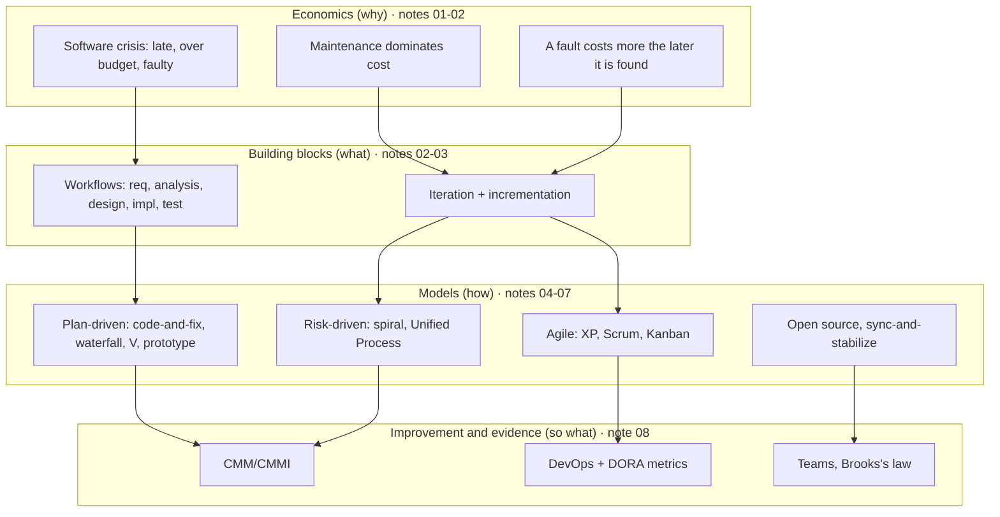

# 01 — Software Processes & Lifecycle Models

> Module 01 · Advanced Software Engineering · Term 1 · Farsi: [lesson.fa.md](lesson.fa.md) · Pins for source excerpts: Linux **v6.18.63**, OpenBSD **`8cada8c`**
> Time: ~15 h (lesson 2 h · notes 5 h · case study 1.5 h · labs 6.5 h) · Slides: [`slides/lesson.en.html`](slides/lesson.en.html) · Quiz: [`quiz.en.md`](quiz.en.md) · Case study: [`case-study.en.md`](case-study.en.md)
> **Depends on:** Module 00 (toolchain, the `project/` skeleton at tag `m0`, CI workflow). **Used by:** Module 02 (requirements are one workflow of the process), Module 06 (testing levels and CI gates), Module 07 (maintenance economics, metrics), Module 08 (DORA and process claims as empirical questions).
> Sources: Schach, *Object-Oriented and Classical Software Engineering*, 8th ed. (cited `Schach 8e, ch. N §x`); DORA metrics page (dora.dev, fetched 2026-11-23). Anything not opened is marked `UNVERIFIED`.

## Learning objectives

- Explain, with numbers, why the economics of software (maintenance, late faults) shape every process decision.
- Distinguish **workflows** (requirements, analysis, design, implementation, test) from **phases**, and **iteration** from **incrementation**, using Schach's vocabulary.
- Describe code-and-fix, waterfall, V-model, rapid prototyping, spiral, Unified Process, open-source, synchronize-and-stabilize and agile (XP, Scrum, Kanban) models: what problem each one answers and where each one fails.
- Choose, justify and mix a life-cycle model for a given project (size, risk, client, team, contract).
- Read a DORA-style metrics table and a CI pipeline as evidence about a process, and say what they do not show.
- Compare how two real, decades-old operating-system projects (Linux, OpenBSD) encode process in text and tooling.

## Glossary

| Term | Definition |
|---|---|
| **Software process** | The set of activities, people, tools and rules by which software is built and maintained. |
| **Life-cycle model** | A description of the order (and repetition) of the activities of a process, from first idea to retirement. |
| **Workflow** | An activity that runs throughout the project: requirements, analysis, design, implementation, test (Schach, ch. 2-3). Several workflows are active at once. |
| **Phase** | A time interval with a goal and a milestone (Unified Process: inception, elaboration, construction, transition). Not the same as a workflow. |
| **Iteration** | Revisiting and improving the same artifacts (a better requirements document, a reworked design). Schach: the software is developed by successive approximations. |
| **Incrementation** | Building the product in pieces (builds), each adding functionality to the previous one. |
| **Iterative-and-incremental model** | The model Schach presents as closest to real practice: both at once, workflow by workflow (§2.5). |
| **Mistake / fault / failure / error** | Schach's terms: a *mistake* is a human action; a *fault* (defect) is its result in an artifact; a *failure* is observable incorrect behaviour; an *error* is the wrong value inside the running program (§1.11). |
| **Postdelivery maintenance** | All work after delivery: corrective (fix faults), perfective (add features, improve), adaptive (new environment) (Schach, §1.3.1). |
| **Waterfall model** | Linear sequence of documented phases with feedback loops to the previous phase; first published by Royce 1970 (Schach, §2.9.2). |
| **V-model** | Waterfall variant that pairs each development level with a test level (unit, integration, system, acceptance). Not a section of Schach; treat definitions as `OPINION / VARIES BY AUTHOR`. |
| **Rapid prototyping** | Build a throw-away working model early to learn what the client really needs (§2.9.3). |
| **Spiral model** | Risk-driven life cycle: each loop is a rapid prototype plus risk analysis, then a waterfall-style step (Boehm 1988; Schach §2.9.7). |
| **Unified Process (UP)** | An iterative-and-incremental process in four phases with five core workflows (Schach, ch. 3). |
| **Agile processes** | Approaches that value working software, client collaboration and response to change over plan-following (Agile Manifesto 2001, cited by Schach, §2.9.5). |
| **XP** | Extreme programming: stories, test-driven development, pair programming, continuous integration, no overtime (§2.9.5). |
| **Scrum / Kanban** | Scrum: fixed-length sprints with roles and events. Kanban: continuous flow with work-in-progress (WIP) limits. Schach only names Scrum; both are described here as modern practice. |
| **Timeboxing** | Setting aside a fixed amount of time for a task and doing the best job possible in it; scope is what gives (Schach, §2.9.5). |
| **Stand-up meeting** | A short daily meeting whose aim is to raise problems, not solve them (Schach, §2.9.5). |
| **Synchronize-and-stabilize** | Microsoft-style cycle: small teams work in parallel and synchronize at the end of each day (put the parts together, test, debug); each build ends with a stabilization step that fixes known faults and freezes the specification (§2.9.6). |
| **Open-source life-cycle model** | Informal start by one person, then a long phase that is only postdelivery maintenance by volunteers (§2.9.4). |
| **CMM / CMMI** | Capability Maturity Model (Integration): five maturity levels (initial, repeatable, defined, managed, optimizing) describing process capability (Schach, §3.13). |
| **DevOps** | A culture and set of practices that join development and operations: automation, small changes, shared responsibility. It is not a tool. |
| **DORA metrics** | Delivery performance metrics from the DevOps Research and Assessment programme: change lead time, deployment frequency, failed-deployment recovery time, change fail rate, deployment rework rate (dora.dev, 2026-01-05 version). VERSION-DEPENDENT (earlier versions listed four "key metrics"). |
| **Brooks's law** | Adding people to a late software project makes it later (Schach, §4.1; Brooks 1975). |
| **COTS / contract / open-source software** | Commercial off-the-shelf, built for one client under contract, or developed in the open: three very different process contexts. |

## 1. Big picture

Every model is an answer to a specific failure of the previous one. Code-and-fix produces unmaintainable code; waterfall adds control and documents but delivers the wrong product late; prototyping and spiral address "wrong product" and "unknown risk"; agile and DevOps shorten the feedback loop; CMM and DORA ask whether any of it actually worked.

## 2. Concepts

### 2.1 Why do most projects still finish late, over budget or never?

Schach reports the Standish Group study of projects completed in 2006: **35% successful, 19% cancelled or never used, 46% "challenged"** (late, over budget or short of features) (`Schach 8e, ch. 1 §1.1`, Figure 1.1). Treat this as one industry survey, not a law of nature: the Standish methodology is itself disputed `OPINION / CONTESTED`. The useful lesson is the direction of the argument: because a large share of projects fail on schedule, cost or scope, the *order of activities* is an engineering decision, not a taste.

Where the money goes matters more. Schach's averaged data say roughly **two-thirds of total cost** went to postdelivery maintenance in older data, and **70-80% or more** in newer data (`ch. 1 §1.3.2`, p. 11). His worked consequence: a coding technique that cuts coding time by 10% saves at most **0.85%** of total cost (coding plus unit testing is about 8.5% of the total), while a technique that cuts maintenance cost by 10% saves about **7.5%** (`§1.3.2`, p. 12). → note [01-software-crisis-and-economics](notes/01-software-crisis-and-economics.en.md); lab [03 cost-of-fault simulation](labs/03-cost-of-fault-simulation/README.md).

> **Schach says X; modern practice says Y.** Schach (2011) treats maintenance as postdelivery work after a delivery event, split into corrective, perfective and adaptive. In a service that deploys ten times a day there is no single "delivery" and the same pipeline ships the original feature, the fix and the dependency bump. ISO/IEC 14764 adds a fourth category, *preventive* maintenance (`UNVERIFIED`, standard not opened). Modern teams measure the same economics differently: change lead time and change fail rate (§2.9).

### 2.2 Is "design" a phase or something that happens all the time?

Classical models (Schach calls this the *classical* view) name phases: requirements, analysis, design, implementation, postdelivery maintenance. In practice every one of those activities happens in every part of the project, so Schach separates **workflows** (activities that keep running) from **phases** (periods ending in a milestone) (`ch. 2 §2.5`; `ch. 3`). A Go service that is "in implementation" still has a pull request that changes a requirement, an ADR that changes the design, and a test that was written first.

The cost-of-fault curve is why the early workflows get disproportionate attention. In Schach's 1974-80 data, a fault that costs about **$40** to fix in design costs about **$30** in analysis but around **$2000** in postdelivery maintenance; newer AS/400 data show about **$3680** at maintenance (`ch. 1 §1.4`, Figure 1.6, p. 13-14). He also reports that **60-70%** of faults found in large projects are requirements, analysis or design faults, and that JPL inspections found about **1.9, 0.9 and 0.3 faults per page** of specification, design and code (`§1.4`, p. 14). → note [02-phases-workflows-cost-of-faults](notes/02-phases-workflows-cost-of-faults.en.md).

> **Schach says X; modern practice says Y.** Schach shows a steep curve from 1970s-80s batch-oriented projects. Some agile authors argue that with fast automated tests and continuous deployment the curve flattens `OPINION / CONTESTED`: it is hard to measure and depends on how cheap a rollback is. The robust claim that survives both views: a fault in a *requirement* is expensive whenever it is found, because everything built on it is wrong.

### 2.3 What is the difference between iterating and incrementing?

Ask: "We shipped three releases; did we iterate or increment?" If each release only *added* features to the last, that is incrementation. If you reworked the design after learning from a release, that is iteration. Real projects do both, in every workflow, and Schach's **iterative-and-incremental model** (§2.5) is the baseline against which he compares the other models. He argues (§2.7) that each iteration is a small but complete waterfall, that every iteration includes the test workflow and so gives another chance to find faults while they are still cheap, and that the robustness of the architecture can be judged early. → note [03-iteration-vs-incrementation](notes/03-iteration-vs-incrementation.en.md).

In a Git repo: **increments** are tagged releases (`v0.3.0` adds an endpoint); **iterations** are refactoring commits and revised design docs that make the same artifact better. A feature branch merged weekly with passing tests is an increment; "rewrite the repository layer after the load test" is an iteration.

### 2.4 Why did waterfall become the thing everybody warns about?

Plan-driven models answer "how do we keep a 200-person project under control?" with order, documents and sign-off: a phase is not complete until its documents are approved by the quality assurance group (`Schach 8e, ch. 2 §2.9.2`). **Royce's 1970 paper**, which Schach cites as the origin of the waterfall, shows the simple sequential figure and then says the implementation of that concept "is risky and invites failure", because testing at the end is the first time timing, storage and I/O are experienced rather than analysed; it recommends five additions (preliminary program design first, document the design, do the job twice, plan and monitor testing, involve the customer) (Royce, "Managing the Development of Large Software Systems", IEEE WESCON, Aug. 1970, pp. 1-9; opened as a reprint, see [case study §8](case-study.en.md)). So the model people criticise is the *first* picture in a paper that itself argues for iteration and a prototype.

| Model | What it is built to fix | Where it fails | Note |
|---|---|---|---|
| Code-and-fix | nothing; the default when there is no process | no design, no documentation, maintenance cost explodes (Schach: "by far the worst way") | [04](notes/04-plan-driven-models.en.md) |
| Waterfall | uncontrolled, undocumented work | late discovery that the product is not what the client wants; assumes discrete phases | [04](notes/04-plan-driven-models.en.md) |
| V-model | tests designed too late | same linear assumption; heavy documents | [04](notes/04-plan-driven-models.en.md) |
| Rapid prototyping | "built what was asked, not what was needed" | prototype becomes the product; Schach: insufficient evidence it beats waterfall in other respects | [04](notes/04-plan-driven-models.en.md) |
| Spiral | unmanaged risk | needs skilled risk analysis; Schach: internal, large-scale projects only | [05](notes/05-spiral-and-unified-process.en.md) |

### 2.5 What does it mean that a process is "risk-driven"?

Before committing the budget to the next step, ask "what is the single thing that could kill this project, and what is the cheapest way to find out?" The spiral model makes that question a formal part of every loop: objectives, risk analysis, prototype, plan the next loop (Boehm 1988, via Schach §2.9.7; the paper itself is not opened, see case study §8). The Unified Process uses the same idea inside four phases: **inception** (business case), **elaboration** (architecture, kill the top risks), **construction**, **transition** (`Schach 8e, ch. 3 §3.10`). → note [05-spiral-and-unified-process](notes/05-spiral-and-unified-process.en.md).

In a repo this looks like a time-boxed spike branch, a throw-away prototype directory marked as such, or an ADR that records "we tried X, risk Y, decision Z".

### 2.6 Does agile mean no plan and no documents?

No. Schach presents XP as a controlled set of practices: stories estimated by the team, the client choosing the next build by cost-benefit, tests written first, pair programming, continuous integration, no overtime for two weeks in a row (`ch. 2 §2.9.5`). He also notes that agile is "controversial", works so far for small-scale software, and that the retained test cases form a growing regression suite. Schach only names Scrum (as one of the methods behind the Manifesto, §2.9.5) and does not mention Kanban; treat what follows as modern practice: Scrum fixes the *time* (sprint) and varies scope (timeboxing); Kanban limits *work in progress* and measures **cycle time** and flow. → note [06-agile-methods](notes/06-agile-methods.en.md); labs [05 kanban flow](labs/05-kanban-flow-metrics/README.md), [06 timebox vs waterfall](labs/06-timebox-vs-waterfall/README.md).

> **Schach says X; modern practice says Y.** Schach (2011) describes agile processes as a "somewhat controversial new approach" and sizes them for small projects. By now agile (or something that calls itself agile) is the default in industry and is used at large scale, usually combined with plan-driven governance. The 2011 caution about limited evidence is still fair: most "agile vs plan-driven" studies are observational `OPINION / CONTESTED`.

### 2.7 Can a project with no specification and no design succeed?

Schach's answer for open source (§2.9.4): the model starts as an informal first version by one person, followed by a second informal phase that consists *only* of postdelivery maintenance (corrective, perfective, adaptive) done mostly by volunteers in a core group and a peripheral group. There is usually no specification or design, and it works for infrastructure used by the contributors themselves (operating systems, compilers, web servers, databases). His explanation of the success is the high skill of the people involved, plus a "release early, release often" culture. → note [07-open-source-and-sync-stabilize](notes/07-open-source-and-sync-stabilize.en.md).

> **Schach says X; modern practice says Y.** Schach (2011) says open-source projects "generally have no specifications or design" and are maintained by unpaid volunteers. Linux in 2026 has a written process of its own (`Documentation/process/`: a roughly two-week merge window, then weekly release candidates, a mandatory sign-off, tiers of maintainers) and much of the work is done by paid engineers `UNVERIFIED as a quantitative claim; the statement about paid contributors is common knowledge but not checked here`. See the [case study](case-study.en.md) for excerpts from the v6.18.63 tree.

Synchronize-and-stabilize (§2.9.6) is the closed-source counterpart: the work is split into three or four builds; teams synchronize daily, and each build ends in a stabilization step that fixes known faults and freezes the specification. Linux's merge window followed by `-rc` releases has a similar shape at a different scale (the analogy is mine, not Schach's).

### 2.8 How do we know whether a process change helped?

CMM/CMMI answer "is the organization's process mature?" by levels: initial, repeatable, defined, managed, optimizing (`Schach 8e, ch. 3 §3.13`). Level 2 starts with measurement of cost and schedule. DORA answers the question with **outcome metrics of delivery**, not with a checklist of practices. The DORA page (fetched 2026-11-23, page dated 2026-01-05) lists five: change lead time, deployment frequency, failed-deployment recovery time (throughput group); change fail rate and deployment rework rate (instability group). → note [08-process-improvement-devops-dora](notes/08-process-improvement-devops-dora.en.md); lab [01 DORA metrics](labs/01-dora-metrics/README.md).

Example reading of a metrics table (full exercise in the [quiz](quiz.en.md)):

| Team | Deployments / week | Change lead time | Change fail rate | Failed-deployment recovery |
|---|---|---|---|---|
| A | 0.25 | 6 weeks | 5% | 2 days |
| B | 20 | 3 hours | 15% | 20 minutes |

Team B ships 80 times as often, in a fraction of the time, with a higher failure rate but much faster recovery. Whether B is "better" depends on the cost of a failure, which is a business question. A metric is not a goal: once it becomes a target, teams can game it (`OPINION / CONTESTED`, Goodhart-style argument, not sourced here).

### 2.9 Is DevOps a tool?

No. DevOps is a way of organizing the *flow* from commit to production so that changes are small, frequent and reversible, with the people who build also responsible for running. Tools (CI, containers, infrastructure as code) enable it but do not make it. Schach (2011) has no chapter on DevOps and no continuous delivery; this is where the book is out of date and the course supplies modern practice. → note 08; lab [02 CI quality gates](labs/02-ci-quality-gates/README.md).

### 2.10 Why does adding programmers to a late project make it later?

Because coordination cost grows faster than the work you can hand over: new people must be taught, and communication paths grow with team size. This is **Brooks's law** (Schach §4.1, citing Brooks 1975). Schach compares democratic teams, classical chief programmer teams (judged impractical in their pure form, §4.3.2), and teams for synchronize-and-stabilize, agile and open-source processes (§4.5-4.7), then discusses how to choose (§4.9). → note 08.

### 2.11 Which model should we use?

Schach's own advice (§2.10): each organization should choose the model appropriate to its management, employees and process, and the iterative-and-incremental and evolution-tree models are closest to reality. Use a decision table, then mix:

| Situation | Leaning toward | Why |
|---|---|---|
| Requirements stable, safety-critical, contract with fixed scope | plan-driven (V-model, waterfall with iteration) | documents and verification are the deliverable |
| Large internal project with real technical risk | spiral or UP elaboration | risk analysis is affordable and useful |
| Unclear needs, one client reachable daily | agile (XP/Scrum) | feedback loop is the control mechanism |
| Operations workload with unpredictable arrival | Kanban | flow and WIP limits, not sprints |
| Infrastructure used by its own developers | open-source model | users are co-maintainers |
| Hardware or regulatory gate in the middle | mix: agile inside, plan-driven gates around | a "mix-and-match" model |

## 3. Where this lives in a real repository

| Source | What it shows | Where |
|---|---|---|
| Linux `Documentation/process/2.Process.rst` | merge window, `-rc` releases: a stabilization cycle in text | [case study §2](case-study.en.md) |
| Linux `Documentation/process/submitting-patches.rst` | change discipline: one logical change per patch, sign-off, `Reviewed-by` | [case study §3](case-study.en.md) |
| Linux `coding-style.rst`, `.clang-format` vs OpenBSD `style.9` | the same standard, written differently | [case study §4](case-study.en.md) |
| Linux `deprecated.rst` | a process for technical debt: a list to point at in review | [case study §5](case-study.en.md) |

| Lab | What you build on `project/` (tag `m0` → `m1`) |
|---|---|
| [01 DORA metrics](labs/01-dora-metrics/README.md) | a Python script that computes deployment frequency and lead time from Git tags and commits |
| [02 CI quality gates](labs/02-ci-quality-gates/README.md) | a pipeline that blocks merges on lint, tests and a coverage threshold |
| [03 cost-of-fault simulation](labs/03-cost-of-fault-simulation/README.md) | a simulation that reproduces the 0.85% vs 7.5% argument |
| [04 git bisect + worktrees](labs/04-git-bisect-worktrees/README.md) | find a seeded regression and test two versions side by side |
| [05 Kanban flow metrics](labs/05-kanban-flow-metrics/README.md) | cycle time and WIP from a small issue export |
| [06 timebox vs waterfall](labs/06-timebox-vs-waterfall/README.md) | the same backlog planned two ways |
| [07 CONTRIBUTING guide](labs/07-contributing-guide/README.md) | a contributing guide and review checklist modelled on Linux practice |

## 4. Theory ↔ Practice

| Academic concept | What it looks like in a real Go/Python repo |
|---|---|
| Workflow (requirements, analysis, design, impl, test) | issue templates, ADRs in `docs/adr/`, code, tests; all active in the same week, in the same pull request |
| Phase gate / SQA approval (waterfall) | required status checks and required reviews on the protected branch; a release checklist |
| V-model test levels | `go test ./...` / `pytest` (unit), integration tests against a compose stack, acceptance tests from requirements |
| Incrementation | tagged releases `v0.1.0`, `v0.2.0`, each adding a feature |
| Iteration | refactoring commits, revised design docs, "rewrite" branches after measurement |
| Rapid prototype | a clearly labelled `spike/` branch that is deleted or rewritten, not merged |
| Spiral risk analysis | an ADR with a "risks and mitigation" section and a time-boxed spike before the decision |
| Timeboxing | a milestone with a fixed date; scope cut instead of date moved |
| Stand-up meeting | a daily written status in a team channel, or none if the board is current |
| Kanban WIP limit | a board column limit of N; a script that flags more than N items "in progress" |
| XP test-first, continuous integration | write the failing test first; CI runs lint and tests on every push |
| Synchronize-and-stabilize | a nightly build; a `release/x.y` branch frozen to bug fixes (the Linux `-rc` phase) |
| Open-source model | `CONTRIBUTING.md`, a sign-off requirement (`git commit -s`), `CODEOWNERS` for maintainers |
| Postdelivery maintenance categories | commit prefixes (`fix:` corrective, `feat:` perfective, `chore(deps):` adaptive/preventive); the mapping is a convention, not a standard `OPINION` |
| CMM level 2 (measurement) | a script that reports lead time, failure rate and open defects per release |
| DORA metrics | lead time from `git log`, deployment frequency from tags or deployment events, change fail rate from incident or rollback labels |

## 5. Common misconceptions

| Misconception | Reality |
|---|---|
| "Agile means no documentation." | The Agile Manifesto values working software over comprehensive documentation, not instead of it. XP in Schach has stories, retained tests and an explicit client role, and Schach reports that the Manifesto places working software above detailed documentation (§2.9.5), not in place of it. |
| "Waterfall never works." | Schach calls it a known quantity with understood strengths and weaknesses (§2.10). It works when requirements are stable and the cost of a late fault is huge. Royce's own paper argues for iteration on top of it. |
| "Waterfall was invented by Royce as a recommendation." | Schach credits Royce 1970 for the model. Royce's paper presents the simple sequential version and calls it risky (see §2.4). |
| "DevOps is a tool (or a team)." | It is a delivery culture and set of practices; Jenkins or GitHub Actions do not give you DevOps. A separate "DevOps team" that owns deployments for everyone can recreate the silo. |
| "Iteration and incrementation are synonyms." | Different questions: *improve the same artifact* vs *add a piece*. Schach needs both words (§2.5). |
| "More people, faster delivery." | Brooks's law (Schach §4.1). Communication cost grows with team size. |
| "Scrum is a life-cycle model." | It is a management framework for timeboxed iterations; it says nothing about how you test or architect. |
| "Open source means no process." | Linux has a documented release cycle, sign-off rules and maintainer hierarchy. Informal origin is not the same as no process. |
| "Maturity level = quality of the product." | CMM measures process capability, not product quality. Schach reports ROI studies, but correlation is not proof. |
| "DORA metrics are targets." | They are diagnostic indicators. Optimising deployment frequency by splitting deployments artificially improves the number and nothing else. |
| "Maintenance is bug fixing." | Corrective is only one of three categories (four with preventive). Schach also notes that the classical corrective/perfective/adaptive split is blurry: the same change is "development" before delivery and "perfective maintenance" after (§1.3.1). |

## 6. Self-check

1. Define workflow and phase. Give one example where a workflow runs in several phases.
2. State the 0.85% vs 7.5% argument and say which assumption (the share of coding in total cost) it rests on.
3. In Figure 1.6 terms: what is the order of magnitude between fixing a fault in design and in maintenance? What does it imply for where to invest?
4. Is "adding a new endpoint every sprint" iteration or incrementation? What would count as iteration?
5. Give two reasons Royce's paper is misread by people who criticise the waterfall.
6. When is the spiral model a bad choice, according to Schach?
7. A team ships 30 times a week with a 25% change fail rate and a 10-minute recovery time. Argue for and against calling that "high performing".
8. Why can a Linux-style merge window be called a synchronize-and-stabilize cycle? Where does the analogy break?
9. Which of your last three projects was closest to code-and-fix, and what would you change first?
10. Name one thing in Schach's treatment of agile processes that is out of date, and one that still holds.

Answers to the conceptual and diagram questions are in the [quiz](quiz.en.md).
