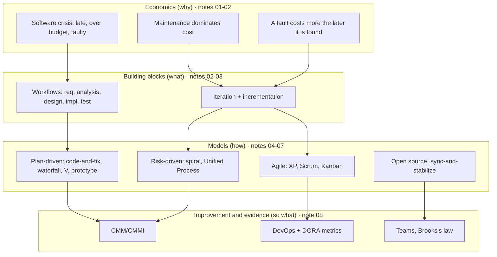

# ۰۱ — فرایندهای نرم‌افزار و مدل‌های چرخهٔ حیات

> ماژول ۰۱ · مهندسی نرم‌افزار پیشرفته · ترم ۱ · نسخهٔ انگلیسی: [lesson.en.md](lesson.en.md) · نسخه‌های ثابت سورس: Linux **v6.18.63** و OpenBSD **`8cada8c`**
> زمان: حدود ۱۵ ساعت (درس ۲ · یادداشت‌ها ۵ · case study ‏۱٫۵ · آزمایش‌ها ‏۶٫۵) · اسلایدها: [`slides/lesson.fa.html`](slides/lesson.fa.html) · آزمونک: [`quiz.fa.md`](quiz.fa.md) · Case study: [`case-study.fa.md`](case-study.fa.md)
> **پیش‌نیاز:** ماژول ۰۰ (ابزارها، اسکلت `project/` در تگ `m0`، workflow مربوط به CI). **ماژول‌هایی که به این وابسته‌اند:** ماژول ۰۲ (requirements یکی از workflowهای فرایند است)، ماژول ۰۶ (سطوح تست و CI gate)، ماژول ۰۷ (اقتصاد maintenance و metrics)، ماژول ۰۸ (DORA و ادعاهای فرایندی به‌عنوان پرسش تجربی).
> منابع: Schach، *Object-Oriented and Classical Software Engineering*، ویرایش ۸ (با ارجاع `Schach 8e, ch. N §x`)؛ صفحهٔ DORA metrics (dora.dev، تاریخ دریافت 2026-11-23). هر چیزی که باز نشده با `UNVERIFIED` علامت خورده است.

## هدف‌های یادگیری

- با عدد و رقم توضیح دهید چرا اقتصاد نرم‌افزار (maintenance و خطاهایی که دیر پیدا می‌شوند) همهٔ تصمیم‌های فرایندی را شکل می‌دهد.
- با واژگان Schach، **workflow** (requirements، analysis، design، implementation، test) را از **phase** و **iteration** را از **incrementation** جدا کنید.
- مدل‌های code-and-fix، waterfall، V-model، rapid prototyping، spiral، Unified Process، open-source، synchronize-and-stabilize و agile (‏XP، Scrum، Kanban) را شرح دهید: هر کدام جواب کدام مشکل است و کجا شکست می‌خورد.
- برای یک پروژهٔ مشخص (اندازه، ریسک، client، تیم، قرارداد) یک مدل چرخهٔ حیات انتخاب، توجیه و ترکیب کنید.
- یک جدول متریک به سبک DORA و یک pipeline مربوط به CI را به‌عنوان شاهدی دربارهٔ فرایند بخوانید و بگویید چه چیزی را نشان نمی‌دهند.
- مقایسه کنید دو پروژهٔ قدیمی و واقعی سیستم‌عامل (Linux و OpenBSD) چطور فرایند را در متن و ابزار ثبت کرده‌اند.

## واژه‌نامه

| اصطلاح | تعریف |
|---|---|
| **Software process** | مجموعهٔ فعالیت‌ها، آدم‌ها، ابزارها و قاعده‌هایی که با آن نرم‌افزار ساخته و نگه‌داری می‌شود. |
| **Life-cycle model** | توصیف ترتیب (و تکرار) فعالیت‌های یک فرایند، از اولین ایده تا بازنشستگی محصول. |
| **Workflow** | فعالیتی که در تمام طول پروژه ادامه دارد: requirements، analysis، design، implementation، test (Schach، فصل ۲ و ۳). چند workflow هم‌زمان فعال‌اند. |
| **Phase** | بازهٔ زمانی با یک هدف و یک milestone (در Unified Process: inception، elaboration، construction، transition). با workflow یکی نیست. |
| **Iteration** | بازنگری و بهتر کردن همان artifactها (سند requirements بهتر، طراحی بازنویسی‌شده). به گفتهٔ Schach نرم‌افزار با تقریب‌های متوالی ساخته می‌شود. |
| **Incrementation** | ساختن محصول تکه‌تکه (build به build)، که هر تکه به قبلی قابلیت اضافه می‌کند. |
| **Iterative-and-incremental model** | مدلی که Schach آن را نزدیک‌ترین به عمل واقعی می‌داند: هر دو با هم، workflow به workflow (§2.5). |
| **Mistake / fault / failure / error** | اصطلاحات Schach: *mistake* اشتباه انسانی است؛ *fault* (defect) نتیجهٔ آن در یک artifact است؛ *failure* رفتار نادرستِ قابل مشاهده است؛ *error* مقدار غلط درون برنامهٔ در حال اجراست (§1.11). |
| **Postdelivery maintenance** | همهٔ کارهای بعد از تحویل: corrective (رفع fault)، perfective (افزودن قابلیت و بهبود)، adaptive (محیط جدید) (Schach، §1.3.1). |
| **Waterfall model** | دنبالهٔ خطی از phaseهای مستندشده با حلقهٔ بازخورد به phase قبلی؛ اولین بار Royce در 1970 منتشرش کرد (Schach، §2.9.2). |
| **V-model** | گونه‌ای از waterfall که هر سطح توسعه را با یک سطح تست جفت می‌کند (unit، integration، system، acceptance). در Schach بخش مستقلی ندارد؛ تعریف‌ها را `OPINION / VARIES BY AUTHOR` بدانید. |
| **Rapid prototyping** | ساختن زودهنگام یک مدل کاری دورریختنی تا معلوم شود client واقعاً چه می‌خواهد (§2.9.3). |
| **Spiral model** | چرخهٔ حیات ریسک‌محور: هر حلقه یک rapid prototype به‌اضافهٔ risk analysis است و بعد یک گام به سبک waterfall (Boehm 1988؛ Schach §2.9.7). |
| **Unified Process (UP)** | فرایند iterative-and-incremental در چهار phase با پنج workflow اصلی (Schach، فصل ۳). |
| **Agile processes** | رویکردهایی که نرم‌افزار کارا، همکاری با client و پاسخ به تغییر را بر پیروی از برنامه مقدم می‌دارند (Agile Manifesto سال 2001، به نقل از Schach، §2.9.5). |
| **XP** | Extreme programming: story، test-driven development، pair programming، continuous integration و بدون اضافه‌کاری (§2.9.5). |
| **Scrum / Kanban** | Scrum: sprintهای با طول ثابت با نقش‌ها و رویدادها. Kanban: جریان پیوسته با سقف کار در جریان (WIP limit). Schach فقط نام Scrum را می‌آورد؛ هر دو در اینجا به‌عنوان رویهٔ مدرن توضیح داده می‌شوند. |
| **Timeboxing** | کنار گذاشتن مقدار مشخصی زمان برای یک کار و انجام بهترین کار ممکن در همان زمان؛ آنچه کم و زیاد می‌شود scope است (Schach، §2.9.5). |
| **Stand-up meeting** | جلسهٔ کوتاه روزانه که هدفش طرح مشکل است نه حل آن (Schach، §2.9.5). |
| **Synchronize-and-stabilize** | چرخهٔ سبک Microsoft: تیم‌های کوچک موازی کار می‌کنند و آخر هر روز synchronize می‌کنند (قطعه‌ها را کنار هم می‌گذارند، تست و debug می‌کنند)؛ هر build با یک مرحلهٔ stabilization تمام می‌شود که faultهای شناخته‌شده را رفع و specification را freeze می‌کند (§2.9.6). |
| **Open-source life-cycle model** | شروع غیررسمی توسط یک نفر و بعد یک دورهٔ طولانی که فقط postdelivery maintenance به دست داوطلبان است (§2.9.4). |
| **CMM / CMMI** | Capability Maturity Model (Integration): پنج سطح بلوغ (initial، repeatable، defined، managed، optimizing) برای توصیف توانایی فرایند (Schach، §3.13). |
| **DevOps** | فرهنگ و مجموعه‌ای از رویه‌ها که توسعه و عملیات را به هم می‌پیوندد: خودکارسازی، تغییرهای کوچک، مسئولیت مشترک. ابزار نیست. |
| **DORA metrics** | متریک‌های کارایی تحویل از برنامهٔ DevOps Research and Assessment: change lead time، deployment frequency، failed-deployment recovery time، change fail rate، deployment rework rate (dora.dev، نسخهٔ 2026-01-05). VERSION-DEPENDENT (نسخه‌های قدیمی‌تر چهار «key metric» داشتند). |
| **Brooks's law** | افزودن آدم به پروژهٔ نرم‌افزاریِ عقب‌افتاده آن را عقب‌تر می‌کند (Schach، §4.1؛ Brooks 1975). |
| **COTS / contract / open-source software** | نرم‌افزار آماده از قفسه، نرم‌افزار ساخته‌شده برای یک client با قرارداد، یا نرم‌افزار توسعه‌یافته در فضای باز: سه بافت فرایندیِ بسیار متفاوت. |

## ۱. تصویر کلی

هر مدل پاسخی است به یک شکست مشخص از مدل قبلی. code-and-fix کدِ غیرقابل نگه‌داری می‌سازد؛ waterfall کنترل و مستند اضافه می‌کند اما محصول غلط را دیر تحویل می‌دهد؛ prototyping و spiral «محصول غلط» و «ریسک ناشناخته» را هدف می‌گیرند؛ agile و DevOps حلقهٔ بازخورد را کوتاه می‌کنند؛ و CMM و DORA می‌پرسند آیا هیچ‌کدام واقعاً جواب داد.

## ۲. مفاهیم

### ۲.۱ چرا بیشتر پروژه‌ها هنوز دیر، گران یا ناقص تمام می‌شوند؟

Schach مطالعهٔ Standish Group را روی پروژه‌های تمام‌شده در 2006 نقل می‌کند: **35٪ موفق، 19٪ لغوشده یا هرگز استفاده‌نشده، 46٪ «challenged»** (دیر، بیش از بودجه، یا کم‌قابلیت‌تر از مشخصات) (`Schach 8e, ch. 1 §1.1`، Figure 1.1). این را یک نظرسنجی صنعتی بدانید، نه قانون طبیعت: روش‌شناسی Standish خودش محل بحث است `OPINION / CONTESTED`. درس مفید جهت استدلال است: چون سهم بزرگی از پروژه‌ها در زمان، هزینه یا scope شکست می‌خورند، *ترتیب فعالیت‌ها* یک تصمیم مهندسی است نه سلیقه.

مهم‌تر این است که پول کجا می‌رود. دادهٔ میانگین Schach می‌گوید در دادهٔ قدیمی‌تر حدود **دو سوم کل هزینه** و در دادهٔ جدیدتر **70 تا 80٪ یا بیشتر** صرف postdelivery maintenance می‌شد (`ch. 1 §1.3.2`، ص 11). نتیجهٔ محاسباتی او: تکنیکی که زمان coding را 10٪ کم کند حداکثر **0.85٪** از کل هزینه را صرفه‌جویی می‌کند (coding به‌اضافهٔ unit testing حدود 8.5٪ کل است)، در حالی که تکنیکی که هزینهٔ maintenance را 10٪ کم کند حدود **7.5٪** صرفه‌جویی می‌کند (`§1.3.2`، ص 12). ← یادداشت [01-software-crisis-and-economics](notes/01-software-crisis-and-economics.fa.md)؛ آزمایش [03 cost-of-fault simulation](labs/03-cost-of-fault-simulation/README.md).

> **Schach می‌گوید X؛ رویهٔ مدرن می‌گوید Y.** Schach (2011) maintenance را کارِ بعد از یک رویداد تحویل می‌داند و آن را به corrective، perfective و adaptive تقسیم می‌کند. در سرویسی که روزی ده بار deploy می‌شود «تحویل» واحدی وجود ندارد و همان pipeline هم قابلیت اولیه، هم رفع باگ و هم به‌روزرسانی وابستگی را می‌فرستد. ISO/IEC 14764 دستهٔ چهارمی هم دارد: *preventive* (`UNVERIFIED`، استاندارد باز نشده). تیم‌های مدرن همین اقتصاد را با چیز دیگری می‌سنجند: change lead time و change fail rate (§2.9).

### ۲.۲ طراحی یک phase است یا چیزی که همیشه در جریان است؟

مدل‌های کلاسیک (Schach اسمش را دید *classical* می‌گذارد) phase نام می‌برند: requirements، analysis، design، implementation، postdelivery maintenance. در عمل همهٔ این فعالیت‌ها در هر بخش از پروژه رخ می‌دهند؛ برای همین Schach **workflow** (فعالیت‌هایی که ادامه دارند) را از **phase** (دوره‌هایی که به milestone ختم می‌شوند) جدا می‌کند (`ch. 2 §2.5`؛ `ch. 3`). سرویس Go که «در implementation» است هنوز pull requestی دارد که یک requirement را عوض می‌کند، ADRای که طراحی را تغییر می‌دهد و تستی که اول نوشته شده.

منحنی هزینهٔ fault دلیل توجه نامتناسب به workflowهای اول است. در دادهٔ 1974-80 Schach، faultی که حدود **$40** در design رفع می‌شود، در analysis حدود **$30** و در postdelivery maintenance حدود **$2000** خرج دارد؛ دادهٔ جدیدتر AS/400 حدود **$3680** در maintenance نشان می‌دهد (`ch. 1 §1.4`، Figure 1.6، ص 13-14). او همچنین گزارش می‌کند **60 تا 70٪** faultهای پروژه‌های بزرگ از نوع requirements، analysis یا design هستند و inspectionهای JPL حدود **1.9، 0.9 و 0.3 fault در هر صفحه** برای specification، design و code پیدا کردند (`§1.4`، ص 14). ← یادداشت [02-phases-workflows-cost-of-faults](notes/02-phases-workflows-cost-of-faults.fa.md).

> **Schach می‌گوید X؛ رویهٔ مدرن می‌گوید Y.** Schach منحنی تند را از پروژه‌های batch دههٔ 70-80 نشان می‌دهد. برخی نویسندگان agile استدلال می‌کنند که با تست خودکار سریع و continuous deployment منحنی صاف‌تر می‌شود `OPINION / CONTESTED`: اندازه‌گیری‌اش سخت است و به ارزانیِ rollback بستگی دارد. ادعای مقاوم در برابر هر دو دیدگاه: fault در یک *requirement* همیشه گران است، چون هر چیز ساخته‌شده روی آن غلط است.

### ۲.۳ تفاوت iterating و incrementing چیست؟

بپرسید: «سه release دادیم؛ iterate کردیم یا increment؟» اگر هر release فقط به قبلی *قابلیت اضافه* کرد، incrementation بوده. اگر بعد از یادگرفتن از یک release طراحی را بازسازی کردید، iteration بوده. پروژه‌های واقعی هر دو را در هر workflow انجام می‌دهند و **iterative-and-incremental model** (§2.5) مبنایی است که Schach بقیهٔ مدل‌ها را با آن مقایسه می‌کند. او (§2.7) استدلال می‌کند که هر iteration یک waterfall کوچک اما کامل است، که هر iteration شامل test workflow است و پس فرصت دیگری برای پیدا کردن faultها وقتی هنوز ارزان‌اند می‌دهد، و اینکه استواری معماری را می‌شود زود قضاوت کرد. ← یادداشت [03-iteration-vs-incrementation](notes/03-iteration-vs-incrementation.fa.md).

در یک مخزن Git: **incrementها** releaseهای تگ‌خورده‌اند (`v0.3.0` یک endpoint اضافه می‌کند)؛ **iterationها** commitهای refactoring و سندهای طراحیِ بازنگری‌شده‌اند که همان artifact را بهتر می‌کنند. branch ویژگی که هفتگی با تست‌های سبز merge می‌شود یک increment است؛ «بعد از load test لایهٔ repository را بازنویسی کنیم» یک iteration.

### ۲.۴ چرا waterfall شد چیزی که همه از آن می‌ترسانند؟

مدل‌های plan-driven جواب می‌دهند به «چطور پروژهٔ 200 نفره را تحت کنترل نگه داریم؟» با نظم، سند و امضا: یک phase تا وقتی سندهایش تمام و توسط گروه quality assurance تأیید نشده کامل نیست (`Schach 8e, ch. 2 §2.9.2`). **مقالهٔ Royce در 1970** که Schach آن را مبدأ waterfall می‌داند، شکل ساده و ترتیبی را نشان می‌دهد و بعد می‌گوید پیاده‌سازیِ آن مفهوم «risky و invites failure» است، چون تست در انتهای چرخه اولین باری است که timing، storage و I/O *تجربه* می‌شوند نه تحلیل؛ و پنج افزودنی توصیه می‌کند (طراحی مقدماتی اول، مستندسازی طراحی، کار را دو بار انجام بده، تست را برنامه‌ریزی و پایش کن، client را درگیر کن) (Royce، "Managing the Development of Large Software Systems"، IEEE WESCON، آگوست 1970، ص 1-9؛ به‌صورت reprint باز شد، ببینید [case study §8](case-study.fa.md)). پس مدلی که مردم نقدش می‌کنند *شکل اول* مقاله‌ای است که خودش به iteration و prototype دعوت می‌کند.

| مدل | برای رفع چه ساخته شده | کجا شکست می‌خورد | یادداشت |
|---|---|---|---|
| Code-and-fix | هیچ؛ پیش‌فرضِ نبودنِ فرایند | نه design، نه مستند، هزینهٔ maintenance منفجر می‌شود (Schach: «by far the worst way») | [04](notes/04-plan-driven-models.fa.md) |
| Waterfall | کار بی‌کنترل و بی‌سند | دیر فهمیدن اینکه محصول چیزی نیست که client می‌خواهد؛ فرض می‌کند phaseها گسسته‌اند | [04](notes/04-plan-driven-models.fa.md) |
| V-model | تست‌هایی که دیر طراحی می‌شوند | همان فرض خطی؛ سندهای سنگین | [04](notes/04-plan-driven-models.fa.md) |
| Rapid prototyping | «چیزی که خواستند ساخته شد نه چیزی که لازم بود» | prototype تبدیل به محصول می‌شود؛ Schach: شواهد کافی نیست که در جنبه‌های دیگر از waterfall بهتر باشد | [04](notes/04-plan-driven-models.fa.md) |
| Spiral | ریسکِ مدیریت‌نشده | به risk analysis ماهرانه نیاز دارد؛ Schach: فقط پروژه‌های داخلی و بزرگ | [05](notes/05-spiral-and-unified-process.fa.md) |

### ۲.۵ «ریسک‌محور» بودن یک فرایند یعنی چه؟

قبل از اینکه بودجه را به گام بعدی متعهد کنید بپرسید: «چه چیزی می‌تواند این پروژه را بکشد و ارزان‌ترین راه فهمیدنش چیست؟» مدل spiral این پرسش را بخشی رسمی از هر حلقه می‌کند: هدف‌ها، risk analysis، prototype، برنامهٔ حلقهٔ بعد (Boehm 1988، به نقل از Schach §2.9.7؛ خود مقاله باز نشده، ببینید case study §8). Unified Process همین ایده را درون چهار phase می‌برد: **inception** (توجیه کسب‌وکار)، **elaboration** (معماری، کشتن ریسک‌های اصلی)، **construction**، **transition** (`Schach 8e, ch. 3 §3.10`). ← یادداشت [05-spiral-and-unified-process](notes/05-spiral-and-unified-process.fa.md).

در مخزن این شکل می‌گیرد: یک branch از نوع spike با محدودیت زمانی، یک پوشهٔ prototype دورریختنی که صریحاً برچسب خورده، یا ADRای که ثبت می‌کند «X را امتحان کردیم، ریسک Y، تصمیم Z».

### ۲.۶ آیا agile یعنی بدون برنامه و بدون سند؟

نه. Schach نمایش می‌دهد XP مجموعه‌ای کنترل‌شده از رویه‌هاست: story با تخمین تیم، client که build بعدی را با تحلیل هزینه-فایده انتخاب می‌کند، تست‌ها اول نوشته می‌شوند، pair programming، continuous integration، و بدون اضافه‌کاری دو هفتهٔ پیاپی (`ch. 2 §2.9.5`). او همچنین می‌گوید agile «controversial» است، تاکنون برای نرم‌افزار کوچک‌مقیاس جواب داده و تست‌های نگه‌داشته‌شده یک مجموعهٔ regression در حال رشد می‌سازند. Schach فقط Scrum را نام می‌برد (به‌عنوان یکی از روش‌های پشت Manifesto، §2.9.5) و از Kanban حرفی نمی‌زند؛ آنچه در ادامه می‌آید رویهٔ مدرن است: Scrum *زمان* را ثابت (sprint) و scope را متغیر می‌کند (timeboxing)؛ Kanban *کار در جریان* را محدود می‌کند و **cycle time** و جریان را می‌سنجد. ← یادداشت [06-agile-methods](notes/06-agile-methods.fa.md)؛ آزمایش‌ها [05 kanban flow](labs/05-kanban-flow-metrics/README.md) و [06 timebox vs waterfall](labs/06-timebox-vs-waterfall/README.md).

> **Schach می‌گوید X؛ رویهٔ مدرن می‌گوید Y.** Schach (2011) agile را «رویکردی نسبتاً بحث‌برانگیز و جدید» می‌نامد و برای پروژه‌های کوچک اندازه‌اش می‌کند. امروز agile (یا چیزی که اسم خودش را agile می‌گذارد) پیش‌فرض صنعت است و در مقیاس بزرگ هم، معمولاً همراه با حاکمیت plan-driven، به کار می‌رود. احتیاط 2011 دربارهٔ شواهد محدود هنوز بجاست: بیشتر مطالعه‌های «agile در برابر plan-driven» مشاهده‌ای‌اند `OPINION / CONTESTED`.

### ۲.۷ آیا پروژه‌ای بدون specification و بدون design می‌تواند موفق شود؟

پاسخ Schach برای open source (§2.9.4): مدل با یک نسخهٔ اولِ غیررسمی توسط یک نفر شروع می‌شود و بعد phase غیررسمی دوم *فقط* postdelivery maintenance است (corrective، perfective، adaptive)، که بیشتر توسط داوطلبان در یک core group و یک peripheral group انجام می‌شود. معمولاً نه specification هست نه design، و برای زیرساختی جواب می‌دهد که خود مشارکت‌کنندگان کاربرش‌اند (سیستم‌عامل، compiler، web server، پایگاه داده). توضیح او برای موفقیت، مهارت بالای افراد و فرهنگ «release early, release often» است. ← یادداشت [07-open-source-and-sync-stabilize](notes/07-open-source-and-sync-stabilize.fa.md).

> **Schach می‌گوید X؛ رویهٔ مدرن می‌گوید Y.** Schach (2011) می‌گوید پروژه‌های open-source «generally» specification و design ندارند و توسط داوطلبانِ بی‌مزد نگه‌داری می‌شوند. Linux در 2026 فرایند مکتوب خودش را دارد (`Documentation/process/`: merge window حدوداً دو هفته‌ای، بعد release candidateهای هفتگی، sign-off اجباری، سطح‌بندی maintainerها) و بخش بزرگی از کار را مهندسان دستمزدی انجام می‌دهند `UNVERIFIED به‌صورت ادعای کمّی؛ مشارکت دستمزدی دانش رایج است اما اینجا بررسی نشد`. برای excerptهای درخت v6.18.63 [case study](case-study.fa.md) را ببینید.

Synchronize-and-stabilize (§2.9.6) همتای closed-source است: کار به سه یا چهار build تقسیم می‌شود؛ تیم‌ها هر روز synchronize می‌کنند و هر build با یک مرحلهٔ stabilization تمام می‌شود که faultهای شناخته‌شده را رفع و specification را freeze می‌کند. merge window لینوکس و بعد از آن releaseهای `-rc` در مقیاسی دیگر شکل مشابهی دارند (این قیاس از من است نه از Schach).

### ۲.۸ از کجا بفهمیم یک تغییر فرایندی کمک کرد؟

CMM/CMMI با سطح‌ها جواب می‌دهد «آیا فرایند سازمان بالغ است؟»: initial، repeatable، defined، managed، optimizing (`Schach 8e, ch. 3 §3.13`). سطح ۲ با اندازه‌گیری هزینه و زمان‌بندی شروع می‌شود. DORA با **متریک‌های نتیجهٔ تحویل** جواب می‌دهد نه با فهرست رویه‌ها. صفحهٔ DORA (دریافت 2026-11-23، تاریخ صفحه 2026-01-05) پنج متریک می‌شمارد: change lead time، deployment frequency، failed-deployment recovery time (گروه throughput)؛ change fail rate و deployment rework rate (گروه instability). ← یادداشت [08-process-improvement-devops-dora](notes/08-process-improvement-devops-dora.fa.md)؛ آزمایش [01 DORA metrics](labs/01-dora-metrics/README.md).

نمونهٔ خواندن یک جدول متریک (تمرین کامل در [آزمونک](quiz.fa.md)):

| Team | Deployments / week | Change lead time | Change fail rate | Failed-deployment recovery |
|---|---|---|---|---|
| A | 0.25 | 6 weeks | 5% | 2 days |
| B | 20 | 3 hours | 15% | 20 minutes |

تیم B هشتاد برابر بیشتر deploy می‌کند، در کسری از زمان، با نرخ شکست بالاتر اما بازیابی بسیار سریع‌تر. اینکه B «بهتر» است یا نه به هزینهٔ یک شکست بستگی دارد، که پرسشی کسب‌وکاری است. متریک هدف نیست: وقتی متریک به target تبدیل شود تیم‌ها می‌توانند آن را دستکاری کنند (`OPINION / CONTESTED`، استدلال به سبک Goodhart، بدون منبع در اینجا).

### ۲.۹ آیا DevOps یک ابزار است؟

نه. DevOps روشی برای سازمان‌دهی *جریان* از commit تا production است تا تغییرها کوچک، پرتکرار و برگشت‌پذیر باشند، و کسانی که می‌سازند مسئول اجرا هم باشند. ابزارها (CI، container، infrastructure as code) آن را ممکن می‌کنند ولی خودشان DevOps نیستند. Schach (2011) فصلی دربارهٔ DevOps و continuous delivery ندارد؛ این‌جا کتاب قدیمی شده و درس رویهٔ مدرن را اضافه می‌کند. ← یادداشت 08؛ آزمایش [02 CI quality gates](labs/02-ci-quality-gates/README.md).

### ۲.۱۰ چرا افزودن برنامه‌نویس به پروژهٔ عقب‌افتاده آن را عقب‌تر می‌کند؟

چون هزینهٔ هماهنگی سریع‌تر از کاری که می‌توانید واگذار کنید رشد می‌کند: آدم‌های جدید باید آموزش ببینند و مسیرهای ارتباطی با اندازهٔ تیم زیاد می‌شود. این **Brooks's law** است (Schach §4.1، به نقل از Brooks 1975). Schach تیم‌های democratic، تیم‌های chief programmer کلاسیک (در شکل خالص‌شان غیرعملی، §4.3.2) و تیم‌ها برای فرایندهای synchronize-and-stabilize، agile و open-source (§4.5-4.7) را مقایسه می‌کند و بعد دربارهٔ انتخاب بحث می‌کند (§4.9). ← یادداشت 08.

### ۲.۱۱ کدام مدل را استفاده کنیم؟

توصیهٔ خود Schach (§2.10): هر سازمان باید مدلی را انتخاب کند که با مدیریت، کارکنان و فرایندش جور باشد، و مدل‌های iterative-and-incremental و evolution-tree نزدیک‌ترین به واقعیت‌اند. از یک جدول تصمیم استفاده کنید و بعد ترکیب کنید:

| وضعیت | تمایل به | چرا |
|---|---|---|
| requirements پایدار، safety-critical، قرارداد با scope ثابت | plan-driven (V-model، waterfall همراه با iteration) | سند و verification خودِ تحویلی هستند |
| پروژهٔ داخلی بزرگ با ریسک فنی واقعی | spiral یا elaboration در UP | risk analysis مقرون‌به‌صرفه و مفید است |
| نیازهای مبهم، یک client که هر روز در دسترس است | agile (XP/Scrum) | حلقهٔ بازخورد سازوکار کنترل است |
| بار عملیاتی با ورود غیرقابل پیش‌بینی | Kanban | جریان و WIP limit، نه sprint |
| زیرساختی که توسعه‌دهندگانش کاربرش‌اند | مدل open-source | کاربران co-maintainer هستند |
| گیت سخت‌افزاری یا قانونی در میانهٔ کار | ترکیب: agile درون، گیت‌های plan-driven اطراف | یک مدل «mix-and-match» |

## ۳. این‌ها در یک مخزن واقعی کجا هستند

| منبع | چه چیزی نشان می‌دهد | کجا |
|---|---|---|
| Linux `Documentation/process/2.Process.rst` | merge window و releaseهای `-rc`: چرخهٔ stabilization در قالب متن | [case study §2](case-study.fa.md) |
| Linux `Documentation/process/submitting-patches.rst` | انضباط تغییر: یک تغییر منطقی در هر patch، sign-off، `Reviewed-by` | [case study §3](case-study.fa.md) |
| Linux `coding-style.rst` و `.clang-format` در برابر OpenBSD `style.9` | همان استاندارد، به دو شکل نوشته‌شده | [case study §4](case-study.fa.md) |
| Linux `deprecated.rst` | فرایندی برای technical debt: فهرستی که در review به آن اشاره می‌کنند | [case study §5](case-study.fa.md) |

| آزمایش | چه چیزی روی `project/` می‌سازید (تگ `m0` ← `m1`) |
|---|---|
| [01 DORA metrics](labs/01-dora-metrics/README.md) | اسکریپت Python که deployment frequency و lead time را از تگ‌ها و commitهای Git حساب می‌کند |
| [02 CI quality gates](labs/02-ci-quality-gates/README.md) | pipelineای که merge را با lint، تست و آستانهٔ coverage مسدود می‌کند |
| [03 cost-of-fault simulation](labs/03-cost-of-fault-simulation/README.md) | شبیه‌سازی‌ای که استدلال 0.85٪ در برابر 7.5٪ را بازتولید می‌کند |
| [04 git bisect + worktrees](labs/04-git-bisect-worktrees/README.md) | پیدا کردن یک regression کاشته‌شده و تست دو نسخه کنار هم |
| [05 Kanban flow metrics](labs/05-kanban-flow-metrics/README.md) | cycle time و WIP از یک export کوچک issueها |
| [06 timebox vs waterfall](labs/06-timebox-vs-waterfall/README.md) | همان backlog که به دو روش برنامه‌ریزی شده |
| [07 CONTRIBUTING guide](labs/07-contributing-guide/README.md) | راهنمای مشارکت و checklist مرور بر مبنای رویهٔ Linux |

## ۴. نظریه ↔ عمل

| مفهوم آکادمیک | در یک مخزن واقعی Go/Python چه شکلی دارد |
|---|---|
| Workflow (requirements، analysis، design، impl، test) | issue templateها، ADRها در `docs/adr/`، کد، تست‌ها؛ همه در یک هفته و در یک pull request فعال‌اند |
| Phase gate / تأیید SQA (waterfall) | status checkهای اجباری و reviewهای اجباری روی branch محافظت‌شده؛ checklist برای release |
| سطوح تست V-model | `go test ./...` / `pytest` (unit)، تست‌های integration روی یک compose stack، تست‌های acceptance از requirements |
| Incrementation | releaseهای تگ‌خورده `v0.1.0`، `v0.2.0`، هر کدام با یک قابلیت جدید |
| Iteration | commitهای refactoring، سندهای طراحیِ بازنگری‌شده، branchهای «rewrite» بعد از اندازه‌گیری |
| Rapid prototype | branch با برچسب روشن `spike/` که حذف یا بازنویسی می‌شود، merge نمی‌شود |
| Risk analysis در spiral | ADR با بخش «risks and mitigation» و یک spike با محدودیت زمانی قبل از تصمیم |
| Timeboxing | milestone با تاریخ ثابت؛ scope کم می‌شود، تاریخ جابه‌جا نمی‌شود |
| Stand-up meeting | گزارش روزانهٔ مکتوب در کانال تیم، یا هیچ اگر board به‌روز است |
| WIP limit در Kanban | سقف N برای یک ستون board؛ اسکریپتی که بیش از N مورد «in progress» را علامت می‌زند |
| Test-first و continuous integration در XP | اول تست شکست‌خورده را بنویس؛ CI با هر push، lint و تست را اجرا می‌کند |
| Synchronize-and-stabilize | nightly build؛ یک branch از نوع `release/x.y` که فقط رفع باگ می‌پذیرد (فاز `-rc` لینوکس) |
| مدل open-source | `CONTRIBUTING.md`، الزام sign-off (`git commit -s`)، `CODEOWNERS` برای maintainerها |
| دسته‌های postdelivery maintenance | پیشوند commitها (`fix:` corrective، `feat:` perfective، `chore(deps):` adaptive/preventive)؛ این نگاشت یک قرارداد است نه استاندارد `OPINION` |
| CMM سطح ۲ (اندازه‌گیری) | اسکریپتی که lead time، failure rate و defectهای باز را برای هر release گزارش می‌کند |
| DORA metrics | lead time از `git log`، deployment frequency از تگ‌ها یا رویدادهای deploy، change fail rate از برچسب incident یا rollback |

## ۵. تصورهای غلط رایج

| تصور غلط | واقعیت |
|---|---|
| «agile یعنی بدون مستندات.» | Agile Manifesto نرم‌افزار کارا را بر مستندات جامع مقدم می‌دارد، نه جایگزین آن. XP در Schach story، تست‌های نگه‌داشته‌شده و نقش صریح client دارد، و Schach گزارش می‌کند Manifesto نرم‌افزار کارا را بالاتر از مستندات تفصیلی می‌گذارد (§2.9.5)، نه به‌جای آن. |
| «waterfall هرگز کار نمی‌کند.» | Schach آن را یک «known quantity» با نقاط قوت و ضعف شناخته‌شده می‌نامد (§2.10). وقتی requirements پایدار است و هزینهٔ fault دیرهنگام عظیم است کار می‌کند. مقالهٔ خود Royce هم iteration را روی آن توصیه می‌کند. |
| «Royce waterfall را به‌عنوان توصیه ابداع کرد.» | Schach مدل را به Royce 1970 نسبت می‌دهد. مقالهٔ Royce نسخهٔ ساده و ترتیبی را نشان می‌دهد و آن را risky می‌نامد (§2.4). |
| «DevOps یک ابزار (یا یک تیم) است.» | فرهنگ و مجموعه‌ای از رویه‌های تحویل است؛ Jenkins یا GitHub Actions به شما DevOps نمی‌دهند. «تیم DevOps»ی جدا که deployها را برای همه انجام می‌دهد می‌تواند همان silo را بازسازی کند. |
| «iteration و incrementation مترادف‌اند.» | پرسش‌هایشان فرق دارد: *همان artifact را بهتر کن* در برابر *یک تکه اضافه کن*. Schach به هر دو واژه نیاز دارد (§2.5). |
| «آدم بیشتر، تحویل سریع‌تر.» | Brooks's law (Schach §4.1). هزینهٔ ارتباط با اندازهٔ تیم رشد می‌کند. |
| «Scrum یک life-cycle model است.» | چارچوب مدیریتی برای iterationهای timebox‌شده است؛ دربارهٔ اینکه چطور تست یا معماری کنید چیزی نمی‌گوید. |
| «open source یعنی بدون فرایند.» | Linux چرخهٔ release مستند، قواعد sign-off و سلسله‌مراتب maintainer دارد. شروع غیررسمی با نبودِ فرایند یکی نیست. |
| «سطح بلوغ = کیفیت محصول.» | CMM توانایی فرایند را می‌سنجد نه کیفیت محصول را. Schach مطالعه‌های ROI را گزارش می‌کند، اما همبستگی اثبات نیست. |
| «DORA metrics هدف‌اند.» | شاخص‌های تشخیصی‌اند. بهینه کردن deployment frequency با تکه‌تکه کردن مصنوعی deployها عدد را بهتر می‌کند و چیز دیگری را نه. |
| «maintenance یعنی رفع باگ.» | corrective فقط یکی از سه دسته است (چهار با preventive). Schach هم یادآور می‌شود تقسیم کلاسیک corrective/perfective/adaptive مبهم است: همان تغییر پیش از تحویل «development» و بعد از تحویل «perfective maintenance» است (§1.3.1). |

## ۶. خودآزمایی

1. workflow و phase را تعریف کنید. یک مثال بزنید که یک workflow در چند phase اجرا می‌شود.
2. استدلال 0.85٪ در برابر 7.5٪ را بیان کنید و بگویید به کدام فرض (سهم coding در کل هزینه) تکیه دارد.
3. با زبان Figure 1.6: مرتبهٔ بزرگی بین رفع یک fault در design و در maintenance چقدر است؟ این برای اینکه کجا سرمایه‌گذاری کنیم چه نتیجه‌ای دارد؟
4. «هر sprint یک endpoint جدید اضافه کردن» iteration است یا incrementation؟ چه چیزی iteration به حساب می‌آید؟
5. دو دلیل بیاورید که چرا مقالهٔ Royce را کسانی که waterfall را نقد می‌کنند اشتباه می‌خوانند.
6. به گفتهٔ Schach، spiral model کِی انتخاب بدی است؟
7. تیمی هفته‌ای 30 بار deploy می‌کند با change fail rate برابر 25٪ و recovery time برابر 10 دقیقه. له و علیه «high performing» نامیدنش استدلال کنید.
8. چرا می‌شود merge window به سبک Linux را یک چرخهٔ synchronize-and-stabilize نامید؟ قیاس کجا می‌شکند؟
9. کدام یک از سه پروژهٔ اخیرتان به code-and-fix نزدیک‌تر بود و اولین چیزی که تغییر می‌دادید چه بود؟
10. یک چیز در بحث Schach دربارهٔ agile را نام ببرید که کهنه شده و یکی را که هنوز برقرار است.

پاسخ پرسش‌های مفهومی و نمودار در [آزمونک](quiz.fa.md) است.

