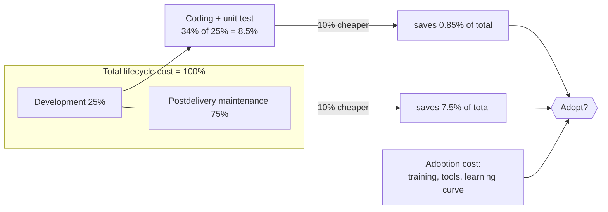

# Note 01 — The software crisis and the economics of software engineering

> Module 01 · Advanced Software Engineering · Term 1 · Farsi: [01-software-crisis-and-economics.fa.md](01-software-crisis-and-economics.fa.md) · Index: [INDEX.en.md](INDEX.en.md)

## 1. Summary

- The term "software crisis" comes from the 1968 NATO conference in Garmisch: software was late, over budget and faulty. Surveys such as the Standish CHAOS reports are still quoted as evidence, but their numbers are **contested**.
- The economic question is never "which technique is faster at one step?" but "which technique lowers the **total lifecycle cost**?" Adoption costs and maintenance consequences can outweigh a local speed-up.
- Because roughly two-thirds to three-quarters of lifecycle cost is postdelivery maintenance, a 10% maintenance saving is worth about ten times a 10% coding saving (7.5% vs 0.85% of total cost in Schach's model).

## 2. Detailed explanation

### Intuition: where does the money go?

Ask a team "what is the expensive part of software?" and most say "writing the code". The lifecycle data say otherwise. The code you write today will be read, fixed, ported and extended for years by people who did not write it. Economics in software engineering means choosing practices by their effect on the whole life of the product, not on the next sprint.

### The 1968 conference and the word "crisis"

In 1967 a NATO study group coined the term *software engineering*; the 1968 NATO conference in Garmisch, Germany (edited report: Naur and Randell) endorsed the idea that software production should borrow the philosophy of established engineering. The participants described a **software crisis**: quality was unacceptably low, and deadlines and budgets were routinely missed (Schach 8e, ch. 1 §1.1). Randell's retrospective notes that the participants shared a sense of common concern rather than a measured dataset. A German historical paper argues the "Garmisch story" has become partly myth (checked only via a search summary; the report itself was not opened here, so treat the historiography as `UNVERIFIED`).

Schach remarks that, forty years on, the "crisis" is better called a **depression**: it has lasted too long to be a crisis (ch. 1 §1.1).

### The statistics, with sources and caveats

| Claim | Source (as cited by Schach) | How far to trust it |
|---|---|---|
| 2006: 35% of projects successful, 46% completed late/over budget/with fewer features, 19% canceled (over 9,000 projects) | Standish Group CHAOS report, 2006, via Rubenstein 2007; Schach 8e, ch. 1 §1.1, Fig. 1.1 | Real publication, but see the critique below. |
| Trend 1994 → 2006: success 16, 27, 26, 28, 34, 29, 35 percent | Schach 8e, ch. 2 §2.7, Fig. 2.7 | Same source, same caveats. |
| 78% of IT organizations had been in litigation; in 67% of those cases the delivered product fell short of the developer's claims | Cutter Consortium survey 2002, via Schach ch. 1 §1.1 | Survey of organizations that self-select into litigation; not a measure of average project health. |

**The critique.** Eveleens and Verhoef (IEEE Software 27(1), 2010, pp. 30–36) applied Standish's own definitions to 5,457 forecasts of 1,211 projects from their data and argued that the definitions rest only on estimation accuracy (cost, time, functionality), use a one-sided accuracy measure, and so produce figures that do not reflect reality (summary read via the VU Amsterdam and IEEE Xplore listing, not the full paper). Glass (CACM 2006) made a related point about selection bias if respondents were invited to share failure stories (bibliographic details checked via search only). Bertrand Meyer's blog posts go further, but a blog is an opinion, not a measurement.

**OPINION / CONTESTED:** whether "only about one in three projects succeeds" is an accurate description of industry. What is not contested: large projects with fixed scope and a single big delivery are the ones that fail most spectacularly, and late discovery of faults is expensive (see Note 02).

### Economics 1: cost-benefit of a new technique

Schach's example (ch. 1 §1.2): technique `CT_new` produces code in 90% of the time of `CT_old`. Common sense says adopt it. Economics says check two things first.

1. **Adoption cost.** Training takes people off productive work; new tools must be bought; the first projects with the new technique are slower because of the learning curve. It may take two or three projects to recoup the investment.
2. **Maintenance consequence.** Faster code that is harder to maintain makes the product dearer overall. If the developer is not paying for maintenance (a contract that ends at delivery), the incentive points the wrong way: the client should insist on the technique that minimizes lifetime cost.

A third point is hidden in the example: coding (with unit testing) is a small part of the total.

### Economics 2: the maintenance share

Schach's cost breakdown (ch. 1 §1.3, Fig. 1.3, Fig. 1.4):

| Period | Development | Postdelivery maintenance |
|---|---|---|
| 1976–1981 (several sources) | about 33% | about 67% (two-thirds) |
| 1992–1998 (Yourdon 1992, Hatton 1998) | about 25% | about 75%, and many organizations spend 70–80% or more |

Within development, coding with unit testing was about 34% of the development cost in Schach's Fig. 1.4 (the comparison there is between 1976–81 data and 132 Hewlett-Packard projects). So coding plus unit testing is `0.34 × 0.25 = 8.5%` of total cost. Hence:

- 10% faster coding saves at most `0.10 × 8.5% = 0.85%` of total cost.
- 10% cheaper maintenance saves `0.10 × 75% = 7.5%` of total cost.

That is the entire argument for caring about maintainability: readable code, tests, documentation, modular design and good version control (Notes 03 and 08) are investments in the 75%.

**Schach says / modern practice says.** Schach says maintenance is about two-thirds to three-quarters of lifecycle cost and builds the classical case on it. Modern practice says: the exact percentage is a **VERSION-DEPENDENT** figure from 1976–1998 data, and continuous delivery blurs the line between "development" and "maintenance" (every merge to `main` of a service in production is a small enhancement). The qualitative conclusion (long-lived code is dominated by change) is widely shared; the 75% figure is not a constant of nature.

## 3. Diagram



## 4. Worked example (run it yourself)

The script below turns the argument into numbers. It is a scratch script, not part of the repo's lint scope. Save it as `econ.py` and run `python -I econ.py` (Python 3.12.14 on the author's machine). The adoption cost and lifecycle cost in person-days are **illustrative assumptions**, not data from the book.

```python
MAINT_SHARE = 0.75
DEV_SHARE = 0.25
CODING_SHARE_OF_DEV = 0.34


def total_saving(share_of_total: float, saving: float) -> float:
    return share_of_total * saving


coding_share = DEV_SHARE * CODING_SHARE_OF_DEV
print(f"coding+unit-test share of total cost : {coding_share:.4f}")
print(f"10% cheaper coding      -> total saving {total_saving(coding_share, 0.10) * 100:.2f}%")
print(f"10% cheaper maintenance -> total saving {total_saving(MAINT_SHARE, 0.10) * 100:.2f}%")

LIFECYCLE_COST = 1000.0   # person-days per product (assumption)
ADOPTION_COST = 40.0      # one-off training/tools/learning curve (assumption)
per_project = LIFECYCLE_COST * total_saving(coding_share, 0.10)
print(f"projects needed to recoup {ADOPTION_COST:.0f} pd: {ADOPTION_COST / per_project:.1f}")

net = total_saving(coding_share, 0.10) - total_saving(MAINT_SHARE, 0.03)
print(f"net effect if maintenance gets 3% dearer  : {net * 100:+.2f}% of total cost")
```

Real output of the complete script (it also computes the maintenance variant):

```text
coding+unit-test share of total cost : 0.0850
10% cheaper coding      -> total saving 0.85%
10% cheaper maintenance -> total saving 7.50%
ratio maintenance/coding saving      : 8.8x

per-project saving from 10% faster coding : 8.5 person-days
projects needed to recoup 40 pd           : 4.7
per-project saving from 10% cheaper maint.: 75.0 person-days
projects needed to recoup 40 pd           : 0.53

net effect if maintenance gets 3% dearer  : -1.40% of total cost
```

What to observe:

- The ratio is 8.8x here (7.5 / 0.85), "about ten times" in round numbers.
- With a 40 person-day adoption cost, the faster-coding technique needs about five products to pay for itself; the maintenance technique pays back before the first product is retired.
- The last line is the trap: a 10% coding gain is wiped out by only a 3% rise in maintenance cost, and then some. "We ship 10% faster" is not by itself a business case.

Lab 03 ([cost-of-fault simulation](../labs/03-cost-of-fault-simulation/README.md)) extends this calculation with fault costs per phase.

## 5. Edge cases & pitfalls

- **Treating CHAOS numbers as facts.** Always say "reported by Standish" and name the year; quote the critique alongside. The 2006 figures (35/46/19) are what Schach reports; later CHAOS editions changed the format and are **UNVERIFIED** here.
- **Mixing definitions of success.** "Success" in CHAOS means on time, on budget and with the specified features. A product that meets users' needs two months late is "challenged". Compare with DORA-style outcome measures (Note 08), which do not use plan accuracy.
- **Reading 75% as "maintenance = fixing bugs".** Maintenance includes corrective, perfective and adaptive changes (ISO/IEC 14764 adds preventive; its current edition was not opened, so the exact wording is `UNVERIFIED`). Schach warns that the widely quoted 17.4% / 18.2% / 60.3% split comes from a 1978 manager survey, not from measurements, and that data on the Linux kernel and gcc show at least 50% corrective maintenance (ch. 1 §1.3, Box 1.3).
- **Ignoring who pays.** If the developer's contract ends at delivery, the developer minimizes development cost and the client inherits the maintenance bill. Open-source projects (Linux, OpenBSD) are almost entirely in maintenance mode for decades.
- **Applying the 0.85% figure to a different team.** The 34%-of-25% share is an industry average from older data. For a team that has no unit tests and heavy rework, coding may be a larger share; measure your own.
- **Forgetting the discount rate.** Schach's argument compares undiscounted costs. A real business case discounts future maintenance; the qualitative conclusion usually still holds for long-lived products.

## 6. Exam-style key points

- Software crisis (NATO 1968, Garmisch): software late, over budget, low quality; motivated "software engineering". Schach suggests "depression".
- Standish 2006 (via Schach): 35% successful, 46% challenged, 19% canceled; trend 16% (1994) to 35% (2006). Methodology criticized (Eveleens & Verhoef 2010): `OPINION / CONTESTED`.
- Cutter 2002 (via Schach): 78% of IT organizations had been in litigation.
- A technique is judged by total lifecycle cost: adoption cost (training, tools, learning curve) plus maintenance consequences.
- Postdelivery maintenance: about 2/3 of cost (1976–81), about 75% (1992–98); many organizations spend 70–80% or more.
- Coding plus unit testing = 34% of 25% = 8.5% of total, so a 10% coding saving gives at most 0.85%; a 10% maintenance saving gives 7.5%.
- Faults found late cost far more (Note 02); 60–70% of faults are requirements, analysis or design faults.
- Maintenance types: corrective, perfective, adaptive (Schach); preventive added by ISO/IEC 14764.

## 7. Links

- Lesson: [§2.1 Why do most projects still finish late, over budget or never?](../lesson.en.md#21-why-do-most-projects-still-finish-late-over-budget-or-never)
- Next notes: [02 Phases, workflows, cost of faults](02-phases-workflows-cost-of-faults.en.md), [08 Process improvement, DevOps, DORA](08-process-improvement-devops-dora.en.md).
- Lab: [03 Cost-of-fault simulation](../labs/03-cost-of-fault-simulation/README.md) (reproduces the 0.85% vs 7.5% argument).
- Quiz: questions 1 and 2 in [quiz.en.md](../quiz.en.md#a-conceptual) (Standish numbers; 10% coding vs 10% maintenance).
- Case study: [§8 classic sources](../case-study.en.md#8-classic-sources-schach-cites-them-what-did-i-verify) shows what was and was not opened.

## Glossary

- **Software crisis** — the 1960s observation that software was routinely late, over budget and unreliable.
- **Software engineering** — a discipline aiming at fault-free software delivered on time, within budget, meeting the user's needs (Schach's definition, ch. 1).
- **CHAOS report** — periodic project-outcome survey by the Standish Group; the acronym's meaning is not disclosed.
- **Postdelivery maintenance** — all changes after delivery and acceptance: corrective (fix faults), perfective (improve), adaptive (react to environment).
- **Life-cycle model vs life cycle** — a model describes the steps that should be taken; the life cycle is what actually happened to one product.
- **Cost-benefit analysis** — comparing the total cost of a change (including adoption) with its total benefit over the product's life.
- **Learning curve** — the temporary productivity loss while people learn a new technique.
