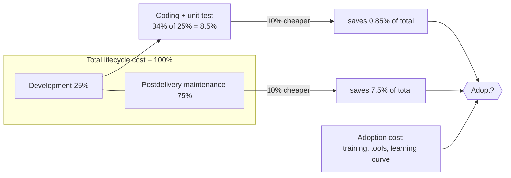

<div dir="rtl">

# یادداشت ۰۱ — بحران نرم‌افزار و اقتصاد مهندسی نرم‌افزار

> ماژول ۰۱ · Advanced Software Engineering · ترم ۱ · نسخهٔ انگلیسی: [01-software-crisis-and-economics.en.md](01-software-crisis-and-economics.en.md) · فهرست: [INDEX.fa.md](INDEX.fa.md)

## ۱. خلاصه

- اصطلاح «software crisis» از کنفرانس ۱۹۶۸ ناتو در Garmisch می‌آید: نرم‌افزار دیر تحویل می‌شد، از بودجه می‌گذشت و خطا داشت. نظرسنجی‌هایی مثل گزارش‌های CHAOS از Standish هنوز به‌عنوان شاهد نقل می‌شوند، ولی عددهایشان **محل مناقشه** است.
- پرسش اقتصادی هرگز این نیست که «کدام تکنیک در یک گام سریع‌تر است»، بلکه این است که «کدام تکنیک **هزینهٔ کل چرخهٔ عمر** را کم می‌کند». هزینهٔ پذیرش یک تکنیک و پیامدهای آن برای نگهداری می‌تواند از یک افزایش سرعت موضعی بیشتر باشد.
- چون حدود دو سوم تا سه‌چهارم هزینهٔ چرخهٔ عمر صرف postdelivery maintenance می‌شود، صرفه‌جویی ۱۰٪ در نگهداری تقریباً ده برابر صرفه‌جویی ۱۰٪ در کدنویسی می‌ارزد (در مدل Schach: ۷٫۵٪ در برابر ۰٫۸۵٪ از هزینهٔ کل).

## ۲. توضیح

### شهود: پول کجا خرج می‌شود؟

از یک تیم بپرسید «بخش گران نرم‌افزار چیست؟» بیشترشان می‌گویند «نوشتن کد». داده‌های چرخهٔ عمر چیز دیگری می‌گویند. کدی که امروز می‌نویسید سال‌ها توسط کسانی خوانده، اصلاح، منتقل و گسترش داده می‌شود که آن را ننوشته‌اند. «اقتصاد» در مهندسی نرم‌افزار یعنی انتخاب روش‌ها بر پایهٔ اثرشان بر کل عمر محصول، نه بر sprint بعدی.

### کنفرانس ۱۹۶۸ و واژهٔ «crisis»

در ۱۹۶۷ یک گروه مطالعاتی ناتو اصطلاح *software engineering* را ساخت. کنفرانس ۱۹۶۸ ناتو در Garmisch آلمان (گزارش ویراستاری‌شده: Naur و Randell) این ایده را تأیید کرد که تولید نرم‌افزار باید فلسفهٔ رشته‌های مهندسی جاافتاده را وام بگیرد. شرکت‌کنندگان از یک **software crisis** گفتند: کیفیت به‌طرز غیرقابل‌قبولی پایین بود و مهلت‌ها و بودجه‌ها مرتب رعایت نمی‌شد (Schach 8e, ch. 1 §1.1). مرور تاریخی Randell نشان می‌دهد شرکت‌کنندگان بیشتر یک نگرانی مشترک داشتند، نه یک مجموعه‌دادهٔ اندازه‌گیری‌شده. یک مقالهٔ تاریخی آلمانی استدلال می‌کند «روایت Garmisch» تا حدی افسانه شده است (این‌ها را فقط از خلاصهٔ نتایج جست‌وجو دیدم و خود گزارش را باز نکردم، پس تاریخ‌نگاری‌اش `UNVERIFIED` است).

Schach می‌گوید چهل سال بعد، به‌جای «crisis» بهتر است گفت **depression**: آن‌قدر طولانی شده که دیگر بحران نیست (ch. 1 §1.1).

### آمارها، با منبع و احتیاط

| ادعا | منبع (آن‌گونه که Schach نقل می‌کند) | تا چه حد قابل اعتماد است |
|---|---|---|
| ۲۰۰۶: ۳۵٪ پروژه‌ها موفق، ۴۶٪ دیر/گران‌تر/با قابلیت کمتر تمام شده، ۱۹٪ لغو شده (بیش از ۹۰۰۰ پروژه) | گزارش CHAOS از Standish Group، ۲۰۰۶، از طریق Rubenstein 2007؛ Schach 8e, ch. 1 §1.1, Fig. 1.1 | انتشار واقعی است، ولی نقد زیر را ببینید. |
| روند ۱۹۹۴ تا ۲۰۰۶ برای موفقیت: ۱۶، ۲۷، ۲۶، ۲۸، ۳۴، ۲۹، ۳۵ درصد | Schach 8e, ch. 2 §2.7, Fig. 2.7 | همان منبع و همان ملاحظات. |
| ۷۸٪ سازمان‌های IT درگیر دعوای قضایی بوده‌اند؛ در ۶۷٪ آن موارد محصول تحویل‌شده با ادعای توسعه‌دهنده نمی‌خواند | نظرسنجی Cutter Consortium، ۲۰۰۲، از طریق Schach ch. 1 §1.1 | نظرسنجی از سازمان‌هایی است که خودشان وارد دعوا شده‌اند؛ سنجهٔ سلامت متوسط پروژه‌ها نیست. |

**نقد.** Eveleens و Verhoef (IEEE Software 27(1), 2010, pp. 30–36) تعریف‌های خود Standish را روی ۵٬۴۵۷ پیش‌بینی از ۱٬۲۱۱ پروژه در داده‌های خودشان اجرا کردند و استدلال کردند که این تعریف‌ها فقط بر دقت تخمین (هزینه، زمان، قابلیت) تکیه دارند، از یک سنجهٔ دقتِ یک‌طرفه استفاده می‌کنند و در نتیجه عددهایی می‌دهند که با واقعیت نمی‌خوانند (خلاصه را از فهرست VU Amsterdam و IEEE Xplore خواندم، نه متن کامل را). Glass (CACM 2006) نکتهٔ مشابهی دربارهٔ سوگیری انتخاب گفت: اگر از پاسخ‌دهندگان خواسته شده باشد داستان شکست تعریف کنند، یافته‌ها طبعاً به سمت شکست کج می‌شوند (مشخصات کتاب‌شناختی فقط با جست‌وجو بررسی شد). پست‌های وبلاگ Bertrand Meyer تندتر می‌روند، ولی وبلاگ نظر است، نه اندازه‌گیری.

**OPINION / CONTESTED:** اینکه «تنها حدود یک پروژه از هر سه پروژه موفق است» توصیف دقیقی از صنعت باشد. آنچه محل مناقشه نیست: پروژه‌های بزرگ با دامنهٔ ثابت و یک تحویل بزرگ، آن‌هایی‌اند که چشمگیرترین شکست‌ها را دارند، و کشف دیرهنگام خطا گران است (یادداشت ۰۲).

### اقتصاد ۱: هزینه-فایدهٔ یک تکنیک جدید

مثال Schach (ch. 1 §1.2): تکنیک `CT_new` کد را در ۹۰٪ زمان `CT_old` تولید می‌کند. عقل سلیم می‌گوید بپذیرید. اقتصاد می‌گوید اول دو چیز را بررسی کنید.

۱. **هزینهٔ پذیرش.** آموزش، افراد را از کار مولد بیرون می‌کشد؛ ابزار تازه باید خریداری شود؛ چند پروژهٔ اول با تکنیک جدید به‌خاطر منحنی یادگیری کندترند. ممکن است دو یا سه پروژه طول بکشد تا سرمایه‌گذاری برگردد.
۲. **پیامد برای نگهداری.** کد سریع‌تر ولی سخت‌تر برای نگهداری، محصول را در کل گران‌تر می‌کند. اگر توسعه‌دهنده هزینهٔ نگهداری را نمی‌پردازد (قراردادی که با تحویل تمام می‌شود)، انگیزه به سمت اشتباه می‌رود: مشتری باید بر تکنیکی پافشاری کند که هزینهٔ طول عمر را کمینه می‌کند.

نکتهٔ سوم در خود مثال پنهان است: کدنویسی (همراه با unit test) بخش کوچکی از کل است.

### اقتصاد ۲: سهم نگهداری

تفکیک هزینهٔ Schach (ch. 1 §1.3, Fig. 1.3 و Fig. 1.4):

| دوره | توسعه | postdelivery maintenance |
|---|---|---|
| ۱۹۷۶–۱۹۸۱ (چند منبع) | حدود ۳۳٪ | حدود ۶۷٪ (دوسوم) |
| ۱۹۹۲–۱۹۹۸ (Yourdon 1992، Hatton 1998) | حدود ۲۵٪ | حدود ۷۵٪؛ بسیاری از سازمان‌ها ۷۰ تا ۸۰٪ یا بیشتر خرج می‌کنند |

در Fig. 1.4 کتاب، سهم کدنویسی به‌همراه unit test حدود ۳۴٪ هزینهٔ توسعه بود (مقایسه‌ای بین داده‌های ۱۹۷۶–۸۱ و ۱۳۲ پروژهٔ Hewlett-Packard). پس کدنویسی با unit test برابر است با `0.34 × 0.25 = 8.5%` از هزینهٔ کل. در نتیجه:

- کدنویسی ۱۰٪ سریع‌تر حداکثر `0.10 × 8.5% = 0.85%` از هزینهٔ کل را صرفه‌جویی می‌کند.
- نگهداری ۱۰٪ ارزان‌تر `0.10 × 75% = 7.5%` از هزینهٔ کل را صرفه‌جویی می‌کند.

کل استدلالِ «چرا نگهداری‌پذیری مهم است» همین است: کد خوانا، آزمون، مستندات، طراحی ماژولار و کنترل نسخهٔ خوب سرمایه‌گذاری روی همان ۷۵٪ هستند (یادداشت‌های ۰۳ و ۰۸).

**Schach says / modern practice says.** Schach می‌گوید نگهداری حدود دوسوم تا سه‌چهارم هزینهٔ چرخهٔ عمر است و استدلال کلاسیک را روی آن بنا می‌کند. روال امروز می‌گوید: درصد دقیق یک عدد **VERSION-DEPENDENT** از داده‌های ۱۹۷۶ تا ۱۹۹۸ است، و continuous delivery مرز «توسعه» و «نگهداری» را محو می‌کند (هر merge به `main` در سرویسی که در تولید است یک بهبود کوچک است). نتیجهٔ کیفی (هزینهٔ کدِ عمر بلند را بیش از هر چیز تغییر تعیین می‌کند) به‌طور گسترده پذیرفته است؛ عدد ۷۵٪ ثابت طبیعت نیست.

## ۳. نمودار

</div>



<div dir="rtl">

## ۴. مثال عملی (خودتان اجرا کنید)

اسکریپت زیر استدلال را به عدد تبدیل می‌کند. این یک اسکریپت موقت است و در دامنهٔ lint مخزن نیست. آن را با نام `econ.py` ذخیره کنید و با `python -I econ.py` اجرا کنید (Python 3.12.14 روی ماشین نویسنده). هزینهٔ پذیرش و هزینهٔ چرخهٔ عمر بر حسب person-day **فرض‌های توضیحی** هستند، نه داده‌ای از کتاب.

</div>

```python
MAINT_SHARE = 0.75
DEV_SHARE = 0.25
CODING_SHARE_OF_DEV = 0.34


def total_saving(share_of_total: float, saving: float) -> float:
    return share_of_total * saving


coding_share = DEV_SHARE * CODING_SHARE_OF_DEV
print(f"coding+unit-test share of total cost : {coding_share:.4f}")
print(f"10% cheaper coding      -> total saving {total_saving(coding_share, 0.10) * 100:.2f}%")
print(f"10% cheaper maintenance -> total saving {total_saving(MAINT_SHARE, 0.10) * 100:.2f}%")

LIFECYCLE_COST = 1000.0   # person-days per product (assumption)
ADOPTION_COST = 40.0      # one-off training/tools/learning curve (assumption)
per_project = LIFECYCLE_COST * total_saving(coding_share, 0.10)
print(f"projects needed to recoup {ADOPTION_COST:.0f} pd: {ADOPTION_COST / per_project:.1f}")

net = total_saving(coding_share, 0.10) - total_saving(MAINT_SHARE, 0.03)
print(f"net effect if maintenance gets 3% dearer  : {net * 100:+.2f}% of total cost")
```

<div dir="rtl">

خروجی واقعی اسکریپت کامل (نسخهٔ نگهداری را هم حساب می‌کند):

</div>

```text
coding+unit-test share of total cost : 0.0850
10% cheaper coding      -> total saving 0.85%
10% cheaper maintenance -> total saving 7.50%
ratio maintenance/coding saving      : 8.8x

per-project saving from 10% faster coding : 8.5 person-days
projects needed to recoup 40 pd           : 4.7
per-project saving from 10% cheaper maint.: 75.0 person-days
projects needed to recoup 40 pd           : 0.53

net effect if maintenance gets 3% dearer  : -1.40% of total cost
```

<div dir="rtl">

چه چیزی را ببینید:

- نسبت اینجا ۸٫۸ برابر است (۷٫۵ تقسیم بر ۰٫۸۵)؛ در گرد کردن می‌شود «حدود ده برابر».
- با هزینهٔ پذیرش ۴۰ person-day، تکنیکِ «کدنویسی سریع‌تر» حدود پنج محصول لازم دارد تا خودش را جبران کند؛ تکنیک نگهداری پیش از بازنشستگی اولین محصول برمی‌گردد.
- خط آخر تله است: سود ۱۰٪ در کدنویسی با افزایش فقط ۳٪ در هزینهٔ نگهداری از بین می‌رود و حتی بیشتر. «۱۰٪ سریع‌تر تحویل می‌دهیم» به‌تنهایی یک مورد کسب‌وکار نیست.

Lab 03 ([شبیه‌سازی هزینهٔ خطا](../labs/03-cost-of-fault-simulation/README.md)) همین محاسبه را با هزینهٔ خطا در هر فاز گسترش می‌دهد.

## ۵. حالت‌های خاص و دام‌ها

- **اعداد CHAOS را واقعیت گرفتن.** همیشه بگویید «Standish گزارش داده» و سال را بنویسید؛ نقد را کنارش بیاورید. اعداد ۲۰۰۶ (۳۵/۴۶/۱۹) همان‌هایی‌اند که Schach گزارش می‌کند؛ ویرایش‌های بعدی CHAOS قالب را عوض کردند و اینجا **UNVERIFIED** هستند.
- **تعریف‌های متفاوت از «موفقیت».** در CHAOS «موفق» یعنی به‌موقع، در بودجه و با قابلیت‌های مشخص‌شده. محصولی که دو ماه دیر نیاز کاربران را برآورده کند «challenged» است. با سنجه‌های نتیجه‌محور سبک DORA (یادداشت ۰۸) مقایسه کنید که از دقت برنامه استفاده نمی‌کنند.
- **۷۵٪ را «نگهداری = رفع باگ» خواندن.** نگهداری شامل corrective، perfective و adaptive است (ISO/IEC 14764 نوع preventive را هم اضافه می‌کند؛ ویرایش جاری آن را باز نکردم، پس عبارت دقیقش `UNVERIFIED` است). Schach هشدار می‌دهد که تقسیم پرنقل‌قول ۱۷٫۴٪ / ۱۸٫۲٪ / ۶۰٫۳٪ از یک نظرسنجی مدیران در ۱۹۷۸ آمده، نه از اندازه‌گیری، و داده‌های واقعی Linux kernel و gcc دست‌کم ۵۰٪ نگهداری corrective را نشان می‌دهند (ch. 1 §1.3, Box 1.3).
- **نادیده گرفتن اینکه چه کسی می‌پردازد.** اگر قرارداد توسعه‌دهنده با تحویل تمام شود، او هزینهٔ توسعه را کمینه می‌کند و صورتحساب نگهداری به مشتری می‌رسد. پروژه‌های متن‌باز (Linux، OpenBSD) دهه‌ها تقریباً کاملاً در حالت نگهداری‌اند.
- **اعمال رقم ۰٫۸۵٪ بر تیمی دیگر.** سهم ۳۴٪ از ۲۵٪ میانگین صنعتی از داده‌های قدیمی است. تیمی که unit test ندارد و بازکاری زیاد دارد ممکن است سهم کدنویسی بزرگ‌تری داشته باشد؛ مال خودتان را اندازه بگیرید.
- **فراموش کردن نرخ تنزیل.** استدلال Schach هزینه‌ها را بدون تنزیل مقایسه می‌کند. یک مورد کسب‌وکار واقعی نگهداری آینده را تنزیل می‌کند؛ نتیجهٔ کیفی معمولاً برای محصولات عمر بلند همچنان برقرار است.

## ۶. نکته‌های کلیدی امتحانی

- Software crisis (ناتو ۱۹۶۸، Garmisch): نرم‌افزار دیر، گران‌تر از بودجه و کم‌کیفیت؛ انگیزهٔ «software engineering». Schach واژهٔ «depression» را پیشنهاد می‌کند.
- Standish 2006 (از طریق Schach): ۳۵٪ موفق، ۴۶٪ challenged، ۱۹٪ لغو؛ روند ۱۶٪ (۱۹۹۴) تا ۳۵٪ (۲۰۰۶). روش‌شناسی نقد شده است (Eveleens و Verhoef 2010): `OPINION / CONTESTED`.
- Cutter 2002 (از طریق Schach): ۷۸٪ سازمان‌های IT درگیر دعوای قضایی بوده‌اند.
- یک تکنیک را با کل هزینهٔ چرخهٔ عمر می‌سنجند: هزینهٔ پذیرش (آموزش، ابزار، منحنی یادگیری) به‌علاوهٔ پیامدهای نگهداری.
- Postdelivery maintenance: حدود ۲/۳ هزینه (۱۹۷۶–۸۱)، حدود ۷۵٪ (۱۹۹۲–۹۸)؛ بسیاری از سازمان‌ها ۷۰ تا ۸۰٪ یا بیشتر.
- کدنویسی به‌علاوهٔ unit test = ۳۴٪ از ۲۵٪ = ۸٫۵٪ هزینهٔ کل؛ پس ۱۰٪ صرفه‌جویی در کدنویسی حداکثر ۰٫۸۵٪ می‌دهد و ۱۰٪ صرفه‌جویی در نگهداری ۷٫۵٪.
- خطاهای دیر پیدا شده بسیار گران‌ترند (یادداشت ۰۲)؛ ۶۰ تا ۷۰٪ خطاها از requirements، analysis یا design می‌آیند.
- انواع نگهداری: corrective، perfective، adaptive (Schach)؛ preventive در ISO/IEC 14764 اضافه شده.

## ۷. پیوندها

- درس: [§2.1 Why do most projects still finish late, over budget or never?](../lesson.en.md#21-why-do-most-projects-still-finish-late-over-budget-or-never)
- یادداشت‌های بعدی: [02 فازها، workflowها و هزینهٔ خطا](02-phases-workflows-cost-of-faults.en.md)، [08 بهبود فرایند، DevOps و DORA](08-process-improvement-devops-dora.en.md).
- آزمایشگاه: [03 شبیه‌سازی هزینهٔ خطا](../labs/03-cost-of-fault-simulation/README.md) (استدلال ۰٫۸۵٪ در برابر ۷٫۵٪ را بازتولید می‌کند).
- آزمون: پرسش‌های ۱ و ۲ در [quiz.en.md](../quiz.en.md#a-conceptual) (اعداد Standish؛ ۱۰٪ کدنویسی در برابر ۱۰٪ نگهداری).
- مطالعهٔ موردی: [§8 منابع کلاسیک](../case-study.en.md#8-classic-sources-schach-cites-them-what-did-i-verify) نشان می‌دهد چه چیزی باز شد و چه چیزی نه.

## واژه‌نامه

- **Software crisis (بحران نرم‌افزار):** مشاهدهٔ دههٔ ۱۹۶۰ که نرم‌افزار مرتب دیر، گران‌تر از بودجه و غیرقابل‌اعتماد بود.
- **Software engineering (مهندسی نرم‌افزار):** رشته‌ای که هدفش نرم‌افزار بدون خطا، به‌موقع، در بودجه و برآورندهٔ نیاز کاربر است (تعریف Schach، ch. 1).
- **CHAOS report:** نظرسنجی دوره‌ای از نتیجهٔ پروژه‌ها توسط Standish Group؛ معنی مخفف آن فاش نشده است.
- **Postdelivery maintenance (نگهداری پس از تحویل):** همهٔ تغییرها پس از تحویل و پذیرش: corrective (رفع خطا)، perfective (بهبود)، adaptive (واکنش به تغییر محیط).
- **Life-cycle model در برابر life cycle:** مدل، گام‌هایی را که باید برداشت توصیف می‌کند؛ life cycle آن چیزی است که واقعاً برای یک محصول رخ داده است.
- **Cost-benefit analysis (تحلیل هزینه-فایده):** مقایسهٔ هزینهٔ کل یک تغییر (با هزینهٔ پذیرش) و فایدهٔ کل آن در طول عمر محصول.
- **Learning curve (منحنی یادگیری):** افت موقت بهره‌وری تا زمانی که افراد تکنیک جدید را یاد بگیرند.

</div>
