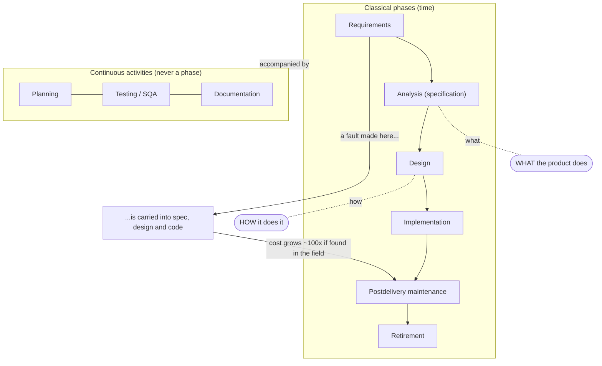

# Note 02 — Phases, workflows and the cost of faults

> Module 01 · Advanced Software Engineering · Term 1 · Farsi: [02-phases-workflows-cost-of-faults.fa.md](02-phases-workflows-cost-of-faults.fa.md) · Index: [INDEX.en.md](INDEX.en.md)

## 1. Summary

- The classical life cycle has six phases (requirements, analysis/specification, design, implementation, postdelivery maintenance, retirement). Planning, testing and documentation are **not** phases: they run through the whole life.
- A phase is a slice of time; a **workflow** is a kind of activity. The iterative-and-incremental view (Note 03) replaces "phases" with five core workflows, one of which predominates at any moment.
- The later a fault is found, the more it costs, and 60–70% of faults originate in requirements, analysis or design. So effort belongs in checking early artifacts (inspections), not only in testing code.

## 2. Detailed explanation

### Intuition: "what" before "how"

Before building a bridge you decide what it must do (span, load, budget) and only then how (materials, structure). Software is the same. The first two classical phases answer **what** the product must do; design and implementation answer **how**. A mistake in the "what" travels downstream into specification, design and code, and every later artifact has to be corrected.

### The six classical phases

Schach (8e, ch. 1 §1.3) uses the following generic names; real organizations name them differently.

| # | Phase | Question it answers | Main artifact |
|---|---|---|---|
| 1 | Requirements | What does the client need? The concept is explored and refined. | requirements document / notes |
| 2 | Analysis (specification) | What exactly must the product do? | specification document; the software project management plan (SPMP) is drawn up at the end |
| 3 | Design | How? Architectural design (split into modules), then detailed design of each module | two design documents |
| 4 | Implementation | Code, unit test, integrate, acceptance test | code, test cases |
| 5 | Postdelivery maintenance | Keep it useful after delivery | change requests, new versions |
| 6 | Retirement | Remove from service when it no longer has use | — |

Maintenance has types (ch. 1 §1.3): **corrective** (remove residual faults, specifications unchanged), **perfective** (client-requested improvements), **adaptive** (changes forced by a new environment, such as a new OS or regulation). Corrective is "repair"; perfective plus adaptive are "enhancement".

**Schach says / modern practice says.** Schach treats requirements and analysis as two phases and *analysis* as the same thing as *specification*. Modern requirements engineering (Module 02) usually uses "requirements" for the whole elicit-analyze-specify-validate activity and "analysis" for modelling the problem domain. Also, ISO/IEC 14764 adds a fourth maintenance type, **preventive** (restructuring to avoid future faults); the edition was not opened here, so the wording is `UNVERIFIED`.

### Why there is no planning, testing or documentation phase

Schach devotes a section to each (ch. 1 §1.6–1.8). The argument in short:

- **Planning.** You cannot make an accurate detailed plan before you know what is to be built, so there are three kinds of planning activity: preliminary planning at the start (for requirements and analysis), the full SPMP after the specification is approved, and continuous monitoring of the plan. Predominance changes; the activity never stops. A project that compares progress to the plan only at the end learns of a disaster far too late.
- **Testing.** Checking a finished product is "far too late". Verification happens at the end of each phase, validation before handing over to the client, and checking should accompany every activity. A separate testing phase invites "no testing until the end".
- **Documentation.** Documentation must be correct and current at all times: staff turnover, the next phase depends on the previous phase's documents, testing needs a statement of correct behaviour, and maintenance is nearly impossible without it.

Today's equivalents: planning is the backlog and roadmap, testing is CI, documentation is README, ADRs and docs next to the code (Module 04 covers ADRs).

### Workflow vs phase

A **phase** answers *when*; a **workflow** answers *what kind of work*. In the iterative-and-incremental model there are five core workflows (requirements, analysis, design, implementation, test), all active over the whole life cycle. The phases of the classical model are the periods in which one workflow predominates. Schach's Fig. 1.4 gives effort split by phase: requirements plus analysis about one-fifth, design about one-fifth, implementation (coding with unit test plus integration) about three-fifths (ch. 2 §2.5).

### The cost of fixing a fault

Schach (ch. 1 §1.4, Fig. 1.5 and 1.6) reproduces Boehm's data (Boehm 1981, drawing on IBM, GTE, Safeguard and TRW projects): the relative cost to detect and correct a fault grows steeply with the phase in which it is found. The worked numbers in the text: a fault costing about $40 to fix in design costs about $30 in analysis and about $2000 in postdelivery maintenance; newer IBM AS/400 data put the maintenance cost at about $3680. I could not visually check these against the plotted figure (the PDF text extraction loses the chart), so treat the exact dollar values as `UNVERIFIED` against the figure; the shape (roughly two orders of magnitude from requirements to field) is the point.

Why does the cost rise? Early, the product exists only as documents; later, fixing means editing code, recompiling, retesting for regressions, updating manuals and redelivering and reinstalling.

**OPINION / CONTESTED.** The "exponential cost curve" is quoted everywhere, but it comes from 1970s projects with sequential processes. With automated tests, CI and deploy-on-merge the cost of a code-level fault can be flat for hours or days. Requirements faults (building the wrong thing) remain expensive in any process. Treat the curve as "late is costly *when the feedback loop is long*".

### Where faults come from

Boehm (1979, via Schach ch. 1 §1.4): **60–70%** of the faults found in large projects are requirements, analysis or design faults. Inspections confirm the shape: in 203 inspections of NASA JPL software, about **1.9 faults per page of specification, 0.9 per page of design and 0.3 per page of code** (Kelly, Sherif and Hops 1992). Consequence: reducing requirements/analysis/design faults by 10% reduces total faults by 6–7%.

### Fault terminology

Schach, following IEEE Std 610.12 (1990, reaffirmed 2002), distinguishes (ch. 1 §1.11):

| Term | Meaning | Example |
|---|---|---|
| **Mistake** | human action that leads to a fault | the programmer assumes the list is never empty |
| **Fault** | the incorrect piece in an artifact (code, design, spec) | `sum(v) / len(v)` with no empty check |
| **Failure** | observed incorrect behaviour caused by executing a fault | `ZeroDivisionError` on an empty list |
| **Error** | the amount by which a result is wrong | 174.6 instead of 175.0: error −0.4 |
| **Defect** | umbrella word for fault, failure or error | used loosely in trackers |

Schach avoids **bug** because it hides human responsibility ("a bug crept in" rather than "I made a mistake"; the word has a long pre-computing history). **Modern practice says:** "bug" is universal in issue trackers, and a blameless post-mortem culture deliberately avoids assigning personal blame, which is a fair counter-argument to Schach's moral point. Use fault/failure in exams; use "bug" in team talk if you like, but know the difference. Note that in a bug report a user can report only a *failure*; fixing requires finding the *fault*.

## 3. Diagram



## 4. Worked example (run it yourself)

The scratch script `faults.py` (Python 3.12.14, run as `python -I faults.py`) first shows the fault/failure/error distinction in six lines of code, then computes expected inspection yields and an **illustrative** cost model. The cost multipliers (1, 2, 5, 12, 30, 100) and the fault split (25/20/20/35 out of 100) are **assumptions** that only reproduce the shape of Boehm's curve and the 60–70% rule; they are not the book's numbers.

```python
def average(values):
    # FAULT: the developer's MISTAKE was assuming the list is never empty.
    return sum(values) / len(values)

print("average([170, 180]) ->", round(average([170, 180]), 1))
try:
    average([])
except ZeroDivisionError as exc:
    print("average([])         -> FAILURE:", type(exc).__name__, exc)
true_value, computed = 175.0, 174.6
print(f"error = computed - true = {computed - true_value:+.1f} cm")

RATES = {"specification": 1.9, "design": 0.9, "code": 0.3}   # JPL, faults per page
PAGES = {"specification": 40, "design": 60, "code": 200}     # assumed sizes
COST = {"requirements": 1, "analysis": 2, "design": 5, "implementation": 12, "acceptance": 30, "maintenance": 100}
INTRODUCED = {"requirements": 25, "analysis": 20, "design": 20, "implementation": 35}
# ... then: total = sum(n * COST[phase_detected]) for each phase's faults
```

Real output:

```text
average([170, 180]) -> 175.0
average([])         -> FAILURE: ZeroDivisionError division by zero
error = computed - true = -0.4 cm

expected faults found by inspection (assumed page counts):
  specification    40 pages x 1.9 =   76.0
  design           60 pages x 0.9 =   54.0
  code            200 pages x 0.3 =   60.0

relative cost, faults fixed in the phase they were made :    585
relative cost, faults found at acceptance test          :   3000  (5.1x)
relative cost, faults found in maintenance              :  10000  (17.1x)
share of faults from requirements/analysis/design       : 65%
10% fewer R/A/D faults -> 6.5% fewer faults overall
```

What to observe:

- The fault exists from the moment the code is written; the failure appears only for one input. Testing finds failures, review and inspection find faults directly.
- A 40-page specification, cheap to inspect, yields as many faults as 200 pages of code. That is why inspecting the specification and design is the best return on reviewer time.
- With these assumed multipliers, finding every fault only at acceptance costs 5 times as much as fixing in place; finding them in the field costs 17 times as much. Change the multipliers in the script and see how sensitive the result is: the *ordering* is robust, the *numbers* are not.
- 65% of the faults and a 10% reduction among them gives 6.5% overall, matching Schach's "6–7%".

Lab 03 ([cost-of-fault simulation](../labs/03-cost-of-fault-simulation/README.md)) turns this into a parameterized simulation. In a Go or Python repo, the "inspection" practice corresponds to code review on pull requests, and "early detection" to lint and unit-test gates in CI (Lab 02).

## 5. Edge cases & pitfalls

- **Calling testing "the phase after coding".** Verification is per phase; validation precedes acceptance; regression testing continues in maintenance (Schach ch. 2 §2.9.2).
- **"Maintenance = bug fixing".** Corrective maintenance is only one of three types (and Schach's own data suggest at least half of Linux/gcc maintenance is corrective, while the old 17.4% survey figure is unreliable).
- **Confusing the cost curve with an exponential law.** The data are heterogeneous projects from the 1970s–90s; the curve is a qualitative guide. Do not quote "100x" without naming the source and date.
- **Mixing up failure and fault in reports.** A user reports a failure; a developer locates the fault. Schach notes that closed-source users can submit only failure reports, while open-source users with source access may submit fault reports (ch. 2 §2.9.4).
- **Thinking inspections only apply to code.** The JPL numbers show they pay off most on specifications and designs.
- **Assuming "analysis" means the same everywhere.** In Schach it is the specification step; elsewhere it often means domain modelling.
- **Regression faults.** A change that induces a new fault in unrelated code. Information hiding and modular design reduce them; regression suites detect them.

## 6. Exam-style key points

- Six classical phases: requirements, analysis (specification), design, implementation, postdelivery maintenance, retirement. Requirements and analysis: *what*; design: *how*.
- No planning, testing or documentation phase: they are continuous (Schach ch. 1 §1.6–1.8).
- Workflow = type of activity; phase = period of time; five core workflows: requirements, analysis, design, implementation, test.
- Maintenance types: corrective, perfective, adaptive (+ preventive in ISO/IEC 14764). Corrective = repair; perfective + adaptive = enhancement.
- Relative cost to fix a fault rises steeply by phase (Boehm 1981); early detection is cheaper.
- 60–70% of faults are requirements/analysis/design faults (Boehm 1979); 10% fewer of them means 6–7% fewer faults in total.
- JPL inspections: 1.9 / 0.9 / 0.3 faults per page for specification / design / code.
- Mistake (human) → fault (in artifact) → failure (observed behaviour); error = amount of incorrectness; defect = umbrella term; avoid "bug" in the formal answer.

## 7. Links

- Lesson: [§2.2 Is "design" a phase or something that happens all the time?](../lesson.en.md#22-is-design-a-phase-or-something-that-happens-all-the-time) (also §2.1 for the maintenance share).
- Previous / next: [01 Software crisis and economics](01-software-crisis-and-economics.en.md) · [03 Iteration vs incrementation](03-iteration-vs-incrementation.en.md).
- Labs: [03 Cost-of-fault simulation](../labs/03-cost-of-fault-simulation/README.md), [04 git bisect and worktrees](../labs/04-git-bisect-worktrees/README.md) (locating the commit that introduced a fault).
- Quiz: question 3 (workflow vs phase; mistake/fault/failure) in [section A](../quiz.en.md#a-conceptual) and question 10 (cost per fault by detection phase) in [section B](../quiz.en.md#b-read-the-diagram--code--metric-report).

## Glossary

- **Phase** — a period of the life cycle in which one kind of activity predominates (classical model).
- **Workflow** — a kind of activity (requirements, analysis, design, implementation, test) performed across the whole life cycle.
- **Specification document** — the contract-like statement of what the product must do, produced at the end of analysis.
- **SPMP (software project management plan)** — the detailed budget, staffing and schedule, drawn up once the specification is approved.
- **Verification / validation** — checking that a phase's output is correct against the previous phase / that the finished product satisfies the client's needs.
- **SQA group** — the independent software quality assurance group.
- **Mistake, fault, failure, error, defect** — see the table in section 2.
- **Regression fault** — a new fault induced in previously working code by a change.
- **Inspection** — a meticulous review of an artifact by a team, with a fault count.
- **Corrective / perfective / adaptive / preventive maintenance** — repair, client-driven improvement, environment-driven change, restructuring to avoid future faults.
