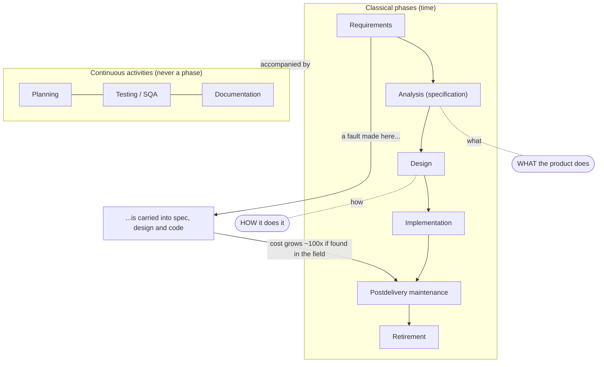

<div dir="rtl">

# یادداشت ۰۲ — فازها، workflowها و هزینهٔ خطا

> ماژول ۰۱ · Advanced Software Engineering · ترم ۱ · نسخهٔ انگلیسی: [02-phases-workflows-cost-of-faults.en.md](02-phases-workflows-cost-of-faults.en.md) · فهرست: [INDEX.fa.md](INDEX.fa.md)

## ۱. خلاصه

- چرخهٔ عمر کلاسیک شش فاز دارد: requirements، analysis (specification)، design، implementation، postdelivery maintenance و retirement. برنامه‌ریزی، آزمون و مستندسازی **فاز نیستند**؛ در کل عمر محصول جریان دارند.
- فاز یک برش از زمان است؛ **workflow** یک نوع فعالیت است. نگاه iterative-and-incremental (یادداشت ۰۳) فازها را با پنج core workflow جایگزین می‌کند که در هر لحظه یکی غالب است.
- هرچه خطا دیرتر پیدا شود گران‌تر است، و ۶۰ تا ۷۰٪ خطاها از requirements، analysis یا design می‌آیند. پس تلاش باید صرف بررسی مصنوعات اولیه (inspection) شود، نه فقط آزمون کد.

## ۲. توضیح

### شهود: «چه» پیش از «چگونه»

پیش از ساختن یک پل تصمیم می‌گیرید چه کاری باید بکند (دهانه، بار، بودجه) و بعد چگونه (مصالح، سازه). نرم‌افزار هم همین‌طور است. دو فاز اول کلاسیک به **چه** پاسخ می‌دهند: محصول باید چه کند؛ design و implementation به **چگونه**. اشتباه در «چه» به specification، design و کد سرایت می‌کند و هر مصنوع بعدی باید اصلاح شود.

### شش فاز کلاسیک

Schach (8e, ch. 1 §1.3) نام‌های عمومی زیر را به کار می‌برد؛ سازمان‌های واقعی نام‌های دیگری دارند.

| # | فاز | به چه پرسشی پاسخ می‌دهد | مصنوع اصلی |
|---|---|---|---|
| ۱ | Requirements | مشتری چه می‌خواهد؟ مفهوم کاویده و پالوده می‌شود. | سند یا یادداشت‌های requirements |
| ۲ | Analysis (specification) | محصول دقیقاً باید چه کند؟ | سند specification؛ در پایان، software project management plan (SPMP) تنظیم می‌شود |
| ۳ | Design | چگونه؟ ابتدا طراحی معماری (تقسیم به ماژول)، سپس طراحی تفصیلی هر ماژول | دو سند طراحی |
| ۴ | Implementation | کدنویسی، unit test، integration، acceptance test | کد، test caseها |
| ۵ | Postdelivery maintenance | محصول بعد از تحویل مفید بماند | درخواست‌های تغییر، نسخه‌های جدید |
| ۶ | Retirement | وقتی دیگر کاربردی ندارد از سرویس خارج شود | — |

نگهداری انواعی دارد (ch. 1 §1.3): **corrective** (رفع خطاهای باقی‌مانده بدون تغییر specification)، **perfective** (بهبودهایی که مشتری می‌خواهد) و **adaptive** (تغییرهای اجباری از محیط جدید، مثل OS جدید یا مقررات). Corrective «تعمیر» است؛ perfective و adaptive «enhancement».

**Schach says / modern practice says.** Schach فازهای requirements و analysis را دو فاز می‌داند و *analysis* را با *specification* یکی می‌گیرد. مهندسی نیازمندی‌های امروز (ماژول ۰۲) معمولاً «requirements» را برای کل فعالیت استخراج-تحلیل-مشخص‌سازی-اعتبارسنجی به کار می‌برد و «analysis» را برای مدل‌سازی دامنهٔ مسئله. ISO/IEC 14764 هم نوع چهارمی به نگهداری اضافه می‌کند، **preventive** (بازساختاردهی برای پیشگیری از خطاهای آینده)؛ ویرایش آن را باز نکردم، پس عبارتش `UNVERIFIED` است.

### چرا فاز برنامه‌ریزی، آزمون یا مستندسازی نداریم

Schach برای هر کدام بخشی دارد (ch. 1 §1.6 تا 1.8). خلاصهٔ استدلال:

- **برنامه‌ریزی.** تا ندانید دقیقاً چه ساخته می‌شود نمی‌توان برنامهٔ دقیق ریخت؛ پس سه نوع فعالیت برنامه‌ریزی داریم: برنامه‌ریزی مقدماتی در آغاز (برای فازهای requirements و analysis)، SPMP کامل پس از تأیید specification، و پایش مداوم برنامه. غالب بودن تغییر می‌کند؛ فعالیت هرگز نمی‌ایستد. پروژه‌ای که پیشرفت را فقط در پایان با برنامه مقایسه کند، فاجعه را بسیار دیر می‌فهمد.
- **آزمون.** وارسی محصولِ آمادهٔ تحویل «بسیار دیر» است. Verification در پایان هر فاز انجام می‌شود، validation پیش از تحویل به مشتری، و وارسی باید همراه هر فعالیت باشد. یک فاز آزمون جداگانه به «تا آخر آزمون نمی‌کنیم» دعوت می‌کند.
- **مستندسازی.** مستندات باید همیشه درست و به‌روز باشند: جابه‌جایی نیرو، وابستگی فاز بعد به اسناد فاز قبل، نیاز آزمون به شرح رفتار درست، و اینکه نگهداری بدون مستندات تقریباً ناممکن است.

معادل‌های امروز: برنامه‌ریزی همان backlog و roadmap است، آزمون همان CI، و مستندسازی README، ADR و مستندات کنار کد (ADRها در ماژول ۰۴).

### Workflow در برابر phase

**Phase** به «چه وقت» پاسخ می‌دهد؛ **workflow** به «چه نوع کار». در مدل iterative-and-incremental پنج core workflow داریم (requirements، analysis، design، implementation، test) که همه در کل چرخهٔ عمر فعال‌اند. فازهای مدل کلاسیک بازه‌هایی‌اند که در آن‌ها یک workflow غالب است. Fig. 1.4 Schach تقسیم تلاش بر اساس فاز را می‌دهد: requirements و analysis روی هم حدود یک‌پنجم، design حدود یک‌پنجم، و implementation (کدنویسی با unit test به‌علاوهٔ integration) حدود سه‌پنجم (ch. 2 §2.5).

### هزینهٔ رفع یک خطا

Schach (ch. 1 §1.4, Fig. 1.5 و 1.6) داده‌های Boehm را بازتولید می‌کند (Boehm 1981، بر پایهٔ پروژه‌های IBM، GTE، Safeguard و TRW): هزینهٔ نسبیِ کشف و رفع یک خطا با فازی که در آن پیدا می‌شود به‌شدت بالا می‌رود. عددهای مثال در متن: خطایی که رفعش در design حدود ۴۰ دلار می‌ارزد، در analysis حدود ۳۰ دلار و در postdelivery maintenance حدود ۲۰۰۰ دلار هزینه دارد؛ داده‌های تازهٔ IBM AS/400 هزینهٔ نگهداری را حدود ۳۶۸۰ دلار می‌دهند. نتوانستم این‌ها را با نمودار چاپ‌شده تطبیق دهم (استخراج متن PDF نمودار را از دست می‌دهد)، پس مقدار دقیق دلاری‌ها را در برابر شکل `UNVERIFIED` بدانید؛ شکل کلی (تقریباً دو مرتبهٔ بزرگی از requirements تا میدان) اصل مطلب است.

چرا هزینه بالا می‌رود؟ در ابتدا محصول فقط روی کاغذ است؛ بعداً رفع خطا یعنی ویرایش کد، دوباره کامپایل، آزمون مجدد برای regression، به‌روزرسانی راهنماها و تحویل و نصب دوباره.

**OPINION / CONTESTED.** «منحنی هزینهٔ نمایی» همه‌جا نقل می‌شود، ولی از پروژه‌های دههٔ ۱۹۷۰ با فرایند ترتیبی آمده است. با آزمون خودکار، CI و استقرار به‌ازای هر merge، هزینهٔ خطای سطح کد می‌تواند ساعت‌ها یا روزها ثابت بماند. خطاهای requirements (ساختن چیز اشتباه) در هر فرایندی گران می‌مانند. منحنی را این‌طور بخوانید: «دیر گران است، *وقتی حلقهٔ بازخورد طولانی است*».

### خطاها از کجا می‌آیند

Boehm (1979، از طریق Schach ch. 1 §1.4): **۶۰ تا ۷۰٪** خطاهای پیداشده در پروژه‌های بزرگ از requirements، analysis یا design هستند. inspectionها همین الگو را تأیید می‌کنند: در ۲۰۳ inspection روی نرم‌افزار JPL ناسا، به‌طور متوسط حدود **۱٫۹ خطا در هر صفحهٔ specification، ۰٫۹ در هر صفحهٔ design و ۰٫۳ در هر صفحهٔ کد** پیدا شد (Kelly, Sherif and Hops 1992). نتیجه: ۱۰٪ کاهش خطاهای requirements/analysis/design، کل خطاها را ۶ تا ۷٪ کم می‌کند.

### واژگان خطا

Schach، به پیروی از IEEE Std 610.12 (1990، تأییدشده در 2002)، این‌ها را از هم جدا می‌کند (ch. 1 §1.11):

| اصطلاح | معنی | مثال |
|---|---|---|
| **Mistake** | عمل انسانی که به fault می‌انجامد | برنامه‌نویس فرض می‌کند فهرست هرگز خالی نیست |
| **Fault** | بخش نادرست در یک مصنوع (کد، طرح، specification) | `sum(v) / len(v)` بدون بررسی خالی بودن |
| **Failure** | رفتار نادرست مشاهده‌شده در اثر اجرای یک fault | `ZeroDivisionError` برای فهرست خالی |
| **Error** | مقداری که نتیجه از درست فاصله دارد | ۱۷۴٫۶ به‌جای ۱۷۵٫۰: خطای ‎−۰٫۴‎ |
| **Defect** | واژهٔ چتری برای fault، failure یا error | در trackerها به‌طور آزاد استفاده می‌شود |

Schach از **bug** پرهیز می‌کند چون مسئولیت انسانی را پنهان می‌کند («یک bug به کد خزید» به‌جای «من اشتباه کردم»؛ این کلمه تاریخچه‌ای پیش از رایانه هم دارد). **Modern practice says:** «bug» در issue trackerها همگانی است، و فرهنگ post-mortem بدون سرزنش آگاهانه از نسبت دادن تقصیر شخصی پرهیز می‌کند، که ایرادی منصفانه به استدلال اخلاقی Schach است. در امتحان از fault/failure استفاده کنید؛ در گفت‌وگوی تیمی اگر خواستید «bug» بگویید، ولی تفاوت را بدانید. توجه کنید که در یک گزارش باگ، کاربر فقط می‌تواند یک *failure* را گزارش کند؛ برای رفع باید *fault* را پیدا کرد.

## ۳. نمودار

</div>



<div dir="rtl">

## ۴. مثال عملی (خودتان اجرا کنید)

اسکریپت موقت `faults.py` (Python 3.12.14، اجرا با `python -I faults.py`) ابتدا تفاوت fault، failure و error را در شش خط کد نشان می‌دهد و سپس بازده مورد انتظار inspection و یک مدل هزینهٔ **توضیحی** را حساب می‌کند. ضریب‌های هزینه (۱، ۲، ۵، ۱۲، ۳۰، ۱۰۰) و تقسیم خطاها (۲۵/۲۰/۲۰/۳۵ از ۱۰۰) **فرض** هستند و فقط شکل منحنی Boehm و قاعدهٔ ۶۰ تا ۷۰٪ را بازتولید می‌کنند؛ عددهای کتاب نیستند.

</div>

```python
def average(values):
    # FAULT: the developer's MISTAKE was assuming the list is never empty.
    return sum(values) / len(values)

print("average([170, 180]) ->", round(average([170, 180]), 1))
try:
    average([])
except ZeroDivisionError as exc:
    print("average([])         -> FAILURE:", type(exc).__name__, exc)
true_value, computed = 175.0, 174.6
print(f"error = computed - true = {computed - true_value:+.1f} cm")

RATES = {"specification": 1.9, "design": 0.9, "code": 0.3}   # JPL, faults per page
PAGES = {"specification": 40, "design": 60, "code": 200}     # assumed sizes
COST = {"requirements": 1, "analysis": 2, "design": 5, "implementation": 12, "acceptance": 30, "maintenance": 100}
INTRODUCED = {"requirements": 25, "analysis": 20, "design": 20, "implementation": 35}
# ... then: total = sum(n * COST[phase_detected]) for each phase's faults
```

<div dir="rtl">

خروجی واقعی:

</div>

```text
average([170, 180]) -> 175.0
average([])         -> FAILURE: ZeroDivisionError division by zero
error = computed - true = -0.4 cm

expected faults found by inspection (assumed page counts):
  specification    40 pages x 1.9 =   76.0
  design           60 pages x 0.9 =   54.0
  code            200 pages x 0.3 =   60.0

relative cost, faults fixed in the phase they were made :    585
relative cost, faults found at acceptance test          :   3000  (5.1x)
relative cost, faults found in maintenance              :  10000  (17.1x)
share of faults from requirements/analysis/design       : 65%
10% fewer R/A/D faults -> 6.5% fewer faults overall
```

<div dir="rtl">

چه چیزی را ببینید:

- fault از لحظهٔ نوشتن کد وجود دارد؛ failure فقط برای یک ورودی ظاهر می‌شود. آزمون failureها را پیدا می‌کند، review و inspection مستقیماً faultها را.
- یک specification چهل‌صفحه‌ای که بررسی‌اش ارزان است همان‌قدر خطا می‌دهد که ۲۰۰ صفحه کد. به همین دلیل بازرسی specification و design بهترین بازدهٔ زمان بازبین است.
- با این ضریب‌های فرضی، پیدا کردن همهٔ خطاها فقط در acceptance پنج برابر رفع در جا هزینه دارد و پیدا کردن‌شان در میدان ۱۷ برابر. ضریب‌ها را در اسکریپت عوض کنید و حساسیت را ببینید: *ترتیب* نتیجه مقاوم است، *عددها* نه.
- ۶۵٪ خطاها و ۱۰٪ کاهش در آن‌ها ۶٫۵٪ کاهش کل می‌دهد، که با «۶ تا ۷٪» Schach می‌خواند.

Lab 03 ([شبیه‌سازی هزینهٔ خطا](../labs/03-cost-of-fault-simulation/README.md)) این را به یک شبیه‌سازی پارامتری تبدیل می‌کند. در یک مخزن Go یا Python، «inspection» همان code review روی pull requestهاست و «کشف زودهنگام» همان gateهای lint و unit test در CI (Lab 02).

## ۵. حالت‌های خاص و دام‌ها

- **«آزمون فازی است پس از کدنویسی».** Verification در هر فاز است؛ validation پیش از acceptance؛ و regression testing در نگهداری ادامه دارد (Schach ch. 2 §2.9.2).
- **«نگهداری = رفع باگ».** Corrective فقط یکی از سه نوع است (و داده‌های خود Schach نشان می‌دهد دست‌کم نیمی از نگهداری Linux/gcc corrective است، در حالی که عدد قدیمی ۱۷٫۴٪ از یک نظرسنجی نامعتبر است).
- **منحنی هزینه را قانون نمایی گرفتن.** داده‌ها از پروژه‌های ناهمگن دههٔ ۱۹۷۰ تا ۹۰ هستند؛ منحنی راهنمایی کیفی است. «۱۰۰ برابر» را بدون نام بردن منبع و تاریخ نقل نکنید.
- **قاطی کردن failure و fault در گزارش‌ها.** کاربر failure گزارش می‌دهد؛ توسعه‌دهنده fault را پیدا می‌کند. Schach یادآوری می‌کند که کاربران نرم‌افزار closed-source فقط failure report می‌دهند، در حالی که کاربران متن‌باز با دسترسی به سورس می‌توانند fault report بدهند (ch. 2 §2.9.4).
- **فکر کردن inspection فقط برای کد است.** عددهای JPL نشان می‌دهد بیشترین بازده روی specification و design است.
- **فرض اینکه «analysis» همه‌جا یک معنی دارد.** نزد Schach همان گام specification است؛ جاهای دیگر اغلب یعنی مدل‌سازی دامنه.
- **Regression fault.** تغییری که در کد نامرتبط fault تازه ایجاد کند. information hiding و طراحی ماژولار آن را کم می‌کنند؛ مجموعهٔ regression آن را پیدا می‌کند.

## ۶. نکته‌های کلیدی امتحانی

- شش فاز کلاسیک: requirements، analysis (specification)، design، implementation، postdelivery maintenance، retirement. Requirements و analysis: *چه*؛ design: *چگونه*.
- فاز برنامه‌ریزی، آزمون یا مستندسازی وجود ندارد: این‌ها پیوسته‌اند (Schach ch. 1 §1.6 تا 1.8).
- Workflow = نوع فعالیت؛ phase = بازهٔ زمانی؛ پنج core workflow: requirements، analysis، design، implementation، test.
- انواع نگهداری: corrective، perfective، adaptive (به‌علاوهٔ preventive در ISO/IEC 14764). Corrective = تعمیر؛ perfective + adaptive = enhancement.
- هزینهٔ نسبی رفع خطا با فاز به‌شدت بالا می‌رود (Boehm 1981)؛ کشف زودهنگام ارزان‌تر است.
- ۶۰ تا ۷۰٪ خطاها از requirements/analysis/design هستند (Boehm 1979)؛ ۱۰٪ کاهش در آن‌ها یعنی ۶ تا ۷٪ کاهش کل خطاها.
- inspectionهای JPL: ۱٫۹ / ۰٫۹ / ۰٫۳ خطا در هر صفحه برای specification / design / code.
- Mistake (انسان) ← fault (در مصنوع) ← failure (رفتار مشاهده‌شده)؛ error = مقدار نادرستی؛ defect = واژهٔ چتری؛ در پاسخ رسمی از «bug» بپرهیزید.

## ۷. پیوندها

- درس: [§2.2 Is "design" a phase or something that happens all the time?](../lesson.en.md#22-is-design-a-phase-or-something-that-happens-all-the-time) (برای سهم نگهداری §2.1 هم).
- قبلی / بعدی: [01 بحران نرم‌افزار و اقتصاد](01-software-crisis-and-economics.en.md) · [03 iteration در برابر incrementation](03-iteration-vs-incrementation.en.md).
- آزمایشگاه‌ها: [03 شبیه‌سازی هزینهٔ خطا](../labs/03-cost-of-fault-simulation/README.md)، [04 git bisect و worktree](../labs/04-git-bisect-worktrees/README.md) (پیدا کردن commitی که fault را وارد کرد).
- آزمون: پرسش ۳ (workflow در برابر phase؛ mistake/fault/failure) در [بخش A](../quiz.en.md#a-conceptual) و پرسش ۱۰ (هزینهٔ هر خطا بر حسب فاز کشف) در [بخش B](../quiz.en.md#b-read-the-diagram--code--metric-report).

## واژه‌نامه

- **Phase (فاز):** بازه‌ای از چرخهٔ عمر که در آن یک نوع فعالیت غالب است (مدل کلاسیک).
- **Workflow:** یک نوع فعالیت (requirements، analysis، design، implementation، test) که در کل چرخهٔ عمر انجام می‌شود.
- **Specification document (سند مشخصات):** بیان شبیه قرارداد از اینکه محصول باید چه کند؛ در پایان analysis تولید می‌شود.
- **SPMP (software project management plan):** بودجه، نیروی انسانی و زمان‌بندی تفصیلی که پس از تأیید specification تنظیم می‌شود.
- **Verification / validation:** وارسی درستی خروجی هر فاز نسبت به فاز قبل / وارسی اینکه محصول نهایی نیاز مشتری را برآورده می‌کند.
- **SQA group:** گروه مستقل تضمین کیفیت نرم‌افزار.
- **Mistake، fault، failure، error، defect:** جدول بخش ۲ را ببینید.
- **Regression fault:** خطای تازه‌ای که یک تغییر در کدِ پیش‌تر درست ایجاد می‌کند.
- **Inspection (بازرسی):** بررسی دقیق یک مصنوع توسط یک تیم، همراه با شمارش خطا.
- **Corrective / perfective / adaptive / preventive maintenance:** تعمیر، بهبود به درخواست مشتری، تغییر اجباری از محیط، بازساختاردهی برای پیشگیری از خطای آینده.

</div>
