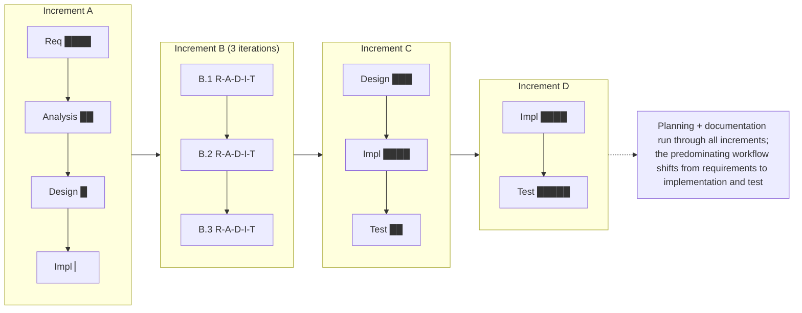

# Note 03 — Iteration vs incrementation, and the iterative-and-incremental model

> Module 01 · Advanced Software Engineering · Term 1 · Farsi: [03-iteration-vs-incrementation.fa.md](03-iteration-vs-incrementation.fa.md) · Index: [INDEX.en.md](INDEX.en.md)

## 1. Summary

- **Incrementation** adds new pieces to a growing product; **iteration** revises an existing piece into a better version. Real software uses both at once: the product is built piece by piece, and every piece goes through several versions.
- The iterative-and-incremental model runs all five core workflows (requirements, analysis, design, implementation, test) in every increment, with one workflow predominating at a time. Each iteration is a small waterfall.
- Its claimed strengths: repeated chances to find faults, an architecture whose robustness is tested early, early risk mitigation and always having a working version. The supporting evidence (Standish data) is correlational: `OPINION / CONTESTED`.

## 2. Detailed explanation

### Intuition: why not just do it in one pass?

Two facts make a single pass impossible (Schach 8e, ch. 2 §2.3–2.5):

1. People make mistakes, so every artifact needs a second version.
2. The client's requirements move while you build (the **moving-target problem**; in Schach's Teal Tractors case a company takeover changes the requirements mid-project, and "feature creep" is the same thing in small steps).

Add a human limit, **Miller's law**: at any moment we can hold only about seven chunks (7 ± 2) of information in mind (Miller 1956, as cited by Schach). A requirements document has far more than seven requirements, a module far more than seven variables. Our coping strategy is *stepwise refinement*: concentrate on the most important aspects now and postpone the rest. Taking the "seven most important requirements" first, then the next seven, is incrementation.

### Two words, two meanings

| | Iteration | Incrementation |
|---|---|---|
| What changes | a version of an artifact is replaced by a better version | the product grows by adding new pieces |
| Question it answers | "Is this piece right yet?" | "What do we build next?" |
| Driven by | mistakes found, changed requirements | Miller's law, priorities, risk |
| Example | `enroll.py` v1 → v2 → v3 | the waitlist feature after the enrollment feature |
| Schach's note | The waterfall model is iterative but **not** incremental (ch. 2 §2.5) | Incremental development is over 45 years old; iterative models over 30 (Larman & Basili 2003, via Schach) |

In Schach's Fig. 2.4 the product is built in four increments (A–D). Fig. 2.5 zooms into one increment (B) and shows three iterations (B.1–B.3), each touching all five workflows in different proportions.

### The five core workflows

Requirements, analysis, design, implementation and test run over the whole life cycle, but **one predominates at a time**. At the start, requirements dominates; toward the end implementation and test occupy most people. Planning and documentation start on day one and continue (Note 02). Testing is a major activity at the end of every iteration and, at the very end, almost the only activity. Overall effort (Fig. 1.4) is about one-fifth requirements and analysis, one-fifth design and three-fifths implementation.

The workflows are **not** phases. Schach's Winburg mini case study (ch. 2 §2.2–2.6) shows an evolution tree: an increment may contain only an implementation fix (a correction of double-precision variables), another only design plus implementation (a faster algorithm), and the last a requirements change, which is perfective maintenance. The model does not require every workflow in every increment. Each increment is maintenance of the previous one.

### "It is the waterfall model, applied repeatedly" (Schach ch. 2 §2.8)

At first glance the iterative-and-incremental model looks chaotic: some code in the morning, some specifying in the afternoon. Schach's point is that it is as regimented as the waterfall: a series of small waterfall mini projects, each with requirements, analysis, design, implementation and checking, and each iterating until the team is satisfied. What changes is the **size of the batch** and how early feedback arrives.

### Claimed strengths (Schach ch. 2 §2.7)

1. **Multiple chances to find faults.** Every iteration includes testing, and late faults are costly (Note 02).
2. **Robustness of the architecture is checked early.** An architecture is the set of components and how they fit; it is *robust* if it can absorb new increments (and later changes) without falling apart. If increment three forces drastic reorganization, the architecture was not robust, and the client can abandon, restart or redesign while little has been spent.
3. **Risk mitigation early.** Build the risky part first. Schach's example: if you fear the network cannot carry the new traffic, build the network-facing part in the first iterations and report to the client early.
4. **There is always a working version** that clients and users can try; partial delivery also eases adoption.
5. **Empirical evidence** that it works, from the Standish CHAOS reports (below).

**Schach says / modern practice says.** Schach presents this model as the realistic description of how software is built and as the basis of the Unified Process (Note 05). Modern practice names the same ideas with different vocabulary: agile development (Note 06), continuous integration, trunk-based or feature-branch workflows, and "walking skeleton" first. Schach's text predates DevOps and treats XP as "somewhat controversial" and new; do not copy that framing.

### Evidence, and its limits

Schach cites Standish data: success rose from 16% in 1994 to 34% in 2002, fell to 29% in 2004, then rose to 35% in 2006. The 2002 and 2004 reports list iterative process as a factor associated with success, and the 2004 decline was linked to more large projects, use of the waterfall model, lack of user involvement and lack of support from executives. In 2006 the Standish president credited better project management, the emerging Web infrastructure and, again, iterative development (via Schach ch. 2 §2.7).

Why this is weak evidence:

- It is a **trend over seven survey years**, not a comparison of iterative versus non-iterative projects; the data do not record which projects iterated.
- It is **correlational** and confounded: project size, management practices, technology and what counts as "success" all changed. See Note 01 for the published critique of CHAOS definitions (Eveleens & Verhoef 2010).
- **OPINION / CONTESTED:** that iterative-incremental development *causes* higher success. It is plausible, theory-backed and widely adopted; the case rests on mechanism (shorter feedback loops) more than on controlled data. Miller's law is also a 1956 psychology result about short-term memory; later work suggests the capacity of working memory is smaller than seven (not checked here, `UNVERIFIED`), so "7 ± 2" is a useful rule of thumb, not a precise number.

### Mapping to Git and CI in a Go/Python repository

| Model concept | In a repository |
|---|---|
| Increment (a new capability) | a feature branch `inc/<capability>` merged to `main` with a merge commit or squash, tagged at baselines |
| Iteration (a better version) | successive commits/PR revisions on that branch; each push runs CI |
| Baseline (complete set of artifacts) | a tag, e.g. `inc-B`; artifacts include code, tests, docs |
| Test workflow in every iteration | CI: `go vet ./... && go test ./...` or `ruff check . && pytest` on each push |
| "Always a working version" | `main` is always green and releasable |
| Early architecture robustness check | the first increment is a walking skeleton (health endpoint, CI, one test); later increments must not need a rewrite of it |
| Risk-first | spike branches for the riskiest dependency (DB, broker) before feature work |

A minimal CI workflow expressing "test in every iteration" (illustrative; not run here):

```yaml
on: [push, pull_request]
jobs:
  test:
    runs-on: ubuntu-latest
    steps:
      - uses: actions/checkout@v4
      - uses: actions/setup-go@v5
        with: { go-version: '1.22' }
      - run: go vet ./... && go test ./...
```

## 3. Diagram



(The bars are qualitative, after Schach's Fig. 2.4. R-A-D-I-T = requirements, analysis, design, implementation, test.)

## 4. Worked example (real commands and output)

**Part 1: increments and iterations in Git.** In a scratch repository (Git 2.56.1) I created a skeleton commit, then increment B with three iterations on a branch and increment C with two, merging each with `--no-ff` and tagging baselines:

```text
$ git log --graph --oneline --no-decorate
*   ba001f8 Merge increment C: waitlist
|\
| * eb05d72 C.2 waitlist: fix ordering (iteration)
| * 7ad996b C.1 waitlist: first version
|/
*   1924145 Merge increment B: enrollment
|\
| * 63e57eb B.3 enrollment: refine API after review
| * 714e2e2 B.2 enrollment: fix capacity check (iteration)
| * d62fbc8 B.1 enrollment: first version
|/
* 2681fb3 skeleton: health endpoint + CI
$ git tag
inc-A
inc-B
inc-C
$ git log --first-parent --oneline --no-decorate
ba001f8 Merge increment C: waitlist
1924145 Merge increment B: enrollment
2681fb3 skeleton: health endpoint + CI
$ git log inc-A..inc-B --oneline --no-merges --no-decorate | wc -l
3
```

(Commit hashes differ on your machine.) Reading it: the vertical stack of side branches is **iteration**; the left-hand line of merges is **incrementation**. `--first-parent` shows the increments (what a client cares about); the side commits are the iterations (what developers care about). `inc-A..inc-B` counts the three iterations that produced increment B. This matches Schach's Fig. 2.5, where B has B.1–B.3.

**Part 2: what the Standish trend can and cannot say.** Data from Schach's Fig. 2.7, analysed with a least-squares line (scratch script `trend.py`, `python -I trend.py`):

```text
success   slope +1.23 pts/year, r = +0.85, n = 7
canceled  slope -1.66 pts/year, r = -0.82, n = 7
iteration used per project in this data: not recorded -> no way to test it
```

Success rises about 1.2 points per year and cancellations fall about 1.7 points per year, with strong correlation with *time*, from only seven points. The last line is the lesson: time is not a treatment variable. Without per-project records of "iterative or not", this data cannot support "iteration causes success".

## 5. Edge cases & pitfalls

- **"Iterative" used for "incremental" and vice versa.** In exams: iteration = refine versions; incrementation = add pieces. The waterfall model with feedback loops is iterative, not incremental.
- **Mini-waterfalls turning into mini-code-and-fix.** Without requirements and design inside each iteration, you get Note 04's code-and-fix with a nicer name.
- **Increments that are not working software.** A "layer" (database layer, then UI layer) leaves no working version until the end; prefer vertical slices.
- **Architecture not robust.** If every increment reshapes the core, the early iterations were spent on the wrong structure. Schach's suggested responses: abandon, restart, or redesign and reuse what you can.
- **Unbounded iteration.** "Iterate until satisfied" needs a stopping rule (timebox, acceptance criteria; Note 06).
- **Moving-target problem has no known solution** (Schach); frequent changes build dependencies and can lead to regression faults and eventually a redesign. Incrementation limits the damage but does not remove it.
- **Treating the Standish numbers as proof.** See section 2 and Note 01.
- **Branching strategy is not the model.** Long-lived feature branches delay integration; trunk-based development with short branches is closer to continuous iteration. Which is better is `OPINION / CONTESTED`; the mapping above is an analogy, not part of Schach's text.

## 6. Exam-style key points

- Iteration: successive versions of the same artifact, each closer to the goal. Incrementation: adding pieces (stepwise refinement, Miller's law 7 ± 2).
- The two are used together: each increment goes through several iterations.
- Five core workflows (requirements, analysis, design, implementation, test) run through the life cycle; one predominates at a time; planning and documentation are continuous.
- Iterative-and-incremental = a series of waterfall mini projects (Schach ch. 2 §2.8); the waterfall alone is iterative but not incremental.
- Strengths: more chances to find faults; early check of architectural robustness; early risk mitigation; always a working version; empirical support (Standish).
- Robustness: ability of the architecture to absorb new increments and changes without falling apart.
- Moving-target problem: requirements change during development; no known solution.
- Evidence limit: Standish trend (16% in 1994 to 35% in 2006) is correlational and the definitions are criticized (`OPINION / CONTESTED`).
- Winburg case: an increment can contain only some workflows; each increment is maintenance of the previous one.

## 7. Links

- Lesson: [§2.3 What is the difference between iterating and incrementing?](../lesson.en.md#23-what-is-the-difference-between-iterating-and-incrementing)
- Previous / next: [02 Phases, workflows, cost of faults](02-phases-workflows-cost-of-faults.en.md) · [04 Plan-driven models](04-plan-driven-models.en.md) · [05 Spiral and Unified Process](05-spiral-and-unified-process.en.md).
- Labs: [02 CI quality gates](../labs/02-ci-quality-gates/README.md) (test in every iteration), [04 git bisect and worktrees](../labs/04-git-bisect-worktrees/README.md), [06 Timebox vs waterfall](../labs/06-timebox-vs-waterfall/README.md).
- Quiz: question 4 (classify iteration / incrementation / both) in [quiz.en.md](../quiz.en.md#a-conceptual).

## Glossary

- **Iteration** — producing a revised version of an artifact.
- **Incrementation** — building a product by adding pieces one after another.
- **Iterative-and-incremental model** — the life-cycle model in which each increment passes through iterations of all five core workflows.
- **Core workflow** — one of requirements, analysis, design, implementation, test.
- **Predominating workflow** — the workflow that occupies most of the team's effort at a given time.
- **Stepwise refinement** — handle the currently most important aspects first and postpone the rest.
- **Miller's law** — humans hold about seven (7 ± 2) chunks in short-term memory.
- **Moving-target problem** — requirements change while the product is being developed.
- **Robustness (of an architecture)** — ability to absorb further increments and changes without falling apart.
- **Baseline** — a complete set of artifacts at one point in time (a Git tag is its closest analogue).
- **Evolution-tree model** — a life-cycle model that records episodes and baselines of a real project.
