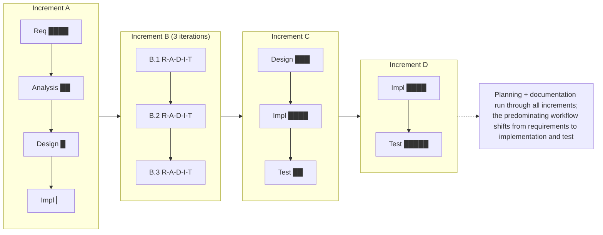

<div dir="rtl">

# یادداشت ۰۳ — Iteration در برابر incrementation و مدل iterative-and-incremental

> ماژول ۰۱ · Advanced Software Engineering · ترم ۱ · نسخهٔ انگلیسی: [03-iteration-vs-incrementation.en.md](03-iteration-vs-incrementation.en.md) · فهرست: [INDEX.fa.md](INDEX.fa.md)

## ۱. خلاصه

- **Incrementation** قطعه‌های تازه به محصولِ درحال‌رشد اضافه می‌کند؛ **iteration** یک قطعهٔ موجود را به نسخهٔ بهتر بازنگری می‌کند. نرم‌افزار واقعی هر دو را هم‌زمان به کار می‌برد: محصول تکه‌تکه ساخته می‌شود و هر تکه چند نسخه می‌گذراند.
- مدل iterative-and-incremental پنج core workflow (requirements، analysis، design، implementation، test) را در هر increment اجرا می‌کند و در هر لحظه یکی غالب است. هر iteration یک waterfall کوچک است.
- مزیت‌های ادعاشده: فرصت‌های مکرر برای یافتن خطا، سنجش زودهنگام استحکام معماری، کاهش زودهنگام ریسک و داشتن همیشگی یک نسخهٔ کارا. شواهد پشتیبان (داده‌های Standish) همبستگی‌اند، نه علّی: `OPINION / CONTESTED`.

## ۲. توضیح

### شهود: چرا یک گذر کافی نیست؟

دو واقعیت یک گذر را ناممکن می‌کنند (Schach 8e, ch. 2 §2.3 تا 2.5):

۱. آدم‌ها اشتباه می‌کنند، پس هر مصنوع به نسخهٔ دوم نیاز دارد.
۲. نیازهای مشتری هنگام ساخت جابه‌جا می‌شوند (**moving-target problem**؛ در مورد Teal Tractors نزد Schach، خریدن یک شرکت دیگر نیازها را وسط پروژه عوض می‌کند، و «feature creep» همان است در گام‌های کوچک).

یک محدودیت انسانی هم هست، **قانون Miller**: در هر لحظه فقط حدود هفت «تکه» (7 ± 2) اطلاعات را می‌توانیم در ذهن نگه داریم (Miller 1956، به نقل از Schach). سند requirements خیلی بیشتر از هفت نیاز دارد و یک ماژول خیلی بیشتر از هفت متغیر. راهکار ما *stepwise refinement* است: اکنون روی مهم‌ترین جنبه‌ها تمرکز می‌کنیم و بقیه را عقب می‌اندازیم. گرفتن «هفت نیاز مهم‌تر» و سپس «هفت نیاز مهم بعدی»، همان incrementation است.

### دو واژه، دو معنی

| | Iteration | Incrementation |
|---|---|---|
| چه چیز تغییر می‌کند | نسخه‌ای از یک مصنوع با نسخهٔ بهتر جایگزین می‌شود | محصول با افزودن قطعه‌های تازه رشد می‌کند |
| به چه پرسشی پاسخ می‌دهد | «این قطعه الان درست است؟» | «بعد چه بسازیم؟» |
| محرکش | خطاهای یافت‌شده، نیازهای تغییریافته | قانون Miller، اولویت‌ها، ریسک |
| مثال | `enroll.py` نسخهٔ ۱ ← ۲ ← ۳ | قابلیت waitlist بعد از قابلیت enrollment |
| نکتهٔ Schach | مدل waterfall iterative است ولی **incremental نیست** (ch. 2 §2.5) | توسعهٔ incremental بیش از ۴۵ سال قدمت دارد؛ مدل‌های iterative بیش از ۳۰ سال (Larman و Basili 2003، از طریق Schach) |

در Fig. 2.4 نزد Schach محصول در چهار increment (A تا D) ساخته می‌شود. Fig. 2.5 روی یک increment (B) بزرگ‌نمایی می‌کند و سه iteration (B.1 تا B.3) را نشان می‌دهد که هر کدام با نسبت‌های متفاوت به هر پنج workflow دست می‌زنند.

### پنج core workflow

Requirements، analysis، design، implementation و test در کل چرخهٔ عمر اجرا می‌شوند، ولی **در هر زمان یکی غالب** است. در آغاز requirements غالب است؛ نزدیک پایان، implementation و test بیشتر وقت افراد را می‌گیرند. برنامه‌ریزی و مستندسازی از روز اول شروع می‌شوند و ادامه دارند (یادداشت ۰۲). آزمون در پایان هر iteration فعالیتی اصلی است و در انتهای کار تقریباً تنها فعالیت. تلاش کلی (Fig. 1.4) حدود یک‌پنجم requirements و analysis، یک‌پنجم design و سه‌پنجم implementation است.

workflowها **فاز نیستند**. مورد کوچک Winburg نزد Schach (ch. 2 §2.2 تا 2.6) یک evolution tree نشان می‌دهد: یک increment ممکن است فقط یک اصلاح implementation باشد (اصلاح متغیرهای double-precision)، دیگری فقط design به‌علاوهٔ implementation (یک الگوریتم سریع‌تر)، و آخری تغییر requirements که perfective maintenance است. مدل نمی‌گوید هر workflow باید در هر increment باشد. هر increment نگهداریِ increment قبلی است.

### «همان مدل waterfall است که پیاپی اجرا می‌شود» (Schach ch. 2 §2.8)

در نگاه اول مدل iterative-and-incremental آشفته به نظر می‌رسد: صبح کمی کدنویسی، بعدازظهر کمی specification. نکتهٔ Schach این است که این مدل به اندازهٔ waterfall منظم است: رشته‌ای از پروژه‌های کوچک waterfall، هر کدام با requirements، analysis، design، implementation و وارسی، و هر کدام تکرار می‌شود تا تیم راضی شود. آنچه فرق می‌کند **اندازهٔ batch** و زودی رسیدن بازخورد است.

### مزیت‌های ادعاشده (Schach ch. 2 §2.7)

۱. **فرصت‌های متعدد برای یافتن خطا.** هر iteration آزمون دارد و خطای دیر گران است (یادداشت ۰۲).
۲. **استحکام معماری زود سنجیده می‌شود.** معماری یعنی مجموعهٔ اجزا و چگونگی جور شدنشان؛ اگر بتواند increment تازه (و بعداً تغییرها) را بی‌آنکه از هم بپاشد جذب کند، *robust* است. اگر increment سوم بازسازماندهی شدید بخواهد، معماری robust نبوده و مشتری می‌تواند وقتی هنوز کم خرج شده، رها کند، از نو شروع کند یا بازطراحی کند.
۳. **کاهش زودهنگام ریسک.** بخش پرخطر را اول بسازید. مثال Schach: اگر نگران‌اید شبکه ترافیک جدید را تحمل نکند، بخشی را که به شبکه وصل می‌شود در iterationهای اول بسازید و زود به مشتری گزارش دهید.
۴. **همیشه یک نسخهٔ کارا داریم** که مشتری و کاربران بتوانند امتحان کنند؛ تحویل جزئی پذیرش را هم آسان‌تر می‌کند.
۵. **شواهد تجربی** که کار می‌کند، از گزارش‌های CHAOS از Standish (پایین).

**Schach says / modern practice says.** Schach این مدل را توصیف واقع‌بینانهٔ چگونگی ساخت نرم‌افزار و پایهٔ Unified Process می‌داند (یادداشت ۰۵). روال امروز همان ایده‌ها را با واژگان دیگری می‌گوید: توسعهٔ چابک (یادداشت ۰۶)، continuous integration، گردش‌کار trunk-based یا feature-branch، و «walking skeleton» در ابتدا. متن Schach پیش از DevOps است و XP را «تا حدی بحث‌برانگیز» و نو می‌داند؛ آن قاب‌بندی را کپی نکنید.

### شواهد و محدودیت‌هایشان

Schach داده‌های Standish را نقل می‌کند: موفقیت از ۱۶٪ در ۱۹۹۴ به ۳۴٪ در ۲۰۰۲ رسید، در ۲۰۰۴ به ۲۹٪ افتاد و در ۲۰۰۶ دوباره به ۳۵٪ رسید. گزارش‌های ۲۰۰۲ و ۲۰۰۴ فرایند iterative را از عوامل مرتبط با موفقیت می‌شمارند، و افت ۲۰۰۴ به پروژه‌های بزرگ‌تر، استفاده از مدل waterfall، کمبود مشارکت کاربر و کمبود حمایت مدیران ارشد نسبت داده شد. در ۲۰۰۶ رئیس Standish مدیریت پروژهٔ بهتر، زیرساخت وب در حال ظهور و، باز، توسعهٔ iterative را دلیل بهبود دانست (از طریق Schach ch. 2 §2.7).

چرا این شاهد ضعیف است:

- یک **روند در هفت سال نظرسنجی** است، نه مقایسهٔ پروژه‌های iterative با غیر iterative؛ داده ثبت نمی‌کند کدام پروژه‌ها iteration داشتند.
- **همبستگی** است و مخدوش: اندازهٔ پروژه، شیوه‌های مدیریت، فناوری و معنی «موفقیت» همه تغییر کردند. نقد منتشرشده از تعریف‌های CHAOS را در یادداشت ۰۱ ببینید (Eveleens و Verhoef 2010).
- **OPINION / CONTESTED:** اینکه توسعهٔ iterative-incremental *علت* موفقیت بیشتر باشد. قابل‌قبول است، پشتوانهٔ نظری دارد و گسترده پذیرفته شده؛ استدلالش بیشتر بر سازوکار (حلقهٔ بازخورد کوتاه‌تر) تکیه دارد تا بر داده‌های کنترل‌شده. قانون Miller هم نتیجه‌ای روان‌شناختی از ۱۹۵۶ دربارهٔ حافظهٔ کوتاه‌مدت است؛ پژوهش‌های بعدی ظاهراً ظرفیت حافظهٔ کاری را کمتر از هفت می‌دانند (اینجا بررسی نشد، `UNVERIFIED`)، پس «7 ± 2» قاعدهٔ سرانگشتی مفید است، نه عددی دقیق.

### نگاشت به Git و CI در یک مخزن Go/Python

| مفهوم مدل | در یک مخزن |
|---|---|
| Increment (یک قابلیت تازه) | یک feature branch با نام `inc/<capability>` که با merge commit یا squash به `main` می‌رود و در baselineها tag می‌خورد |
| Iteration (نسخهٔ بهتر) | commitها/بازنگری‌های PR پیاپی روی آن branch؛ هر push، CI را اجرا می‌کند |
| Baseline (مجموعهٔ کامل مصنوعات) | یک tag، مثلاً `inc-B`؛ مصنوعات شامل کد، آزمون و مستندات است |
| Test workflow در هر iteration | CI: `go vet ./... && go test ./...` یا `ruff check . && pytest` در هر push |
| «همیشه یک نسخهٔ کارا» | `main` همیشه سبز و قابل انتشار است |
| سنجش زودهنگام استحکام معماری | increment اول یک walking skeleton است (health endpoint، CI، یک آزمون)؛ incrementهای بعدی نباید بازنویسی آن را بخواهند |
| ریسک‌محور | spike branch برای پرخطرترین وابستگی (DB، broker) پیش از کار روی قابلیت‌ها |

یک workflow حداقلی CI که «آزمون در هر iteration» را بیان می‌کند (توضیحی؛ اینجا اجرا نشده):

</div>

```yaml
on: [push, pull_request]
jobs:
  test:
    runs-on: ubuntu-latest
    steps:
      - uses: actions/checkout@v4
      - uses: actions/setup-go@v5
        with: { go-version: '1.22' }
      - run: go vet ./... && go test ./...
```

<div dir="rtl">

## ۳. نمودار

</div>



<div dir="rtl">

(میله‌ها کیفی‌اند و از Fig. 2.4 نزد Schach الهام گرفته‌اند. R-A-D-I-T = requirements، analysis، design، implementation، test.)

## ۴. مثال عملی (دستور و خروجی واقعی)

**بخش ۱: increment و iteration در Git.** در یک مخزن موقت (Git 2.56.1) یک commit اسکلت ساختم، سپس increment B را با سه iteration روی یک branch و increment C را با دو iteration، هر کدام را با `--no-ff` merge و baselineها را tag کردم:

</div>

```text
$ git log --graph --oneline --no-decorate
*   ba001f8 Merge increment C: waitlist
|\
| * eb05d72 C.2 waitlist: fix ordering (iteration)
| * 7ad996b C.1 waitlist: first version
|/
*   1924145 Merge increment B: enrollment
|\
| * 63e57eb B.3 enrollment: refine API after review
| * 714e2e2 B.2 enrollment: fix capacity check (iteration)
| * d62fbc8 B.1 enrollment: first version
|/
* 2681fb3 skeleton: health endpoint + CI
$ git tag
inc-A
inc-B
inc-C
$ git log --first-parent --oneline --no-decorate
ba001f8 Merge increment C: waitlist
1924145 Merge increment B: enrollment
2681fb3 skeleton: health endpoint + CI
$ git log inc-A..inc-B --oneline --no-merges --no-decorate | wc -l
3
```

<div dir="rtl">

(hash commitها روی ماشین شما فرق می‌کند.) خواندنش: پشتهٔ عمودی branchهای جانبی **iteration** است؛ خط merge سمت چپ **incrementation**. `--first-parent` incrementها را نشان می‌دهد (چیزی که مشتری می‌خواهد)؛ commitهای جانبی iterationها هستند (چیزی که توسعه‌دهنده‌ها می‌خواهند). `inc-A..inc-B` سه iterationای را می‌شمارد که increment B را ساختند. این با Fig. 2.5 نزد Schach می‌خواند که B سه iteration B.1 تا B.3 دارد.

**بخش ۲: داده‌های روند Standish چه می‌گویند و چه نمی‌گویند.** داده از Fig. 2.7 نزد Schach، با خط کمترین مربعات تحلیل شد (اسکریپت موقت `trend.py`، اجرا با `python -I trend.py`):

</div>

```text
success   slope +1.23 pts/year, r = +0.85, n = 7
canceled  slope -1.66 pts/year, r = -0.82, n = 7
iteration used per project in this data: not recorded -> no way to test it
```

<div dir="rtl">

موفقیت سالی حدود ۱٫۲ امتیاز بالا می‌رود و لغوها سالی حدود ۱٫۷ امتیاز پایین می‌آیند، با همبستگی قوی با *زمان*، از فقط هفت نقطه. خط آخر درس است: زمان یک متغیر «مداخله» نیست. بدون ثبت «iterative بود یا نه» برای هر پروژه، این داده نمی‌تواند از «iteration علت موفقیت است» پشتیبانی کند.

## ۵. حالت‌های خاص و دام‌ها

- **«iterative» به‌جای «incremental» و برعکس.** در امتحان: iteration = پالایش نسخه‌ها؛ incrementation = افزودن قطعه‌ها. مدل waterfall با حلقه‌های بازخورد iterative است، نه incremental.
- **mini-waterfallهایی که mini-code-and-fix می‌شوند.** بدون requirements و design درون هر iteration، به code-and-fix یادداشت ۰۴ با نامی قشنگ‌تر می‌رسید.
- **Incrementهایی که نرم‌افزار کارا نیستند.** یک «لایه» (اول لایهٔ پایگاه داده، بعد UI) تا آخر نسخهٔ کارا باقی نمی‌گذارد؛ برش‌های عمودی را ترجیح دهید.
- **معماری robust نیست.** اگر هر increment هسته را از نو شکل بدهد، iterationهای اول صرف ساختار اشتباه شده‌اند. واکنش‌های پیشنهادی Schach: رها کردن، شروع دوباره، یا بازطراحی و استفادهٔ مجدد از آنچه می‌شود.
- **Iteration بی‌پایان.** «تکرار تا رضایت» به قاعدهٔ توقف نیاز دارد (timebox، معیارهای پذیرش؛ یادداشت ۰۶).
- **Moving-target problem راه‌حل شناخته‌شده ندارد** (Schach)؛ تغییرهای مکرر وابستگی می‌سازند و می‌توانند به regression fault و در نهایت بازطراحی برسند. Incrementation آسیب را محدود می‌کند، ولی از بین نمی‌برد.
- **اعداد Standish را اثبات گرفتن.** بخش ۲ و یادداشت ۰۱ را ببینید.
- **استراتژی branch همان مدل نیست.** branchهای feature عمر طولانی ادغام را عقب می‌اندازند؛ توسعهٔ trunk-based با branchهای کوتاه به iteration پیوسته نزدیک‌تر است. اینکه کدام بهتر است `OPINION / CONTESTED` است؛ نگاشت بالا یک قیاس است، نه بخشی از متن Schach.

## ۶. نکته‌های کلیدی امتحانی

- Iteration: نسخه‌های پیاپی از یک مصنوع، هر کدام نزدیک‌تر به هدف. Incrementation: افزودن قطعه‌ها (stepwise refinement، قانون Miller 7 ± 2).
- این دو با هم به کار می‌روند: هر increment چند iteration می‌گذراند.
- پنج core workflow (requirements، analysis، design، implementation، test) در کل چرخهٔ عمر اجرا می‌شوند؛ در هر زمان یکی غالب است؛ برنامه‌ریزی و مستندسازی پیوسته‌اند.
- Iterative-and-incremental = رشته‌ای از پروژه‌های کوچک waterfall (Schach ch. 2 §2.8)؛ waterfall تنهایی iterative است ولی incremental نیست.
- مزایا: فرصت‌های بیشتر برای یافتن خطا؛ سنجش زودهنگام استحکام معماری؛ کاهش زودهنگام ریسک؛ همیشه یک نسخهٔ کارا؛ پشتیبانی تجربی (Standish).
- Robustness: توانایی معماری در جذب increment و تغییرهای بعدی بی‌آنکه از هم بپاشد.
- Moving-target problem: نیازها در حین توسعه تغییر می‌کنند؛ راه‌حل شناخته‌شده ندارد.
- محدودیت شواهد: روند Standish (۱۶٪ در ۱۹۹۴ تا ۳۵٪ در ۲۰۰۶) همبستگی است و تعریف‌هایش نقد شده (`OPINION / CONTESTED`).
- مورد Winburg: یک increment می‌تواند فقط بعضی workflowها را داشته باشد؛ هر increment نگهداریِ increment قبلی است.

## ۷. پیوندها

- درس: [§2.3 What is the difference between iterating and incrementing?](../lesson.en.md#23-what-is-the-difference-between-iterating-and-incrementing)
- قبلی / بعدی: [02 فازها، workflowها، هزینهٔ خطا](02-phases-workflows-cost-of-faults.en.md) · [04 مدل‌های برنامه‌محور](04-plan-driven-models.en.md) · [05 Spiral و Unified Process](05-spiral-and-unified-process.en.md).
- آزمایشگاه‌ها: [02 CI quality gates](../labs/02-ci-quality-gates/README.md) (آزمون در هر iteration)، [04 git bisect و worktree](../labs/04-git-bisect-worktrees/README.md)، [06 Timebox در برابر waterfall](../labs/06-timebox-vs-waterfall/README.md).
- آزمون: پرسش ۴ (طبقه‌بندی iteration / incrementation / هر دو) در [quiz.en.md](../quiz.en.md#a-conceptual).

## واژه‌نامه

- **Iteration:** تولید نسخهٔ بازنگری‌شده از یک مصنوع.
- **Incrementation:** ساختن محصول با افزودن قطعه‌ها یکی پس از دیگری.
- **Iterative-and-incremental model:** مدل چرخهٔ عمری که در آن هر increment چند iteration از هر پنج core workflow را می‌گذراند.
- **Core workflow:** یکی از requirements، analysis، design، implementation، test.
- **Predominating workflow (workflow غالب):** workflowی که در یک زمان بیشترین تلاش تیم را می‌گیرد.
- **Stepwise refinement (پالایش گام‌به‌گام):** ابتدا مهم‌ترین جنبه‌ها را بپرداز و بقیه را به بعد بسپار.
- **Miller's law (قانون Miller):** انسان حدود هفت (7 ± 2) «تکه» را در حافظهٔ کوتاه‌مدت نگه می‌دارد.
- **Moving-target problem:** نیازها در حین توسعهٔ محصول تغییر می‌کنند.
- **Robustness (استحکام معماری):** توانایی جذب incrementها و تغییرهای بعدی بی‌آنکه معماری از هم بپاشد.
- **Baseline:** مجموعهٔ کامل مصنوعات در یک لحظه (نزدیک‌ترین همتای آن در Git یک tag است).
- **Evolution-tree model:** مدل چرخهٔ عمر که episodeها و baselineهای یک پروژهٔ واقعی را ثبت می‌کند.

</div>
