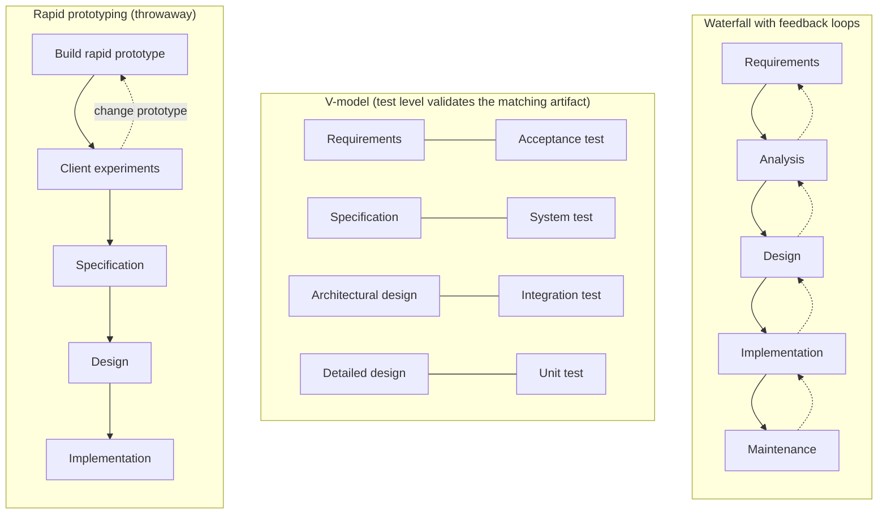

# Note 04 — Plan-driven models: code-and-fix, waterfall, V-model, rapid prototyping

> Module 01 · Advanced Software Engineering · Term 1 · Farsi: [04-plan-driven-models.fa.md](04-plan-driven-models.fa.md) · Index: [INDEX.en.md](INDEX.en.md)

## 1. Summary

- **Code-and-fix** has no requirements, specification or design; it is fine for tiny throwaway programs and unsatisfactory for anything that must be maintained.
- **Waterfall** (feedback loops, **documentation-driven**, every phase signed off by SQA) is disciplined but the client first sees a working product at the end. The **V-model** pairs each development phase with a test level (not in Schach's core list: see the sourcing note). **Rapid prototyping** builds a throwaway working model first to settle *what* the product is.
- Which one fits depends on how well the requirements are understood, how large and long-lived the product is, and who bears the cost of change.

## 2. Detailed explanation

### Intuition: how much do you commit before you learn anything?

A plan-driven model fixes the sequence of activities up front and judges progress against a plan. The risk is that you commit to a wrong picture of "what" before real feedback arrives. The models below differ in *when* the client sees something working and *how much paper* sits between idea and code.

### Code-and-fix (Schach 8e, ch. 2 §2.9.1)

The developers implement a first version with no requirements, specification or design, then modify it until the client is satisfied. Schach calls it "the easiest way to develop software and by far the worst": changes made after coding are expensive (Note 02), maintenance without specification or design documents is hard, and regression faults become likelier. Its worst enabler is measuring progress by lines of code. It "works" for programs of 100–200 lines.

### Waterfall (Royce 1970; Schach ch. 2 §2.9.2)

The waterfall model performs requirements, analysis, design, implementation and postdelivery maintenance in order, on the product as a whole. **Feedback loops** (Schach's Fig. 2.9) let developers go back: a design fault caused by a requirements fault is fixed by backtracking to the requirements, then analysis, then design. Two rules define the model:

- **No phase is complete until its documentation is complete and the SQA group has approved the artifacts**; this extends to changes made via a feedback loop (the earlier phase is complete only when its documents are updated and re-checked).
- Testing is not a phase but happens continually; during maintenance it includes **regression testing**.

Strengths (Schach): enforced discipline, documentation at every phase, meticulous checking. Weakness: because it is **documentation driven**, the client signs a long, technical specification they may not understand, and sees the real product only after everything is coded: "I know this is what I asked for, but it isn't really what I wanted." Schach's analogies are a house described only in a typed document and a suit ordered from a written description.

**Sourcing note on Royce.** Schach credits Royce (1970), "Managing the development of large software systems", Proc. IEEE WESCON, August 1970, pp. 1–9 with the model. The case study ([§8](../case-study.en.md#8-classic-sources-schach-cites-them-what-did-i-verify)) opened a third-party reprint of the paper and verified that it shows the simple sequential figure first, calls that implementation risky and one that invites failure (testing at the end is the first time timing, storage and I/O are experienced), and then adds five steps: program design first, document the design, do it twice, plan and monitor testing, and involve the customer. The word "waterfall" does not appear in it (this last point comes from a secondary source, Wikipedia's article on Royce, and was not checked in the reprint: `UNVERIFIED`). So "Royce advocated pure waterfall" is a popular misreading; the figure people criticize is the first one in the paper, not his recommendation.

### V-model

The V-model draws development as a V: the left arm descends from user needs through requirements, system design and detailed design to implementation at the bottom; the right arm ascends through unit, integration, system and acceptance testing. Each test level *validates* the matching artifact on the left: acceptance tests against requirements, system tests against the specification, integration tests against the architectural design, unit tests against the detailed design.

**Sourcing: the V-model is not in Schach's core list** (§2.9 covers code-and-fix, waterfall, rapid prototyping, open source, agile, synchronize-and-stabilize and spiral; the book has no V-model entry). A systems-engineering source I could open: the SEBoK glossary entry "Vee (V) Model" attributes the picture of the technical side of the project cycle, with stakeholder needs at the upper left and a user-confirmed system at the upper right, to Forsberg and Mooz (1991; the glossary lists the full reference under the author order Mooz and Forsberg, "The Relationship of Systems Engineering to the Project Cycle", joint conference of INCOSE and the American Society for Engineering Management, Chattanooga, 21–23 October 1991). Citation details differ between sources; verify against the proceedings. The claim that the model was invented there, and the claim that a German public-sector "V-Modell" followed, are `UNVERIFIED`. The four-level test mapping above is the common textbook formulation, not taken from a source I opened; verify it in the SEBoK life-cycle model article or in a test-certification syllabus.

**Schach says / modern practice says.** Schach does not treat the V-model; he places testing inside every phase. Modern practice uses the V as a **traceability and test-planning idea** (write acceptance tests from requirements, integration tests from architecture) and it appears in regulated domains (automotive, medical); Module 06 revisits test levels. It is plan-driven but one can run it inside iterations.

### Rapid prototyping (Schach ch. 2 §2.9.3 and ch. 11 §11.13, §11.15)

A **rapid prototype** is a working model that is functionally equivalent to a *subset* of the product, such as screens and reports without file updating or error handling. The client and users experiment with it, the prototype is changed until both sides agree it captures the real needs, and the specification is then drawn up from it. Development after that is nearly linear, so the waterfall's feedback loops are less often needed. Speed is the point: internal structure does not matter.

- **Throwaway** prototype (Schach's model): discarded once it has served to find the requirements; lessons are kept, code is not.
- **Evolutionary** prototype: refine the prototype until it becomes the product. Schach calls this "generally unwise" (ch. 11 §11.15): changing a working product is costly (Note 02) and a hastily built prototype has no specification or design, so it is hard to maintain.

Schach also notes (§2.10) that there is "still insufficient evidence" that prototyping beats the waterfall in other respects than meeting the client's real needs. **Modern practice says:** an evolutionary prototype (a "walking skeleton" or MVP in a startup) is routine, with the discipline that production-grade tests and structure are added as it hardens. The difference from Schach's warning is the presence of automated tests and refactoring, which keep the cost of changing a working product lower than in the 1970s data. Whether that holds for a given team is `OPINION / CONTESTED`.

### Strengths and weaknesses

| Model | Strengths | Weaknesses | Fits when |
|---|---|---|---|
| Code-and-fix | no overhead; fast first version | no spec/design; costly changes; poor maintainability; regression faults | one-person scripts, spikes, programs of a couple of hundred lines |
| Waterfall | discipline; documentation; SQA sign-off; predictable | client sees product late; requirements frozen on paper; assumes discrete phases | stable, well-understood requirements; contract software; heavy regulation |
| V-model | built-in test planning and traceability | same late-feedback risk as waterfall; left arm done before right arm learns anything | safety/regulated systems where each requirement needs a test |
| Rapid prototyping (throwaway) | validates requirements early; later feedback loops rarer | prototype cost; "insufficient evidence" (Schach); users may expect the prototype to ship | vague requirements, UI-heavy products |
| Rapid prototyping (evolutionary) | one codebase; users involved continuously | prototype shortcuts become debt; no design documents | start-up MVPs when tests and refactoring are kept up |

Schach's overall comparison (ch. 2 §2.10, Fig. 2.14) agrees with the first rows: code-and-fix "should be avoided"; waterfall "a known quantity"; rapid prototyping "not yet proven beyond all doubt". His conclusion is that an organization should choose and *mix* models according to the product (Note 07).

## 3. Diagram



## 4. Worked example (toy simulation, run it yourself)

Question: how does the cost of misunderstood requirements compare across code-and-fix, waterfall and a throwaway prototype? The scratch script `models.py` (Python 3.12.14, `python -I models.py`, seeded) simulates 20,000 products. **All parameters are assumptions**, not data: 40 requirements; each is misunderstood with probability `P_WRONG`; building costs 100 units; fixing a wrong requirement costs 1 on paper or in a prototype, 12 when the client first sees the finished product (waterfall), 20 without specification or design (code-and-fix); a throwaway prototype costs 15 and the client spots 80% of wrong requirements while playing with it.

```python
def waterfall(wrong):
    return BUILD + wrong * FIX_AT_ACCEPT

def prototype(wrong):
    found = sum(random.random() < P_PROTO_FINDS for _ in range(wrong))
    return PROTO_COST + BUILD + found * FIX_AT_REQ + (wrong - found) * FIX_AT_ACCEPT
```

Real output for three requirement-uncertainty levels (expected wrong requirements per product: 6.0, 2.0 and 0.8):

```text
P_WRONG = 0.15                    P_WRONG = 0.05                    P_WRONG = 0.02
model          mean   95th pct    model          mean   95th pct    model          mean   95th pct
code-and-fix  219.9     300.0     code-and-fix  139.7     180.0     code-and-fix  115.9     140.0
waterfall     172.1     220.0     waterfall     124.1     160.0     waterfall     109.7     124.0
prototype     134.2     157.0     prototype     121.4     139.0     prototype     117.6     128.0
```

What to observe:

- Code-and-fix is never the best option here, and in the uncertain case it is 64% more expensive than the prototype (219.9 vs 134.2).
- Prototyping wins when requirements are shaky (`P_WRONG = 0.15`) and loses to waterfall when they are stable (`P_WRONG = 0.02`): the 15-unit prototype does not pay for itself. This is the "when each fits" row of the table as a crossover.
- At the middle setting the models are within a few percent, so a real project would decide on factors the toy ignores (contract type, regulation, team experience).
- This is a model of my assumptions, not an experiment; change the constants and the crossover moves. Lab 06 ([timebox vs waterfall](../labs/06-timebox-vs-waterfall/README.md)) and Lab 03 do the same with plans you write yourself.

In a Go/Python repo the V-model idea shows up as traceability: requirement IDs in test names (e.g. `TestREQ012_EnrollmentCapacity`), which Module 02 builds into a traceability matrix.

## 5. Edge cases & pitfalls

- **"Waterfall means Royce said so."** See the sourcing note: Royce's paper presents the single-pass version as risky and then recommends iteration.
- **Waterfall with loops is still iterative, not incremental** (Note 03): it iterates on the whole product, not on a growing part.
- **Documentation-driven is not the same as documentation-heavy for its own sake.** Schach's point is that each phase's output is a checked document the next phase depends on; the risk is a client approving what they do not understand.
- **Prototype turned into the product.** The most common failure of rapid prototyping in practice: management sees it work and ships it. Schach's remedy is the explicit throwaway.
- **A prototype is not the specification.** Schach has the prototype *feed* the specification; the product is still specified and designed afterwards.
- **V-model treated as strictly sequential.** Nothing in the idea forbids running it per increment; the sequential reading is where the late-feedback problem comes from. This is interpretation, not from Schach.
- **Code-and-fix hiding inside "agile".** Iterating without requirements, design thinking or tests is code-and-fix with a standup.
- **Confusing validation levels.** Verification checks a phase against the previous phase; validation checks the product against the client's needs (Note 02). The V's right arm mixes both.
- **Toy simulations as evidence.** The example above shows how parameters drive the conclusion; it does not prove which model is better.

## 6. Exam-style key points

- Code-and-fix: implement, modify until satisfied; no requirements, spec or design; unsatisfactory for non-trivial products; fine for ~100–200 line programs.
- Waterfall (Royce 1970): sequential phases with feedback loops; no phase complete until its documentation is done and SQA-approved; documentation driven; strength = discipline, weakness = delivered product may not meet the client's needs.
- Waterfall is iterative but not incremental; an iterative-and-incremental model is a series of waterfalls.
- Rapid prototype: working model of a subset of functionality, built fast, discarded; used to determine the client's real needs; specification is then written from it.
- Evolving a prototype into the product is generally unwise (costly changes, no spec/design).
- Schach's comparison: code-and-fix avoid; waterfall known quantity; prototyping unproven beyond doubt in other respects.
- V-model: each development artifact paired with a test level; not in Schach's list; origin attribution (Forsberg & Mooz 1991 via SEBoK) must be cited with care; details `UNVERIFIED`.
- Choose and mix models according to the product (Schach ch. 2 §2.10).

## 7. Links

- Lesson: [§2.4 Why did waterfall become the thing everybody warns about?](../lesson.en.md#24-why-did-waterfall-become-the-thing-everybody-warns-about) (its model table lists all four models).
- Previous / next: [03 Iteration vs incrementation](03-iteration-vs-incrementation.en.md) · [05 Spiral and Unified Process](05-spiral-and-unified-process.en.md) · [07 Open source, sync-and-stabilize, choosing and mixing models](07-open-source-and-sync-stabilize.en.md).
- Labs: [03 Cost-of-fault simulation](../labs/03-cost-of-fault-simulation/README.md), [06 Timebox vs waterfall](../labs/06-timebox-vs-waterfall/README.md).
- Quiz: question 5 (waterfall, Royce) in [section A](../quiz.en.md#a-conceptual), question 12 (choose a model) in [section C](../quiz.en.md#c-design-and-critique), and oral question O1 in [quiz.en.md](../quiz.en.md).
- Case study: [§8 classic sources](../case-study.en.md#8-classic-sources-schach-cites-them-what-did-i-verify) (Royce 1970 opened).

## Glossary

- **Code-and-fix model** — build without requirements, specification or design and keep modifying until the client is satisfied.
- **Waterfall model** — sequential phases with feedback loops; each phase ends with approved documentation.
- **Documentation-driven** — the process is organized around producing and approving a document per phase.
- **Feedback loop** — going back to an earlier phase to correct a fault found later.
- **SQA (software quality assurance) group** — independent group that approves each phase's artifacts.
- **V-model** — life-cycle picture pairing each development phase with a test level.
- **Rapid prototype** — hastily built working model of a subset of the product's functionality.
- **Throwaway prototype** — a prototype discarded after the requirements are understood.
- **Evolutionary prototype** — a prototype refined until it becomes the product.
- **Regression testing** — checking that a change did not break previously working behaviour.
- **Walking skeleton / MVP** — a minimal end-to-end version of the product used as a starting point or first release.
