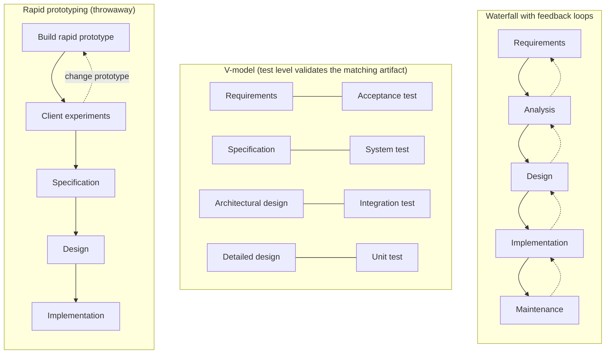

<div dir="rtl">

# یادداشت ۰۴ — مدل‌های برنامه‌محور: code-and-fix، waterfall، V-model، rapid prototyping

> ماژول ۰۱ · Advanced Software Engineering · ترم ۱ · نسخهٔ انگلیسی: [04-plan-driven-models.en.md](04-plan-driven-models.en.md) · فهرست: [INDEX.fa.md](INDEX.fa.md)

## ۱. خلاصه

- **Code-and-fix** requirements، specification و design ندارد؛ برای برنامه‌های کوچکِ یک‌بارمصرف خوب است و برای هر چیزی که باید نگهداری شود نامناسب.
- **Waterfall** (با حلقه‌های بازخورد، **documentation-driven**، هر فاز با تأیید SQA بسته می‌شود) منضبط است ولی مشتری اولین بار محصول کارا را در پایان می‌بیند. **V-model** هر فاز توسعه را با یک سطح آزمون جفت می‌کند (در فهرست اصلی Schach نیست: یادداشت منبع را ببینید). **Rapid prototyping** ابتدا یک مدل کاراِ دورریختنی می‌سازد تا *چه* بودنِ محصول معلوم شود.
- اینکه کدام مناسب است به این بستگی دارد که نیازها چقدر روشن‌اند، محصول چقدر بزرگ و ماندگار است و هزینهٔ تغییر را چه کسی می‌پردازد.

## ۲. توضیح

### شهود: پیش از آنکه چیزی یاد بگیرید چقدر تعهد می‌کنید؟

یک مدل برنامه‌محور دنبالهٔ فعالیت‌ها را از پیش ثابت می‌کند و پیشرفت را با برنامه می‌سنجد. خطر این است که پیش از رسیدن بازخورد واقعی، به تصویری غلط از «چه» متعهد شوید. مدل‌های زیر در این فرق دارند که مشتری *کی* چیزی کارا می‌بیند و *چقدر کاغذ* بین ایده و کد است.

### Code-and-fix (Schach 8e, ch. 2 §2.9.1)

توسعه‌دهندگان نسخهٔ اول را بدون requirements، specification یا design پیاده می‌کنند و بعد آن را تغییر می‌دهند تا مشتری راضی شود. Schach آن را «آسان‌ترین راه توسعهٔ نرم‌افزار و با اختلاف بدترین راه» می‌نامد: تغییرِ پس از کدنویسی گران است (یادداشت ۰۲)، نگهداری بدون اسناد specification و design سخت است و regression fault محتمل‌تر می‌شود. بدترین مشوق آن سنجیدن پیشرفت با تعداد خطوط کد است. برای برنامه‌های ۱۰۰ تا ۲۰۰ خطی «کار می‌کند».

### Waterfall (Royce 1970؛ Schach ch. 2 §2.9.2)

مدل waterfall requirements، analysis، design، implementation و postdelivery maintenance را به‌ترتیب و روی کل محصول انجام می‌دهد. **حلقه‌های بازخورد** (Fig. 2.9 نزد Schach) اجازه می‌دهند به عقب برگردند: خطای design که از خطای requirements آمده با بازگشت به requirements، سپس analysis و سپس design اصلاح می‌شود. دو قاعده مدل را تعریف می‌کند:

- **هیچ فازی کامل نیست مگر مستنداتش کامل شود و SQA مصنوعات را تأیید کند**؛ این شامل تغییرهای ناشی از حلقهٔ بازخورد هم می‌شود (فاز قبلی فقط وقتی کامل است که اسنادش به‌روز و دوباره بررسی شده باشد).
- آزمون فاز نیست، بلکه پیوسته انجام می‌شود؛ در نگهداری شامل **regression testing** است.

نقاط قوت (Schach): رویکرد منضبط اجباری، مستندات در هر فاز، بررسی دقیق توسط SQA. ضعف: چون **documentation driven** است، مشتری یک specification طولانی و فنی را که شاید نفهمد امضا می‌کند و محصول واقعی را فقط پس از کدنویسی کامل می‌بیند: «می‌دانم این چیزی است که خواستم، ولی در واقع چیزی نبود که می‌خواستم.» قیاس‌های Schach: خانه‌ای که فقط با یک سند تایپ‌شده توصیف شده، و کت‌وشلواری که با شرح نوشتاری سفارش داده می‌شود.

**یادداشت منبع دربارهٔ Royce.** Schach مدل را به Royce (1970)، «Managing the development of large software systems»، Proc. IEEE WESCON، اوت ۱۹۷۰، pp. 1–9 نسبت می‌دهد. مطالعهٔ موردی ([§8](../case-study.en.md#8-classic-sources-schach-cites-them-what-did-i-verify)) یک reprint شخص‌ثالث از مقاله را باز کرد و تأیید کرد که اول شکل ترتیبی ساده را نشان می‌دهد، آن پیاده‌سازی را پرخطر و دعوت‌کنندهٔ شکست می‌خواند (آزمون در پایان اولین باری است که timing، storage و I/O تجربه می‌شوند) و سپس پنج گام اضافه می‌کند: ابتدا program design، مستندسازی طرح، دو بار انجام دادن کار، برنامه‌ریزی و پایش آزمون، و درگیر کردن مشتری. واژهٔ «waterfall» در آن نیست (این نکتهٔ آخر از یک منبع ثانویه، مقالهٔ Wikipedia دربارهٔ Royce، می‌آید و در reprint بررسی نشد: `UNVERIFIED`). پس «Royce از waterfall محض دفاع می‌کرد» یک برداشت نادرست رایج است؛ شکلی که مردم نقد می‌کنند اولین شکل مقاله است، نه توصیهٔ او.

### V-model

V-model توسعه را به شکل V می‌کشد: بازوی چپ از نیازهای کاربر از طریق requirements، طراحی سیستم و طراحی تفصیلی به implementation در ته V می‌رسد؛ بازوی راست از طریق آزمون unit، integration، system و acceptance بالا می‌رود. هر سطح آزمون مصنوع متناظر در چپ را *validate* می‌کند: آزمون‌های acceptance در برابر requirements، آزمون‌های system در برابر specification، آزمون‌های integration در برابر طراحی معماری، و آزمون‌های unit در برابر طراحی تفصیلی.

**منبع‌یابی: V-model در فهرست اصلی Schach نیست** (§2.9 این‌ها را پوشش می‌دهد: code-and-fix، waterfall، rapid prototyping، open source، agile، synchronize-and-stabilize و spiral؛ کتاب مدخل V-model ندارد). یک منبع مهندسی سیستم که توانستم باز کنم: مدخل واژه‌نامهٔ SEBoK به نام «Vee (V) Model» تصویر سمت فنی چرخهٔ پروژه، با نیازهای ذی‌نفعان در بالا-چپ و سیستمِ تأییدشده توسط کاربر در بالا-راست، را به Forsberg و Mooz (1991) نسبت می‌دهد (واژه‌نامه مرجع کامل را با ترتیب نویسندگان Mooz و Forsberg می‌آورد: «The Relationship of Systems Engineering to the Project Cycle»، کنفرانس مشترک INCOSE و American Society for Engineering Management، Chattanooga، ۲۱ تا ۲۳ اکتبر ۱۹۹۱). جزئیات استناد بین منابع فرق می‌کند؛ با خود proceedings تطبیق دهید. ادعای اینکه مدل همان‌جا ابداع شد، و ادعای اینکه «V-Modell» آلمانی بخش عمومی بعد از آن آمد، `UNVERIFIED` هستند. نگاشت چهارسطحی آزمون بالا فرمول‌بندی رایج کتاب‌های درسی است، نه چیزی از منبعی که باز کرده باشم؛ آن را در مقالهٔ مدل‌های چرخهٔ عمر SEBoK یا سرفصل یک گواهی آزمون وارسی کنید.

**Schach says / modern practice says.** Schach V-model را بررسی نمی‌کند؛ آزمون را درون هر فاز می‌گذارد. روال امروز V را به‌عنوان یک ایدهٔ **ردیابی و برنامه‌ریزی آزمون** به کار می‌برد (آزمون acceptance را از requirements بنویس، آزمون integration را از معماری) و در حوزه‌های تحت مقررات (خودرو، پزشکی) دیده می‌شود؛ ماژول ۰۶ دوباره به سطوح آزمون می‌پردازد. برنامه‌محور است، ولی می‌شود آن را درون iterationها اجرا کرد.

### Rapid prototyping (Schach ch. 2 §2.9.3 و ch. 11 §11.13 و §11.15)

یک **rapid prototype** مدلی کاراست که از نظر عملکردی معادل یک *زیرمجموعه* از محصول است، مثلاً صفحه‌ها و گزارش‌ها بدون به‌روزرسانی فایل یا مدیریت خطا. مشتری و کاربران با آن کار می‌کنند، prototype تغییر می‌کند تا هر دو طرف موافق شوند که نیازهای واقعی را در بر می‌گیرد و سپس specification از روی آن نوشته می‌شود. توسعهٔ بعد از آن تقریباً خطی است، پس حلقه‌های بازخورد waterfall کمتر لازم می‌شوند. سرعت اصل است: ساختار داخلی اهمیتی ندارد.

- Prototype **دورریختنی** (مدل Schach): پس از آنکه برای یافتن requirements به کار آمد کنار گذاشته می‌شود؛ درس‌ها می‌مانند، کد نه.
- Prototype **تکاملی**: prototype را پالایش می‌کنند تا محصول شود. Schach این را «عموماً نابخردانه» می‌داند (ch. 11 §11.15): تغییر یک محصول کارا گران است (یادداشت ۰۲) و prototype عجولانه ساخته‌شده specification و design ندارد، پس نگهداری‌اش سخت است.

Schach در §2.10 هم می‌گوید هنوز «شواهد کافی» نیست که prototyping در جنبه‌هایی جز برآورده کردن نیاز واقعی مشتری از waterfall بهتر باشد. **Modern practice says:** prototype تکاملی (یک «walking skeleton» یا MVP در استارتاپ) امری عادی است، با این انضباط که آزمون و ساختار در حد تولید با سخت شدنش اضافه می‌شود. تفاوت با هشدار Schach وجود آزمون خودکار و refactoring است که هزینهٔ تغییر یک محصول کارا را کمتر از داده‌های دههٔ ۱۹۷۰ نگه می‌دارند. اینکه برای یک تیم مشخص چنین باشد `OPINION / CONTESTED` است.

### نقاط قوت و ضعف

| مدل | نقاط قوت | نقاط ضعف | کجا مناسب است |
|---|---|---|---|
| Code-and-fix | بدون سربار؛ نسخهٔ اول سریع | بدون spec/design؛ تغییر گران؛ نگهداری‌پذیری ضعیف؛ regression fault | اسکریپت یک‌نفره، spike، برنامه‌های چند صد خطی |
| Waterfall | انضباط؛ مستندات؛ تأیید SQA؛ قابل‌پیش‌بینی | مشتری محصول را دیر می‌بیند؛ requirements روی کاغذ منجمد؛ فرض فازهای گسسته | requirements پایدار و روشن؛ نرم‌افزار قراردادی؛ مقررات سنگین |
| V-model | برنامه‌ریزی آزمون و ردیابی داخلی | همان خطر بازخورد دیرهنگام waterfall؛ بازوی چپ پیش از آنکه بازوی راست چیزی بیاموزد تمام می‌شود | سیستم‌های ایمنی/تحت مقررات که هر نیاز باید آزمونی داشته باشد |
| Rapid prototyping (دورریختنی) | اعتبارسنجی زودهنگام نیازها؛ حلقه‌های بازخورد بعدی کمتر | هزینهٔ prototype؛ «شواهد ناکافی» (Schach)؛ کاربران ممکن است انتظار داشته باشند prototype تحویل شود | نیازهای مبهم، محصولات پر از UI |
| Rapid prototyping (تکاملی) | یک codebase؛ درگیری پیوستهٔ کاربران | میان‌برهای prototype بدهی می‌شوند؛ بدون اسناد طراحی | MVP استارتاپ وقتی آزمون و refactoring ادامه داشته باشد |

مقایسهٔ کلی Schach (ch. 2 §2.10, Fig. 2.14) با ردیف‌های اول می‌خواند: code-and-fix «باید از آن پرهیز کرد»؛ waterfall «یک کمیت شناخته‌شده»؛ rapid prototyping «هنوز فراتر از هر شک ثابت نشده». نتیجه‌گیری او این است که سازمان باید مدل‌ها را بر پایهٔ محصول انتخاب و *ترکیب* کند (یادداشت ۰۷).

## ۳. نمودار

</div>



<div dir="rtl">

## ۴. مثال عملی (شبیه‌سازی اسباب‌بازی، خودتان اجرا کنید)

پرسش: وقتی نیازها اشتباه فهمیده شوند، هزینه در code-and-fix، waterfall و prototype دورریختنی چطور مقایسه می‌شود؟ اسکریپت موقت `models.py` (Python 3.12.14، با `python -I models.py`، با seed ثابت) ۲۰٬۰۰۰ محصول را شبیه‌سازی می‌کند. **همهٔ پارامترها فرض‌اند**، نه داده: ۴۰ نیاز؛ هر نیاز با احتمال `P_WRONG` اشتباه فهمیده می‌شود؛ ساخت ۱۰۰ واحد هزینه دارد؛ اصلاح یک نیاز اشتباه روی کاغذ یا در prototype ۱ واحد، وقتی مشتری اولین بار محصول تمام‌شده را می‌بیند ۱۲ (waterfall) و بدون specification و design ۲۰ (code-and-fix) هزینه دارد؛ یک prototype دورریختنی ۱۵ واحد هزینه دارد و مشتری ۸۰٪ نیازهای اشتباه را هنگام کار با آن تشخیص می‌دهد.

</div>

```python
def waterfall(wrong):
    return BUILD + wrong * FIX_AT_ACCEPT

def prototype(wrong):
    found = sum(random.random() < P_PROTO_FINDS for _ in range(wrong))
    return PROTO_COST + BUILD + found * FIX_AT_REQ + (wrong - found) * FIX_AT_ACCEPT
```

<div dir="rtl">

خروجی واقعی برای سه سطح عدم‌قطعیت نیاز (نیاز اشتباه مورد انتظار در هر محصول: ۶٫۰، ۲٫۰ و ۰٫۸):

</div>

```text
P_WRONG = 0.15                    P_WRONG = 0.05                    P_WRONG = 0.02
model          mean   95th pct    model          mean   95th pct    model          mean   95th pct
code-and-fix  219.9     300.0     code-and-fix  139.7     180.0     code-and-fix  115.9     140.0
waterfall     172.1     220.0     waterfall     124.1     160.0     waterfall     109.7     124.0
prototype     134.2     157.0     prototype     121.4     139.0     prototype     117.6     128.0
```

<div dir="rtl">

چه چیزی را ببینید:

- Code-and-fix هیچ‌جا بهترین نیست، و در حالت نامطمئن ۶۴٪ گران‌تر از prototype است (۲۱۹٫۹ در برابر ۱۳۴٫۲).
- Prototyping وقتی نیازها لرزان‌اند (`P_WRONG = 0.15`) برنده است و وقتی پایدارند (`P_WRONG = 0.02`) از waterfall عقب می‌ماند: prototype ۱۵ واحدی خودش را جبران نمی‌کند. این همان ستون «کجا مناسب است» جدول است، به شکل یک نقطهٔ تقاطع.
- در تنظیم میانی مدل‌ها در چند درصدِ یکدیگرند، پس یک پروژهٔ واقعی بر پایهٔ عواملی تصمیم می‌گیرد که این اسباب‌بازی نادیده می‌گیرد (نوع قرارداد، مقررات، تجربهٔ تیم).
- این مدلِ فرض‌های من است، نه یک آزمایش؛ ثابت‌ها را عوض کنید، نقطهٔ تقاطع جابه‌جا می‌شود. Lab 06 ([timebox در برابر waterfall](../labs/06-timebox-vs-waterfall/README.md)) و Lab 03 همین را با برنامه‌هایی که خودتان می‌نویسید انجام می‌دهند.

در یک مخزن Go/Python، ایدهٔ V-model به‌شکل ردیابی (traceability) ظاهر می‌شود: شناسهٔ نیاز در نام آزمون (مثلاً `TestREQ012_EnrollmentCapacity`)، که ماژول ۰۲ آن را به یک ماتریس traceability تبدیل می‌کند.

## ۵. حالت‌های خاص و دام‌ها

- **«Waterfall یعنی Royce گفته است.»** یادداشت منبع را ببینید: مقالهٔ Royce نسخهٔ تک‌گذر را پرخطر می‌خواند و بعد iteration را توصیه می‌کند.
- **Waterfall با حلقه‌ها همچنان iterative است، نه incremental** (یادداشت ۰۳): کل محصول را تکرار می‌کند، نه بخش درحال‌رشد را.
- **Documentation-driven یعنی مستندات سنگین برای خودِ مستندات نیست.** نکتهٔ Schach این است که خروجی هر فاز سندی وارسی‌شده است که فاز بعد به آن وابسته است؛ خطر این است که مشتری چیزی را که نمی‌فهمد تأیید کند.
- **Prototype که محصول شد.** رایج‌ترین شکست rapid prototyping در عمل: مدیریت می‌بیند کار می‌کند و تحویلش می‌دهد. درمان Schach «دورریختنی بودنِ صریح» است.
- **Prototype همان specification نیست.** نزد Schach prototype specification را *تغذیه* می‌کند؛ محصول همچنان بعدش مشخص و طراحی می‌شود.
- **V-model را کاملاً ترتیبی گرفتن.** هیچ چیز در این ایده اجرای آن را روی هر increment ممنوع نمی‌کند؛ خوانش ترتیبی منبع مشکل بازخورد دیرهنگام است. این تفسیر است، نه از Schach.
- **Code-and-fix پنهان در «agile».** تکرار بدون requirements، فکر طراحی یا آزمون، code-and-fix با یک stand-up است.
- **اشتباه گرفتن سطوح validation.** Verification فاز را در برابر فاز قبل می‌سنجد؛ validation محصول را در برابر نیاز مشتری (یادداشت ۰۲). بازوی راست V هر دو را قاطی می‌کند.
- **شبیه‌سازی‌های اسباب‌بازی به‌عنوان شاهد.** مثال بالا نشان می‌دهد پارامترها چگونه نتیجه را می‌رانند؛ ثابت نمی‌کند کدام مدل بهتر است.

## ۶. نکته‌های کلیدی امتحانی

- Code-and-fix: پیاده‌سازی، تغییر تا رضایت؛ بدون requirements، spec یا design؛ برای محصولات غیرپیش‌پاافتاده نامناسب؛ برای برنامه‌های حدود ۱۰۰ تا ۲۰۰ خطی خوب.
- Waterfall (Royce 1970): فازهای ترتیبی با حلقه‌های بازخورد؛ هیچ فازی کامل نیست مگر مستنداتش کامل و SQA تأیید کند؛ documentation driven؛ قوت = انضباط، ضعف = محصول تحویلی ممکن است نیاز مشتری را برآورده نکند.
- Waterfall iterative است ولی incremental نیست؛ مدل iterative-and-incremental رشته‌ای از waterfallهاست.
- Rapid prototype: مدل کاری از زیرمجموعهٔ عملکرد، سریع ساخته‌شده و دورریخته؛ برای یافتن نیاز واقعی مشتری؛ specification بعد از آن از روی آن نوشته می‌شود.
- تکامل دادن prototype تا محصول شود عموماً نابخردانه است (تغییر گران، بدون spec/design).
- مقایسهٔ Schach: code-and-fix پرهیز؛ waterfall کمیت شناخته‌شده؛ prototyping در جنبه‌های دیگر فراتر از هر شک ثابت نشده.
- V-model: هر مصنوع توسعه با یک سطح آزمون جفت می‌شود؛ در فهرست Schach نیست؛ انتساب مبدأ (Forsberg و Mooz 1991 از طریق SEBoK) را باید با احتیاط نقل کرد؛ جزئیات `UNVERIFIED`.
- مدل‌ها را بر پایهٔ محصول انتخاب و ترکیب کنید (Schach ch. 2 §2.10).

## ۷. پیوندها

- درس: [§2.4 Why did waterfall become the thing everybody warns about?](../lesson.en.md#24-why-did-waterfall-become-the-thing-everybody-warns-about) (جدول مدل‌های آن هر چهار مدل را فهرست می‌کند).
- قبلی / بعدی: [03 iteration در برابر incrementation](03-iteration-vs-incrementation.en.md) · [05 Spiral و Unified Process](05-spiral-and-unified-process.en.md) · [07 متن‌باز، sync-and-stabilize، انتخاب و ترکیب مدل‌ها](07-open-source-and-sync-stabilize.en.md).
- آزمایشگاه‌ها: [03 شبیه‌سازی هزینهٔ خطا](../labs/03-cost-of-fault-simulation/README.md)، [06 Timebox در برابر waterfall](../labs/06-timebox-vs-waterfall/README.md).
- آزمون: پرسش ۵ (waterfall، Royce) در [بخش A](../quiz.en.md#a-conceptual)، پرسش ۱۲ (انتخاب مدل) در [بخش C](../quiz.en.md#c-design-and-critique) و پرسش شفاهی O1 در [quiz.en.md](../quiz.en.md).
- مطالعهٔ موردی: [§8 منابع کلاسیک](../case-study.en.md#8-classic-sources-schach-cites-them-what-did-i-verify) (Royce 1970 باز شد).

## واژه‌نامه

- **Code-and-fix model:** ساختن بدون requirements، specification یا design و ادامهٔ تغییر تا رضایت مشتری.
- **Waterfall model:** فازهای ترتیبی با حلقه‌های بازخورد؛ هر فاز با مستندات تأییدشده پایان می‌یابد.
- **Documentation-driven:** فرایند حول تولید و تأیید یک سند برای هر فاز سازمان یافته است.
- **Feedback loop (حلقهٔ بازخورد):** بازگشت به فاز قبل برای اصلاح خطایی که بعداً پیدا شده است.
- **SQA (software quality assurance) group:** گروه مستقلی که مصنوعات هر فاز را تأیید می‌کند.
- **V-model:** تصویر چرخهٔ عمری که هر فاز توسعه را با یک سطح آزمون جفت می‌کند.
- **Rapid prototype:** مدل کاری عجولانه‌ساخته از زیرمجموعهٔ عملکرد محصول.
- **Throwaway prototype (دورریختنی):** prototypeای که پس از فهمیده شدن نیازها کنار گذاشته می‌شود.
- **Evolutionary prototype (تکاملی):** prototypeای که پالایش می‌شود تا خود محصول شود.
- **Regression testing:** وارسی اینکه یک تغییر رفتار پیش‌تر درست را خراب نکرده است.
- **Walking skeleton / MVP:** نسخهٔ حداقلیِ سرتاسریِ محصول که نقطهٔ شروع یا انتشار اول است.

</div>
