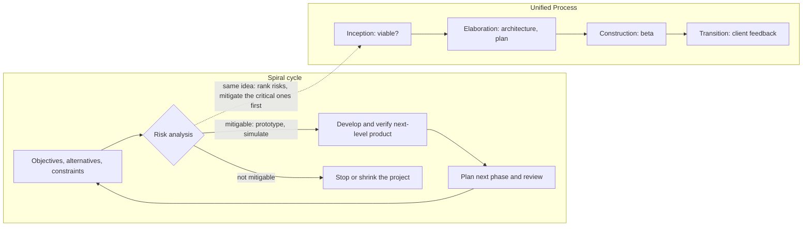

# Note 05 — The spiral model and the Unified Process

> Module 01 · Advanced Software Engineering · Term 1 · Farsi: [05-spiral-and-unified-process.fa.md](05-spiral-and-unified-process.fa.md) · Index: [INDEX.en.md](INDEX.en.md)

## 1. Summary

- Both models are **risk-driven**. The spiral model puts a risk analysis in front of every cycle and stops the project if the risks cannot be mitigated (Schach 8e, ch. 2 §2.9.7). The Unified Process (UP) ranks risks in inception and mitigates the critical ones first (Schach 8e, ch. 3 §3.10.1).
- The spiral model is a waterfall with a risk analysis before each phase; the UP is the iterative-and-incremental model with its four increments named **inception, elaboration, construction, transition**, crossed with five technical **core workflows**.
- Schach rates the spiral usable only for large, in-house projects with risk-literate developers, and calls the UP the best methodology known to him in 2010 (ch. 3 §3.11). Treat both judgements as period opinions (see section 5).

## 2. Detailed explanation

### Intuition

Every project can die from something other than "the code is hard": the client needs a different product, the hardware vendor is late, the key developer resigns, the architecture collapses when the next feature is added. A risk-driven model asks, before spending the next block of money, "what is the worst thing that can still happen, and can we reduce it cheaply?" The answer decides what the next cycle does.

### Mechanism: the spiral model

Boehm's spiral model [Boehm, 1988, cited in Schach] has these ingredients (Schach 8e, ch. 2 §2.9.7, pp. 62-66; Figure 2.13):

1. **Determine objectives, alternatives and constraints** for this cycle. Alternatives are things like "reuse a COTS package or build it"; constraints are cost, schedule, interfaces. This quadrant yields a strategy.
2. **Evaluate alternatives, identify and mitigate risks.** Prototypes are the main tool, but only for some risks: timing, feasibility, font readability, unclear requirements. Schach lists risks a prototype cannot touch: hiring failure, resignations, a team that is simply not competent for large-scale work, a hardware supplier's delivery promise.
3. **Develop and verify the next-level product.** This quadrant is, in Schach's words, the classical waterfall step.
4. **Plan the next phase**, and review what was produced.

The radial axis of Figure 2.13 is cumulative cost; the angle is progress. If a risk cannot be mitigated the project may stop at once, or continue at a much smaller scale. Postdelivery maintenance is just another cycle, so maintenance gets the same rigor as development. Schach also notes that testing effort becomes a risk question: how much risk do we take on by testing too little or too much?

**Simplified form (Figure 2.12).** Take the waterfall (or rapid-prototyping) model and put a risk analysis box before each phase. It is a teaching simplification of the full spiral, not a different model.

**Schach's assessment (ch. 2 §2.9.7).** Strengths: risk-driven; the emphasis on alternatives supports reuse; quality is an explicit objective; maintenance is not a separate, despised activity. He cites a Boehm 1988 report of 25 projects with at least 50% higher productivity, but the spiral was combined with other measures, and the paper was not opened (secondhand). Weaknesses: intended only for **internal** development, because in a contract project a risk-driven cancellation can mean a breach-of-contract lawsuit, so both sides must analyze risk before signing; only worthwhile for **large** projects, since risk analysis must be cheap relative to the project; and it is only as good as the team's risk analysis, which can produce false confidence. Finally, like the waterfall it assumes discrete phases, whereas real development is iterative and incremental.

### Mechanism: the Unified Process

The UP is the iterative-and-incremental model of Schach ch. 2 §2.5 with names (ch. 3 §3.10, Figure 3.1). Each step belongs to **one workflow** (technical context) and **one phase** (business context).

| Phase (increment) | Aim (Schach 8e, ch. 3 §3.10.1-§3.10.4) | Key artifacts |
|---|---|---|
| Inception | Is the product economically viable? | business case (initial), risk list, initial use cases, domain/business models, plan for elaboration |
| Elaboration | Refine requirements, architecture, risks, business case; produce the project management plan | completed requirements and analysis artifacts, updated architecture, software project management plan |
| Construction | First operational-quality version (beta release) | beta-level artifacts, initial user manual, completed architecture |
| Transition | Make sure the client's requirements are met; driven by feedback from beta sites | final artifacts, completed manuals |

The five **core workflows** are requirements, analysis, design, implementation and test (ch. 3 §3.3-§3.7). Figure 3.1 shows their relative emphasis changing over time: requirements and analysis dominate early, implementation and test dominate construction. Schach calls the result a **two-dimensional** life-cycle model (§3.11): phases are the business axis, workflows the technical axis. The waterfall is one-dimensional.

Three inception risks are named: technical risks, not getting the requirements right, and not getting the architecture right (a "house of cards" that collapses when a card is added). Risks are ranked so the critical ones are mitigated first. That is the same idea as the spiral, spread across increments.

**Baselines.** A *baseline* is a complete set of artifacts at the end of an episode (ch. 2 §2.2); in the UP each iteration should end with one. The UP's own vocabulary (iteration, milestone) is richer than Schach's summary: `UNVERIFIED`, the primary UP sources were not opened.

## 3. Diagram



## 4. Worked example

A spiral-style cycle for the course project (a registration platform), with made-up but explicit numbers. Exposure is probability times loss, a common risk-analysis formula; Schach does not give it, and Boehm's own definition was not opened, so the formula is presented as a convention, not as a quote. Scratch script (not in the repo; it passes `ruff check` with the repo config):

```text
$ python -I spiral_risk.py
Cycle 1: exposure = probability x loss (k$)
   120.0  p=0.40 loss=  300  Registration peak load misses 2s response
    45.0  p=0.30 loss=  150  Students reject the enrollment screens
    30.0  p=0.15 loss=  200  Key backend developer leaves
    30.0  p=0.25 loss=  120  Message broker cannot sustain event rate
  prototype 'Registration peak load misses 2s response': cost 20, exposure reduced by 105.0
  prototype 'Students reject the enrollment screens': cost 10, exposure reduced by 37.5
  prototype spend 30 of budget 40
Cycle 2: after prototypes
    30.0  p=0.15 loss=  200  Key backend developer leaves
    30.0  p=0.25 loss=  120  Message broker cannot sustain event rate
    15.0  p=0.05 loss=  300  Registration peak load misses 2s response
     7.5  p=0.05 loss=  150  Students reject the enrollment screens
  total exposure 82.5; unmitigable risk remains -> management decision (continue, shrink, stop)
```

What to read in it:

- The ranking drives the order: the load-test prototype (a **proof-of-concept** prototype in Schach's sense, ch. 2 §2.9.7) comes first because it removes 105 k$ of exposure for 20 k$.
- The screens risk is attacked with a **rapid prototype** (§2.9.3), a different kind of prototype for a different risk.
- The message-broker prototype (15 k$) is skipped: only 10 k$ of budget is left. The spiral does not say "mitigate everything"; it says mitigate in order of exposure within what is affordable.
- "Key backend developer leaves" is unchanged after cycle 1. No prototype lowers it (Schach's example of a risk prototypes cannot address). It stays on the list as a management risk for the next cycle's go/no-go decision.

The same project in UP terms: inception would produce the business case and this risk list; elaboration would fix the architecture (the load-test prototype is architecture evidence) and the project plan; construction would build to a beta; transition would run a pilot with one faculty.

## 5. Edge cases and pitfalls

- **Spiral is not "iterate until done".** Without an explicit risk analysis and a stop option it degenerates into code-and-fix with meetings. Schach's warning: unskilled risk analysts produce false confidence.
- **Contracts.** Cancelling after a risk review is easy in-house and legally costly under contract, hence Schach's restriction to internal work.
- **UP is not the waterfall in disguise.** The phase names sound sequential, but every phase contains all five workflows to some degree (Figure 3.1). Reading phases as "requirements, then design, then code" is the standard mistake.
- **Phases vs workflows.** Phase = economic/management slice (inception to transition). Workflow = technical activity (requirements to test). The same step appears in both views.

> **Schach says X; modern practice says Y.** Schach (2010): the UP is "currently the best methodology available" and the spiral suits only large in-house projects. Modern practice: the UP survives mostly as the Rational Unified Process (RUP) in regulated and enterprise settings; most product teams use agile or flow-based methods (note 06), and risk-driven thinking appears as risk-based planning, spikes, and tracer bullets. The statement "best methodology" is `OPINION / CONTESTED`.

## 6. Exam-style key points

- Spiral = waterfall + risk analysis before each phase; prototypes mitigate some risks (timing, requirements, feasibility) but not hiring, resignations, supplier delivery.
- Four quadrants: objectives/alternatives/constraints; evaluate alternatives and mitigate risks; develop and verify; plan next phase.
- Applicable only to large, internal projects, and only with competent risk analysts; maintenance is just another cycle.
- UP phases = increments: inception, elaboration, construction, transition. Workflows: requirements, analysis, design, implementation, test.
- Inception decides economic viability (business case, risk list); elaboration fixes architecture and the project plan; construction gives the beta; transition fixes faults from client feedback.
- The UP is two-dimensional (phases x workflows); the waterfall is one-dimensional.
- Three risk categories in inception: technical, wrong requirements, wrong architecture.

## 7. Links

- Lesson: [§2.5 What does it mean that a process is "risk-driven"?](../lesson.en.md#25-what-does-it-mean-that-a-process-is-risk-driven)
- Previous: [04 Plan-driven models](04-plan-driven-models.en.md). Next: [06 Agile methods](06-agile-methods.en.md).
- Lab: [06 Timebox vs waterfall](../labs/06-timebox-vs-waterfall/README.md) (fixed scope vs fixed time); the risk list above can be reused for the project backlog.
- Quiz: questions 9 and 14 in [quiz.en.md](../quiz.en.md).
- Sources: Schach 8e, ch. 2 §2.9.7 and §2.10; ch. 3 §3.10-§3.11. Secondhand only: Boehm 1988, Jacobson/Booch/Rumbaugh 1999.

## Glossary

| Term | Meaning |
|---|---|
| Risk analysis | Identifying, ranking and planning to mitigate things that can still go wrong before committing to the next phase. |
| Mitigate | Reduce probability or impact of a risk (for example by a prototype). |
| Proof-of-concept prototype | Engineering prototype that tests whether part of the product can be built (for example a timing test). Not a rapid prototype. |
| Rapid prototype | Working model of a subset of the product, built to check requirements with the client. |
| Risk exposure | Probability times loss (convention used in the example). |
| Inception / elaboration / construction / transition | The four UP phases (increments). |
| Core workflow | One of requirements, analysis, design, implementation, test. |
| Artifact | A constituent component of the software product or its documentation. |
| Baseline | A complete set of artifacts at the end of an episode or iteration. |
| Two-dimensional life-cycle model | Model with both phases and workflows as axes (UP). |
| Beta release | First operational-quality version, produced at the end of construction. |
