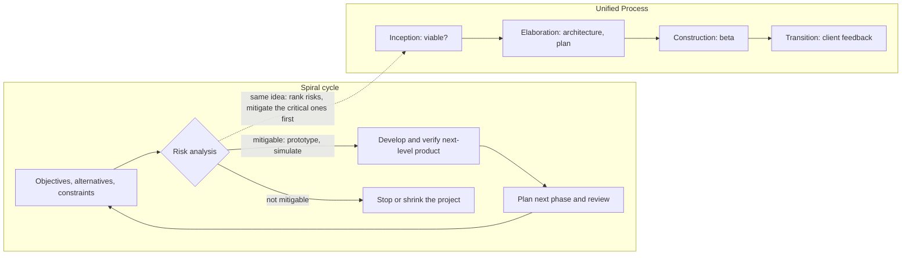

<div dir="rtl">

# یادداشت ۰۵ — مدل مارپیچی (spiral) و Unified Process

> ماژول ۰۱ · مهندسی نرم‌افزار پیشرفته · ترم ۱ · نسخهٔ انگلیسی: [`05-spiral-and-unified-process.en.md`](05-spiral-and-unified-process.en.md) · فهرست: [`INDEX.fa.md`](INDEX.fa.md)

## ۱. خلاصه

- هر دو مدل **risk-driven** هستند. مدل spiral پیش از هر چرخه یک risk analysis می‌گذارد و اگر ریسک‌ها قابل کاهش نباشند پروژه را متوقف می‌کند (`Schach 8e, ch. 2 §2.9.7`). Unified Process (UP) در inception ریسک‌ها را رتبه‌بندی می‌کند و ریسک‌های بحرانی را اول کاهش می‌دهد (`Schach 8e, ch. 3 §3.10.1`).
- spiral یک waterfall است که قبل از هر phase یک risk analysis دارد؛ UP همان مدل iterative-and-incremental است که چهار increment آن نام گرفته‌اند (**inception، elaboration، construction، transition**) و با پنج **core workflow** فنی تقاطع می‌خورد.
- Schach مدل spiral را فقط برای پروژه‌های بزرگ و داخلی با توسعه‌دهندگان آشنا با ریسک مناسب می‌داند و UP را بهترین methodology شناخته‌شده برای خودش در ۲۰۱۰ می‌نامد (ch. 3 §3.11). هر دو را باید قضاوت‌های مربوط به زمان خودشان بخوانید (بخش ۵).

## ۲. توضیح

### شهود

پروژه می‌تواند به دلیلی غیر از «کد سخت است» بمیرد: مشتری محصول دیگری لازم دارد، فروشندهٔ سخت‌افزار دیر تحویل می‌دهد، توسعه‌دهندهٔ کلیدی استعفا می‌دهد، یا معماری با اضافه شدن قابلیت بعدی فرو می‌ریزد. مدل risk-driven پیش از خرج کردن بودجهٔ بلوک بعدی می‌پرسد: «بدترین اتفاقی که هنوز ممکن است بیفتد چیست و آیا می‌شود ارزان آن را کم کرد؟» پاسخ تعیین می‌کند چرخهٔ بعدی چه کاری انجام دهد.

### سازوکار: مدل spiral

مدل spiral از Boehm (در `Schach 8e, ch. 2 §2.9.7`، صفحه‌های ۶۲ تا ۶۶ و Figure 2.13؛ منبع اصلی: Boehm 1988 به نقل از Schach) این اجزا را دارد:

1. **تعیین objectives، alternatives و constraints** برای همین چرخه. alternativeها مثلاً «COTS بخریم یا خودمان بسازیم» هستند و constraintها هزینه، زمان‌بندی و interfaceها. خروجی این ربع یک strategy است.
2. **ارزیابی alternativeها، شناسایی و کاهش ریسک.** ابزار اصلی prototype است، ولی فقط برای بعضی ریسک‌ها: timing، امکان‌پذیری، خوانایی فونت، نیازمندی‌های مبهم. Schach ریسک‌هایی را می‌شمارد که prototype به آن‌ها دست نمی‌زند: ناتوانی در استخدام، استعفا، تیمی که برای کار بزرگ‌مقیاس واقعاً صلاحیت ندارد، و قول تحویل فروشندهٔ سخت‌افزار.
3. **توسعه و verify محصول سطح بعد.** به تعبیر Schach این ربع همان گام waterfall کلاسیک است.
4. **برنامه‌ریزی phase بعد** و review آنچه ساخته شده.

محور شعاعی Figure 2.13 هزینهٔ تجمعی و زاویه پیشرفت است. اگر ریسکی قابل کاهش نباشد پروژه می‌تواند فوراً متوقف شود یا با مقیاس بسیار کوچک‌تر ادامه یابد. postdelivery maintenance فقط یک چرخهٔ دیگر است، پس نگهداری همان دقت توسعه را می‌گیرد. Schach همچنین یادآوری می‌کند که میزان testing به یک پرسش ریسک تبدیل می‌شود: با کم یا زیاد test کردن چه ریسکی می‌پذیریم؟

**شکل ساده‌شده (Figure 2.12).** waterfall (یا rapid-prototyping) را بردارید و پیش از هر phase یک جعبهٔ risk analysis بگذارید. این یک ساده‌سازی آموزشی از spiral کامل است، نه مدلی جدا.

**ارزیابی Schach (ch. 2 §2.9.7).** نقاط قوت: risk-driven است؛ تأکید بر alternativeها از reuse پشتیبانی می‌کند؛ کیفیت یک objective صریح است؛ maintenance فعالیتی جدا و تحقیرشده نیست. او گزارشی از Boehm 1988 دربارهٔ ۲۵ پروژه با دست‌کم ۵۰٪ بهبود productivity را نقل می‌کند، ولی spiral همراه اقدام‌های دیگر به کار رفته و مقالهٔ اصلی باز نشده است (دست‌دوم). ضعف‌ها: فقط برای توسعهٔ **داخلی** است، چون در پروژهٔ قراردادی لغو بر پایهٔ ریسک می‌تواند به شکایت نقض قرارداد برسد و هر دو طرف باید پیش از امضا ریسک را تحلیل کنند؛ فقط برای پروژهٔ **بزرگ** می‌ارزد، چون هزینهٔ risk analysis باید در برابر پروژه ناچیز باشد؛ و فقط به اندازهٔ risk analysis تیم خوب است و می‌تواند اطمینان کاذب بدهد. در نهایت، مثل waterfall فرض می‌کند توسعه در phaseهای گسسته انجام می‌شود، در حالی که توسعهٔ واقعی iterative و incremental است.

### سازوکار: Unified Process

UP همان مدل iterative-and-incremental فصل ۲ §2.5 است با نام‌های مشخص (ch. 3 §3.10، Figure 3.1). هر گام به **یک workflow** (زمینهٔ فنی) و **یک phase** (زمینهٔ کسب‌وکاری) تعلق دارد.

| Phase (increment) | هدف (`Schach 8e, ch. 3 §3.10.1`-`§3.10.4`) | artifactهای کلیدی |
|---|---|---|
| Inception | آیا محصول از نظر اقتصادی توجیه دارد؟ | business case اولیه، فهرست ریسک، use caseهای اولیه، مدل‌های domain و business، برنامهٔ elaboration |
| Elaboration | پالایش نیازمندی‌ها، معماری، ریسک‌ها و business case؛ تولید برنامهٔ مدیریت پروژه | artifactهای کامل requirements و analysis، معماری به‌روز، software project management plan |
| Construction | نخستین نسخهٔ با کیفیت عملیاتی (beta release) | artifactهای سطح beta، راهنمای کاربر اولیه، معماری کامل |
| Transition | اطمینان از برآورده شدن نیازمندی‌های مشتری؛ بر پایهٔ بازخورد سایت‌های beta | artifactهای نهایی، راهنماهای کامل |

پنج **core workflow** عبارت‌اند از requirements، analysis، design، implementation و test (ch. 3 §3.3 تا §3.7). Figure 3.1 نشان می‌دهد تأکید نسبی آن‌ها در طول زمان عوض می‌شود: اول requirements و analysis غالب‌اند و در construction، implementation و test. Schach نتیجه را مدل **دوبعدی** می‌نامد (§3.11): phaseها محور کسب‌وکار و workflowها محور فنی‌اند. waterfall یک‌بعدی است.

در inception سه دستهٔ ریسک نام برده می‌شود: ریسک‌های فنی، درست نگرفتن requirements، و درست نگرفتن معماری («خانهٔ کارتی» که با اضافه شدن یک کارت فرو می‌ریزد). ریسک‌ها رتبه‌بندی می‌شوند تا بحرانی‌ها اول کاهش یابند. این همان ایدهٔ spiral است که بین incrementها پخش شده.

**Baseline.** *baseline* مجموعهٔ کاملی از artifactها در پایان یک episode است (ch. 2 §2.2)؛ در UP هر iteration باید به یکی ختم شود. واژگان خود UP (iteration، milestone) غنی‌تر از خلاصهٔ Schach است: `UNVERIFIED`، منابع اصلی UP باز نشدند.

## ۳. نمودار

</div>



<div dir="rtl">

## ۴. مثال عملی

یک چرخهٔ spiral-مانند برای پروژهٔ درس (پلتفرم ثبت‌نام) با عددهای ساختگی ولی صریح. exposure برابر احتمال ضرب‌در زیان است، فرمولی رایج در risk analysis؛ Schach آن را نمی‌دهد و تعریف خود Boehm هم باز نشده، پس به‌عنوان قرارداد ارائه می‌شود نه نقل‌قول. اسکریپت scratch (بیرون از repo؛ با پیکربندی ruff مخزن `ruff check` را می‌گذراند):

</div>

```text
$ python -I spiral_risk.py
Cycle 1: exposure = probability x loss (k$)
   120.0  p=0.40 loss=  300  Registration peak load misses 2s response
    45.0  p=0.30 loss=  150  Students reject the enrollment screens
    30.0  p=0.15 loss=  200  Key backend developer leaves
    30.0  p=0.25 loss=  120  Message broker cannot sustain event rate
  prototype 'Registration peak load misses 2s response': cost 20, exposure reduced by 105.0
  prototype 'Students reject the enrollment screens': cost 10, exposure reduced by 37.5
  prototype spend 30 of budget 40
Cycle 2: after prototypes
    30.0  p=0.15 loss=  200  Key backend developer leaves
    30.0  p=0.25 loss=  120  Message broker cannot sustain event rate
    15.0  p=0.05 loss=  300  Registration peak load misses 2s response
     7.5  p=0.05 loss=  150  Students reject the enrollment screens
  total exposure 82.5; unmitigable risk remains -> management decision (continue, shrink, stop)
```

<div dir="rtl">

چه چیزی را باید خواند:

- رتبه‌بندی ترتیب را تعیین می‌کند: prototype آزمون بار (یک prototype از نوع **proof-of-concept** به معنی Schach، ch. 2 §2.9.7) اول می‌آید چون با ۲۰ هزار دلار، ۱۰۵ هزار دلار exposure را حذف می‌کند.
- ریسک صفحه‌های ثبت‌نام با **rapid prototype** (§2.9.3) مهار می‌شود، که نوع دیگری از prototype برای ریسک دیگری است.
- prototype message broker (۱۵ هزار) کنار گذاشته می‌شود: فقط ۱۰ هزار بودجه مانده. spiral نمی‌گوید «همه چیز را کاهش بده»؛ می‌گوید به ترتیب exposure و در حد توان کاهش بده.
- «توسعه‌دهندهٔ کلیدی backend می‌رود» پس از چرخهٔ ۱ تغییر نکرده. هیچ prototype آن را کم نمی‌کند (مثال Schach از ریسکی که prototype به آن نمی‌رسد). این ریسک مدیریتی در فهرست می‌ماند تا در تصمیم go/no-go چرخهٔ بعد بررسی شود.

همین پروژه به زبان UP: inception، business case و همین فهرست ریسک را می‌سازد؛ elaboration معماری (prototype آزمون بار شاهد معماری است) و برنامهٔ پروژه را قطعی می‌کند؛ construction تا beta می‌سازد؛ transition یک pilot با یک دانشکده اجرا می‌کند.

## ۵. حالت‌های خاص و دام‌ها

- **spiral یعنی «تا تمام شدن iterate کن» نیست.** بدون risk analysis صریح و گزینهٔ توقف، به code-and-fix با جلسه تبدیل می‌شود. هشدار Schach: تحلیلگران ریسک کم‌مهارت اطمینان کاذب تولید می‌کنند.
- **قرارداد.** لغو پس از risk review در سازمان داخلی ساده و در قرارداد از نظر حقوقی گران است؛ به همین دلیل Schach spiral را به کار داخلی محدود می‌کند.
- **UP همان waterfall با نام دیگر نیست.** نام phaseها ترتیبی به نظر می‌رسد، ولی هر phase تا حدی هر پنج workflow را دارد (Figure 3.1). خواندن phaseها به‌صورت «اول requirements، بعد design، بعد code» اشتباه رایج است.
- **Phase در برابر workflow.** Phase برش اقتصادی/مدیریتی است (inception تا transition)؛ workflow فعالیت فنی (requirements تا test). همان گام در هر دو دید ظاهر می‌شود.

> **Schach می‌گوید X؛ رویهٔ امروز می‌گوید Y.** Schach (۲۰۱۰): UP «بهترین methodology موجود» است و spiral فقط به درد پروژه‌های بزرگ داخلی می‌خورد. رویهٔ امروز: UP بیشتر به‌شکل Rational Unified Process (RUP) در محیط‌های سازمانی و مقررات‌دار باقی مانده؛ بیشتر تیم‌های محصول از agile یا روش‌های مبتنی بر flow استفاده می‌کنند (یادداشت ۰۶) و تفکر risk-driven به شکل برنامه‌ریزی مبتنی بر ریسک، spike و tracer bullet دیده می‌شود. عبارت «بهترین methodology» `OPINION / CONTESTED` است.

## ۶. نکته‌های کلیدی امتحانی

- spiral = waterfall + risk analysis پیش از هر phase؛ prototype بعضی ریسک‌ها را کم می‌کند (timing، requirements، امکان‌پذیری) ولی نه استخدام، استعفا و تحویل فروشنده را.
- چهار ربع: objectives/alternatives/constraints؛ ارزیابی alternativeها و کاهش ریسک؛ توسعه و verify؛ برنامهٔ phase بعد.
- فقط برای پروژهٔ بزرگ و داخلی، و فقط با تحلیلگران ریسک کاردان؛ maintenance فقط یک چرخهٔ دیگر است.
- phaseهای UP = incrementها: inception، elaboration، construction، transition. workflowها: requirements، analysis، design، implementation، test.
- inception دربارهٔ توجیه اقتصادی تصمیم می‌گیرد (business case، فهرست ریسک)؛ elaboration معماری و برنامه را قطعی می‌کند؛ construction به beta می‌رسد؛ transition خطاهای بازخورد مشتری را رفع می‌کند.
- UP دوبعدی (phase × workflow) است؛ waterfall یک‌بعدی.
- سه دستهٔ ریسک در inception: فنی، requirements غلط، معماری غلط.

## ۷. پیوندها

- درس: [بخش ۲.۵ risk-driven یعنی چه؟](../lesson.fa.md)
- قبلی: [۰۴ مدل‌های plan-driven](04-plan-driven-models.fa.md). بعدی: [۰۶ روش‌های agile](06-agile-methods.fa.md).
- آزمایش: [۰۶ timebox در برابر waterfall](../labs/06-timebox-vs-waterfall/README.md) (دامنهٔ ثابت در برابر زمان ثابت)؛ فهرست ریسک بالا برای backlog پروژه قابل استفادهٔ دوباره است.
- آزمونک: پرسش‌های ۹ و ۱۴ در [`quiz.fa.md`](../quiz.fa.md).
- منابع: Schach 8e, ch. 2 §2.9.7 و §2.10؛ ch. 3 §3.10 تا §3.11. فقط دست‌دوم: Boehm 1988، Jacobson/Booch/Rumbaugh 1999.

## واژه‌نامه

| اصطلاح | تعریف |
|---|---|
| **Risk analysis** | شناسایی و رتبه‌بندی چیزهایی که هنوز ممکن است خراب شوند و برنامه‌ریزی برای کاهش آن‌ها پیش از تعهد به phase بعد. |
| **Mitigate** | کم کردن احتمال یا اثر یک ریسک (مثلاً با prototype). |
| **Proof-of-concept prototype** | prototype مهندسی برای آزمودن این‌که بخشی از محصول ساخته می‌شود یا نه (مثلاً آزمون timing)؛ rapid prototype نیست. |
| **Rapid prototype** | مدل کاری از زیرمجموعه‌ای از محصول که برای راستی‌آزمایی نیازمندی‌ها با مشتری ساخته می‌شود. |
| **Risk exposure** | احتمال ضرب‌در زیان (قرارداد مورد استفاده در مثال). |
| **Inception / elaboration / construction / transition** | چهار phase (increment) در UP. |
| **Core workflow** | یکی از requirements، analysis، design، implementation، test. |
| **Artifact** | هر جزء سازندهٔ محصول نرم‌افزاری یا مستنداتش. |
| **Baseline** | مجموعهٔ کامل artifactها در پایان یک episode یا iteration. |
| **Two-dimensional life-cycle model** | مدلی که هم phase و هم workflow محور آن‌اند (UP). |
| **Beta release** | نخستین نسخهٔ با کیفیت عملیاتی که در پایان construction تولید می‌شود. |

</div>
