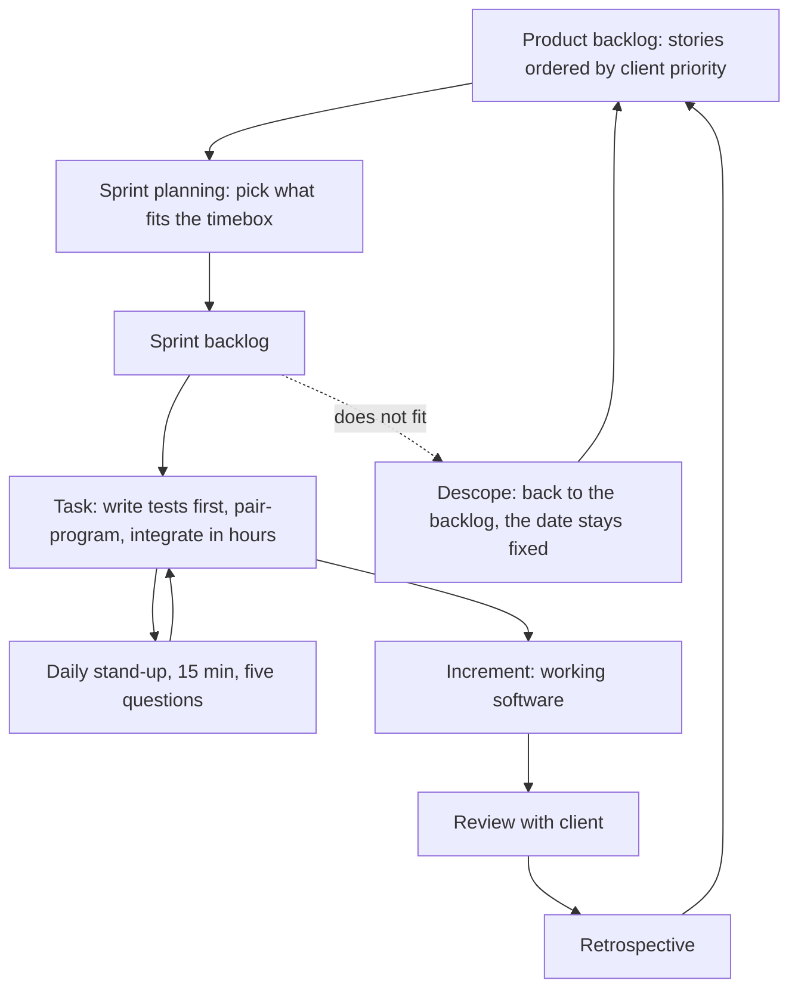

# Note 06 — Agile methods: XP, Scrum, Kanban, timeboxing, stand-ups

> Module 01 · Advanced Software Engineering · Term 1 · Farsi: [06-agile-methods.fa.md](06-agile-methods.fa.md) · Index: [INDEX.en.md](INDEX.en.md)

## 1. Summary

- Agile processes put working software, client collaboration and response to change ahead of detailed up-front analysis and design. They are built on the iterative-and-incremental model with **fixed time, not fixed features** (Schach 8e, ch. 2 §2.9.5).
- Schach presents Extreme Programming (stories, test-driven development, pair programming, refactoring) plus two management techniques that outlived it: **timeboxing** and the **daily stand-up** with five questions. Scrum and Kanban are modern frameworks Schach mentions only in passing.
- Schach (2010): agile works for small-scale products with vague requirements; evidence for medium and large products was missing. Treat that as a dated statement (box in section 5).

## 2. Detailed explanation

### Intuition

When the client cannot say what they want until they see something, a long specification is a guess. Agile shortens the feedback loop: build a small slice, show it, adjust. The price is that you give up predicting the final scope on day one.

### The Agile Manifesto

The Manifesto (agilemanifesto.org, copyright 2001, opened for this note) states four values, each as a preference: "Individuals and interactions over processes and tools", "Working software over comprehensive documentation", "Customer collaboration over contract negotiation", "Responding to change over following a plan", followed by: while there is value in the items on the right, the items on the left are valued more. Schach (ch. 2 §2.9.5) records that seventeen developers wrote it in February 2001 and that it names principles, not a life-cycle model. Many of them had their own methods (XP, Crystal, Scrum).

### XP as Schach presents it (ch. 2 §2.9.5, ch. 4 §4.6)

1. **Stories.** The team lists features the client wants; for each it gives a duration and a cost. The client picks features per build by cost-benefit analysis.
2. **Tasks and TDD.** A build is split into tasks. Test cases are written *first* for a task (test-driven development), and are kept for all later integration testing.
3. **Pair programming.** Two programmers share one computer, alternating typing every 15 to 20 minutes. Schach's reasons (§4.6): nobody tests only their own code, knowledge survives when one person leaves, juniors learn, and code gets group ownership.
4. **Continuous integration** of small tasks: implementing and integrating a task should take a few hours.
5. **Refactoring instead of an up-front design step**: when a test cannot run, reorganize until the design is simple. Acronyms YAGNI and DTSTTCPW express "build only what is needed".
6. Other traits: on-site client representative, no overtime two weeks running, no specialization.

Evidence on pair programming is mixed (§2.9.5, §4.6): one study found better code in less time; a 2007 experiment with 295 professionals found pairs needed 84% more effort on maintenance tasks; a 15-study analysis concluded it depends on expertise and task complexity.

### Timeboxing

A fixed amount of time is set aside; the team does the best job possible within it. Schach's description: iterations of about three weeks; once the client picks the work it cannot be increased; if it will not fit, the work is **descoped**. In Schach's phrase, agile demands fixed time rather than fixed features. That is the opposite of the waterfall's fixed scope with a moving date.

### The daily stand-up

A short daily meeting, standing in a circle so it stays within the stipulated 15 minutes. Each member answers five questions (Schach 8e, ch. 2 §2.9.5): what have I done since yesterday's meeting; what am I working on today; what problems are preventing me; what have we forgotten; what did I learn that I would like to share. The aim is to **raise** problems, not solve them; solutions come in a follow-up meeting right after.

Schach groups timeboxing and stand-ups as instances of two basic agile principles: communication, and satisfying the client's needs as quickly as possible.

### Scrum (opened: The Scrum Guide, November 2020)

The 2020 edition names three accountabilities (**Developers, Product Owner, Scrum Master**), five events (**the Sprint, Sprint Planning, Daily Scrum, Sprint Review, Sprint Retrospective**), three artifacts (**Product Backlog, Sprint Backlog, Increment**) each with a commitment (**Product Goal, Sprint Goal, Definition of Done**). A Sprint is one month or less; the Daily Scrum is 15 minutes. VERSION-DEPENDENT: other editions of the Guide word roles and events differently; only the 2020 text was checked here (names and the two timeboxes). Whether the 2020 Guide prescribes a fixed question format for the Daily Scrum was not checked (`UNVERIFIED`); Schach's five-question form is the classical teaching version.

### Kanban (opened: The Kanban Guide, v2025.5, May 2025)

Kanban has no iterations or roles. It visualizes the workflow, limits work in progress, and manages flow. The Guide defines four flow metrics: **WIP** (items started but not finished), **throughput** (items finished per unit time), **work item age** (time since start for an unfinished item) and **cycle time** (start to finish). Controlling WIP makes it a pull system: new work starts only when there is capacity. Kanban comes from lean manufacturing; Schach does not cover it. See lab 05.

### Where agile fits

| Factor | Agile works well | Agile struggles |
|---|---|---|
| Requirements | vague, changing | stable and fully known, or contractually fixed |
| Size | small team, one product | hundreds of developers, many interfaces |
| Client | on site, decision-capable | absent, or only a contract |
| Risk | moderate; failure is cheap | safety-critical, must be certified |
| Documentation | code and tests suffice | regulator or maintainers need design documents |

Schach (§2.9.5, after Booch): building a doghouse takes no plans; a house needs plans and trades; stacking a thousand doghouses is not a skyscraper. He also points out the maintenance question: refactoring is permanent, so if every new feature forces refactoring the postdelivery cost may be high, and in 2010 there was almost no data.

## 3. Diagram



## 4. Worked example

A timeboxed sprint plan for the registration project. Capacity assumptions (3 pairs, 10 days, 50% focus) are invented but explicit; estimates are in pair-days. Scratch script, outside the repo:

```text
$ python -I timebox.py
timebox = 10 working days, 3 pairs, focus factor 0.5 -> capacity 15.0 pair-days
  IN   p1 Search courses       3 d  (cumulative 3)
  IN   p2 Enroll in a course   5 d  (cumulative 8)
  IN   p3 Prerequisite check   4 d  (cumulative 12)
  OUT  p4 Waiting list         4 d  -> next timebox (descoped)
  IN   p5 Email receipt        2 d  (cumulative 14)
  OUT  p6 Admin export CSV     3 d  -> next timebox (descoped)
delivered 4 stories, descoped 2; the date did not move
fixed scope instead: 21 d of work / (3 * 0.5) = 14.0 working days
```

Reading it:

- Time is fixed at 10 days and scope is the variable; the waterfall view fixes the 21 days of scope and lets the date slip to 14 days (and in practice further).
- Two of six stories are dropped, chosen by the client's priority, not by the team. The waiting list (priority 4) is dropped but the cheaper priority-5 receipt still fits. A strict "never skip a higher priority" rule would also drop it; a team must decide which rule it uses.
- The 50% focus factor is an assumption, not a measurement; real teams should measure it from past sprints.

## 5. Edge cases and pitfalls

- **Scrum is not XP.** Scrum prescribes roles and events but no engineering practices; XP prescribes practices (TDD, pairing, refactoring) but no roles. Many teams run "Scrum + XP practices".
- **"No documentation" misreading.** The Manifesto says working software over *comprehensive* documentation; the preference is not a ban. Schach's own maintenance discussion (ch. 3 §3.8) says missing documentation is the maintainer's main problem.
- **Stand-up turns into a status report.** Schach's aim is to raise problems, not solve them. If it takes more than 15 minutes, the problem-solving has leaked into it.
- **WIP limits that nobody enforces.** A limit that is exceeded whenever it hurts is only a number on the board.
- **Descoping hides debt.** Dropping tests to fit the timebox cuts quality, not scope.

> **Schach says X; modern practice says Y.** Schach (2010): agile is a "controversial" new approach with success only on small-scale software, and too little evidence of efficacy for agile teams (ch. 2 §2.9.5; ch. 4 §4.9). Modern practice (2020s): agile (usually Scrum, Kanban or hybrids) is the mainstream default in industry, large organizations scale it with frameworks, and DevOps/DORA research ties fast, frequent delivery to organizational performance (note 08). The scaling claims for very large safety-critical systems remain `OPINION / CONTESTED`. Schach's five-question stand-up is a teaching form; check the current Scrum Guide for what it prescribes for the Daily Scrum (`UNVERIFIED` here).

## 6. Exam-style key points

- Manifesto values: individuals/interactions, working software, customer collaboration, responding to change, valued over the items on the right (which still have value). Written in 2001 by 17 developers.
- XP: stories, estimates and costs, client picks builds by cost-benefit, tasks, tests first (TDD), pairs, continuous integration, refactoring, YAGNI, DTSTTCPW.
- Timeboxing: fixed time, not fixed features; work that does not fit is descoped; Schach's example iteration is 3 weeks.
- Stand-up: daily, about 15 minutes, standing, five questions; raises problems, solutions later.
- Agile fits small products with vague requirements; for medium and large ones, evidence was lacking in 2010 (Booch's doghouse analogy).
- Pair programming evidence depends on expertise and complexity.
- Scrum (2020 Guide): 3 accountabilities, 5 events, 3 artifacts. Kanban: visualize, limit WIP, manage flow.
- Agile and disciplined processes can be combined (Boehm and Turner, cited by Schach).

## 7. Links

- Lesson: [§2.6 Does agile mean no plan and no documents?](../lesson.en.md#26-does-agile-mean-no-plan-and-no-documents)
- Previous: [05 Spiral and UP](05-spiral-and-unified-process.en.md). Next: [07 Open source, synchronize-and-stabilize, choosing models](07-open-source-and-sync-stabilize.en.md).
- Labs: [05 Kanban flow metrics](../labs/05-kanban-flow-metrics/README.md), [06 Timebox vs waterfall](../labs/06-timebox-vs-waterfall/README.md).
- Quiz: questions 6 and 12 in [quiz.en.md](../quiz.en.md).
- Sources: Schach 8e, ch. 2 §2.9.5, §2.10; ch. 4 §4.6. Opened online: agilemanifesto.org (2001), The Scrum Guide (November 2020), The Kanban Guide (v2025.5, May 2025).

## Glossary

| Term | Meaning |
|---|---|
| Agile process | Process that values working software, collaboration, and response to change; Schach's umbrella for XP, Scrum, Crystal and similar. |
| Story | A feature the client wants, with a duration and cost estimate. |
| Task | Small piece of a build, implementable and integrable in hours. |
| Test-driven development (TDD) | Writing the test cases for a task before the code. |
| Pair programming | Two programmers at one computer, alternating typing. |
| Refactoring | Reorganizing code to simplify the design without adding features. |
| YAGNI | "You aren't gonna need it": do not build features beyond what is needed. |
| Timeboxing | Fixed time for a task or iteration; scope is reduced if needed. |
| Descope | Remove work from a timebox so that the deadline holds. |
| Stand-up meeting | Daily short meeting, standing, five questions. |
| Sprint | Scrum's timeboxed iteration, one month or less (2020 Guide). |
| Product backlog | Ordered list of what the product needs (Scrum). |
| Increment | Usable, done work produced in a sprint (Scrum). |
| WIP limit | Maximum number of items in progress at once (Kanban). |
| Cycle time | Elapsed time from start to finish of a work item. |
| Throughput | Work items finished per unit time. |
